# Crazy Golf: the overhaul (golfRev 3)

Phase 2 step 4, 15 Nov 2026. Captured on a local dev server at 390 × 844 (DPR 2, saved at 585 px wide): **today** is
main e0aa53f2 (its live look, the Blender course from #423), **new** is this branch. Practice on the fixed intro
example; the played runs are the near-perfect skill-band bot's log through the dev-only audit hook
(`bun scripts/shots/crazy-golf-gallery.ts --tag=before|after --url=<origin>`). The chosen direction is #423's Blender
course (built from concept A, "Today, upgraded", docs/design/game-concepts/sports.md on #426); concept A is shown
beside each for the step up.

## The tee: today · the #423 course · concept A · new

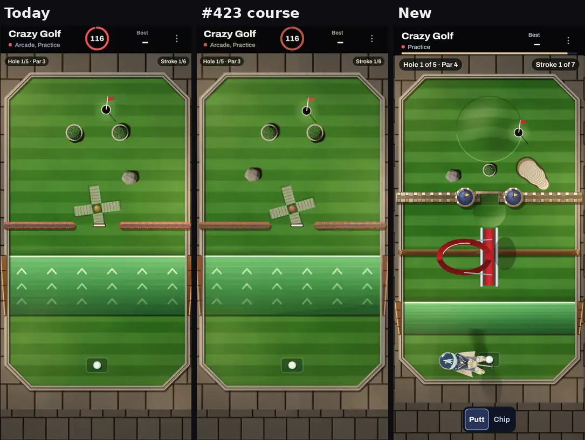

Today is main's live look, the #423 Blender course on golfRev 2's holes (the #423 sample beside it). New (second round,
15 Nov 2026): the opening "Loop lane": a loop-the-loop through a low timber wall, a ramp up to it and a bowl round the
cup, the slopes carried by light and shadow and bending mowing stripes (no arrows), a raked bunker in a smooth natural
shape, Captain Joulz half as big again beside the ball, the larger HUD and the Putt | Chip switch under the course.

## Every layout: today's five holes · the twenty new layouts

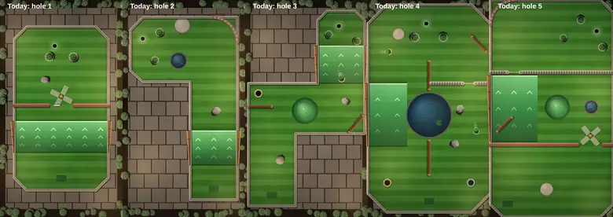

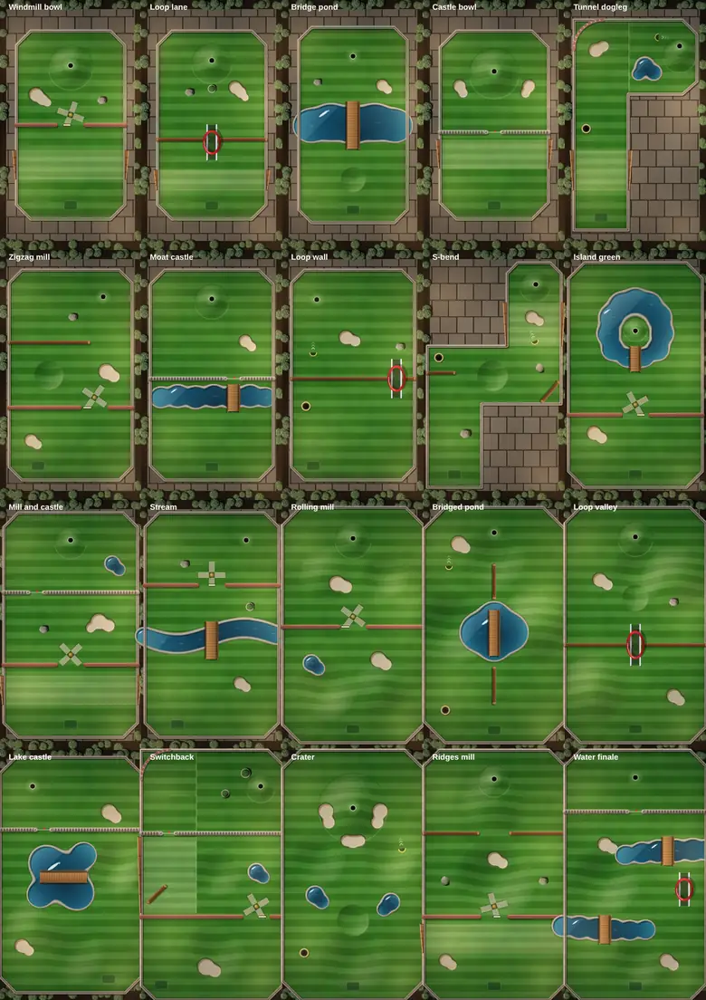

Every new layout is crazy golf: windmills, castle gates, tunnels, ramps, loop-the-loops, plank bridges over water, bowls
round the cup, domes and banked curves, each in the line of play. Sand and water are smooth, natural shapes drawn from
the same field the sim plays (the Stream meanders under its bridge; the island green is ringed by one pond). Each
template has 18 variants (three tees, three cups, mirrored): 357 holes proven at all four levels.

## Aiming: today · new putt · new chip

The rubber band from the ball to the finger (gold for a putt, blue for a chip), the Captain addressing the ball to the
side of the line, the chip's dotted arc to its landing ring.

## Later holes: today · new · new in play

Glossy water in a bevelled stone ring (a crisp specular highlight on its curve, the sky reflected, the stone's shadow on
the water; no glow), and on the last two holes uneven ground: the mowing stripes bend gently over each mound and hollow.

## The answer reveal: today · new · new with hole 3 chosen

Today: the score and its parts only. New: the same score and parts, then the scorecard (each hole's strokes coloured
against par: gold under, green at par, white over, grey not holed; it fills in hole by hole), which is also the switcher;
the chosen hole drawn large with every stroke on it (putts white, chips' flights dotted blue, each resting spot
numbered in order, water red, the drop ringed gold); the hole in plain words ("Hole 3 · Birdie in 2"); and the key
numbers (strokes, against par or holes holed, chips, water). It opens on the hole that cost the most.

## Clips

| | Today | New |
|---|---|---|
| A putt |  |  |
| A chip | (no chip today) |  |
| Play |  | 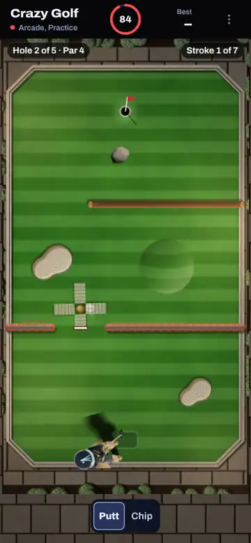 |

## Every frame

| | Today | New |
|---|---|---|
| Intro |  |  |
| First tee | 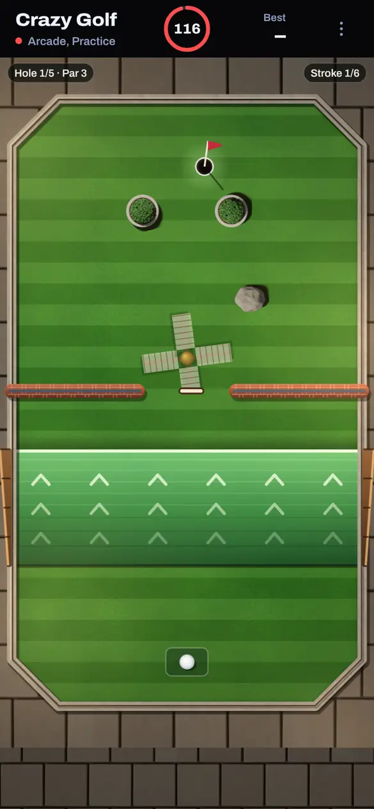 | 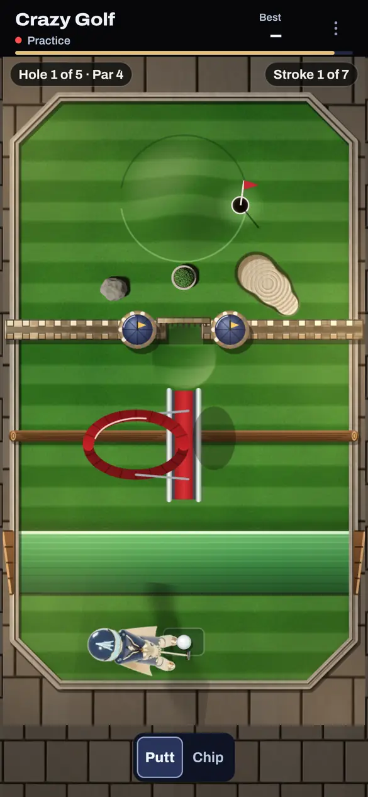 |
| Aiming |  | 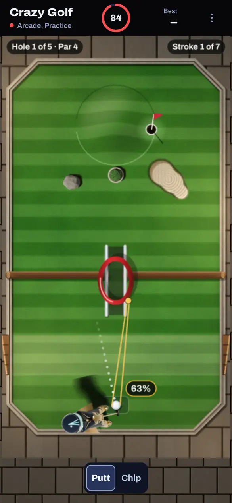 |
| Chip aim | |  |
| In play |  | 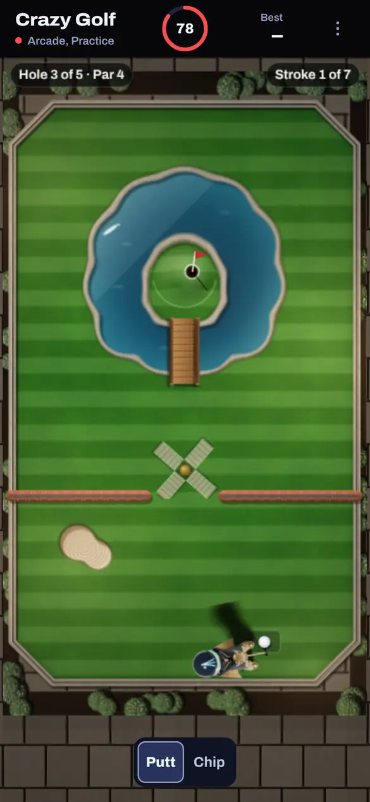 |
| A later hole | 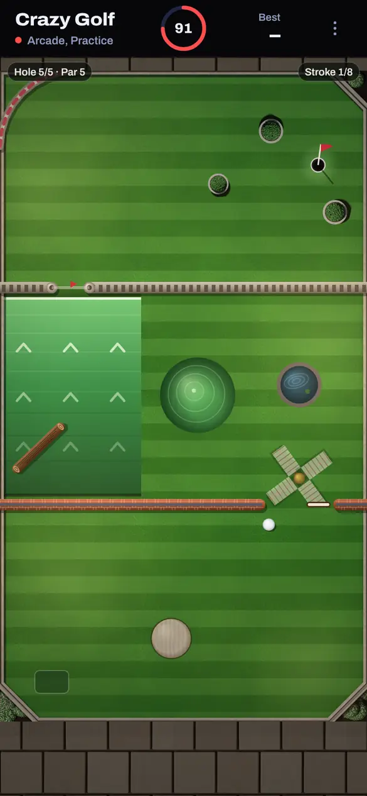 |  |
| Reveal |  | 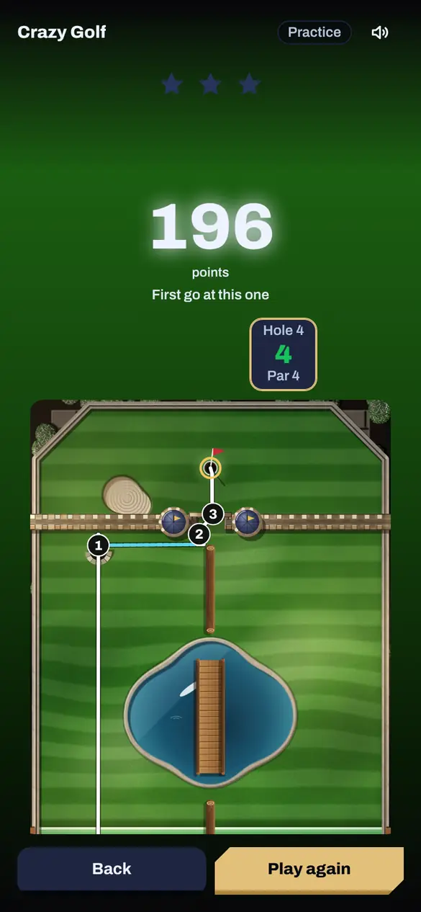 |
| Reveal, hole 3 | | 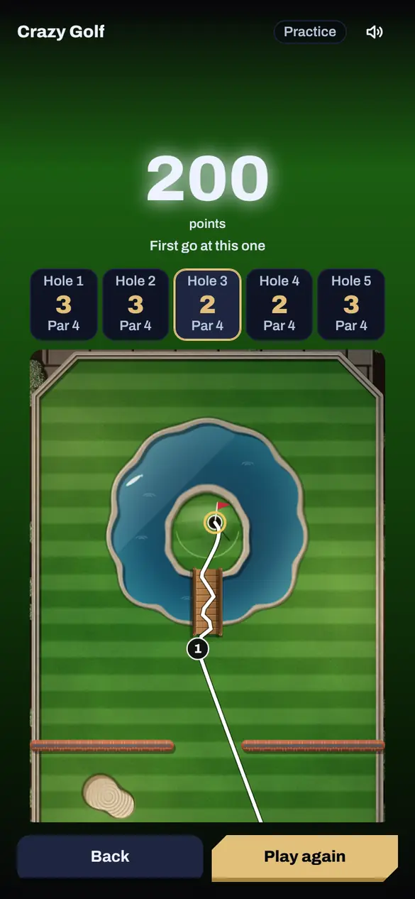 |
