# Crazy Golf: the overhaul (golfRev 3)

Phase 2 step 4, round 3 (16 Nov 2026). Captured on a local dev server at 390 × 844 (DPR 2, saved at 585 px wide):
**today** is main e0aa53f2 (its live look, the Blender course from #423), **new** is this branch. Practice on the fixed
intro example; the played runs are the near-perfect skill-band bot's log through the dev-only audit hook
(`bun scripts/shots/crazy-golf-gallery.ts --tag=before|after --url=<origin>`; comparisons by
`python3 scripts/shots/crazy-golf-compare.py`).

## The tee: today · the #423 course · new

New: the opening hole of the example course ("Loop lane"): a castle across the green (a curtain wall with battlements,
a round tower either side of the gate under the gatehouse's arch), a loop-the-loop through a timber wall, a ramp, a bowl
round the cup, Captain Joulz lit and addressing the ball beside the line, and the Putt | Chip switch.

## Every layout: today's five holes · the twenty new layouts (phone size, 390 px a hole)

Every layout has at least three big features in play (windmills, castles, tunnels, ramps, loops, bridges, banked curves),
and the buildings are solid in the game: a windmill's house stands either side of its doorway (the ball rolls through
the passage) with long, broad sails turning over it; a castle's towers, wall and keep stop a ball. Sand and water are the
natural shapes from round 2. Each template has 18 variants (three tees, three cups, mirrored): 357 holes proven at all
four levels.

## Features in motion

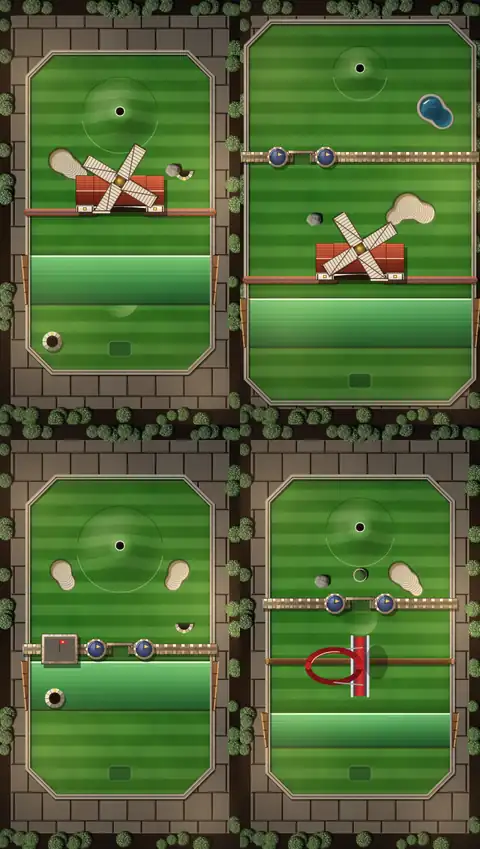

Windmill bowl, Mill and castle, Castle bowl and Loop lane, the sails turning on the game's own clock.

## Captain Joulz's stroke

Re-rendered from the approved 3D Captain (`docs/design/cosmetics-redraws/blender/captain/golf_sprites.py`) with a key,
a front fill and a cool rim light so he reads at 120 px: addressing the ball, the backswing as the pull grows (putter or
wedge), then the follow-through; always beside the line.

## Aiming: today · new putt · new chip

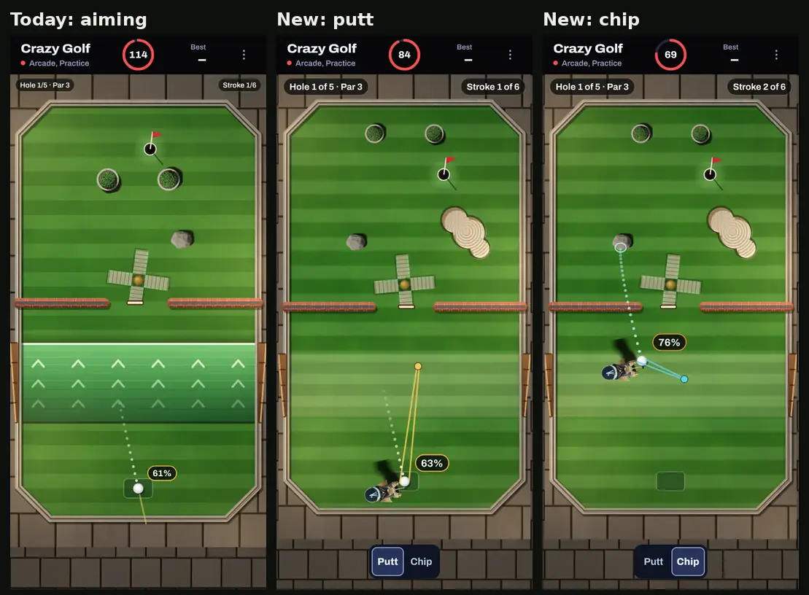

## Later holes: today · new · new in play

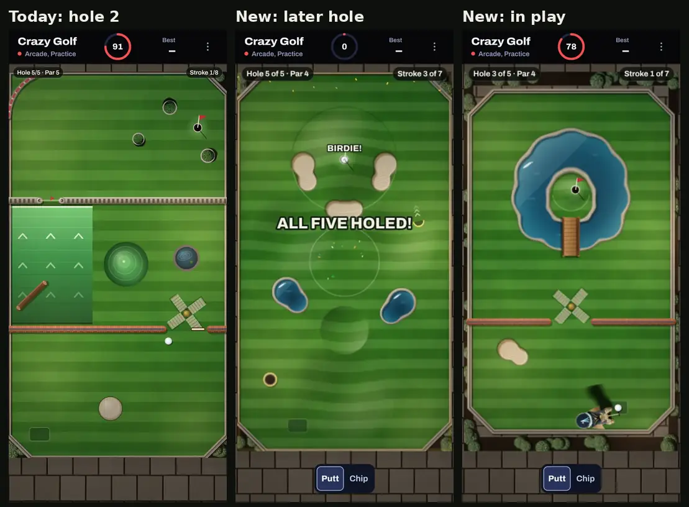

## The answer reveal: today · new · new with hole 3 chosen

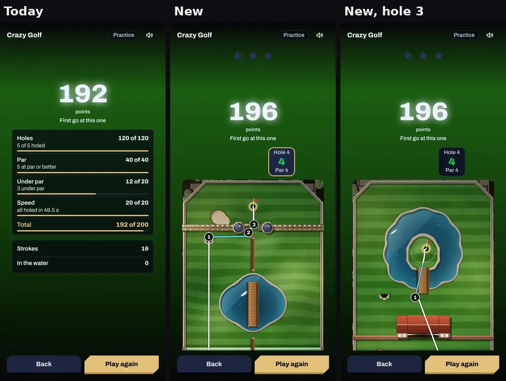

The scorecard cells land in turn through the shared effects kit (#422: `drop`, an under-par hole `match`) and the strokes
count up (`FxCountUp`).

## Clips

| | Today | New |
|---|---|---|
| A putt | 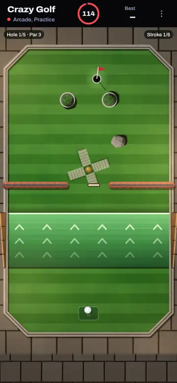 | 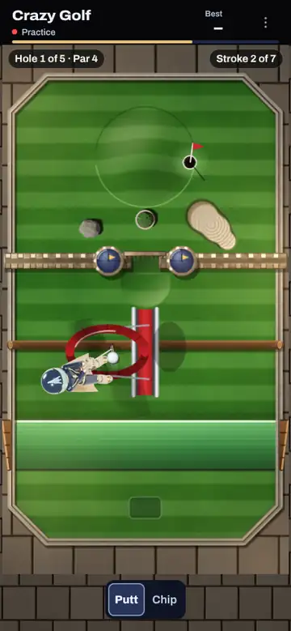 |
| A chip | (no chip today) | 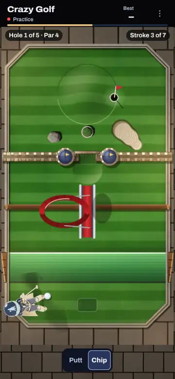 |
| Play | 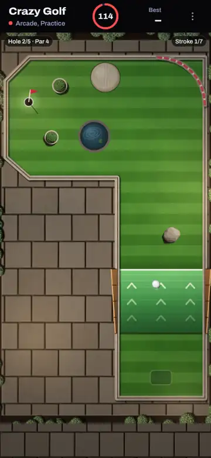 |  |

## Expert courses to play (the elite bot's score on each, `scripts/level-tune.ts`'s deal at Expert, samples 0–23)

Each is five hole ids (template × 100 + variant):

| Sample | Elite score | Holes |
|---|---|---|
| 3 | 197 | Windmill bowl 17, Tunnel dogleg 407, Island green 903, Lake castle 1507, Crater 1708 |
| 14 | 174 | Loop lane 101, Loop wall 703, Island green 910, Lake castle 1512, Crater 1706 |
| 4 | 172 | Bridge pond 200, Tunnel dogleg 414, S-bend 809, Bridged pond 1300, Crater 1709 |
| 16 | 171 | Castle bowl 304, Loop wall 716, Mill and castle 1004, Loop valley 1409, Water finale 1903 |
| 18 | 170 | Bridge pond 203, Zigzag mill 502, S-bend 815, Loop valley 1408, Water finale 1908 |
| 2 | 166 | Loop lane 101, Zigzag mill 502, S-bend 812, Loop valley 1405, Water finale 1908 |
| 12 | 150 | Bridge pond 204, Loop wall 703, Mill and castle 1007, Loop valley 1407, Water finale 1908 |
| 5 | 139 | Castle bowl 315, Loop wall 717, Island green 900, Rolling mill 1206, Water finale 1908 |
| 0 | 116 | Bridge pond 209, Moat castle 613, S-bend 806, Bridged pond 1304, Ridges mill 1801 |
| 9 | 105 | Castle bowl 314, Zigzag mill 508, Island green 906, Bridged pond 1305, Water finale 1905 |

## Every frame

| | Today | New |
|---|---|---|
| Intro | 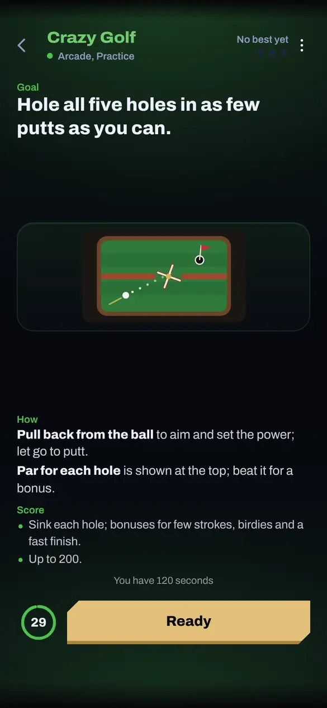 | 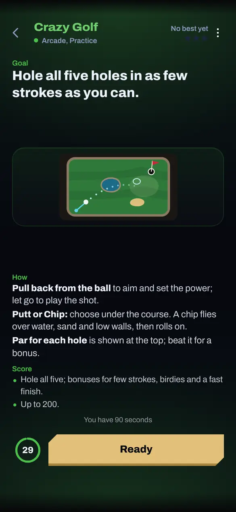 |
| First tee |  |  |
| Aiming | 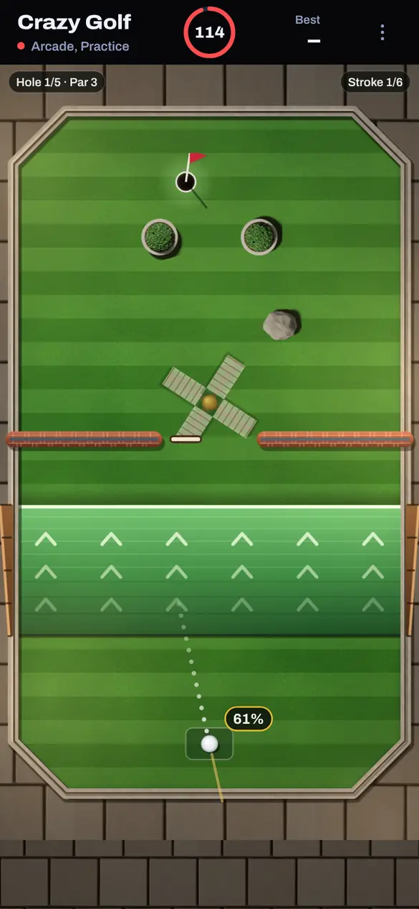 |  |
| Chip aim | | 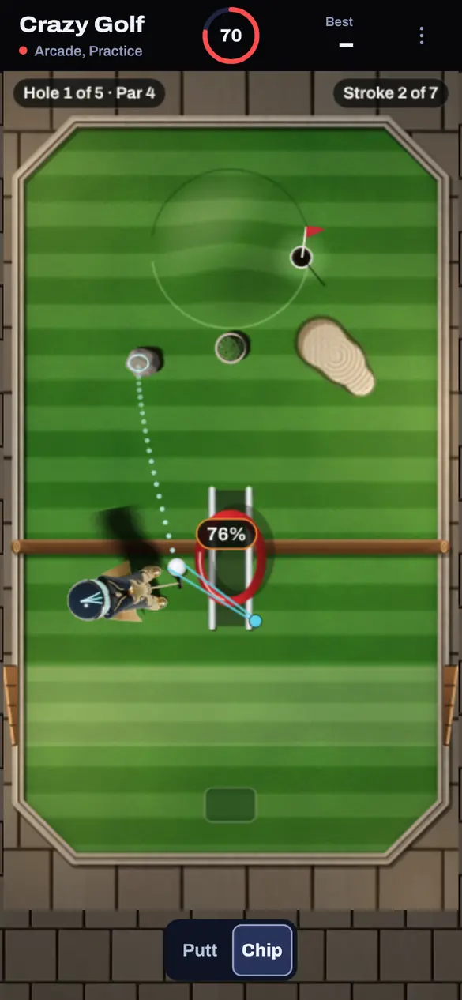 |
| In play | 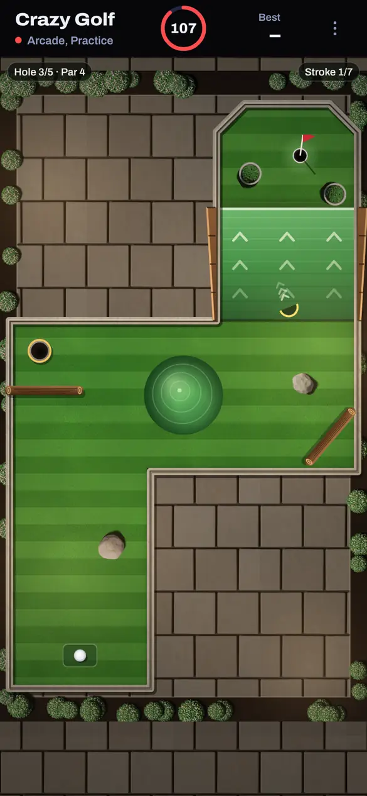 |  |
| A later hole |  | 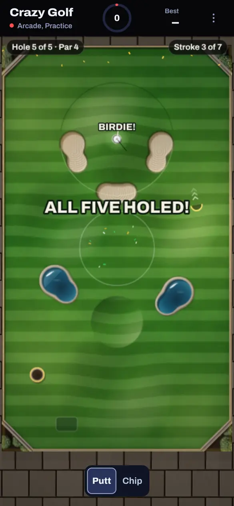 |
| Reveal | 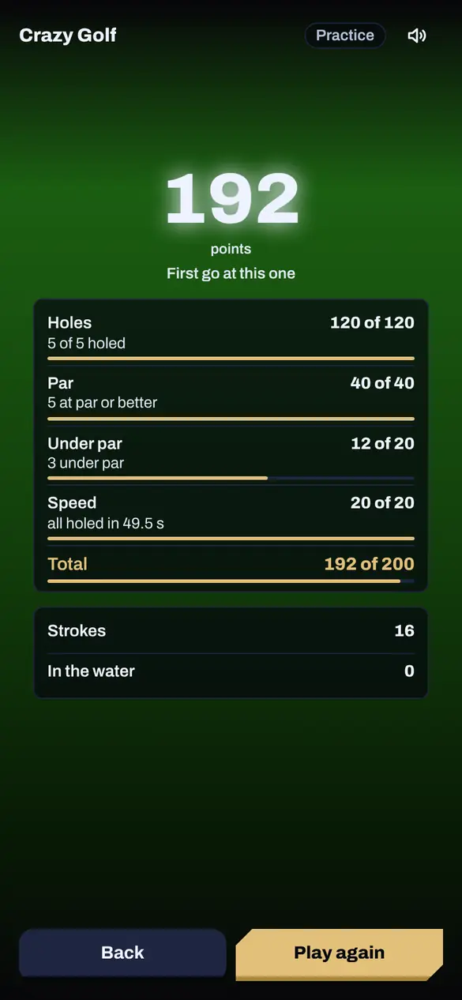 |  |
| Reveal, hole 3 | |  |
