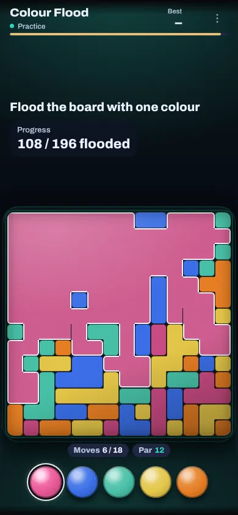
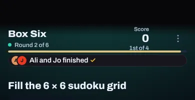
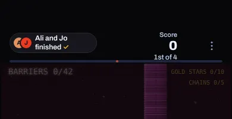
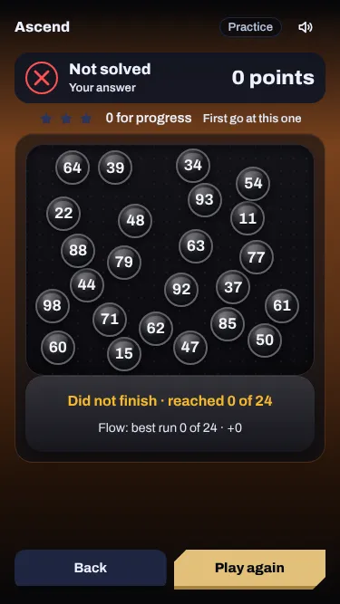
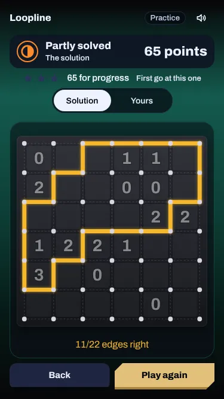
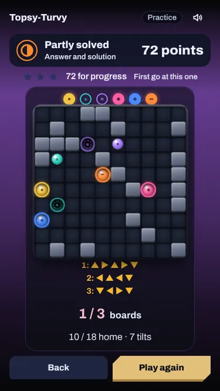
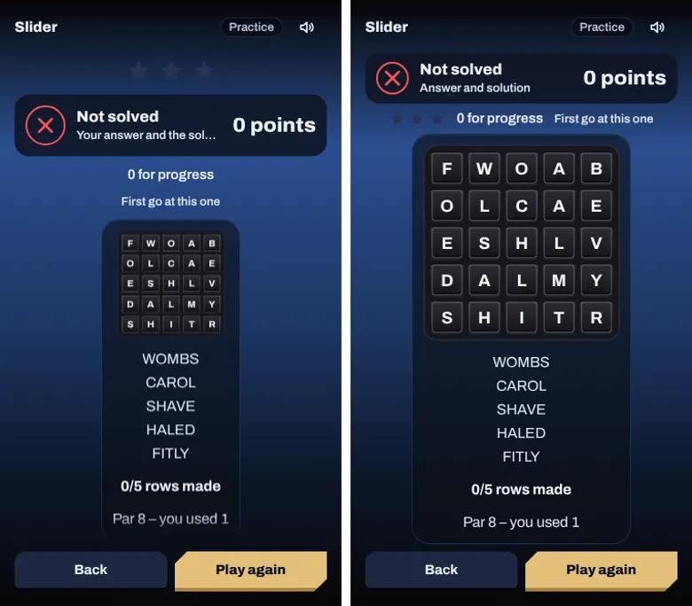
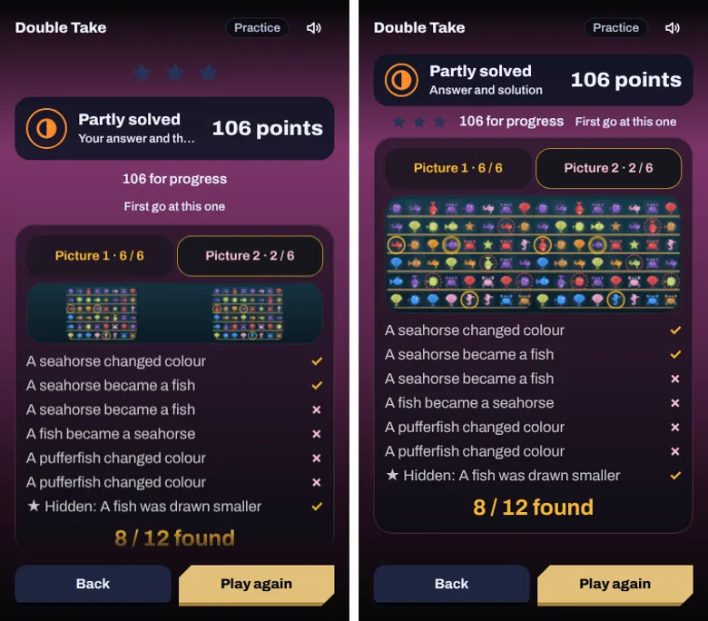
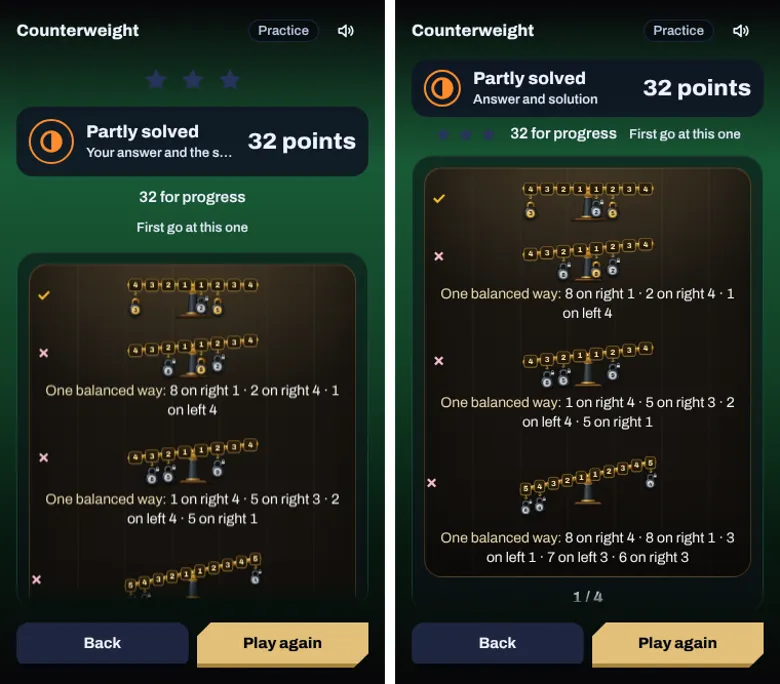

# The effects pass: gallery

15 Nov 2026. Guide: [../../effects-pass/README.md](../../effects-pass/README.md). Clips drawn through the screens harness
(stubbed server) at 390 × 844 by `bun scripts/shots/effects-pass-shots.ts`; each room moment from just before its phase
starts. Presentation only: no game's play, timing, grading or scoring changed, and RoundIntro's timing is unchanged.
Every moment below is drawn only with the celebrations on; reduced motion and reduced effects keep the calm versions.

## Prepare to Duel: the players' cards arrive

| Two players (VS) | Six | Sixteen |
|---|---|---|
| [prepare-2.mp4](prepare-2.mp4) | [prepare-6.mp4](prepare-6.mp4) | [prepare-16.mp4](prepare-16.mp4) |

The cards rise in one after another under the logo while a floor glow, embers, a light sweep and two charge rings
build to the flash.

## Round titles: a different backdrop each round, a bigger final round

| Round 2 | Round 3 | Round 4 | Round 5 | Round 6 | Final round |
|---|---|---|---|---|---|
| [round-2.mp4](round-2.mp4) | [round-3.mp4](round-3.mp4) | [round-4.mp4](round-4.mp4) | [round-5.mp4](round-5.mp4) | [round-6.mp4](round-6.mp4) | [final-round.mp4](final-round.mp4) |

Five backdrops in turn (rays, grid, orbs, stripes, pulse rings) under each round's own look, the round's numeral large
and faint behind the title; the final round adds rays, a burst of sparks and a ★.

## The 3-2-1 lightning

[countdown.mp4](countdown.mp4): a small strike on each of 3, 2 and 1, then the GO strike. Every strike is built fresh
(one to three bolts, their origins, forks, length, timing and a re-strike flicker vary), so no two look the same.
Behind the countdown only, before play starts.

## Results, standings, podium, reveal

| Round result | Standings | Podium | Answer reveal |
|---|---|---|---|
| [round-result.mp4](round-result.mp4) | [standings.mp4](standings.mp4) | [podium.mp4](podium.mp4) | [answer-reveal.mp4](answer-reveal.mp4) |

One entrance language: the results tables' blocks rise in a short stagger, the reveal, standings, podium and final
screen fade theirs (they measure their rows to slide them, so nothing they measure moves).

## App moments

| Rated result (the rating counts up) | Score Attack result | Daily results |
|---|---|---|
| [rated-result.mp4](rated-result.mp4) | [score-attack-result.mp4](score-attack-result.mp4) | [daily-results.mp4](daily-results.mp4) |

Badges earned, pass level-ups and claims, season rewards, challenges done, tournament results and new trophies use
the effects kit's own moments (`newBest`, `win`, `match`), shown in the kit's clips:
[../game-frame/effects-full.mp4](../game-frame/effects-full.mp4) (and its lite, reduced and calm versions beside it).
They fire when the thing happens (a badge earned, a level reached, a reward claimed), which the screens harness
doesn't do, so they have no clip of their own here.

## Pass 3's answers

**The phone's status panel** (Colour Flood, 390 × 844): the goal and progress in larger type in the space above the
board. Status pills that sit above a board move into the panel; pills under a board (Colour Flood's moves and par)
stay with it, since boards that size to their height would change size without them.

**The room's "finished" strip** just below the timer bar on a puzzle, and inside the header (ending above the bar) on
an arcade game, where the world starts right under the header:

| Puzzle | Arcade |
|---|---|
|  |  |

**The reveal heading** follows what is shown: "Your answer", "The solution" or "Answer and solution".

| Ascend: your answer | Loopline: both | Topsy-Turvy: both |
|---|---|---|
|  |  |  |

**Short phones** (375 × 667, before → after): practice's stars join the score lines and the shared rows tighten, so the
game's own reveal keeps its size. Of the 18 puzzles drawn below full size, 15 now draw at full size or larger.

| Slider (0.51 → 0.93) | Double Take (0.50 → 1.03) | Counterweight (0.50, its own list) |
|---|---|---|
|  |  |  |
