# Game frame, arena and effects kit: gallery

Phase 2, step 4 (pass 2, 15 Nov 2026). Before = main (1c9a5edf), after = this branch. Drawn through the screens
harness (fixed clock, stubbed server); the computer clip on the dev server. Guide:
[../../game-fx/README.md](../../game-fx/README.md). The room shots' harness clock has run out, so their timers read 0.

## The arena on a computer (clip)

Breaker in practice at 1440 × 900, played with the arrow keys: the world fills the height, the side panel carries the
game, the timer bar, the best, the goal and the Controls tab.

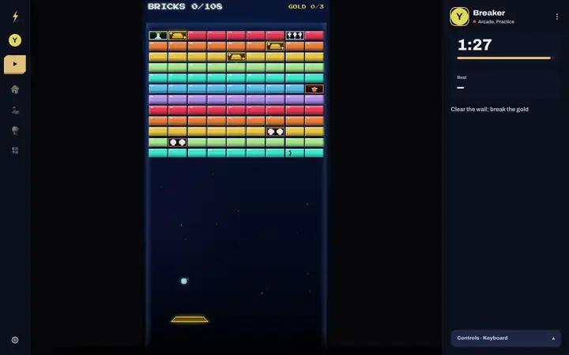

## Header and timer options

Pick one; the default is one line in `src/config/gameFrameConfig.ts` (`GAME_HEADER_STYLE`, today `mockup`). Every
style keeps the header's 60 px. Also on `/dev-design` → Header styles, side by side, with "Use in games".

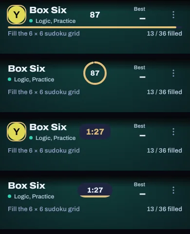

| Style | Practice | A room (one-on-one) |
|---|---|---|
| mockup (default) | 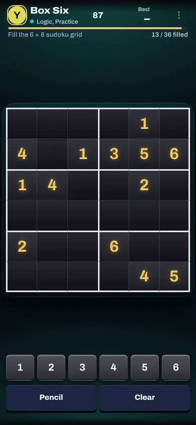 | 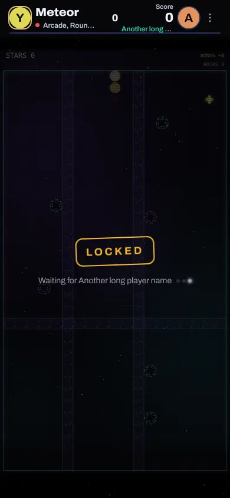 |
| ring | 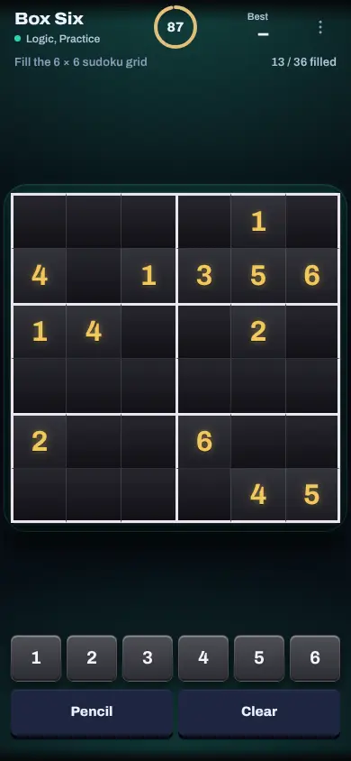 | 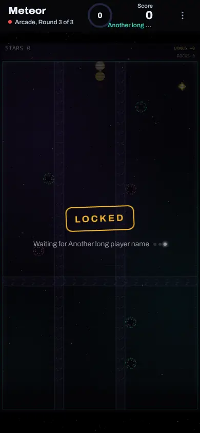 |
| digital | 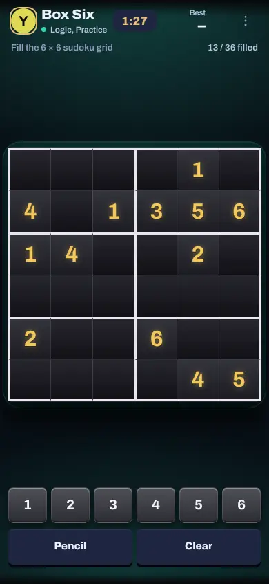 | 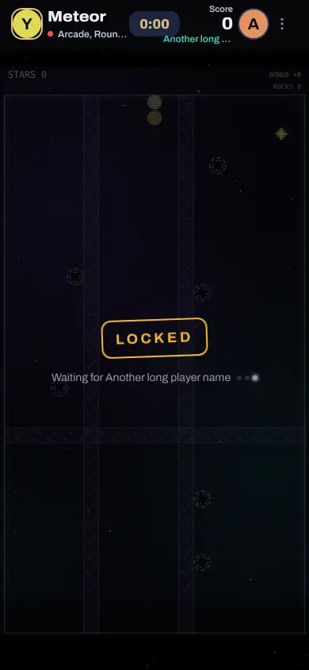 |
| chip | 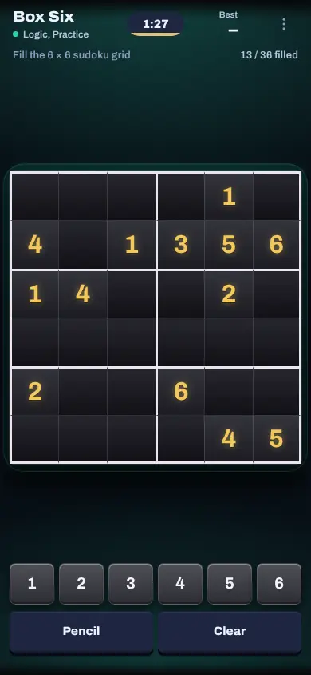 | 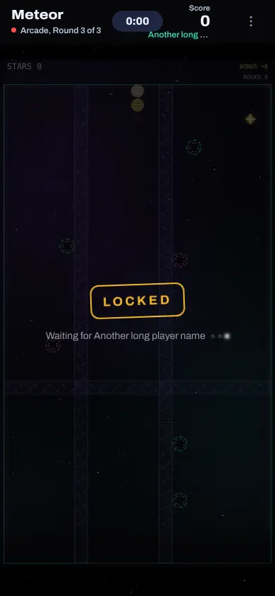 |

## Phone (390 × 844)

| | Before | After |
|---|---|---|
| Practice, puzzle (Box Six) |  |  |
| Practice, arcade (Meteor) | 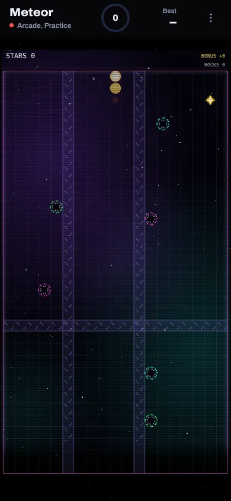 |  |
| Room, puzzle (one-on-one) |  | 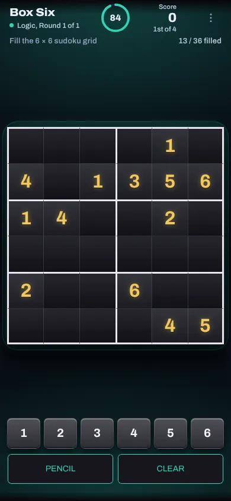 |
| Room, arcade | 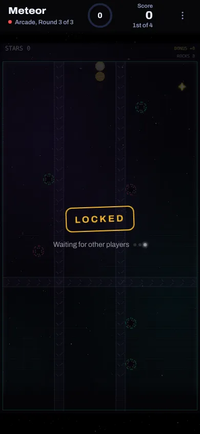 | 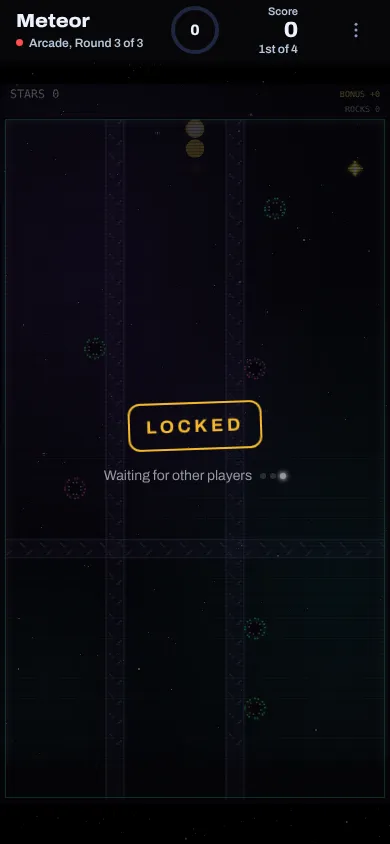 |

## Sideways tablet (1180 × 820, touch): the arena

| | Before | After |
|---|---|---|
| Practice, puzzle |  | 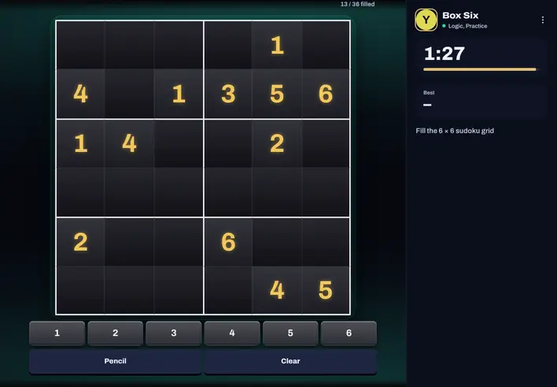 |
| Practice, arcade |  |  |
| Room, puzzle |  |  |
| Room, arcade | 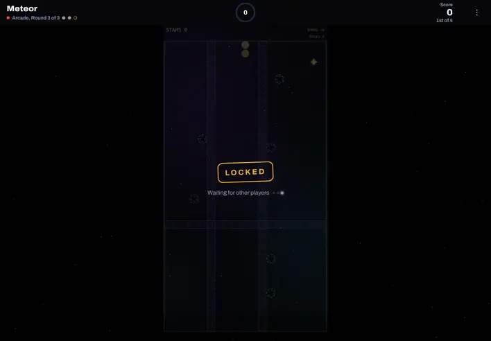 | 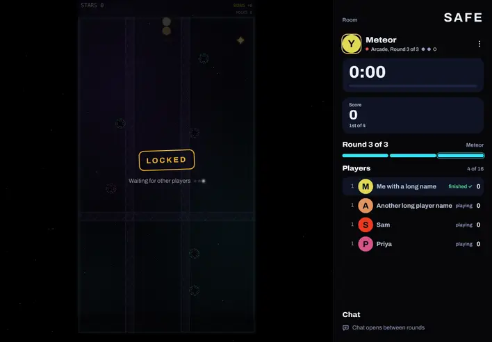 |

## Computer (1600 × 900): the arena

| | Before | After |
|---|---|---|
| Practice, puzzle |  |  |
| Practice, arcade |  |  |
| Room, puzzle (room panel with the game's block) |  | 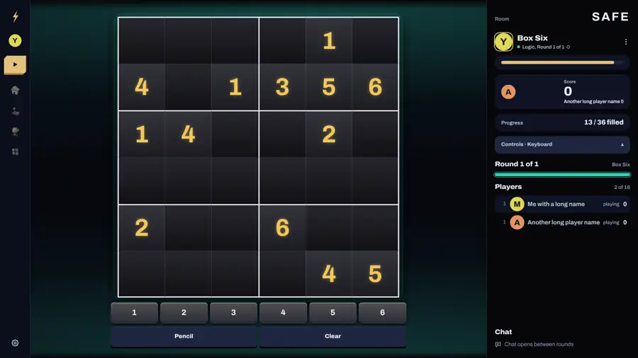 |
| Room, arcade |  | 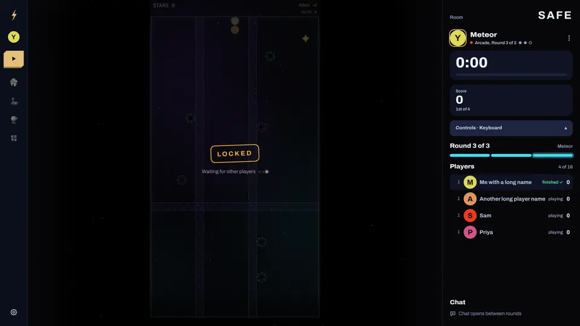 |

## Reveal and result screens (phone)

| | Before | After |
|---|---|---|
| Reveal, puzzle (room) |  |  |
| Reveal, arcade (room) | 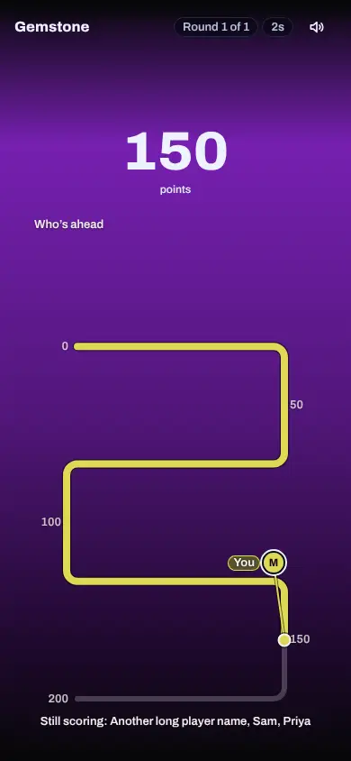 |  |
| Round leaderboard |  |  |
| Final results, two players |  | 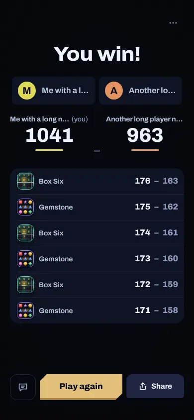 |

Practice's reveal adds the game's three stars (landing), "Star earned" and the new-best badge above the result; the
payoff is motion, so see the effects clips below.

## Effects (clips, /dev-design → Effects)

| Variant | Clip |
|---|---|
| Full | [effects-full.webm](effects-full.webm) |
| Lite (reduced effects, battery saver) | [effects-lite.webm](effects-lite.webm) |
| Reduced motion | [effects-reduced.webm](effects-reduced.webm) |
| Calm (celebrations off; payoff kinds only) | [effects-calm.webm](effects-calm.webm) |

