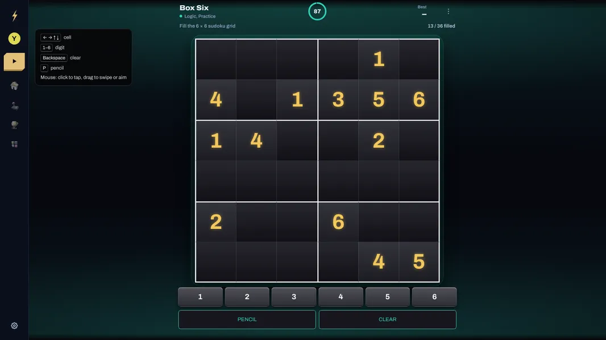
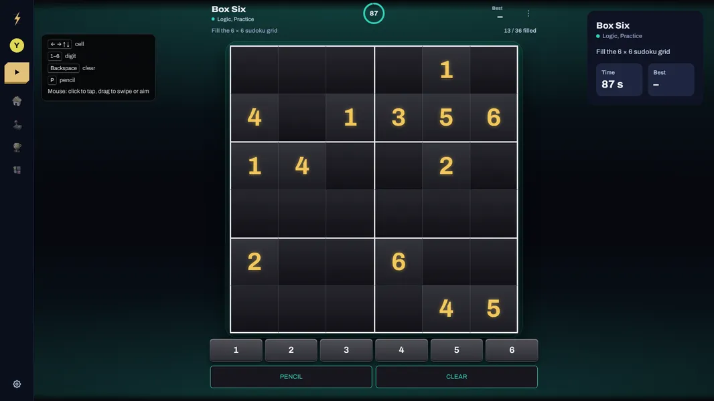
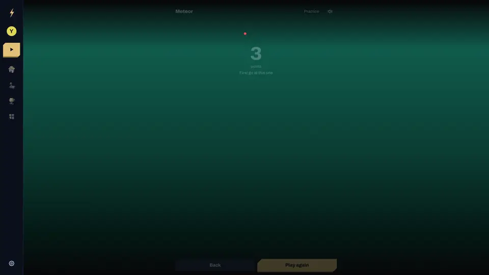
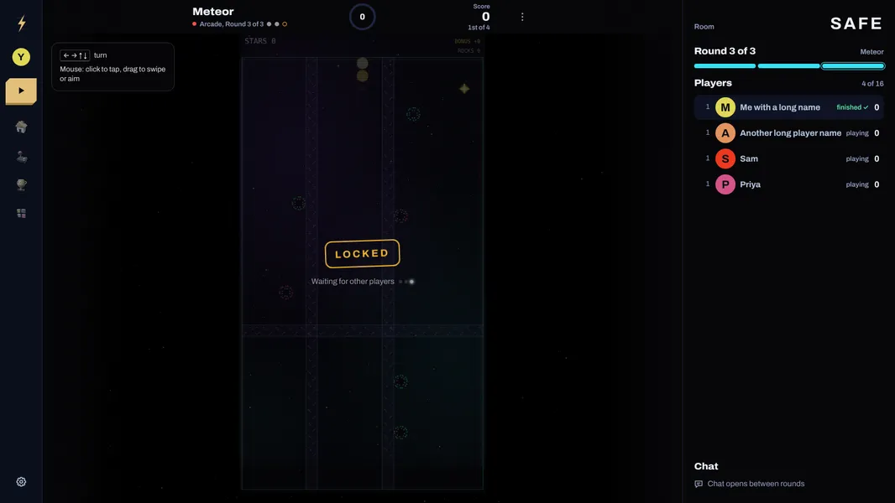

# Game frame and effects kit: gallery

Phase 2, step 4 (15 Nov 2026). Before = main (dd9acbe6), after = this branch. Drawn through the screens harness
(fixed clock, stubbed server; `frame-shots`, the same screens theme-check uses). Guide: [../../game-fx/README.md](../../game-fx/README.md).

## Effects (clips, /dev-design → Effects)

Each clip plays tap, pick up / drop, slide, pour, match, wrong, combo ×4, near miss and win, then the round-end payoff
(count-up, stars landing, new best).

| Variant | Clip |
|---|---|
| Full | [effects-full.webm](effects-full.webm) |
| Lite (reduced effects, battery saver) | [effects-lite.webm](effects-lite.webm) |
| Reduced motion | [effects-reduced.webm](effects-reduced.webm) |
| Calm (celebrations off; payoff kinds only) | [effects-calm.webm](effects-calm.webm) |

## In play: phone

| | Before | After |
|---|---|---|
| Practice, puzzle (Box Six) |  |  |
| Practice, arcade (Meteor) |  |  |
| Room, puzzle |  |  |
| Room, arcade |  |  |

The header keeps its 60 px and every box its place (no board, world or control moves); secondary lines in text 2,
status pills as solid surface chips.

## In play: computer (1600 × 900)

| | Before | After |
|---|---|---|
| Practice, puzzle: the arena panel |  |  |
| Practice, arcade: the arena panel |  |  |
| Room, puzzle (room panel, unchanged) |  |  |
| Room, arcade |  |  |

The panel appears only where the space right of the centred column holds it (puzzles from 1452 px, tall arcade
worlds from 1332 px). The stub clock is frozen, so the time reads as the harness left it.

## Results (phone)

| | Before | After |
|---|---|---|
| Round leaderboard |  |  |
| Final results, two players |  |  |

The payoff is motion (count-up, the winner's `win`, stars, new best), so the stills look alike: see the clips. Score
bars now fill by scale rather than width.
