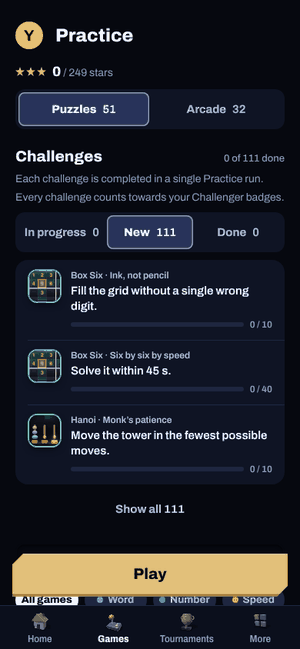
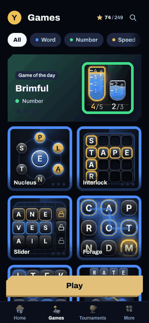
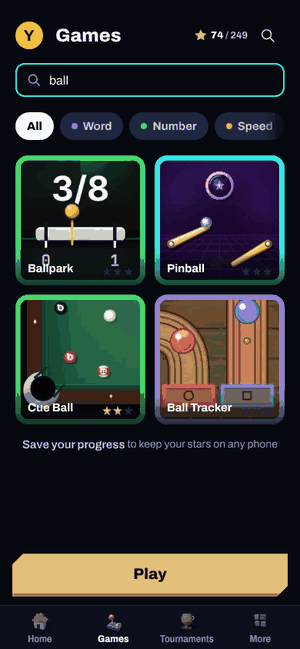
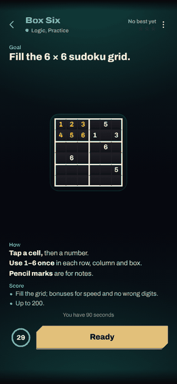
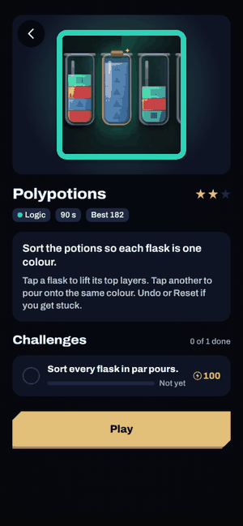
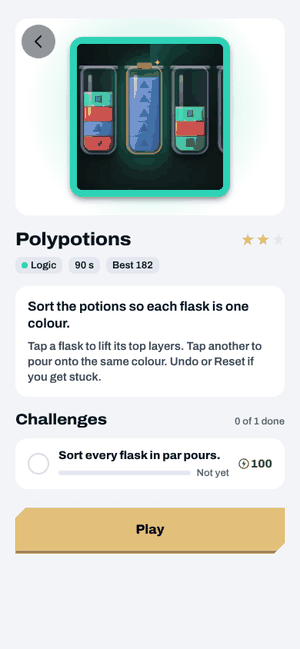
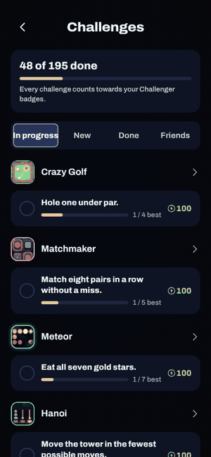
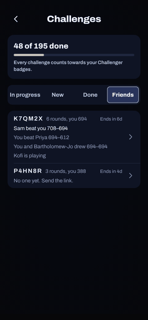
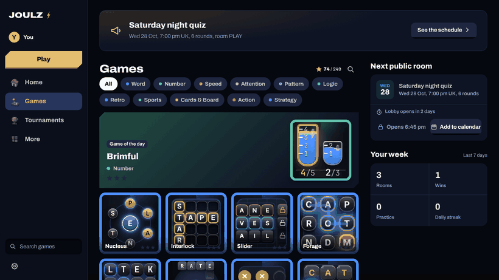
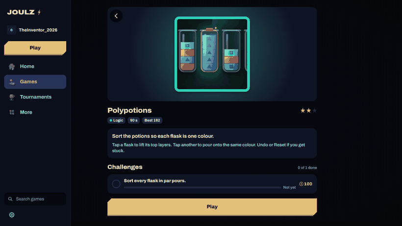

# Games pages: review gallery (phase 2 step 3, 14 Nov 2026)

Phone shots at 390 × 844 (shrunk to 300 wide), two computer shots at 1366 × 768. The "before" shots come from `main`
at 3c12f12 through the screen harness, and the "after" shots from this branch (`bun scripts/shots/games-shots.ts`).
Today's tile art stands in until step 4's key art.

## Games tab

| Before | After |
|---|---|
|  |  |

Before: the title "Practice", the Puzzles | Arcade switch, then the challenges block, then the lists. After: the title
"Games" with the star total and the search button, chips (All, the six categories, the five arcade groups)
in one row that scrolls sideways inside itself on a phone (its edge fading; tablets and computers wrap them, Joe,
14 Nov 2026), so the game-of-the-day hero shows on the first screen, then a two-column grid of tiles with their stars.
No challenges.

Search open (names only): 

## From a tile to playing

| Before: the tile opened the round's intro | After: the tile opens the game's page |
|---|---|
|  |  |

The game's page shows its art, name, tag, time limit, best and stars, then the goal and how to play, that game's
challenges (with Joules where the pass is on; this shot is a tester's) and Play. Play opens the round's intro already in its
3-2-1, so the goal and how-to aren't shown twice. The intro itself is unchanged (step 4).

Light: 

## Challenges (More → Challenges)

The Friends tab (Joe, 14 Nov 2026): the friend challenges this device made or sent (Profile's former "Your challenges"),
each opening the challenge; with none, one line and a Challenge a friend link.

| Friends | Friends, none |
|---|---|
|  |  |

## Computer

