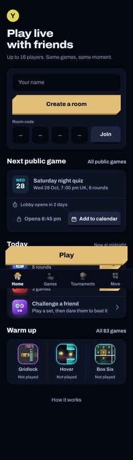
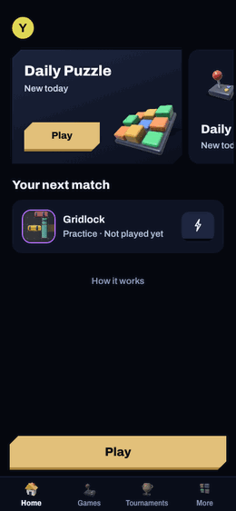
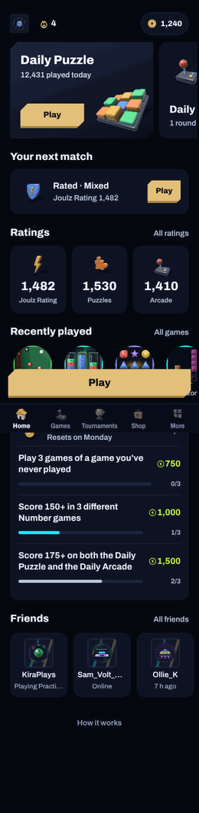
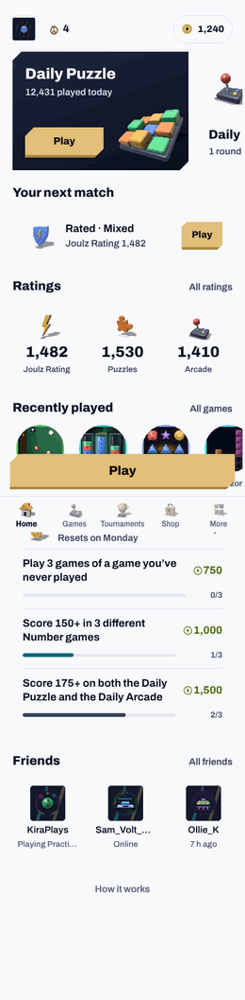
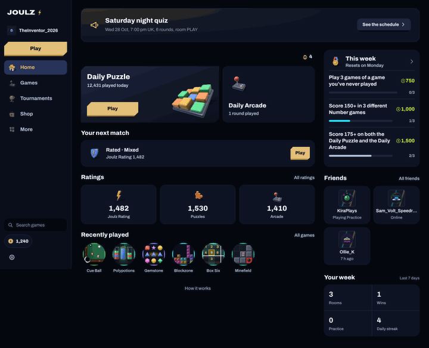
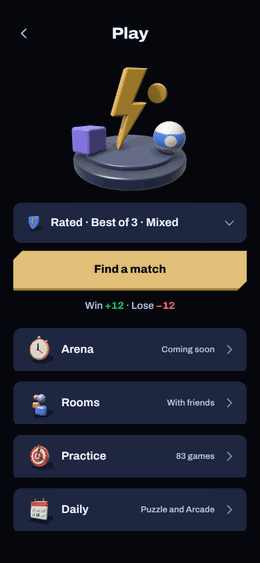
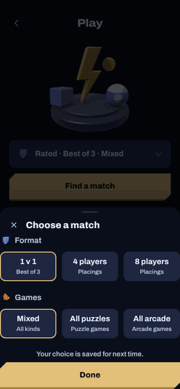
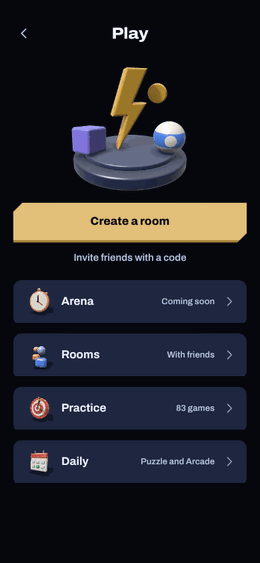
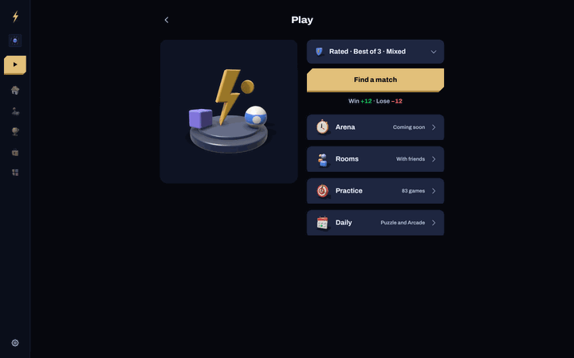
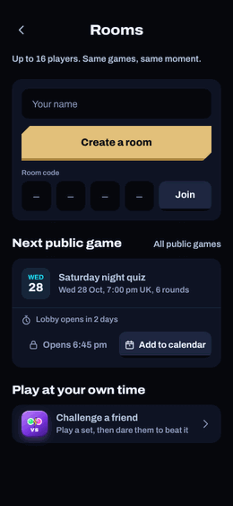

# Home and Play: review gallery (phase 2 step 3, 14 Nov 2026)

Home, the new Play page and the new Rooms page, built from the style guide (`docs/design/style-guide/`) on step 2's
components and tokens. Phone pictures are 390 × 844 (full page; the tab bar and Play bar are fixed, so in a full-page
picture they sit over the middle), drawn by `bun scripts/shots/home-play-shots.ts`, then shrunk for this page.

## Home

| Before (a guest) | After (a guest) | After (an account with everything on) |
|---|---|---|
|  |  |  |

- Header: the avatar; the Daily streak beside it; on the right the coin counter (where the Shop is on). The
  notifications bell is hidden until a notifications inbox exists (Joe, 14 Nov 2026; `HOME_BELL` in
  `src/config/homeConfig.ts`).
- The Daily hero: Daily Puzzle in Joulz navy with the cut corners (navy in both themes), how many have played today
  (from 20 players, the Daily's own rule) and Play; Daily Arcade peeks beside it, and sits beside it on wider screens.
- Your next match: rated play's quick match for players with rated play; else the account's most recently active
  friend; else a Practice game.
- Ratings (rated players only): Joulz Rating, Puzzles, Arcade.
- Recently played: this device's last practice games, round icons, each opening the game's page.
- This week (where the pass is on) and Friends (an account with friends); in the side column on wider screens.
- Moved off Home: Quick play (create and join), Rejoin, Next public game and Challenge a friend (to Rooms); Warm up
  (now Recently played and the Practice suggestion).

| Light | Computer |
|---|---|
|  |  |

## Play (the gold Play bar and the rail's Play open it)

| Rated play | The match sheet | No rated play |
|---|---|---|
|  |  |  |

- The format selector opens the sheet with the formats and game picks switched on today (W3b's switches).
- Find a match, with Win +N · Lose −N under it from the rated server's own estimate (`stakesEstimate`, #411), never a
  number worked out on the phone; no line when it answers nothing (placement, a format or pick with no estimate).
  During placement the line says the rating shows after 5 matches.
- Everyone else: Create a room (today's quick play; the Rooms page asks for a name first if none is stored).
- Arena (the Tournaments tab), Rooms, Practice (Games), Daily.

## Rooms (Play → Rooms)

Create a room (with the guest name field), Join with a code, Rejoin your last room while it is open, the Next public
game card with Add to calendar, and Challenge a friend.
