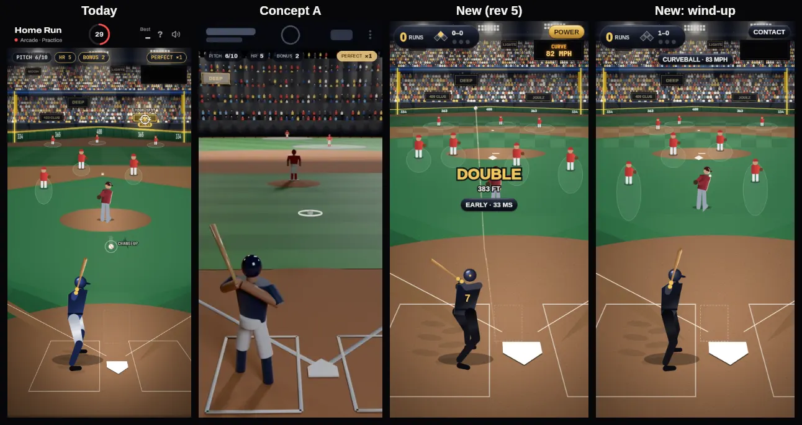
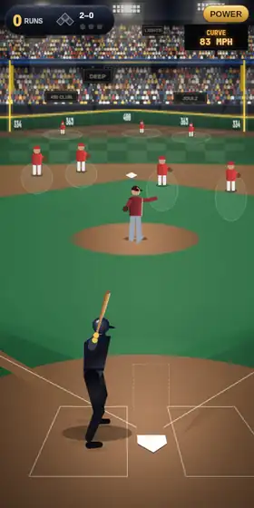
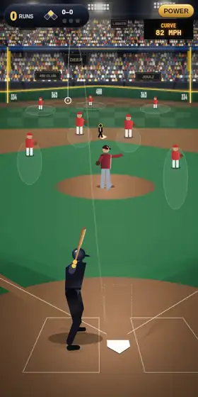
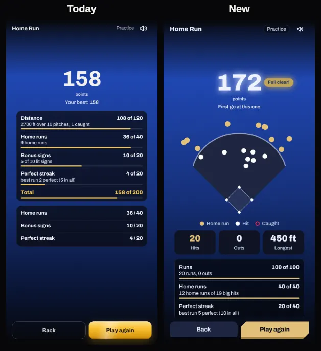
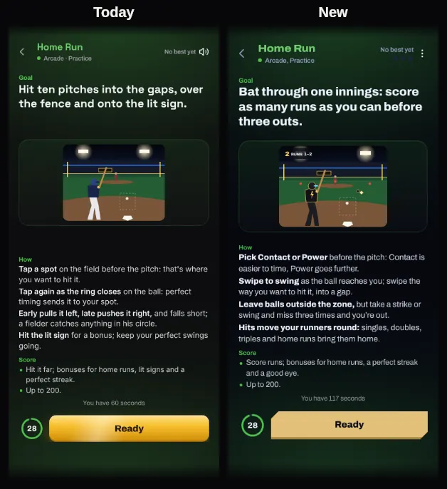
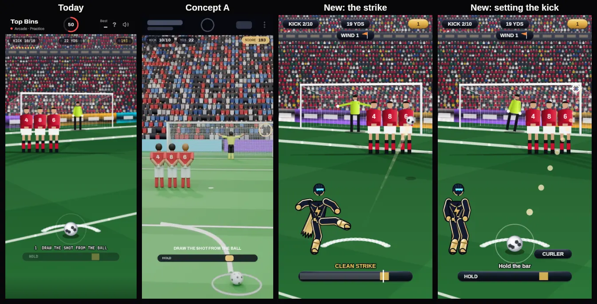
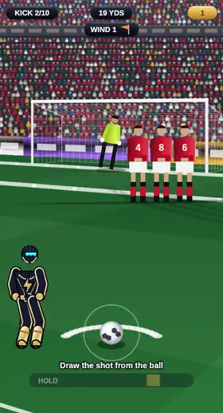
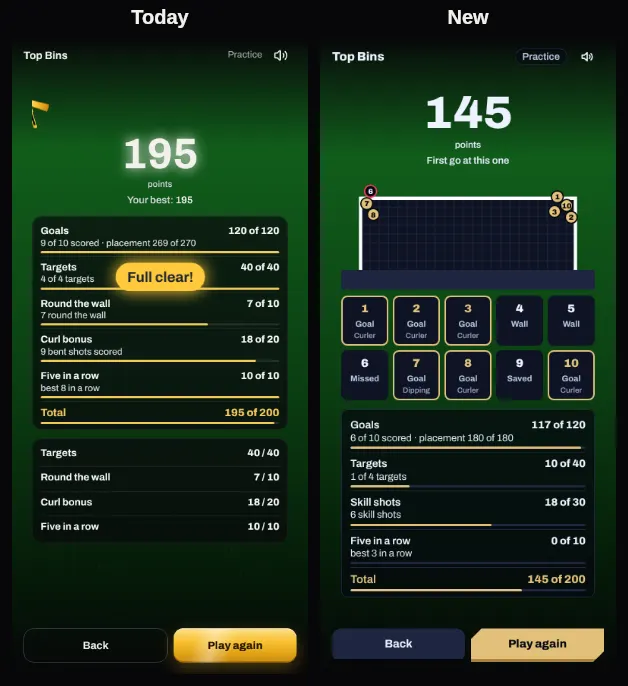
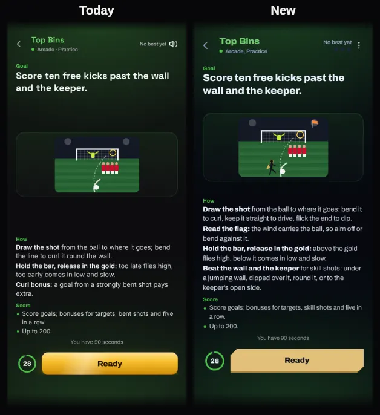

# Home Run and Top Bins overhaul: gallery (phase 2 step 4, 15 Nov 2026)

Today is the 4 Nov 2026 audit's screenshot (`screenshots/audit-nov-2026-final/arcade-sports/`), the concept is PR #426's
**A · Today, upgraded** (no pick is recorded on #426, so A was followed, with some of B's light), and the new frames are
the real renderers drawing a great-level bot's run on the rev-5 Normal deal (`bun scripts/shots/homerun-innings-frames.ts`,
`freekick-layered-frames.ts`; reveals by `bun scripts/shots/capture.ts homerun freekick --phases=intro,play,full`).

## Home Run (homerunRev 5, the innings)

Clips (animated WebP): a hit with the runners going round, and a home run.

 

The reveal: today's text breakdown, and the new one with the field and every batted ball where it came down (gold home
runs, white hits, red hollow catches) over the breakdown.

The intro: today's, and the new one (the innings, Contact or Power, swipe to aim, Captain Joulz's kit).

## Top Bins (freekickRev 5, the layered kick)

Clip: Captain Joulz steps in and strikes, the ball goes in and the net bulges.

The reveal: today's text breakdown, and the new one with the goal frame and all ten kicks where they crossed the line
(gold goals, red misses, numbered) and a strip of the ten results with each goal's strike type.

The intro: today's, and the new one (the three strikes, the wind flag, Captain Joulz on the ball).

## What differs from concept A

- The pictures are still drawn 2D in the canvas (the park, stadium and figures are today's painted art with a
  materials pass: smoked-glass HUD pills with a crisp highlight, gold enamel, a glossy stitched ball, mown turf under
  the lights, a lacquered Captain). Concept A's rendered stands, lit figures and real net are not reached: a Blender
  backdrop cannot line up with Top Bins' per-kick camera or Home Run's warped view without reworking both projections.
- The batter is Captain Joulz in his kit (not the navy capsule of the concept); the kicker is Captain Joulz (the concept
  has no kicker).
