# Logic overhaul, session 1: gallery

Box Six, Polypotions, Hanoi, Safe Cracker, Mosaic, Colour Flood and Minefield (phase 2 step 4). Frames are 390 × 844
practice rounds drawn by `bun scripts/shots/capture.ts`. Today: the game reviews' screenshots
(`docs/design/game-reviews/img/logic/`); concept: the render Joe picked (PR #429, `docs/design/game-concepts/logic/`).

## The look (second pass, 15 Nov 2026)

Every piece is rendered in Blender inside its concept's own scene: the same stage lights, materials and place on the
screen, with a camera framed on that one piece (`scripts/logic-art/render.py`, 47 WebP sprites in `public/logic-art/`).
Real materials with light on them: glass with a crisp highlight down its curve, glossy liquid, lacquer and enamel with
depth, oak with grain, stone with texture. No glare washes across a panel, tile or numeral (glass, liquid and drums take
one strip light along their curve instead of the studio's square windows), and every numeral is drawn sharp by the app.
Each game keeps its own background.

| Game | Today | Concept picked | New |
|---|---|---|---|
| Box Six (A, with B's light) |  | 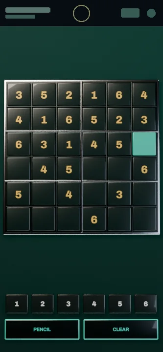 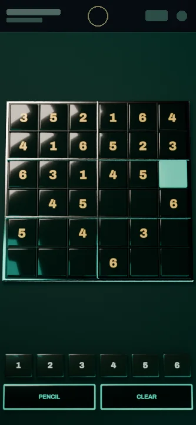 |  |
| Polypotions (A's glass, B's liquid, C's cork) |  |  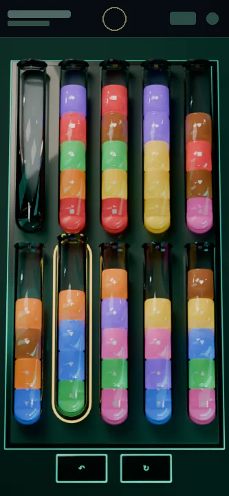 |  |
| Hanoi (A's oak, B's rings) | 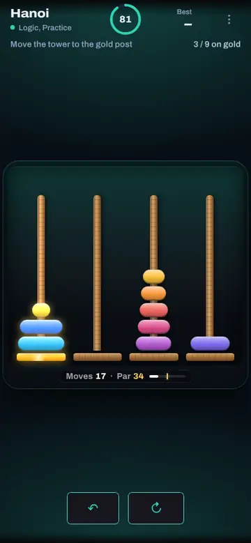 | 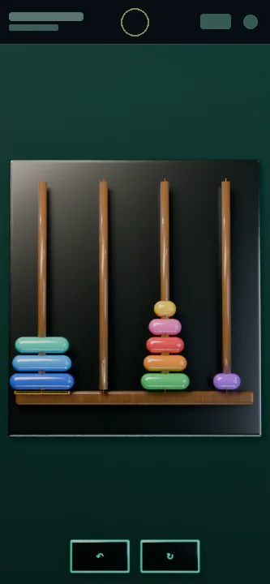 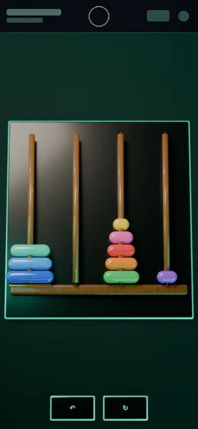 | 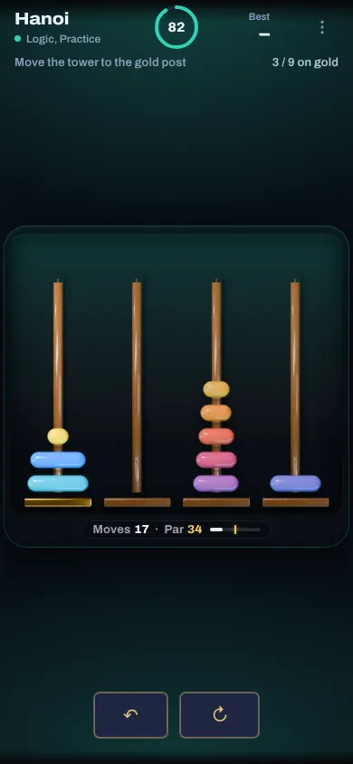 |
| Safe Cracker (A) |  | 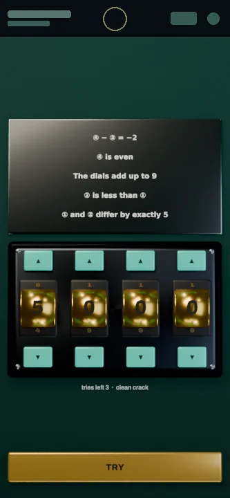 |  |
| Mosaic (A) | 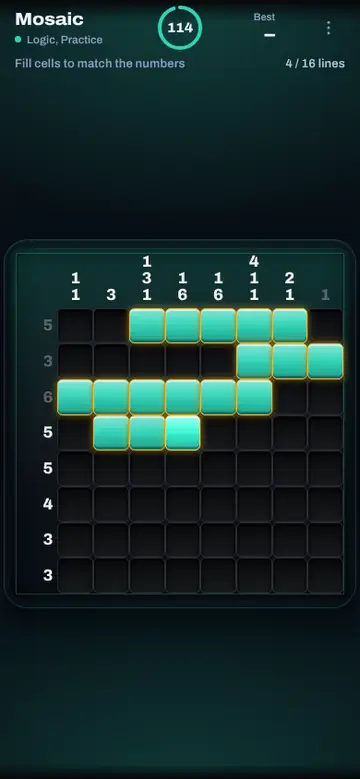 | 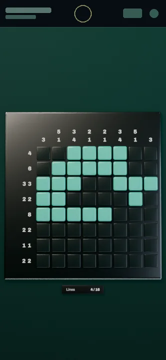 | 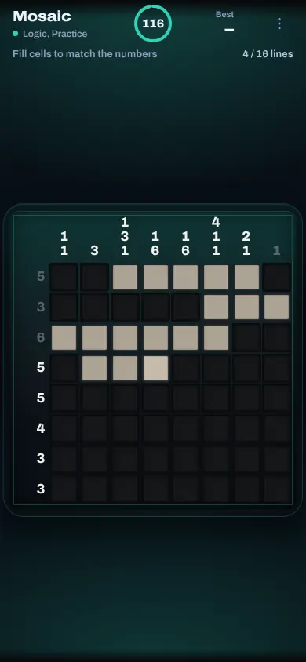 |
| Colour Flood (A) |  | 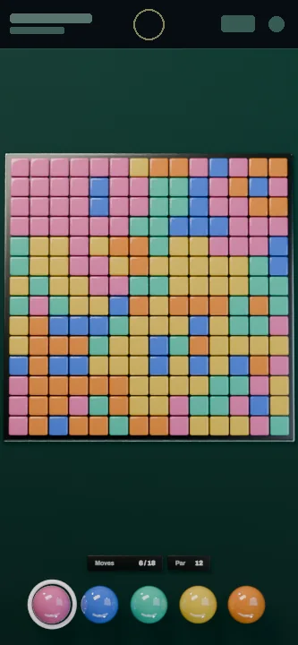 | 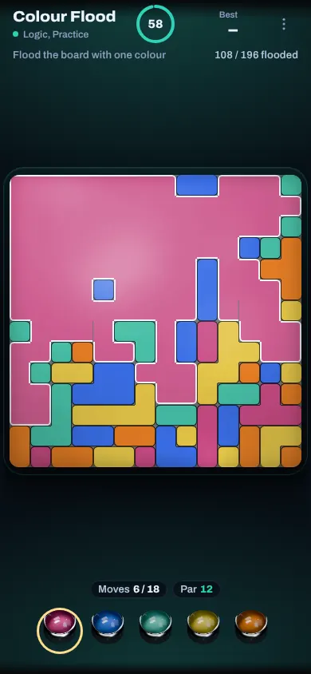 |
| Minefield (A) |  |  | 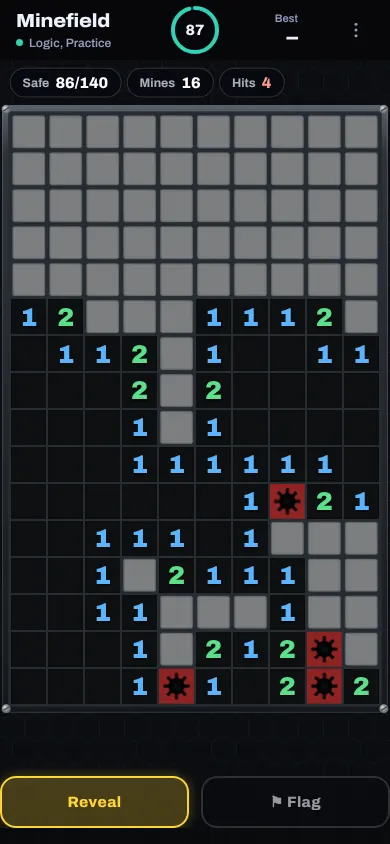 |

The rendered pieces:

Image budget (the sprites each game loads): Box Six 2.9 KB, Polypotions 230.0 KB, Hanoi 68.6 KB, Safe Cracker 10.7 KB,
Mosaic 4.2 KB, Colour Flood 26.4 KB, Minefield 11.0 KB; 354 KB for all seven, each under the 400 KB a game.

**Look pass 2 (15 Nov 2026, with stage 2; the table above shows it):** Polypotions' tubes take concept A's proportions
(a 66 : 316 test tube, 82 % of its column, real space round each), smoked interiors and a faint lit glass wall, with no
box round the flask buttons; Box Six's tiles are concept A's lacquer seen through a close camera under B's light, so a
soft sheen falls across each dark tile and its bevel shows (no hard reflections); Hanoi's posts are thicker turned oak
(radius 8, rendered at twice the resolution) and its rings concept B's candy glass seen at B's camera lean, their glossy
top face over the rounded front.

## The answer reveals

One board at a time (Box Six and Mosaic through the shared Solution / Yours switch), what you missed or got wrong marked
on the board, the key numbers behind the score as big figures over short labels, and pictures instead of text lists: the
shortest route as move pictures (Polypotions, Hanoi), your moves against the par route (Colour Flood), each try as a row
of drums (Safe Cracker) and Minefield's board as your run left it. Before: main.

| Game | Before | After: solved | After: timed out |
|---|---|---|---|
| Box Six | 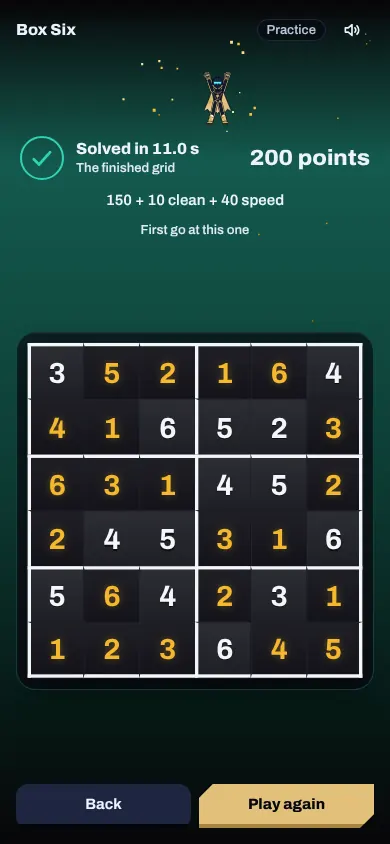 |  | 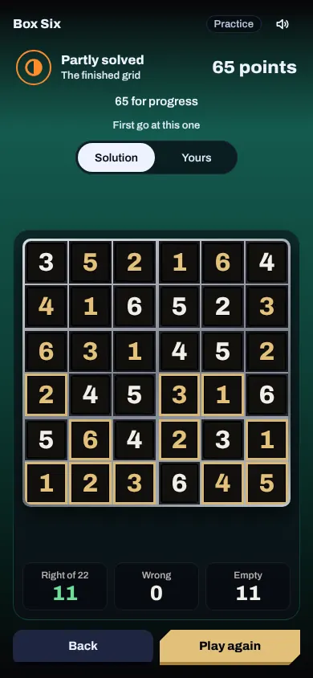 |
| Polypotions | 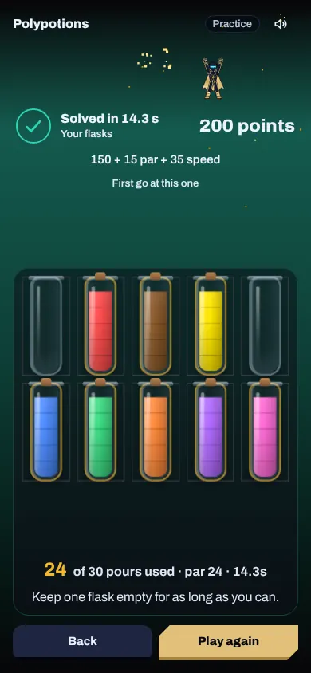 | 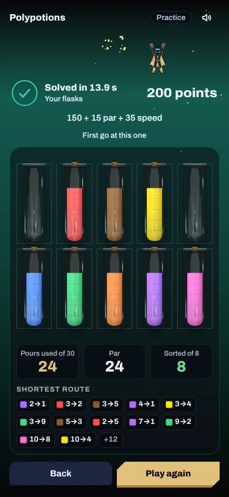 |  |
| Hanoi | 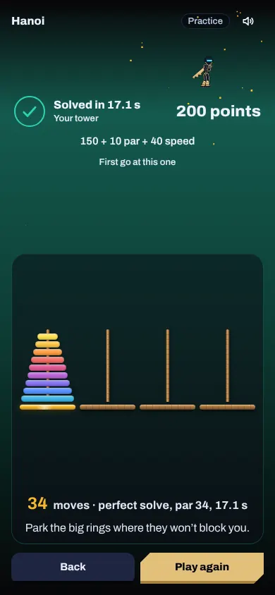 |  | 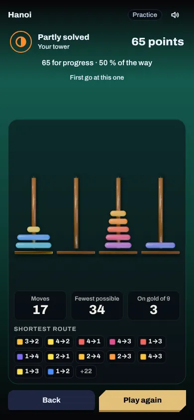 |
| Safe Cracker | 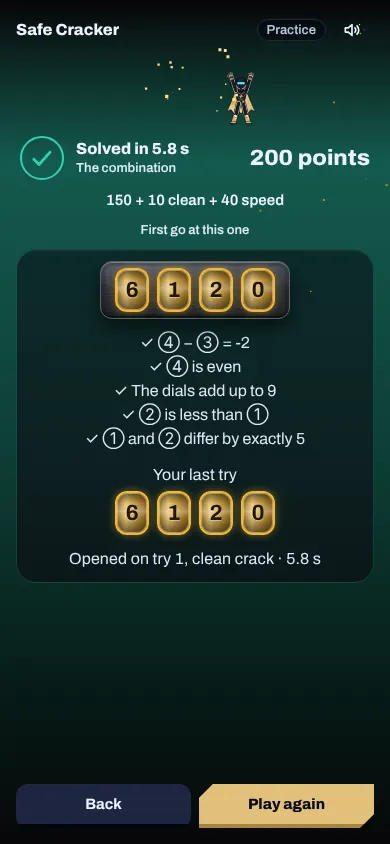 |  |  |
| Mosaic |  |  |  |
| Colour Flood | 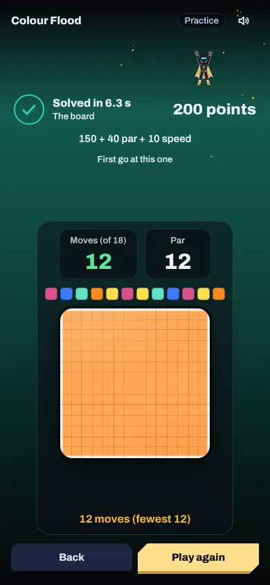 | 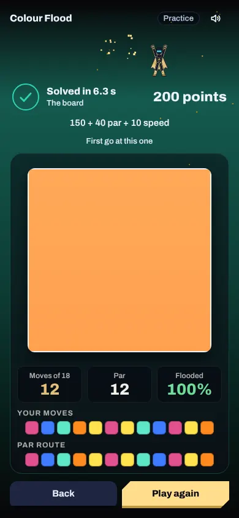 | 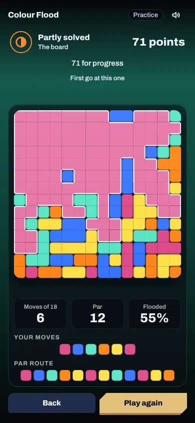 |
| Minefield | 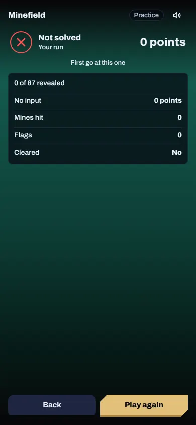 |  | (a run has no timed-out phase) |

375 × 667: 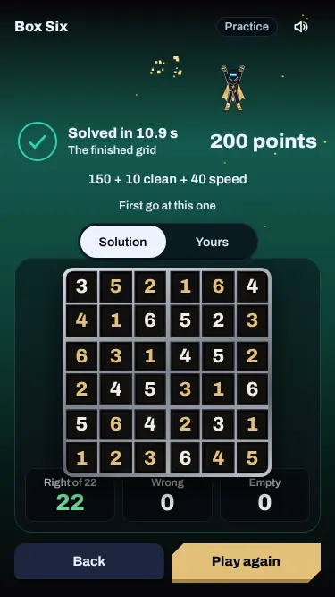 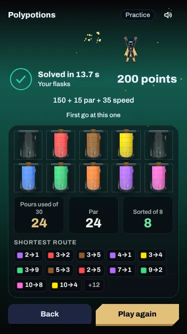
 
 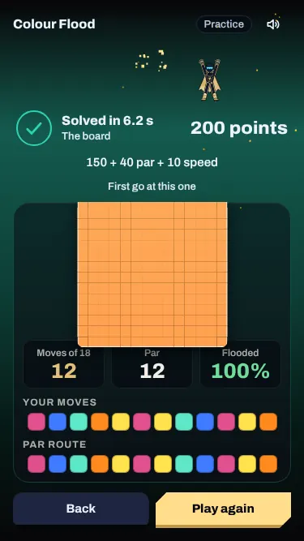
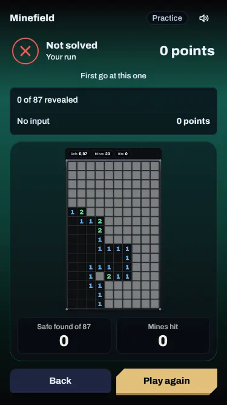

Clips of the hero effects (Polypotions' pour above all) come with stage 2, when the effects kit (#422) is on main.
