# Logic overhaul, session 1: gallery

Box Six, Polypotions, Hanoi, Safe Cracker, Mosaic, Colour Flood and Minefield (phase 2 step 4). Frames are 390 × 844
practice rounds drawn by `bun scripts/shots/capture.ts`. Today: the game reviews' screenshots
(`docs/design/game-reviews/img/logic/`); concept: the render Joe picked (PR #429, `docs/design/game-concepts/logic/`).

## Stage 3: the levels (15–16 Nov 2026)

Every game offers Easy, Normal, Hard and Expert through the difficulty framework (#432; the registry entries in
`src/lib/levels/gameLevels.ts` list each game's levers). Normal is today's game, except Minefield (Joe, 15 Nov 2026:
today's game is Hard, and Normal is a gentler 16-mine game on minesRev 3). Every board at every level is proved by
`scripts/logic-1-levels-check.tsx` (exactly one solution, or for the move games the exact minimum by search), and no
clock is over 120 s.

| Game | Easy | Hard | Expert |
|---|---|---|---|
| Box Six | 19–21 givens, singles only, digits leave the keypad once placed six times | 10–12 givens, needs a pair / pointing / box-line step | 9–10 givens, an advanced step, clashes only on Check, 120 s |
| Polypotions | 6 flasks, 4 colours, 4 layers | 10 flasks, 8 colours, 7 layers, min 26–34, 120 s | 12 flasks, 10 colours (teal and pearl added), 6 layers, min 28–38, hidden layers, 120 s |
| Hanoi | 4 posts, 7 rings, 10–18 moves | 3 posts, 9 rings, 30–45, 120 s | 3 posts, 10 rings, 45–60, 120 s |
| Safe Cracker | 3 dials of 0–9, 5 simple clues | 4 dials of 0–15, primes / squares / differences, 90 s | 5 dials of 0–20, 6 clues, 2 tries, 120 s |
| Mosaic | 6 × 6, single-line logic, a matched line crosses its gaps, 90 s | 9 × 11 (grown downwards), single-line logic | 9 × 14, needs two lines together, 120 s |
| Colour Flood | 10 × 10, 4 colours, par 7–9 | 12 × 17, 6 colours (violet added), par 14–18, 75 s | 14 × 24, 6 colours, 14 stones, par 18–20, 90 s |
| Minefield | 8 × 12, 9 mines, opening 25–40 | today's 10 × 16, 20 mines (minesRev 2) | 12 × 18, 30 mines, opening 10–20, 120 s |

The level boards at 390 × 844 (practice, a real deal at each level):

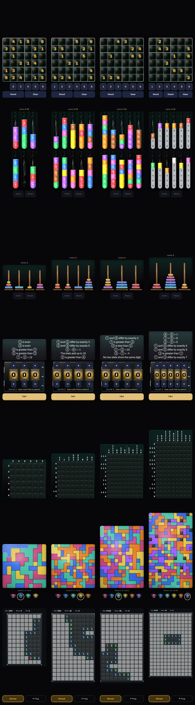

## Stage 3 additions

**Polypotions' liquid, vivid** (Joe, 15 Nov 2026): concept B's palette rendered with a straight colour transform (the
filmic one had washed strong colours to pastel), a deep body darkening towards the tube's side, a little light through
it and one strip highlight down its curve. Today, concept B and the new frame:

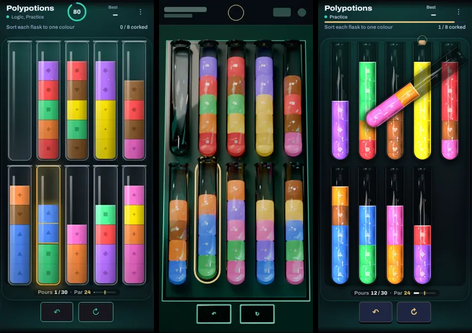

**Minefield's sounds**: the cascade's rising ticks (up to 8, 45 ms apart, a step higher each), one soft click per mine
defused at the clear (on the renderer's beat), and a number tapped before its flags add up gives a tiny shake and a dull
knock (slots `minesweeper.cascadeTick`, `minesweeper.defuse`, `minesweeper.tapNumber`, placeholders until Joe's files).

## Stage 2: the effects (15 Nov 2026)

Built on the effects kit (#422, `src/lib/fx/kit.ts`) and its rules (transform and opacity only, the piece itself moves,
never a control; the next tap is taken at once), with the game-specific moves in `src/puzzles/logicMotion.ts`.

- **Polypotions, the pour** (the style guide's timing: lift 120 ms, travel and tilt 160, pour 300–500 by amount, settle
  220, return 180): the flask flies over its target and tilts, a stream of the colour falls into the mouth while the
  target's layers rise, the glug pitched by the level reached; a refused flask tips toward the target, nothing pours,
  it rights itself (the lift kept); a flask completed gets its cork with a bright ring, two within four seconds a combo;
  at the end the corks glint in turn. Clip: [tubes-effects.mp4](clips/tubes-effects.mp4) (9 s, 0.2 MB).

  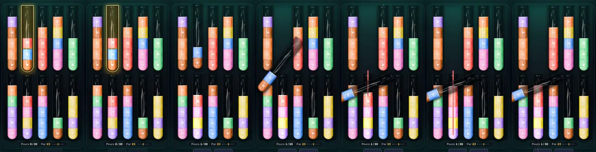
- **Hanoi**: the ring arcs from where it hovered over the posts and lands with a clunk pitched by its size; on the gold
  post in final order it glints; an illegal post bounces the lifted ring and keeps it lifted. Clip:
  [tower-effects.mp4](clips/tower-effects.mp4).
- **Box Six**: a completed row, column or box lights along it from the cell just placed with a rising chime (several
  at once: the kit's combo); a clash shakes the digit and rings it red; on solve the lines turn gold from the last cell
  outwards. 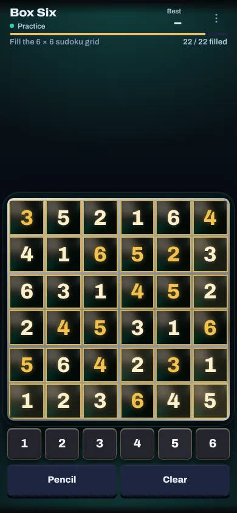
- **Safe Cracker**: a wrong try jolts the door and flashes the broken clues; the right one slides three bolts back one by
  one, the drums lock and the door swings. 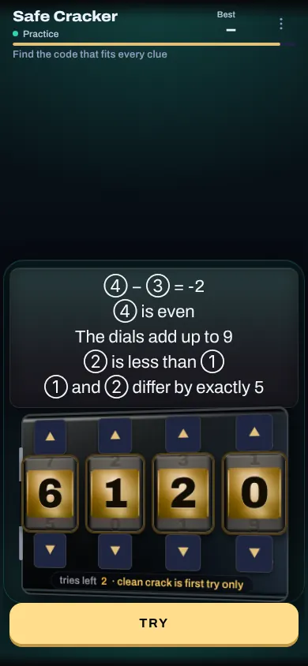
- **Mosaic**: a fill presses the tile in; a drag rises in pitch square by square; a line matching its numbers lights its
  clue with a chime (two at once a combo); the solve flips the picture row by row.
- **Colour Flood**: the whoosh grows with the squares taken; 20 or more is a combo sparkle; near par the move counter
  glows gold; the solve pulses the board in its colour.
- **Minefield**: the cascade, flags and hits as before (a dull red pulse); at the clear the mines still hidden are
  defused one by one, out from the last square opened, each under a fading gold ring.

## The look (second pass, 15 Nov 2026)

Every piece is rendered in Blender inside its concept's own scene: the same stage lights, materials and place on the
screen, with a camera framed on that one piece (`scripts/logic-art/render.py`, 47 WebP sprites in `public/logic-art/`).
Real materials with light on them: glass with a crisp highlight down its curve, glossy liquid, lacquer and enamel with
depth, oak with grain, stone with texture. No glare washes across a panel, tile or numeral (glass, liquid and drums take
one strip light along their curve instead of the studio's square windows), and every numeral is drawn sharp by the app.
Each game keeps its own background.

| Game | Today | Concept picked | New |
|---|---|---|---|
| Box Six (A, with B's light) | 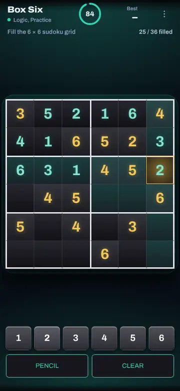 |   |  |
| Polypotions (A's glass, B's liquid, C's cork) |  | 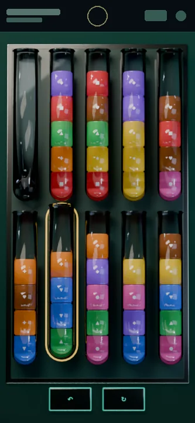  |  |
| Hanoi (A's oak, B's rings) |  |   |  |
| Safe Cracker (A) |  |  |  |
| Mosaic (A) |  |  |  |
| Colour Flood (A) | 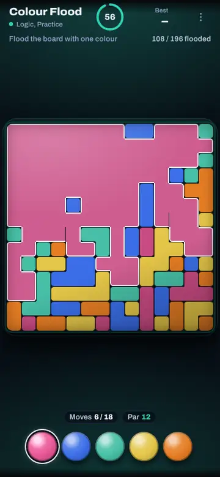 |  |  |
| Minefield (A) |  | 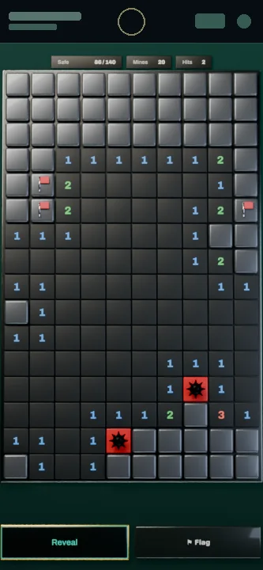 |  |

The rendered pieces:

Image budget (the sprites each game loads): Box Six 2.9 KB, Polypotions 230.0 KB, Hanoi 68.6 KB, Safe Cracker 10.7 KB,
Mosaic 4.2 KB, Colour Flood 26.4 KB, Minefield 11.0 KB; 354 KB for all seven, each under the 400 KB a game.

**Look pass 2 (15 Nov 2026, with stage 2; the table above shows it):** Polypotions' tubes take concept A's proportions
(a 66 : 316 test tube, 82 % of its column, real space round each), smoked interiors and a faint lit glass wall, with no
box round the flask buttons; Box Six's tiles are concept A's lacquer seen through a close camera under B's light, so a
soft sheen falls across each dark tile and its bevel shows (no hard reflections); Hanoi's posts are thicker turned oak
(radius 8, rendered at twice the resolution) and its rings concept B's candy glass seen at B's camera lean, their glossy
top face over the rounded front.

## The answer reveals

One board at a time (Box Six and Mosaic through the shared Solution / Yours switch), what you missed or got wrong marked
on the board, the key numbers behind the score as big figures over short labels, and pictures instead of text lists: the
shortest route as move pictures (Polypotions, Hanoi), your moves against the par route (Colour Flood), each try as a row
of drums (Safe Cracker) and Minefield's board as your run left it. Before: main.

| Game | Before | After: solved | After: timed out |
|---|---|---|---|
| Box Six |  | 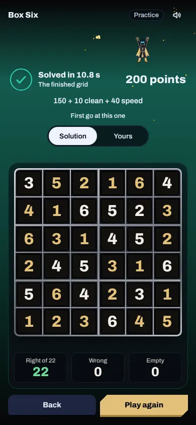 |  |
| Polypotions |  |  | 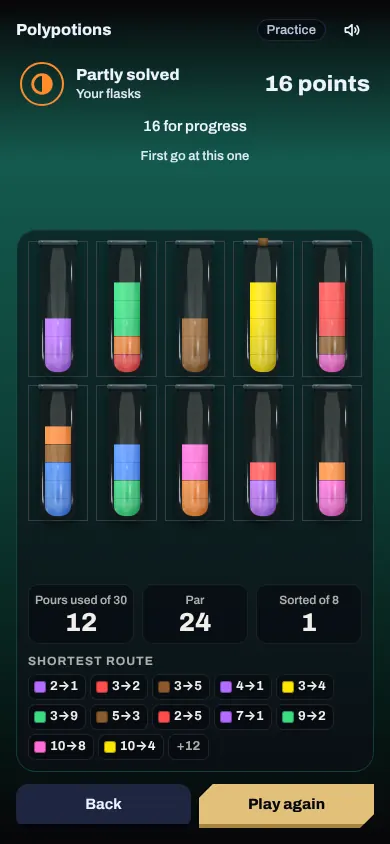 |
| Hanoi |  | 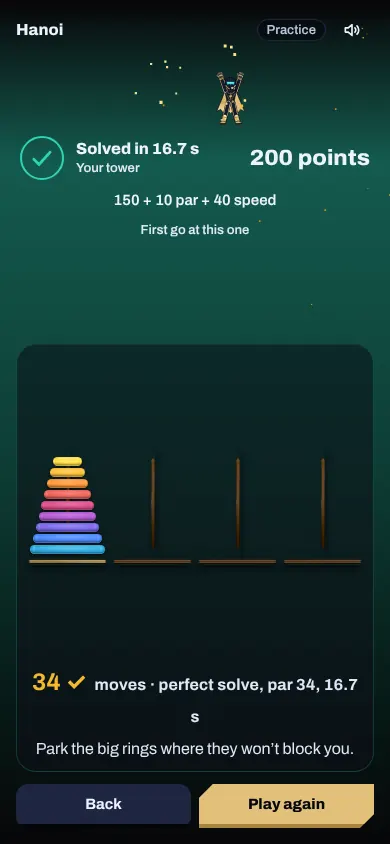 |  |
| Safe Cracker |  |  | 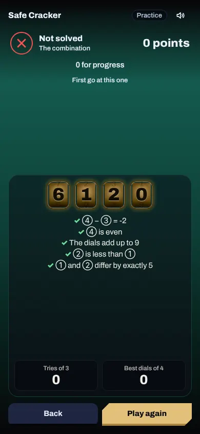 |
| Mosaic | 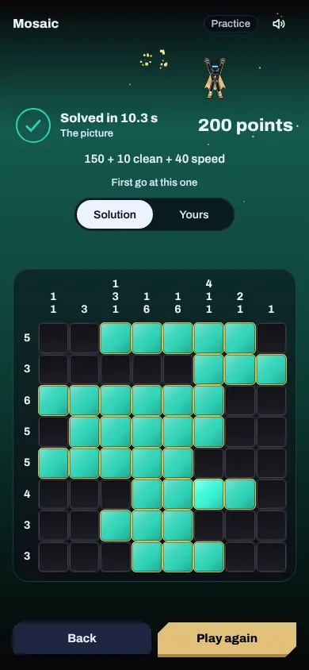 | 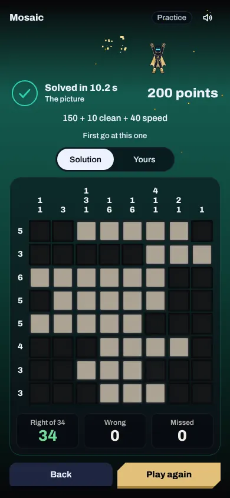 | 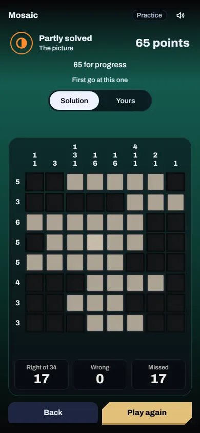 |
| Colour Flood |  |  |  |
| Minefield |  | 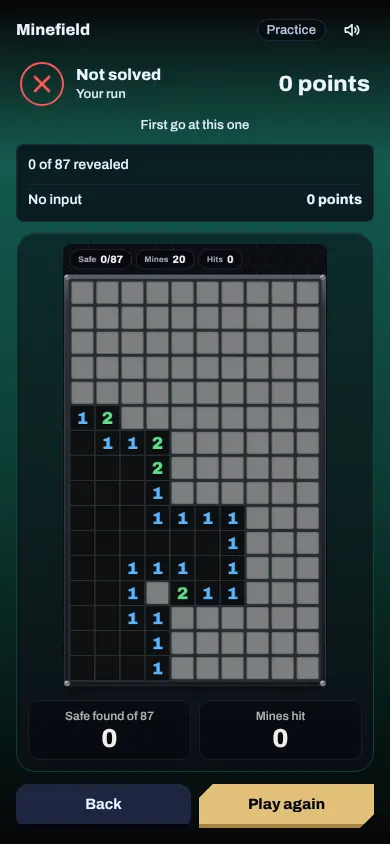 | (a run has no timed-out phase) |

375 × 667:  
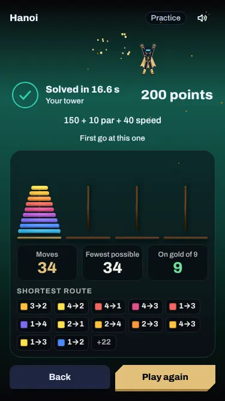 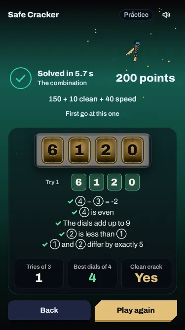
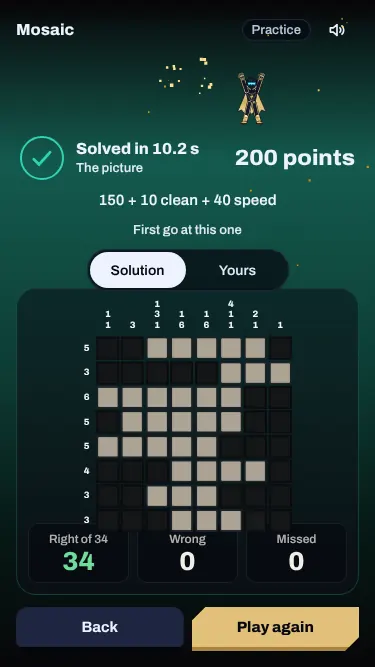 

Clips of the hero effects (Polypotions' pour above all) come with stage 2, when the effects kit (#422) is on main.
