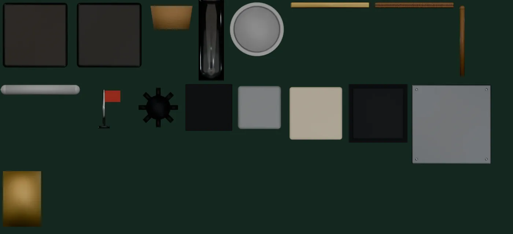
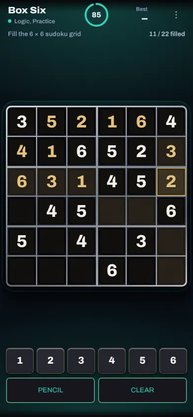
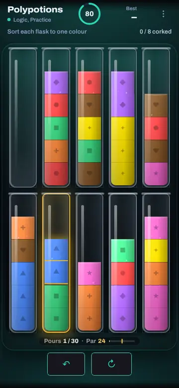
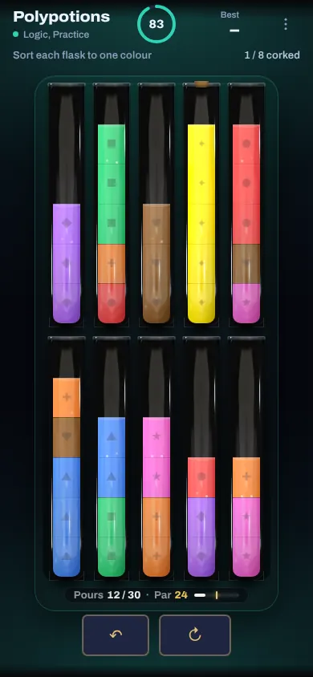
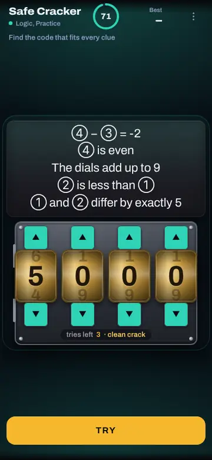
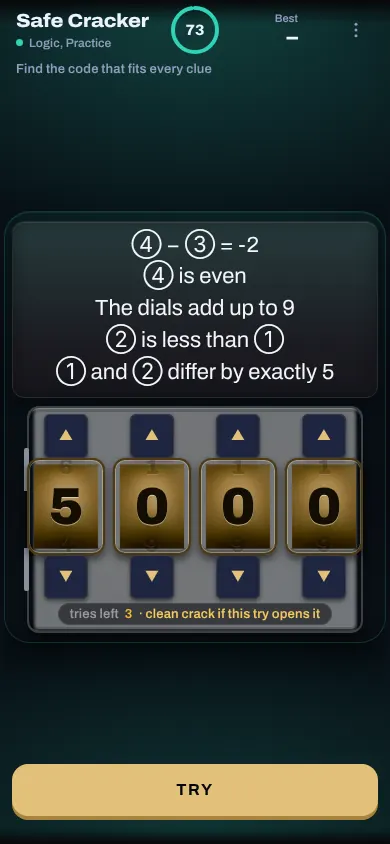
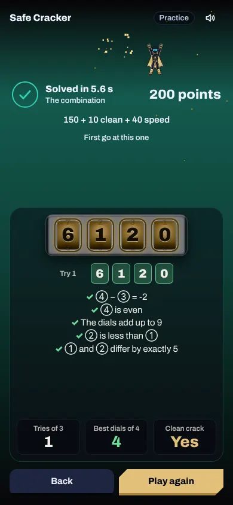
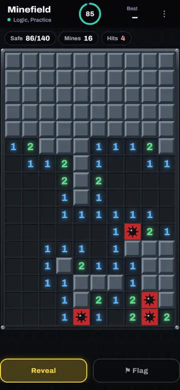

# Logic overhaul, session 1: gallery

Box Six, Polypotions, Hanoi, Safe Cracker, Mosaic, Colour Flood and Minefield (phase 2 step 4). Each stage adds its
section; the newest is first. Frames are 390 × 844 practice rounds drawn by `bun scripts/shots/capture.ts` (Before:
the game reviews' own screenshots of today, `docs/design/game-reviews/img/logic/`).

## Stage 1: the new look and the agreed changes (15 Nov 2026)

Pieces and surfaces are rendered in Blender (Cycles) by `scripts/logic-art/render.py` and exported as 17 WebP sprites
(48 KB in all, `public/logic-art/`); the app lays them out and animates them. Lighting follows Joe's rule of 15 Nov:
one large soft overhead and two broad fills, matte coats, no reflections across panels, tiles or numerals and no
glowing edges. Numerals stay crisp app text, bigger and bolder. Controls are navy with champagne gold, never teal or
bright yellow; every game keeps its own background.

The rendered pieces (the coloured ones are grey shading maps the app tints, so every colour gets the same glass):

| Game | Before (today) | After: playing | After: solved / round end |
|---|---|---|---|
| Box Six |  |  |  |
| Polypotions |  |  |  |
| Hanoi |  |  |  |
| Safe Cracker |  |  |  |
| Mosaic |  |  |  |
| Colour Flood |  |  |  |
| Minefield |  |  |  |

What changed, per game:

- **Box Six**: concept A's lacquered black tiles under B's light, silver box lines, white givens, gold entries; clashes
  show live (the clashing digits turn red and ringed; the per-mistake penalty is unchanged); the goal counts only the
  player's cells ("11 / 22 filled"); missed cells on the reveal show their digit faintly instead of in the givens' colour.
- **Polypotions**: real thin test-tube glass over B's richer liquid, a rendered cork; `tubesRev 3`: Undo gives its
  pour back and Reset gives them all back; an "Out of pours" banner and sound before an unfinished board goes in;
  the reveal reads "24 of 30 pours used".
- **Hanoi**: turned oak posts and plates, a gold plate, candy-glass rings (the rendered glass tinted per ring); an
  illegal post bounces the ring and keeps it lifted.
- **Safe Cracker**: a brushed-steel door, brass drums with inked numerals (the next and last digit kept small and
  faint), navy arrows with gold, a champagne Try; a wrong try marks the clues it broke (✕, red, after a Try only); the
  clean-crack line says "clean crack if this try opens it", then "clean crack is first try only".
- **Mosaic** (a new concept, shown here first): glazed cream ceramic tiles pressed into dark slate wells, bold clue
  numbers; drag to paint, the first square deciding fill, × or clear.
- **Colour Flood**: the merged regions as even enamel, rendered glass paint pots tinted per colour, par beside moves
  everywhere, the round-end board at full width; the help no longer says running out "scores 0".
- **Minefield**: rendered raised silver stone, recessed slate, an iron mine and a cloth flag; bigger, heavier numbers
  with a dark edge instead of a glow; a mine hit pulses dull red instead of flashing white.

Clips of the hero effects (Polypotions' pour above all) come with stage 2, when the effects kit is in.
