# Logic overhaul 2: gallery

Tents and Trees, Shikaku, Lamplighter, Trail, Loopline, Regions and Island Link (phase 2 step 4, 15 Nov 2026). Each
picture is **before | after** at 390 × 844 (practice, the fixed intro example), mid-play and on the answer reveal.

## Stage 1: the new look and the game changes

Every piece and surface is a Blender render (`scripts/logic-art/render.py`, cut by `bun scripts/logic-art.ts` to
`public/logic-art/`, 35 images, about 150 KB): matte and satin materials under even studio light, with no clear coat,
glare or reflection across a tile, panel or number (Joe, 15 Nov 2026). Every number is drawn flat and bold by the game
over the pieces. Each game keeps its own background colours. Controls are navy with champagne gold, never teal.

### Tents and Trees

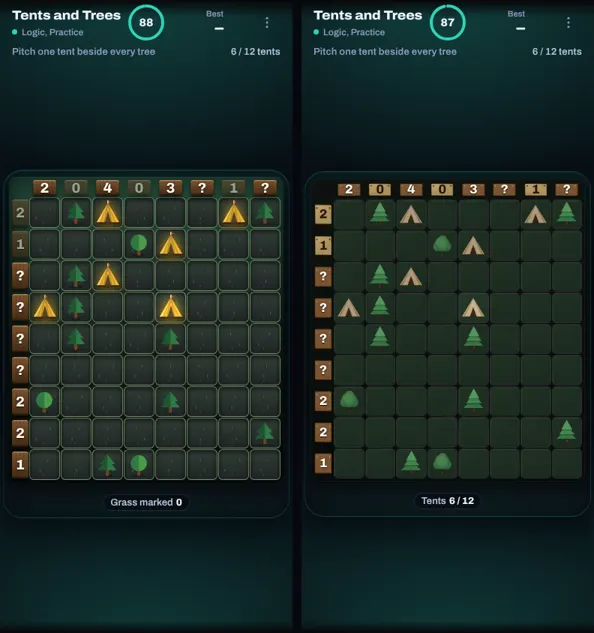
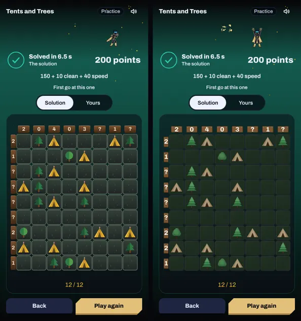

Pine and broadleaf trees, canvas tents (lanterns lit on the solve), turf tiles, wooden signposts that turn to a gold
plaque when their count is met; bigger, bolder counts; a red ring and a line under the board for a tent with no tree
beside it; the pill reads "Tents 6 / 12"; the help explains the "?" signposts.

### Shikaku

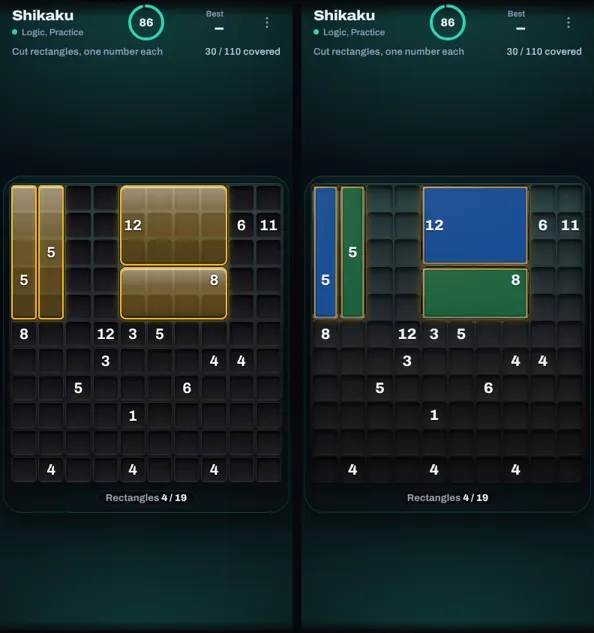
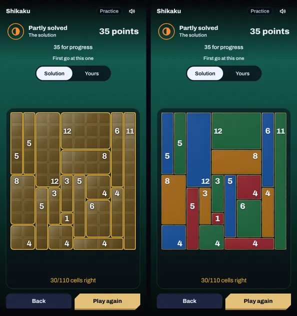
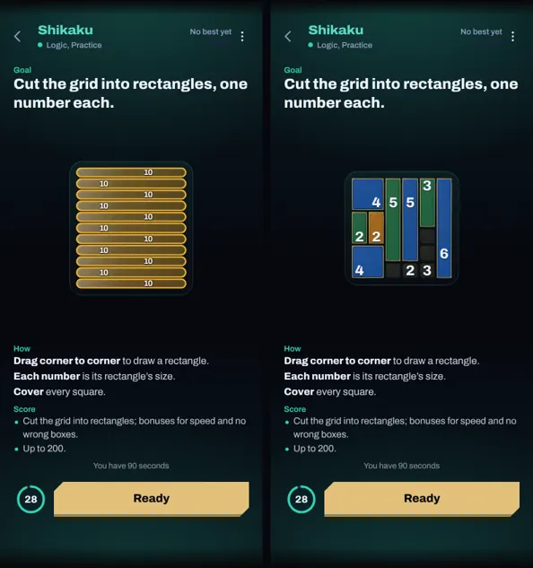

Glass panes in four jewels (sapphire, emerald, amber, ruby), never two alike side by side; the reveal draws each
rectangle in its own colour; a real 6 × 6 intro board with one solution; larger, bolder numbers; the drag outline turns
green when its area matches the number inside; the help says a tap removes a rectangle.

### Lamplighter

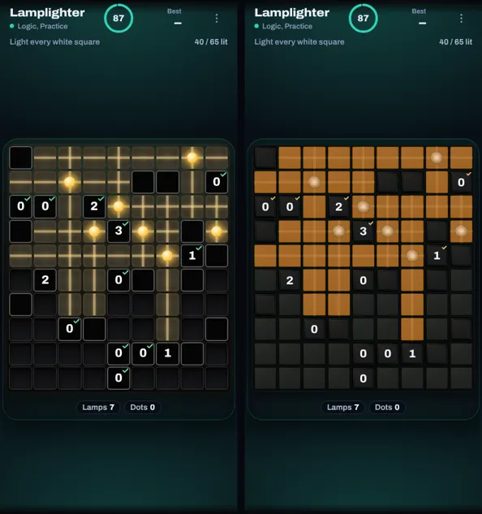
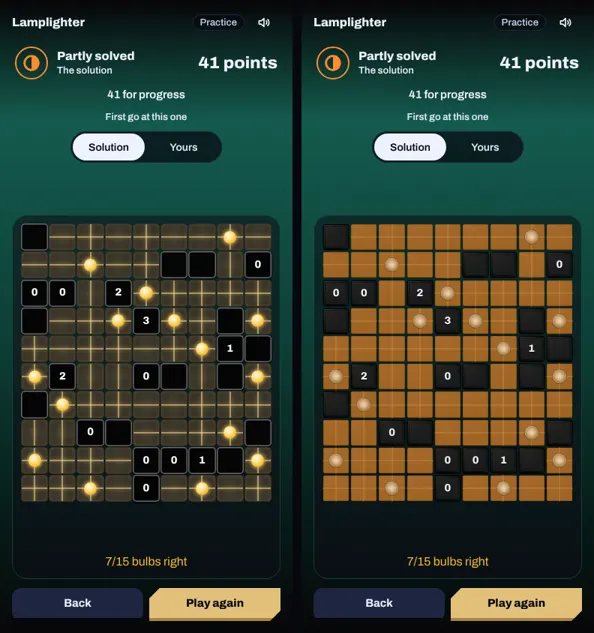

Lit squares fill with warm amber light (the beams stay, quieter), brass bulbs, raised black walls with bold numbers; a
0 is ticked only once every square beside it is lit or dotted; "N squares dark" once six or fewer are left.

### Trail

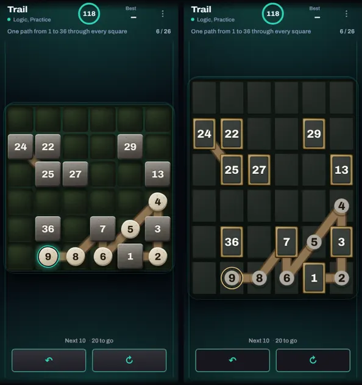
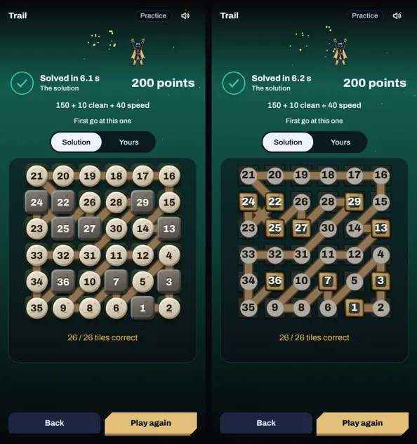

Fixed numbers on gold-edged stone tiles, ceramic path stones, bigger bold numbers; on a phone the squares grow up to a
third taller into the empty band above the controls (up to 90 px a square where there is room). Scoring: each undo
costs 2.5 of the clean bonus (`depthRev 3`).

### Loopline

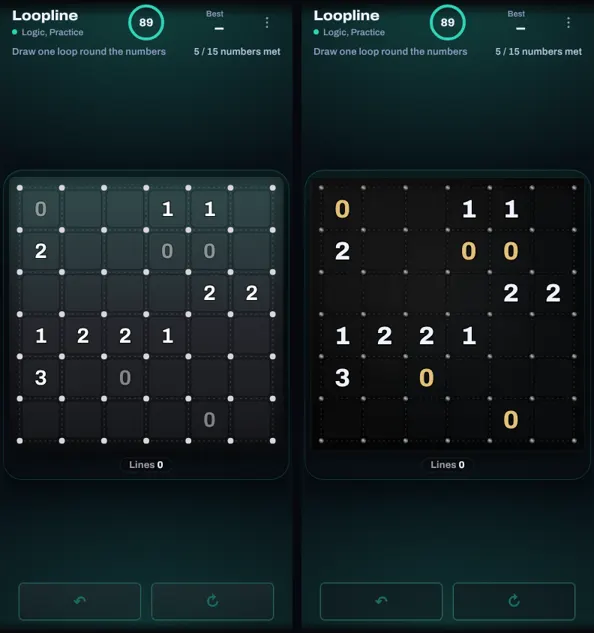

Black slate, silver pegs, a champagne-gold loop; numbers larger and bold; a met number turns gold (it dimmed before).

### Regions

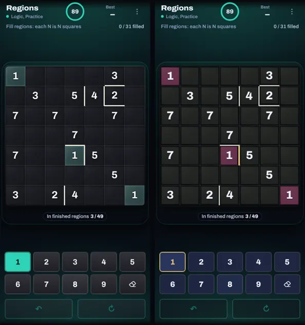

Enamel tiles tinted by region size (two same-size regions can never touch, so neighbours always differ), a finished
region's sides thicker and gold, bold numbers, navy keys with the picked one ringed in gold. Scoring: one drag stroke over
wrong squares is one mistake (`fillominoRev 2`).

### Island Link

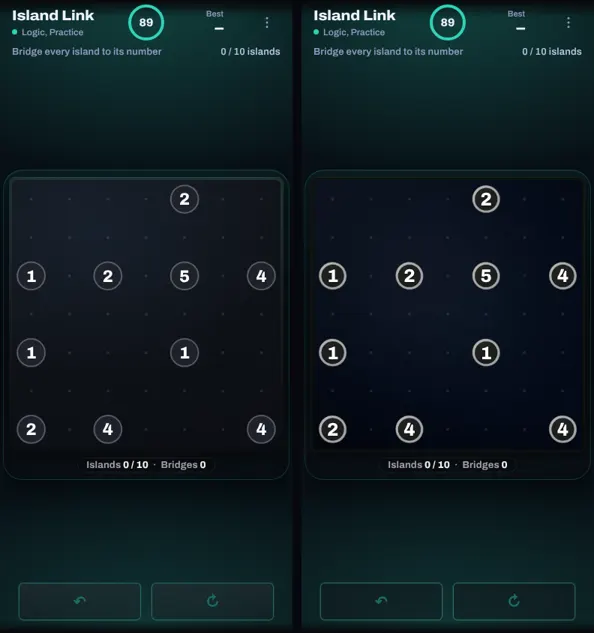

Black enamel coins in silver bezels that turn gold when met, gold rods on today's navy, numbers flat and bold; a tap on a
bridge cycles it (one, two, none); the help says "drag towards an island".

## Stage 2: effects

Waiting for the effects kit (#422) on main.

## Stage 3: levels

Waiting for the difficulty framework on main. Expert boards will be kept only when a person-style solver (every step
deducible, no guessing) completes them and the elite bot finishes most of them (Joe, 15 Nov 2026).

Grids grown downwards so no square falls below about 40 px on a 375 px phone (Joe, 15 Nov 2026), planned and to be
measured when the levels are built: Tents and Trees Expert 8 × 13 (was 10 × 10), Shikaku Expert 9 × 16 (was 12 × 12),
Lamplighter Expert 9 × 14 (was 11 × 11), Island Link Expert 8 × 11 (was 9 × 9). Trail 7 × 7, Loopline 8 × 8 and Regions
8 × 8 fit as they are.
