# Logic overhaul 2: gallery

Tents and Trees, Shikaku, Lamplighter, Trail, Loopline, Regions and Island Link (phase 2 step 4, 15 Nov 2026), at
390 × 844 in practice.

## The look: today, concept A and the new frame

Every piece and surface is a Blender render (`scripts/logic-art/render.py`, cut by `bun scripts/logic-art.ts` to
`public/logic-art/`). Real materials have light on them: glass with a crisp highlight on its rim, glossy enamel and
lacquer with depth, wood with grain, canvas with a woven texture, brushed gold and polished silver, textured slate. There
is no glare across a face and no glowing edge: the studio sky is dark straight above (so a flat top seen from above keeps
its depth and any number on it stays clean) and bright low round the horizon (so bevels, rims and curves catch the
light). The standing pieces (trees, tents) are seen from the front and above, with a soft contact shadow. Every number is
drawn flat and bold by the game. Each picture is **Today | Concept A | New**; Loopline and Island Link show the solved
board (the reveal's Solution view) so the gold wire and rods show.

### Tents and Trees
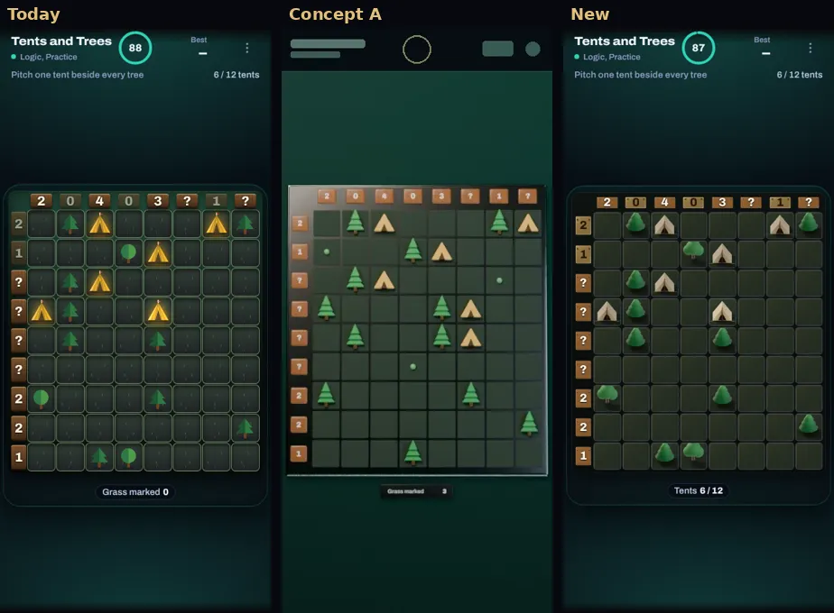

### Shikaku
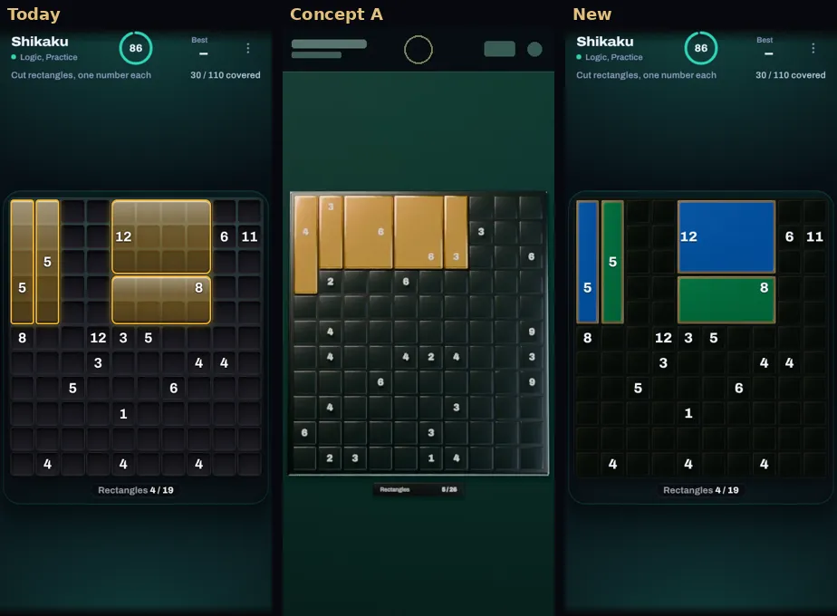

### Lamplighter
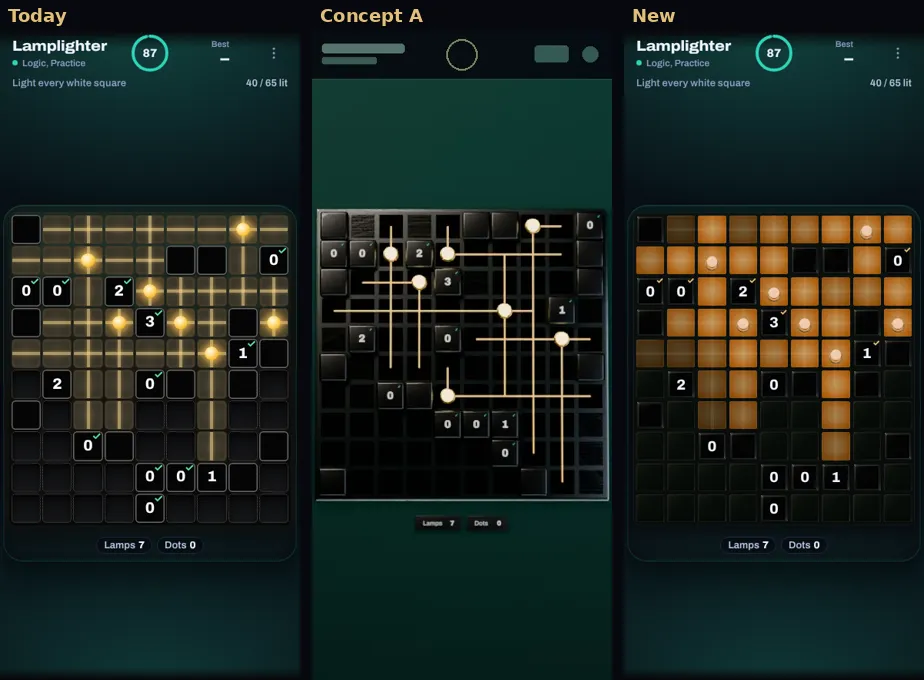

### Trail
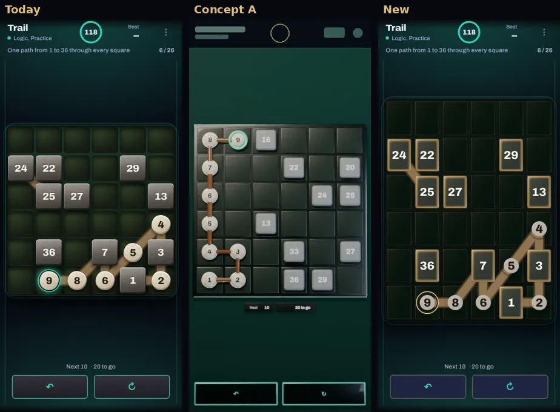

### Loopline
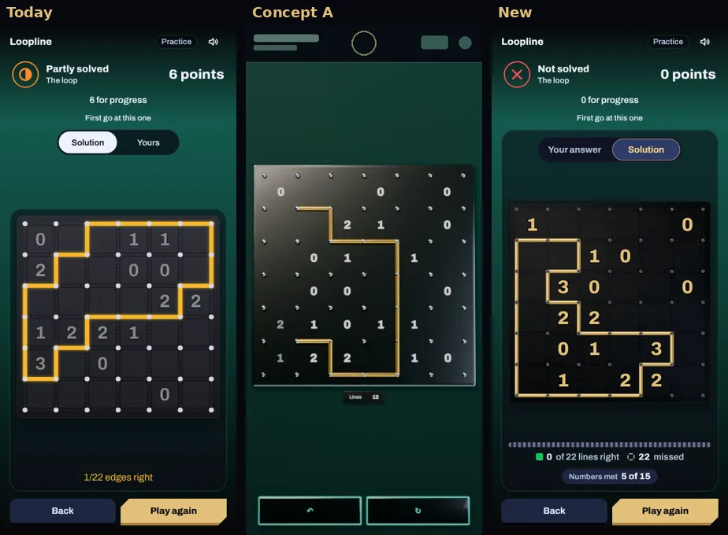

### Regions
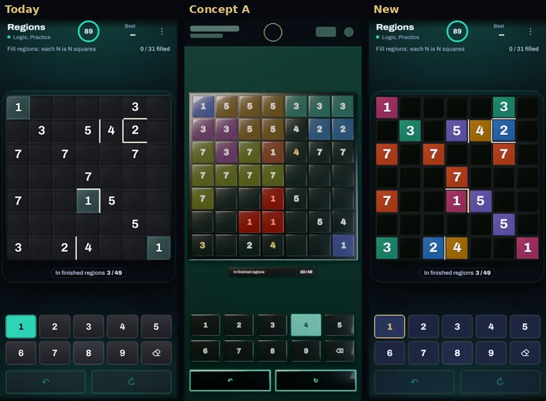

### Island Link
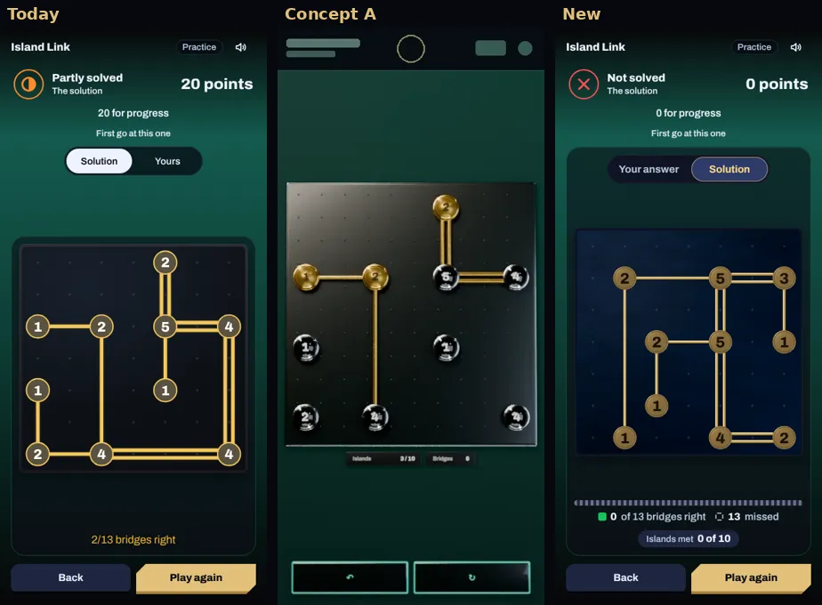

## The answer reveals

Each game's own reveal (`src/puzzles/logic2Reveal.tsx`, inside the shared reveal layout): one large board at a time.
"Your answer" opens first, marked against the solution (wrong pieces ringed red, missed ones as faint dashed ghosts), and
a switch shows the clean "Solution"; a solved round shows "Your solution" with no switch; a Daily or challenge whose
solution is still locked shows only your board. Under the board, a bar and legend ("6 of 12 tents right", wrong,
missed) and plain number chips (signs met, squares lit, numbers met, islands met, how far the path was right, mistakes,
undos). Each picture is **before | after**: a half-played round that ran out of time, then a solved one.

| Game | Timed out (your answer) | Solved |
|---|---|---|
| Tents and Trees | 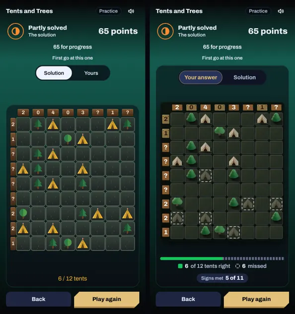 | 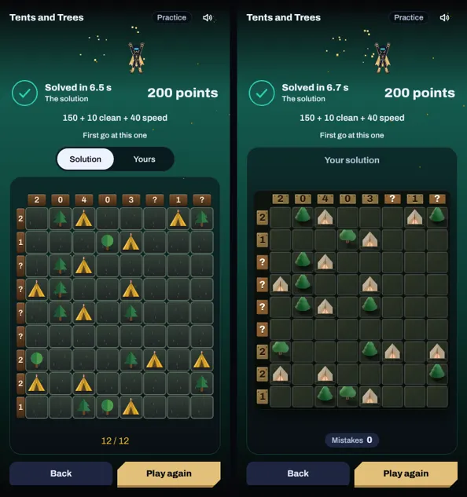 |
| Shikaku | 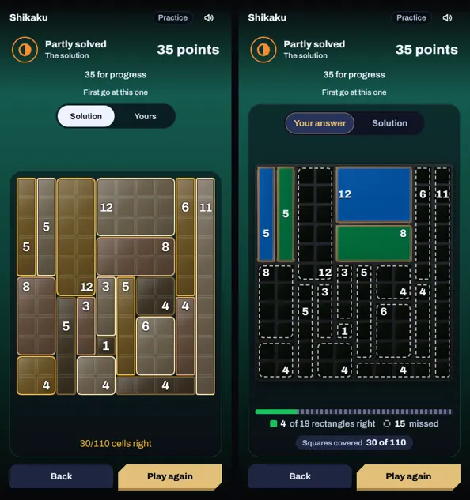 |  |
| Lamplighter | 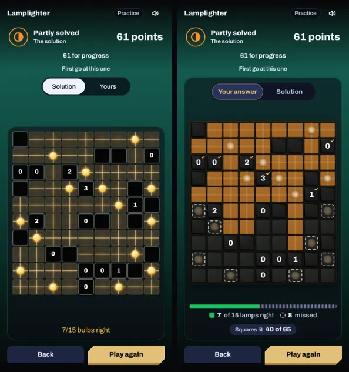 | 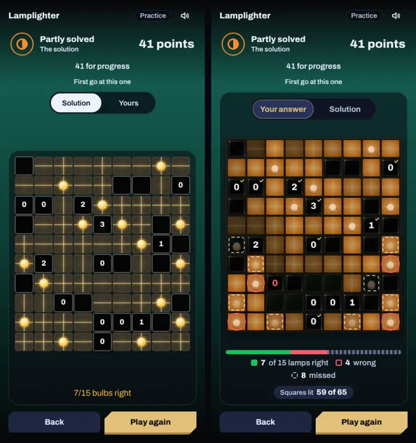 |
| Trail | 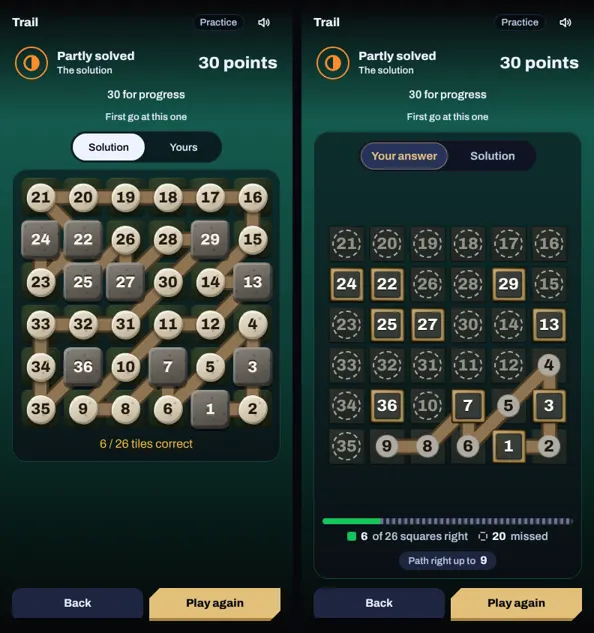 | 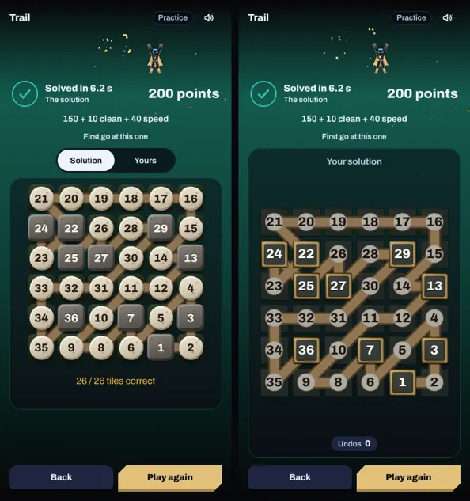 |
| Loopline | 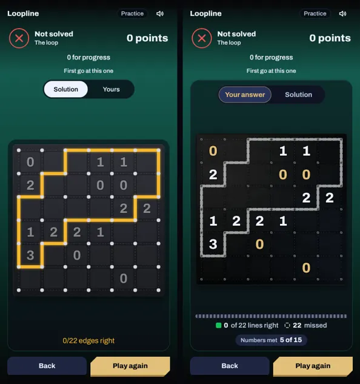 |  |
| Regions | 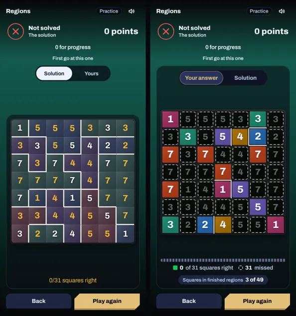 | 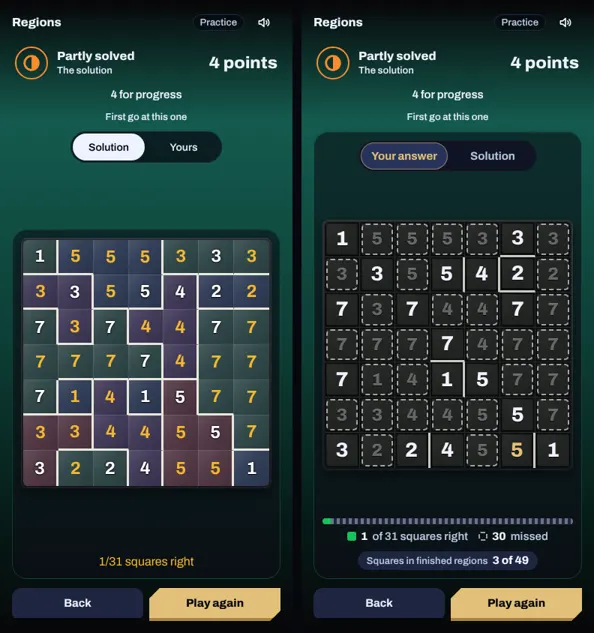 |
| Island Link | 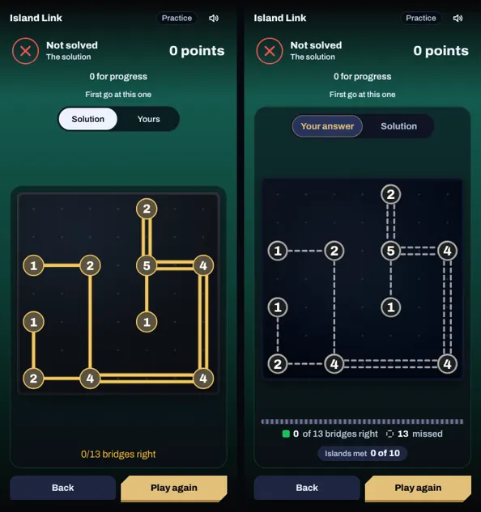 | 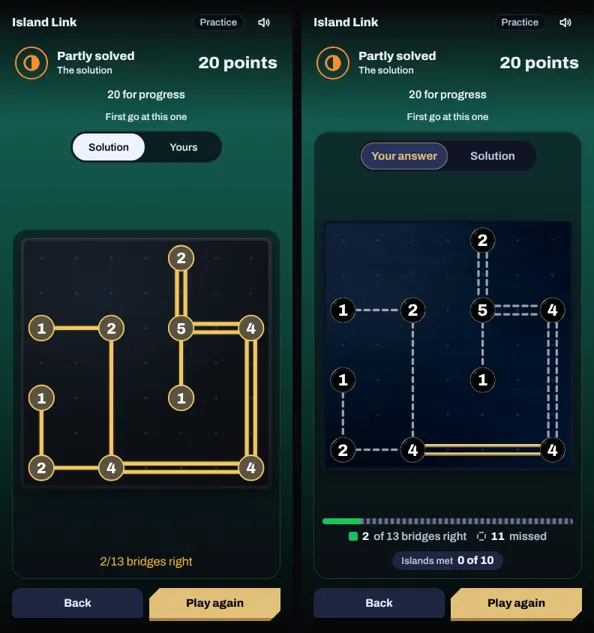 |

## Image budget

Each game's Blender art plus its tile (WebP; 128 px pieces for 2x boards, 640 px slates): Tents and Trees 30 KB,
Shikaku 13 KB, Lamplighter 13 KB, Trail 14 KB, Loopline 10 KB, Regions 26 KB, Island Link 16 KB (86 KB of art for all
seven, plus 33 KB of tiles), far under the 400 KB a game Joe set; logic-overhaul-2-check fails any game over it.

## Stage 2: effects

Waiting for the effects kit (#422) on main.

## Stage 3: levels

Waiting for the difficulty framework on main. Expert boards will be kept only when a person-style solver (every step
deducible, no guessing) completes them and the elite bot finishes most of them (Joe, 15 Nov 2026). Grids planned to grow
downwards so no square falls below about 40 px on a 375 px phone (to be measured when built): Tents and Trees Expert
8 × 13 (was 10 × 10), Shikaku Expert 9 × 16 (was 12 × 12), Lamplighter Expert 9 × 14 (was 11 × 11), Island Link Expert
8 × 11 (was 9 × 9); Trail 7 × 7, Loopline 8 × 8 and Regions 8 × 8 fit as they are.
