# Number overhaul: gallery

Phase 2, step 4 (15 Nov 2026; docs/number-overhaul.md). Today (the game reviews' mid-play frames), the concept Joe chose (A) and the new frame, each at
390 × 844 in practice, mid-play. The pieces and surfaces are rendered in Blender
(`docs/design/number-overhaul/source/`) and drawn by the app with bold Archivo numbers over them.

## Stage 1: the new look and the game changes

| Game | Today | Chosen concept (A) | New |
|---|---|---|---|
| Counterweight |  |  | 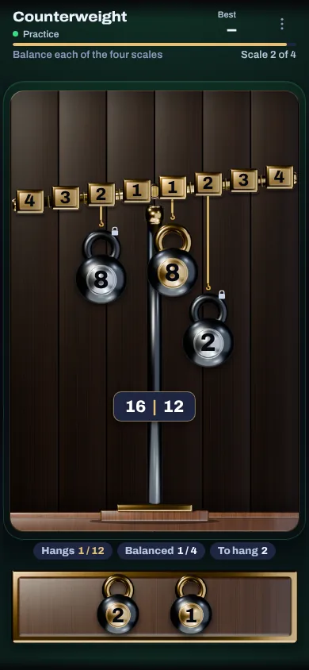 |
| Exact |  |  | 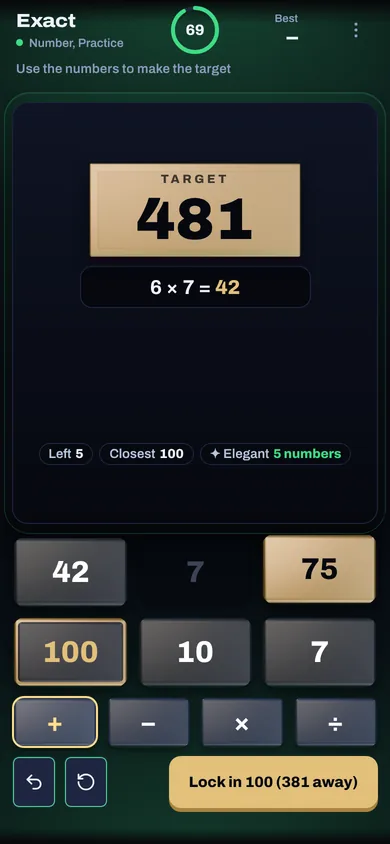 |
| Operator |  |  |  |
| Integer Pyramid |  |  | 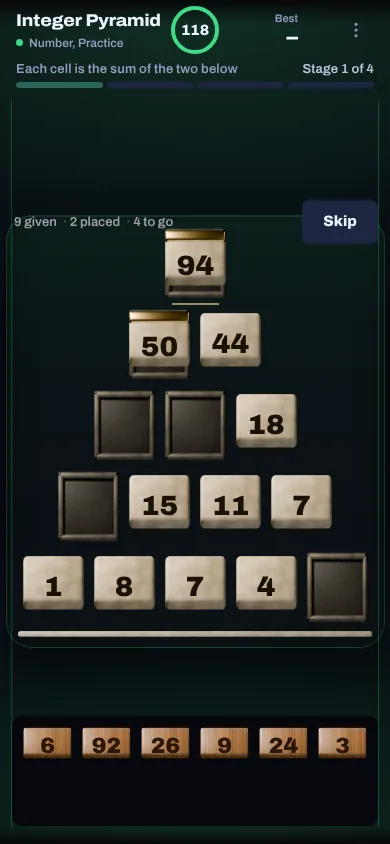 |
| Brimful |  |  |  |
| Checkout |  | 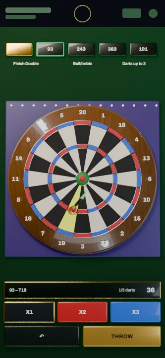 | 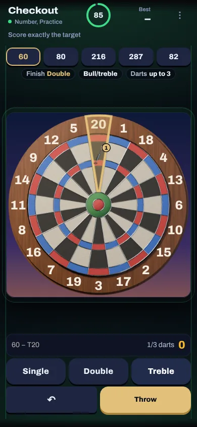 |
| Ballpark |  | 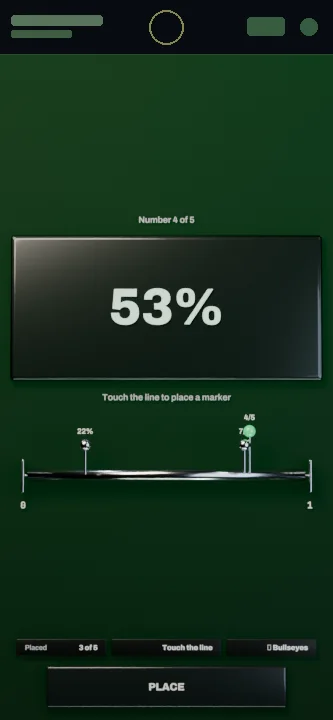 | 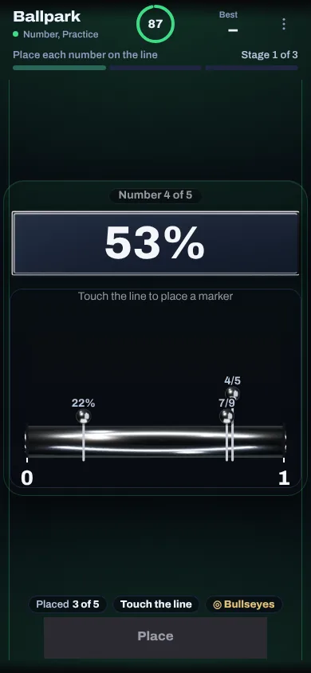 |
| Kakuro |  |  |  |

More frames:

| Checkout's bust (checkoutRev 3) |
|---|
| 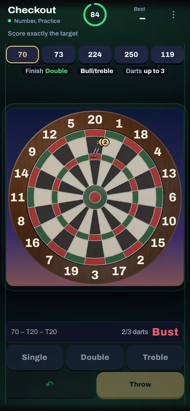 |

Clips (stage 1 plays the existing motion; the effects kit's pour and dart arc come in stage 2):

- [Brimful's pour](clips/measure-pour.mp4)
- [Checkout's dart](clips/checkout-dart.webp)

## The answer reveals

Each game's own reveal, redesigned (Joe, 15 Nov 2026): the solution drawn large, one board at a time with numbered
tabs (right, not right, not reached; it opens on the first not right), Yours against the Solution with what you missed
or got wrong highlighted, short plain labels, the numbers that explain the score as chips, and pictures in place of
text lists (Brimful's moves as jugs, Exact's route as tiles, Checkout's darts as chips, Ballpark's markers joined to
their true spots). Built on `src/components/puzzles/number/RevealParts.tsx`. Before: today's main (Ballpark's from the
game review's round-end frame); after: a part-played practice round at 390 × 844.

| Game | Before | After |
|---|---|---|
| Counterweight |  | 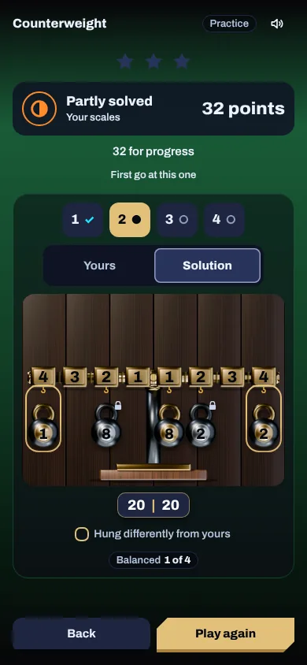 |
| Exact | 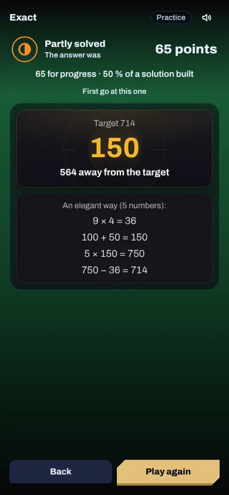 |  |
| Operator |  | 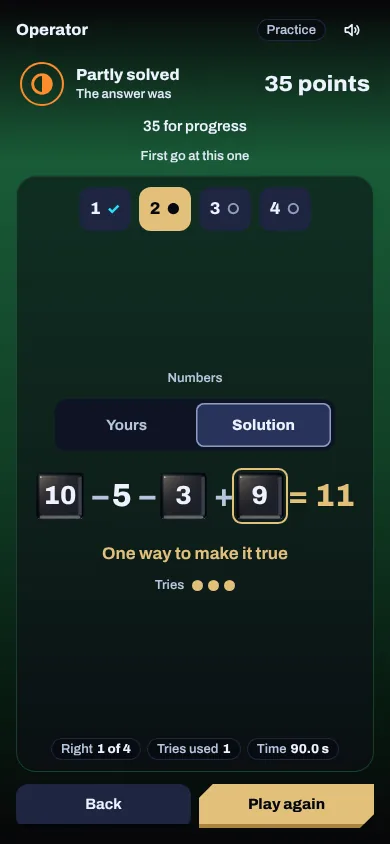 |
| Integer Pyramid |  |  |
| Brimful |  | 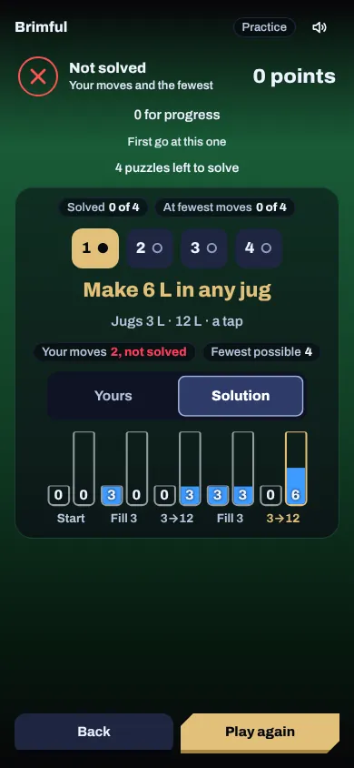 |
| Checkout |  |  |
| Ballpark |  |  |
| Kakuro |  |  |

## Stage 2: effects

To come once the effects kit is on main.

## Stage 3: levels

To come once the level registry is on main.
