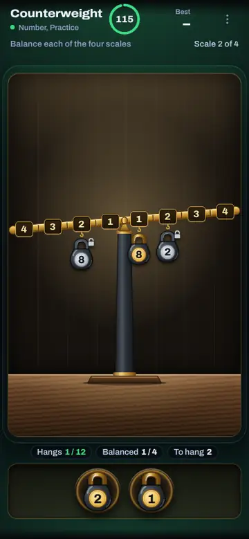
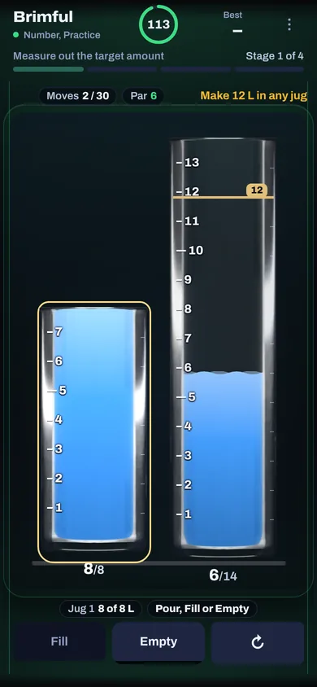
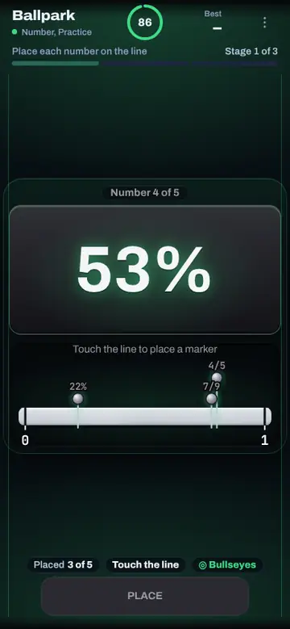
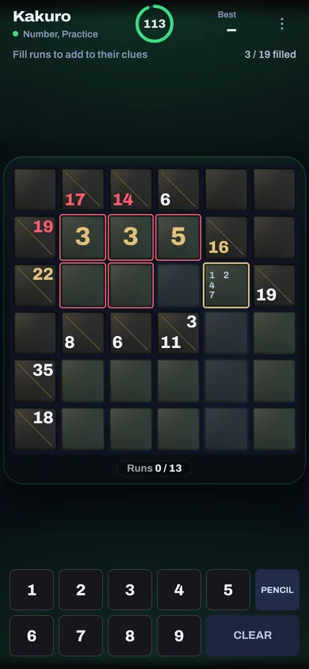

# Number overhaul: gallery

Phase 2, step 4 (15 Nov 2026; docs/number-overhaul.md). Before (the game reviews' mid-play frames) and after, each at
390 × 844 in practice, mid-play. The pieces and surfaces are rendered in Blender
(`docs/design/number-overhaul/source/`) and drawn by the app with bold Archivo numbers over them.

## Stage 1: the new look and the game changes

| Game | Before | After |
|---|---|---|
| Counterweight |  |  |
| Exact |  |  |
| Operator |  |  |
| Integer Pyramid |  |  |
| Brimful |  |  |
| Checkout |  |  |
| Ballpark |  |  |
| Kakuro |  |  |

More frames:

| Checkout's bust (checkoutRev 3) | Brimful's reveal: the best line as jug pictures |
|---|---|
|  |  |

Clips (stage 1 plays the existing motion; the effects kit's pour and dart arc come in stage 2):

- [Brimful's pour](clips/measure-pour.mp4)
- [Checkout's dart](clips/checkout-dart.webp)

## Stage 2: effects

To come once the effects kit is on main.

## Stage 3: levels

To come once the level registry is on main.
