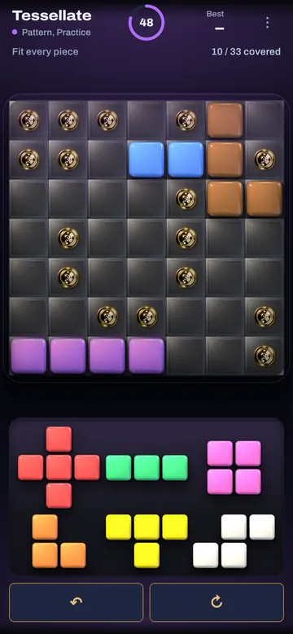
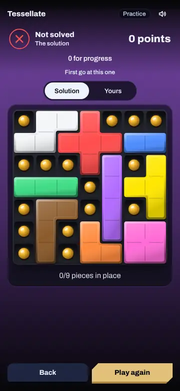

# Pattern overhaul: gallery

Phase 2 step 4 (15 Nov 2026). Before (main) and after for each of the eight Pattern games at 390 × 844, and short
clips of the hero effects. Images are in this folder.

<!-- Each game's section is between its own markers. -->

<!-- gridlock:start -->
## Gridlock
<!-- gridlock:end -->

<!-- tessellate:start -->
## Tessellate

| | Before | After |
|---|---|---|
| Start / intro |  |  |
| Mid-play |  |  |
| Round end |  |  |

- **Look A** in Blender sprites (`public/pattern-art/blockparty/`, source `docs/design/game-art/pattern/source/blockparty.py`):
  brass studs for the pegs, satin recesses for the free squares, a glossy lacquered block for every square of a piece
  in today's nine colours, on a dark slab and tray. One image per board cell, exactly the cell's box (no hit area moved).
- **A double tap only flips**: a tap's turn waits out the 260 ms double-tap window, so the piece never turns first.
- **Undo and Reset** (blockRev 4), navy with champagne-gold icons: Undo gives the last move back, Reset sends every
  piece to the tray (Undo brings the board back).
- **Clean drops** (blockRev 4): moving a placed piece no longer costs the bonus; only a drop where a piece won't fit
  does (one piece's share each).
- **Help**: the flip, Undo and Reset are explained; "Drag a piece's anchor" is gone.
- **Reveal**: the player's count reads "You: 0/9 pieces in place", so under Solution it never reads as the solution's.
- **Tray**: the widest piece fits its own column (a four-long bar used to run over its neighbour once pieces were placed).
- **Sounds**: pick-up, illegal drop (a dull thud as the piece goes back; it was silent), Undo and Reset now sound.
<!-- tessellate:end -->

<!-- pipeline:start -->
## Pipeline
<!-- pipeline:end -->

<!-- chroma:start -->
## Chroma Lines
<!-- chroma:end -->

<!-- skid:start -->
## Skid
<!-- skid:end -->

<!-- heave:start -->
## Heave
<!-- heave:end -->

<!-- lightbender:start -->
## Lightbender
<!-- lightbender:end -->

<!-- topsy:start -->
## Topsy-Turvy
<!-- topsy:end -->
