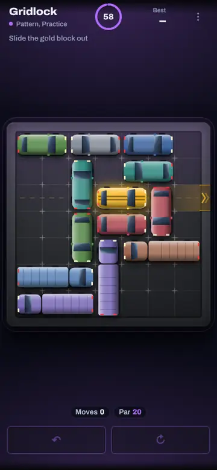
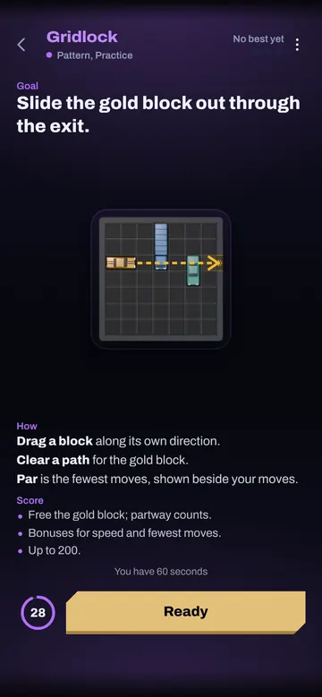
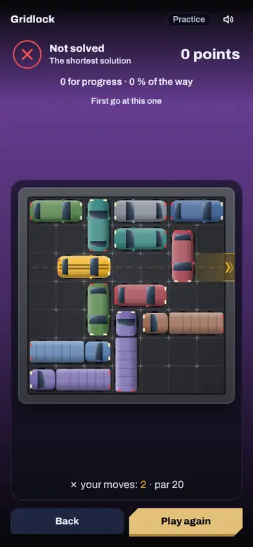

# Pattern overhaul: gallery

Phase 2 step 4 (15 Nov 2026). Before (main) and after for each of the eight Pattern games at 390 × 844, and short
clips of the hero effects. Images are in this folder.

<!-- Each game's section is between its own markers. -->

<!-- gridlock:start -->
## Gridlock

| Before (main) | After |
|---|---|
|  |  |
|  |  |
|  |   |

- **Look (A):** the cars and the lot are Blender renders (`docs/design/game-art/pattern/source/unblock.py`,
  `public/pattern-art/unblock/`): glossy painted toy cars in six muted bodies (blue, teal, red, violet, green, silver),
  2-long saloons and 3-long vans, each rendered horizontal and vertical so the light stays top left; the gold car is the
  only gold thing on the lot (metallic gold with dark pinstripes). The dark lot (kerb, asphalt, worn bay lines) is one
  render; the exit's gold dash and chevrons stay drawn over it. Every image is exactly its vehicle box. No glows.
- **Controls:** Undo and Reset in champagne gold on navy (`--jz-gold`, `--jz-surface-2`).
- **Undo gives the move back (unblockRev 4):** Moves, the par bonus and the stored figure count the slides left on the
  board; the help says so. Older stamps grade as before.
- **Reveal:** under Solution only "Par n" shows; "your moves" is on Yours, which shows the player's real final board,
  unfinished too (the after shot: one slide played, then the clock ran out).
- **Sound:** a short / long scrape by distance (`unblock.slide`, `unblock.slideLong`), a knock when a drag hits the car
  in the way (`unblock.blocked`), a glint when the gold car's lane opens (`unblock.laneClear`); the drive-out is kept.
<!-- gridlock:end -->

<!-- tessellate:start -->
## Tessellate
<!-- tessellate:end -->

<!-- pipeline:start -->
## Pipeline
<!-- pipeline:end -->

<!-- chroma:start -->
## Chroma Lines
<!-- chroma:end -->

<!-- skid:start -->
## Skid

| Before (main) | After |
|---|---|
|  |  |
|  |  |
|  |   |

- **Look (A):** every piece is a Blender render (`docs/design/game-art/pattern/source/iceslide.py`,
  `public/pattern-art/iceslide/`, 13 images, 31 KB): a pale frosted ice sheet with faint frost lines between squares,
  dark granite blocks, a glossy deep-blue ball (90 % of a square, was 92 % in CSS), round black holes with a crushed-ice
  rim, a magenta and a teal portal pair (enamel rings round a dark well; the second pair was orange, too near the gold
  exit), a bold navy chevron on a frosted plate per direction, grey thin ice with white cracks, a jagged broken hole,
  and the gold exit plate with its door-and-arrow mark. Each image is exactly its cell. The old CSS sheet's glints,
  sheen, scratches, the exit's pulsing glow and the ball's glow are gone.
- **Controls:** the arrow pad, Undo and Reset in champagne gold on navy (`--jz-gold`, `--jz-surface-2`).
- **Undo gives the slide back (slideRev 5):** the Slides pill, the par bonus and the stored figure count the slides
  still standing; unfinished credit still counts every slide played (wandering and undoing never earns credit). The help
  says so, and that the arrow pad or swipe is chosen in the game menu (⋮) or Settings → Game controls. Older stamps
  grade as before.
- **A slide into a wall** still does nothing and costs nothing; it now gives a tiny bump (`iceslide.bump`).
- **Near the exit:** resting one slide from the exit with the finish still at par, the exit glows softly
  (`iceslide.nearExit`).
- **Reveal:** a Solution / Yours switch: "shortest route · n slides" under Solution; under Yours the player's own final
  board (the ball where it stopped, the standing route, the ice it broke) and "your slides: n · par p" (the after shot:
  three slides standing, then the clock ran out).
- **Sound:** a short or long ice hiss by distance (`iceslide.slide`, `iceslide.slideLong`), a thump when the ball
  stops (`iceslide.stop`), the bump and the near-exit shimmer; crack, portal, fall and the exit shatter kept.
<!-- skid:end -->

<!-- heave:start -->
## Heave
<!-- heave:end -->

<!-- lightbender:start -->
## Lightbender
<!-- lightbender:end -->

<!-- topsy:start -->
## Topsy-Turvy
<!-- topsy:end -->
