# Pattern overhaul: gallery

Phase 2 step 4 (15 Nov 2026). Before (main) and after for each of the eight Pattern games at 390 × 844, and short
clips of the hero effects. Images are in this folder.

<!-- Each game's section is between its own markers. -->

<!-- gridlock:start -->
## Gridlock

| Before (main) | After |
|---|---|
|  |  |
|  |  |

**The answer reveal** (390 × 844, the same deal and answers on main and the branch: a solve with one slide undone, and
an unfinished third of the line):

| | Before (main) | After |
|---|---|---|
| Solved, Solution | 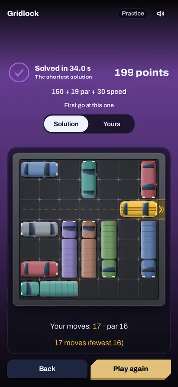 | 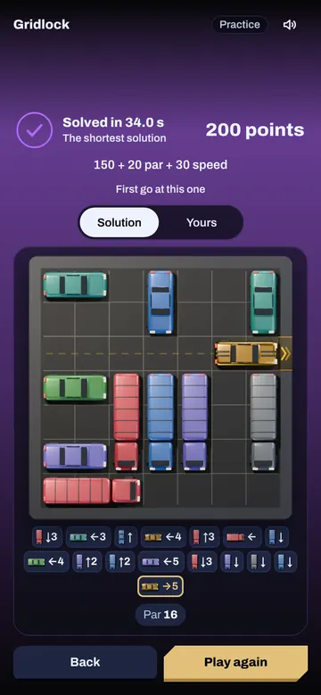 |
| Solved, Yours |  |  |
| Unfinished, Solution | 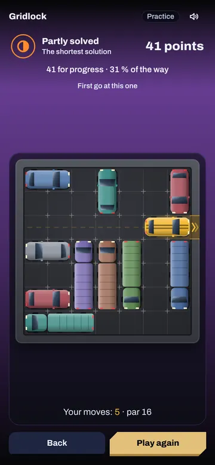 (no Yours side) |  |
| Unfinished, Yours | — | 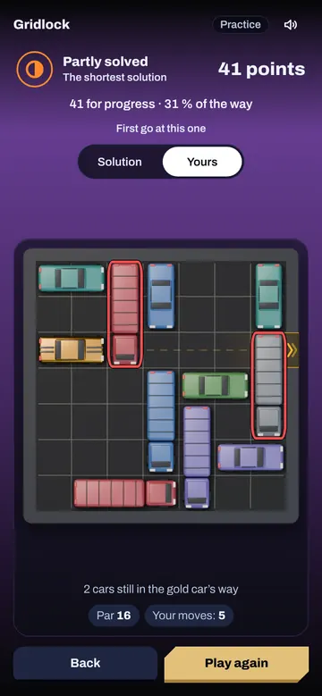 |

- **Look (A):** the cars and the lot are Blender renders (`docs/design/game-art/pattern/source/unblock.py`,
  `public/pattern-art/unblock/`): glossy painted toy cars in six muted bodies (blue, teal, red, violet, green, silver),
  2-long saloons and 3-long vans, each rendered horizontal and vertical so the light stays top left; the gold car is the
  only gold thing on the lot (metallic gold with dark pinstripes). The dark lot (kerb, asphalt, worn bay lines) is one
  render; the exit's gold dash and chevrons stay drawn over it. Every image is exactly its vehicle box. No glows.
- **Controls:** Undo and Reset in champagne gold on navy (`--jz-gold`, `--jz-surface-2`).
- **Undo gives the move back (unblockRev 4):** Moves, the par bonus and the stored figure count the slides left on the
  board; the help says so. Older stamps grade as before.
- **Reveal:** the shortest solution large and playing back, with the par route under it as a strip of move chips (each
  the car's own sprite, its way and its bays, the move just played lit gold); Yours is the player's real final board,
  unfinished too, with the cars still in the gold car's lane outlined red and counted ("2 cars still in the gold car's
  way"); the key numbers as pills from the stored grade: Par under both, "Your moves" and "Time left" under Yours only.
  On main the solve with an undone slide read 17 moves (199); on unblockRev 4 it is 16 (200).
- **Words:** the help, the intro, the frame's goal line and the two challenges say "car", not "block".
- **Sound:** a short / long scrape by distance (`unblock.slide`, `unblock.slideLong`), a knock when a drag hits the car
  in the way (`unblock.blocked`), a glint when the gold car's lane opens (`unblock.laneClear`); the drive-out is kept.
<!-- gridlock:end -->

<!-- tessellate:start -->
## Tessellate

| | Before | After |
|---|---|---|
| Start / intro |  | 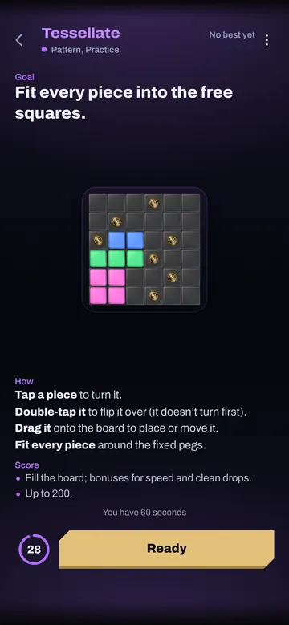 |
| Mid-play |  |  |
| Round end |  |  |

- **Look A** in Blender sprites (`public/pattern-art/blockparty/`, source `docs/design/game-art/pattern/source/blockparty.py`):
  brass studs for the pegs, satin recesses for the free squares, a glossy lacquered block for every square of a piece
  in today's nine colours, on a dark slab and tray. One image per board cell, exactly the cell's box (no hit area moved).
- **A double tap only flips**: a tap's turn waits out the 260 ms double-tap window, so the piece never turns first.
- **Undo and Reset** (blockRev 4), navy with champagne-gold icons: Undo gives the last move back, Reset sends every
  piece to the tray (Undo brings the board back).
- **Clean drops** (blockRev 4): moving a placed piece no longer costs the bonus; only a drop where a piece won't fit
  does (one piece's share each).
- **Help**: the flip, Undo and Reset are explained; "Drag a piece's anchor" is gone.
- **Reveal**: the player's count reads "You: 0/9 pieces in place", so under Solution it never reads as the solution's.
- **Tray**: the widest piece fits its own column (a four-long bar used to run over its neighbour once pieces were placed).
- **Sounds**: pick-up, illegal drop (a dull thud as the piece goes back; it was silent), Undo and Reset now sound.
<!-- tessellate:end -->

<!-- pipeline:start -->
## Pipeline

| | Before (main) | After |
|---|---|---|
| Start / intro | 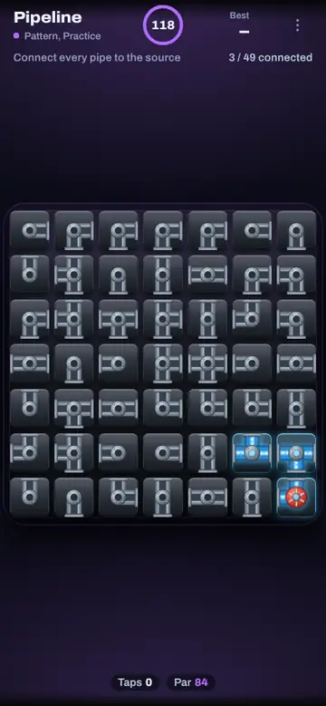 |  |
| Mid-play | 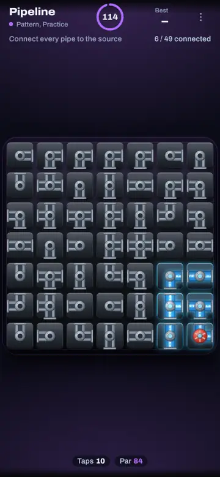 | 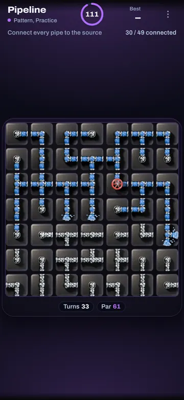 |
| Reveal |  | 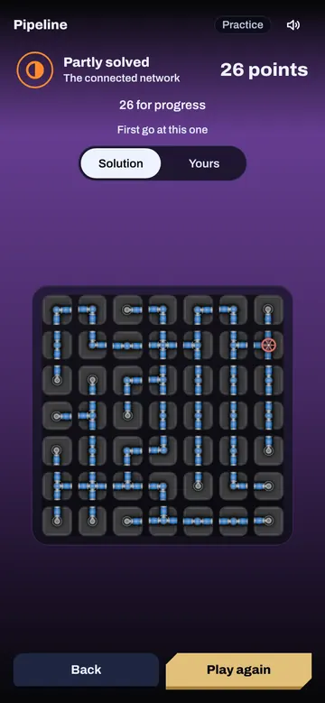 |

- **Look**: Blender sprites (`docs/design/game-art/pattern/source/pipes.py`, `public/pattern-art/pipes/`, 13 files,
  55 KB): chrome pipes on dark tiles, each shape (end, straight, corner, tee, cross) rendered dry (plain chrome) and wet
  (blue water in sight-glass runs), turned by a CSS transform under even overhead light; the red source valve; no glow
  round the network (batch P's blue tile rims and drop shadows removed).
- **Leaks live** (pipesRev 5): water spills from every open end the water reaches, in play, the intro and the reveal.
- **Turns both ways** (pipesRev 5): a tap turns clockwise, a long press (380 ms), a swipe (14 px) or a right click
  anticlockwise; the log carries `-cell`; par is the fewest turns either way.
- **Turns / Par** sit directly under the board (were at the screen's bottom with a gap).
- **Reveal**: the player's line is Yours-only ("You: 12 / 49 connected"), no "×".
- **Sounds**: `pipes.combo` (6+ joined), `pipes.drain` (a turn that cuts pipes off), `pipes.bubble` (the source on the
  solve) added on library placeholders; `pipes.rotate` fires for both directions.
<!-- pipeline:end -->

<!-- chroma:start -->
## Chroma Lines

| Before (main) | After |
|---|---|
|  | 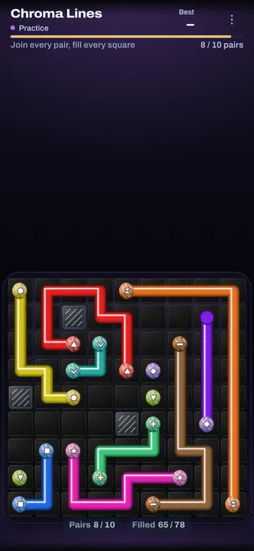 |
|  |  |
|  |  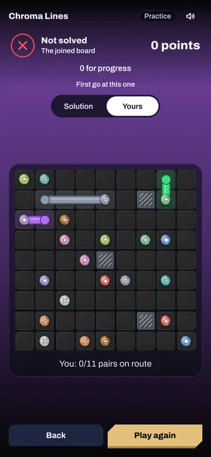 |

- **Look (A):** every dot is a glossy marble bead rendered in Blender (one per colour, `public/pattern-art/flow/`),
  each with its own white symbol so white/silver and yellow/lime are told apart; walls are hatched steel blocks, cells
  dark recessed slots; the lines keep their vivid colours as rich tubes with no glow.
- **flowRev 3:** drawing over another colour cuts that line back to the square before the crossing (the server grades
  the board by the same rule); a stray touch on a finished dot no longer wipes its line (only a drag restarts it).
- **Pills:** "Pairs 0 / 11" beside "Filled 8 / 78".
- **Reveal:** the player's own count reads "You: 0/11 pairs on route" and shows only under Yours.
- **Sound:** the line's tone rises as it grows (`flow.draw`), a cut (`flow.cut`), one sound for a join
  (`flow.connect`, the extra `correct` dropped), a near-miss hint (`flow.nearMiss`) and the solve (`flow.solve`).
<!-- chroma:end -->

<!-- skid:start -->
## Skid

| Before (main) | After |
|---|---|
| 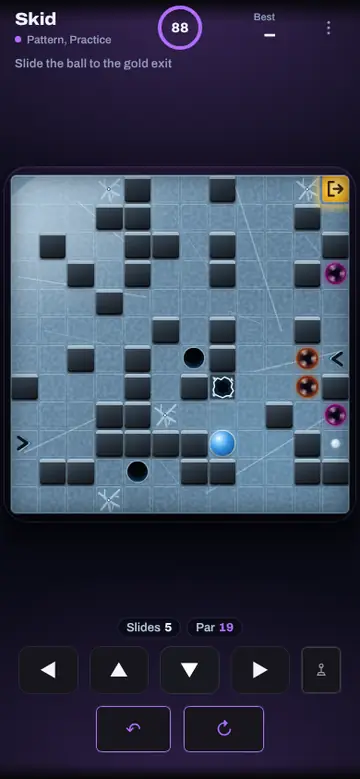 |  |
|  |  |
| 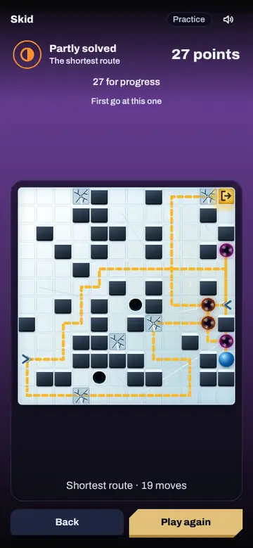 | 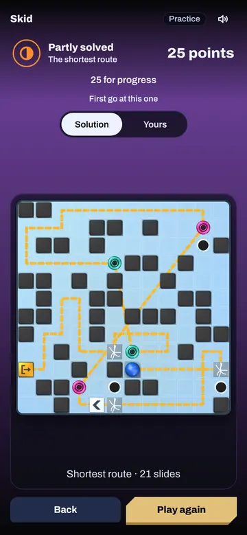 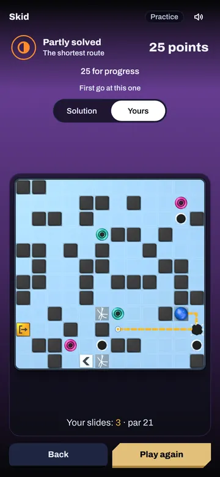 |

- **Look (A):** every piece is a Blender render (`docs/design/game-art/pattern/source/iceslide.py`,
  `public/pattern-art/iceslide/`, 13 images, 31 KB): a pale frosted ice sheet with faint frost lines between squares,
  dark granite blocks, a glossy deep-blue ball (90 % of a square, was 92 % in CSS), round black holes with a crushed-ice
  rim, a magenta and a teal portal pair (enamel rings round a dark well; the second pair was orange, too near the gold
  exit), a bold navy chevron on a frosted plate per direction, grey thin ice with white cracks, a jagged broken hole,
  and the gold exit plate with its door-and-arrow mark. Each image is exactly its cell. The old CSS sheet's glints,
  sheen, scratches, the exit's pulsing glow and the ball's glow are gone.
- **Controls:** the arrow pad, Undo and Reset in champagne gold on navy (`--jz-gold`, `--jz-surface-2`).
- **Undo gives the slide back (slideRev 5):** the Slides pill, the par bonus and the stored figure count the slides
  still standing; unfinished credit still counts every slide played (wandering and undoing never earns credit). The help
  says so, and that the arrow pad or swipe is chosen in the game menu (⋮) or Settings → Game controls. Older stamps
  grade as before.
- **A slide into a wall** still does nothing and costs nothing; it now gives a tiny bump (`iceslide.bump`).
- **Near the exit:** resting one slide from the exit with the finish still at par, the exit glows softly
  (`iceslide.nearExit`).
- **Reveal:** a Solution / Yours switch: "shortest route · n slides" under Solution; under Yours the player's own final
  board (the ball where it stopped, the standing route, the ice it broke) and "your slides: n · par p" (the after shot:
  three slides standing, then the clock ran out).
- **Sound:** a short or long ice hiss by distance (`iceslide.slide`, `iceslide.slideLong`), a thump when the ball
  stops (`iceslide.stop`), the bump and the near-exit shimmer; crack, portal, fall and the exit shatter kept.
<!-- skid:end -->

<!-- heave:start -->
## Heave

| Before (main) | After |
|---|---|
|  |  |
|  |  |
| 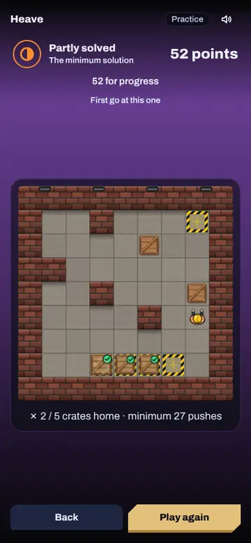 |  |

- **Look (A):** every tile and piece is a Blender render, one cell each (`docs/design/game-art/pattern/source/push.py`,
  `public/pattern-art/push/`, 10 WebPs, 35 KB): brick wall tops whose courses run on from cell to cell, worn stone
  flags, dark painted marks with light tape corners, wooden crates, and the gold crate and gold mark in real gold. The
  worker (white hard hat, orange hi-vis vest, navy arms reaching to push) is rendered once per facing, so the light
  stays top left as it turns. A crate on a mark carries a bold green tick; no glows anywhere.
- **Pushes and Par** are the pills during play (Pushes red once over par); par is the fewest pushes, looked up on the
  phone from the dealt layout (`pushPar.ts`, a count only, never the route). The Moves pill made way for it.
- **Undo** always gave the push back; the help now says so, and where the arrows / swipe choice lives.
- **Controls:** Undo and Reset in champagne gold on navy.
- **Reveal:** under the minimum solution playing back, the player's own count reads "You: 0 / 5 home".
- **Sound:** the gold crate pushed off its mark (`push.goldOff`), a slot for the deadlock creak (`push.stuck`), and
  lines for the footstep, the crate's scrape and the lights coming on at the solve.
- No stamp: nothing Heave deals or grades changed.
<!-- heave:end -->

<!-- lightbender:start -->
## Lightbender
<!-- lightbender:end -->

<!-- topsy:start -->
## Topsy-Turvy
<!-- topsy:end -->
