# Pattern overhaul: gallery

Phase 2 step 4 (15 Nov 2026). Before (main) and after for each of the eight Pattern games at 390 × 844, and short
clips of the hero effects. Images are in this folder.

<!-- Each game's section is between its own markers. -->

<!-- gridlock:start -->
## Gridlock

**Today | concept A | new** (play, the same scale):

| Today (main) | Concept A (PR #429) | New |
|---|---|---|
|  |  |  |

The richness pass (sprite.py's rich studio light): glossy lacquered bodies with a clear-coat highlight on their rounded
edges, dark reflective glass, cabins and lamps, the gold car metallic with a glint on its curves; deeper muted bodies
(none near gold); a near-black asphalt lot. Against the concept: the same top-down toy cars, our gold car brighter and
unmistakable (the concept's was mustard), no glowing lamps, the exit kept as gold markings.

| Before (main) | After |
|---|---|
|  |  |
|  |  |

**The answer reveal** (390 × 844, the same deal and answers on main and the branch: a solve with one slide undone, and
an unfinished third of the line):

| | Before (main) | After |
|---|---|---|
| Solved, Solution |  |  |
| Solved, Yours | 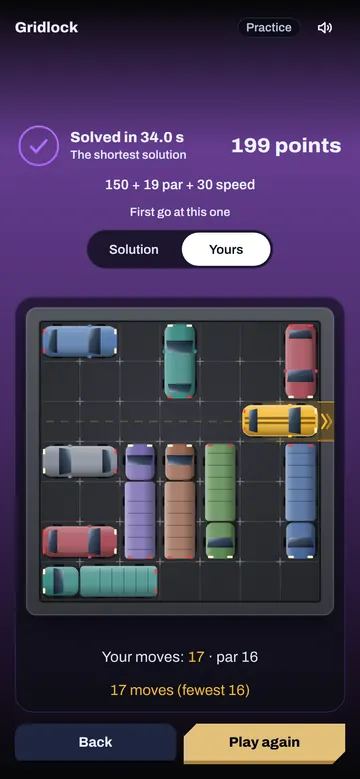 |  |
| Unfinished, Solution |  (no Yours side) | 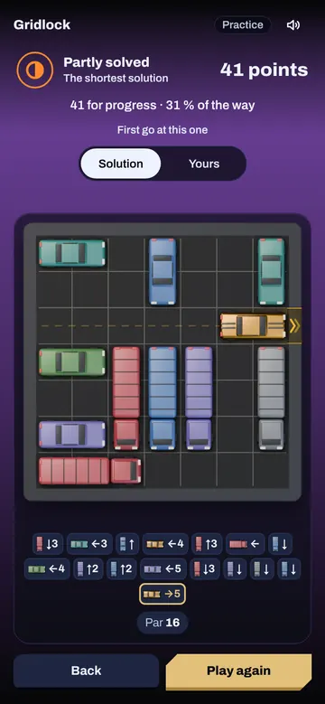 |
| Unfinished, Yours | — |  |

- **Look (A):** the cars and the lot are Blender renders (`docs/design/game-art/pattern/source/unblock.py`,
  `public/pattern-art/unblock/`): glossy painted toy cars in six muted bodies (blue, teal, red, violet, green, silver),
  2-long saloons and 3-long vans, each rendered horizontal and vertical so the light stays top left; the gold car is the
  only gold thing on the lot (metallic gold with dark pinstripes). The dark lot (kerb, asphalt, worn bay lines) is one
  render; the exit's gold dash and chevrons stay drawn over it. Every image is exactly its vehicle box. No glows.
- **Controls:** Undo and Reset in champagne gold on navy (`--jz-gold`, `--jz-surface-2`).
- **Undo gives the move back (unblockRev 4):** Moves, the par bonus and the stored figure count the slides left on the
  board; the help says so. Older stamps grade as before.
- **Reveal:** the shortest solution large and playing back, with the par route under it as a strip of move chips (each
  the car's own sprite, its way and its bays, the move just played lit gold); Yours is the player's real final board,
  unfinished too, with the cars still in the gold car's lane outlined red and counted ("2 cars still in the gold car's
  way"); the key numbers as pills from the stored grade: Par under both, "Your moves" and "Time left" under Yours only.
  On main the solve with an undone slide read 17 moves (199); on unblockRev 4 it is 16 (200).
- **Words:** the help, the intro, the frame's goal line and the two challenges say "car", not "block".
- **Sound:** a short / long scrape by distance (`unblock.slide`, `unblock.slideLong`), a knock when a drag hits the car
  in the way (`unblock.blocked`), a glint when the gold car's lane opens (`unblock.laneClear`); the drive-out is kept.
<!-- gridlock:end -->

<!-- tessellate:start -->
## Tessellate

**The look: today | concept A | new** (mid-play, same scale)

| Today | Concept A | New |
|---|---|---|
|  |  |  |

The richness pass (sprite.py's rich studio): polished brass studs with a mirror highlight on the dome, lacquered
blocks with a hard clear coat (one crisp highlight on the bevel, depth down the sides, today's saturated colours: the
pieces render on the Standard view transform at a lower key, since AgX turned them pastel), satin recessed wells.

| | Before | After |
|---|---|---|
| Start / intro |  |  |
| Mid-play |  |  |
| Round end |  | 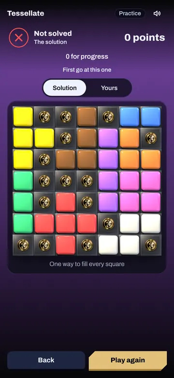 |

**The answer reveal** (390 × 844)

| Before, unfinished | After, unfinished (Yours) | After, solved (Yours) | After, Solution |
|---|---|---|---|
|  | 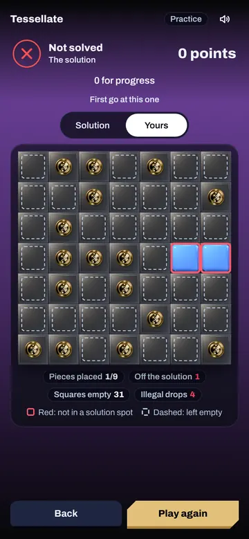 |  |  |

- The solution drawn at full width (each board the reveal fit's own target, and a caption under it: with only a
  board in the shown view the fit had drawn it at half size).
- Under Yours: pieces off every solution spot outlined red, squares left empty dashed, a one-line key; pills from the
  stored grade: Pieces placed, Off the solution, Squares empty, Illegal drops (blockRev 4; Right first time on older
  rounds), Time left on a solve. No stray "×"; nothing under Solution but the board and its caption.

- **Look A** in Blender sprites (`public/pattern-art/blockparty/`, source `docs/design/game-art/pattern/source/blockparty.py`):
  brass studs for the pegs, satin recesses for the free squares, a glossy lacquered block for every square of a piece
  in today's nine colours, on a dark slab and tray. One image per board cell, exactly the cell's box (no hit area moved).
- **A double tap only flips**: a tap's turn waits out the 260 ms double-tap window, so the piece never turns first.
- **Undo and Reset** (blockRev 4), navy with champagne-gold icons: Undo gives the last move back, Reset sends every
  piece to the tray (Undo brings the board back).
- **Clean drops** (blockRev 4): moving a placed piece no longer costs the bonus; only a drop where a piece won't fit
  does (one piece's share each).
- **Help**: the flip, Undo and Reset are explained; "Drag a piece's anchor" is gone.
- **Reveal**: see the answer reveal above.
- **Tray**: the widest piece fits its own column (a four-long bar used to run over its neighbour once pieces were placed).
- **Sounds**: pick-up, illegal drop (a dull thud as the piece goes back; it was silent), Undo and Reset now sound.
<!-- tessellate:end -->

<!-- pipeline:start -->
## Pipeline

**Play: today · concept A · now** (the richness pass, 15 Nov 2026)

| Today (main) | Concept A | Now |
|---|---|---|
|  | 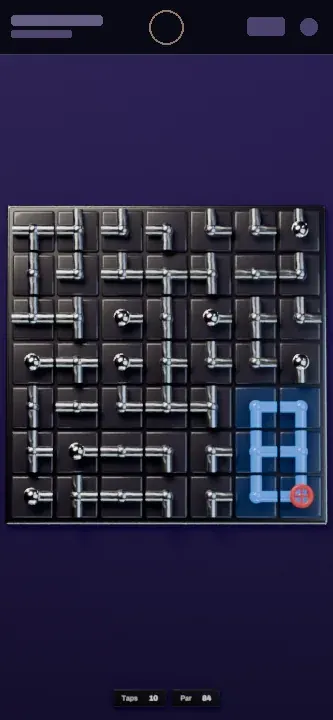 |  |

**Intro**

| Before (main) | After |
|---|---|
|  |  |

**Answer reveal** (390 × 844, practice)

| | Before (main) | After |
|---|---|---|
| Solved, Yours | 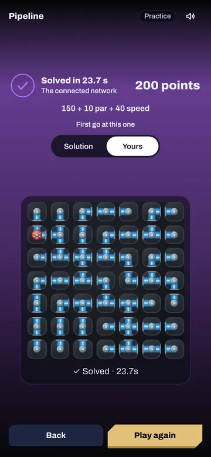 |  |
| Solved, Solution | |  |
| Unfinished |  |  |

- **Look**: Blender sprites (`docs/design/game-art/pattern/source/pipes.py`, `public/pattern-art/pipes/`, 33 files,
  210 KB) under the rich studio light (HDRI reflections, a crisp top-left key, fill and rim, as distant lights so a tube
  shades the same along its whole length). Continuous pass (15 Nov 2026, after the captain's review of the knobbly first
  set): every pipe is one smooth, thicker polished-chrome tube (a corner one bend, no collars, beads or rings); connected
  pipes are a clear glass tube full of saturated glossy blue water with a crisp highlight along its whole length. Each
  sprite runs past its tile and is cropped at half the board gap (`PIPE_BLEED`, `--pipe-gap`), so a connected run reads
  as one continuous pipe across the gaps. Darker glossy tiles with a soft bevel. Each shape is rendered in each of its
  turns, so the key light stays top left; the turn only animates with a transform. No glow round the network.
- **Leaks live** (pipesRev 5): water spills from every open end the water reaches, in play, the intro and the reveal.
- **Turns both ways** (pipesRev 5): a tap turns clockwise, a long press (380 ms), a swipe (14 px) or a right click
  anticlockwise; the log carries `-cell`; par is the fewest turns either way.
- **Turns / Par** sit directly under the board (were at the screen's bottom with a gap).
- **Reveal**: Solution and Yours one large board at a time; Yours is the board the server graded (the log cut at the
  stored turns) with tiles turned but not as in the solution outlined red, tiles still to turn dimmed and spray at open
  ends; "You: …" and the pills (Turns, Par, Joined, Time left, from the stored grade) only under Yours; a turns-against-par
  bar on a solve; a short key; no "×".
- **Sounds**: `pipes.combo` (6+ joined), `pipes.drain` (a turn that cuts pipes off), `pipes.bubble` (the source on the
  solve) on library placeholders; `pipes.rotate` for both directions.
<!-- pipeline:end -->

<!-- chroma:start -->
## Chroma Lines

**Play: today | concept A | new** (390 × 844, the same scale)

| Today (main) | Concept A | New |
|---|---|---|
|  | 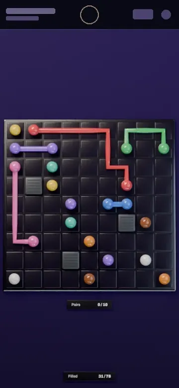 |  |

**Reveal: before | after**

| | Before (main) | After |
|---|---|---|
| Solved |  | 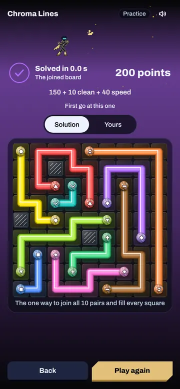 |
| Unfinished, Solution |  |  |
| Unfinished, Yours | 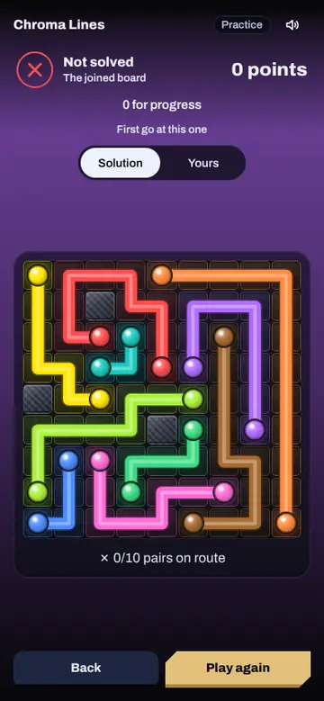 |  |

- **Look (A, richness pass):** every dot is a glossy marble bead rendered in Blender under the rich studio light (a crisp
  highlight on its curve; one per colour, `public/pattern-art/flow/`, 38 KB in all), each with its own white symbol so
  white/silver and yellow/lime are told apart; walls are hatched steel blocks, cells dark recessed slots; the lines are
  saturated glossy tubes (a dark edge, shaded sides, a lighter core and a highlight stripe, no blur halo).
- **flowRev 3:** drawing over another colour cuts that line back to the square before the crossing (the server grades
  the board by the same rule); a stray touch on a finished dot no longer wipes its line (only a drag restarts it).
- **Pills:** "Pairs 7 / 10" beside "Filled 48 / 78".
- **Reveal:** one board at a time, full width (Solution / Yours). Yours shows the player's lines with each unjoined
  pair's dots ringed red and every empty square dotted red, a strip of the pairs as beads (✓ on the solution's route,
  amber ✓ joined another way, red ! not joined), "You: 7 of 10 pairs, 48 of 78 squares" and pills from the stored grade
  (Pairs, Filled, Redraws, Time left). No stray "×".
- **Sound:** the line's tone rises as it grows (`flow.draw`), a cut (`flow.cut`), one sound for a join
  (`flow.connect`, the extra `correct` dropped), a near-miss hint (`flow.nearMiss`) and the solve (`flow.solve`).
<!-- chroma:end -->

<!-- skid:start -->
## Skid

**The play frame: today | concept A | new** (same scale)

| Today (main) | Concept A | New |
|---|---|---|
|  |  | 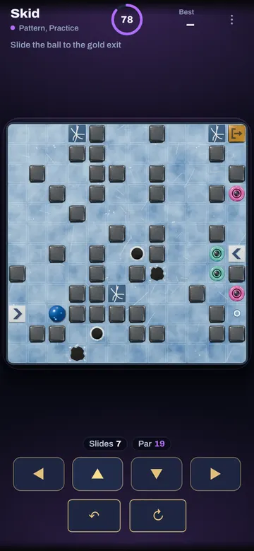 |

**Intro** (the example board in the new art): 

**The answer reveal: before | after**

| Before (main, unfinished) | After, unfinished: Solution | After, unfinished: Yours |
|---|---|---|
|  | 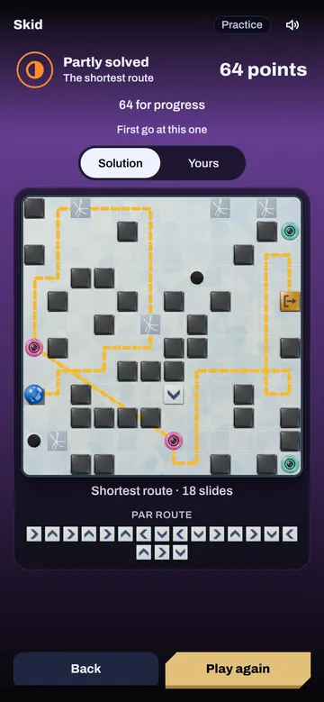 |  |

| After, solved: Solution | After, solved: Yours |
|---|---|
|  | 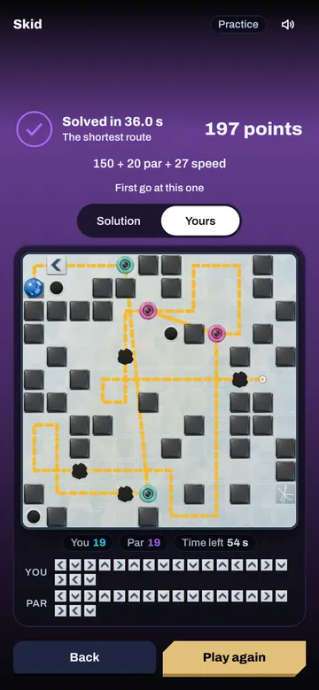 |

(Main had no solved-reveal shot in the review; its solved reveal is the same single board as the unfinished one, plus a
"n moves (fewest m)" line.)

- **Look (A, the richness pass):** every piece is a Blender render under the rich studio light
  (`docs/design/game-art/pattern/source/iceslide.py`, `public/pattern-art/iceslide/`, 13 images, 56 KB):
  - The ice is a clear-coated sheet over crystalline facets, each a slightly different blue, with flakes that catch
    the key light as sparkles.
  - The blocks are polished speckled granite.
  - The ball is deep-blue enamel over steel under a clear coat, with one crisp highlight.
  - The portals are a glossy magenta and a glossy teal enamel ring. The chevrons are navy lacquer on frosted plates.
  - Thin ice is clouded grey-blue with white cracks; the exit is a polished gold plate.
  - Each image is exactly its cell. There is no glow on any piece.
- **Controls:** the arrow pad, Undo and Reset in champagne gold on navy (`--jz-gold`, `--jz-surface-2`).
- **Undo gives the slide back (slideRev 5):**
  - The Slides pill, the par bonus and the stored figure count the slides still standing.
  - Unfinished credit still counts every slide played, so wandering and undoing never earns credit.
  - Older stamps grade as before.
- **A slide into a wall** costs nothing and gives a tiny bump (`iceslide.bump`). One slide from the exit at par, the
  exit glows softly (`iceslide.nearExit`).
- **Reveal (every stamp):** a Solution / Yours switch, one large board at a time.
  - Solution: the shortest route drawn on the rink, "Shortest route · n slides" and the par route as arrow chips (the
    arrow tiles' renders).
  - Yours: the player's own final board (the ball where it stopped, the slides left standing, the ice it broke) with a
    red ring on every square where the ball fell. Below it, pills from the stored grade: You · Par · Falls ·
    From the exit (unfinished) · Time left (solved). Then the player's slides against the par route as two rows of
    arrow chips.
- **Help and intro:** the arrow pad ("Swipe or tap an arrow") is named apart from the chevron tiles ("Chevron tiles turn
  you; holes send you back to the start"). Undo gives the slide back. The arrow pad or swipe is chosen in the game menu
  (⋮) or Settings → Game controls.
- **Intro demo:** a demo recorded before slideRev 5 is stopped; the intro shows its example board.
- **Sound:** a short or long ice hiss by distance (`iceslide.slide`, `iceslide.slideLong`), a thump when the ball
  stops (`iceslide.stop`), the bump and the near-exit shimmer. Crack, portal, fall and the exit shatter are kept.
<!-- skid:end -->

<!-- heave:start -->
## Heave

**The look: today | concept A | new** (390 × 844, mid-play)

| Today | Concept A | New |
|---|---|---|
|  | 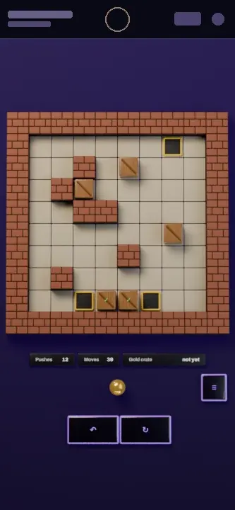 | 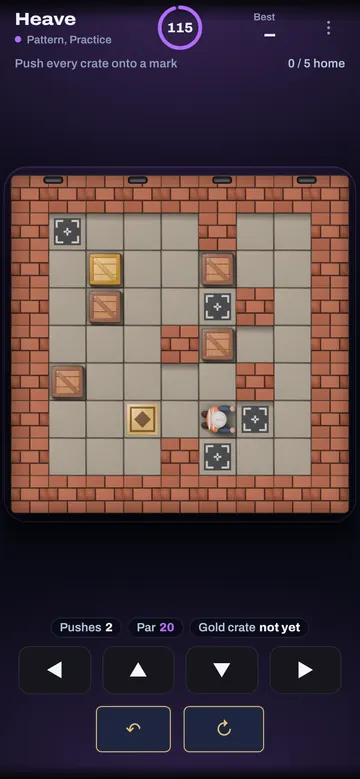 |
|  | | 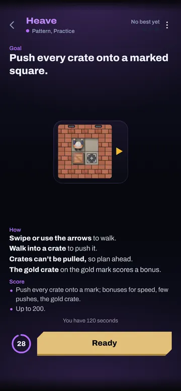 |

**The reveal: before | after**

| Before (main) | After: Solution | After: Yours |
|---|---|---|
| 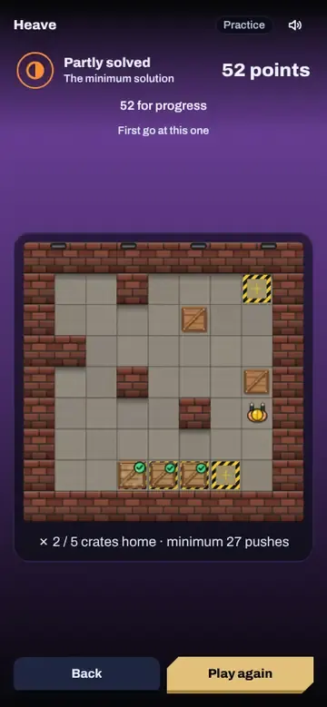 | 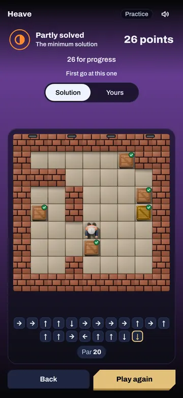 |  |
| (solved: the same single board) |  | 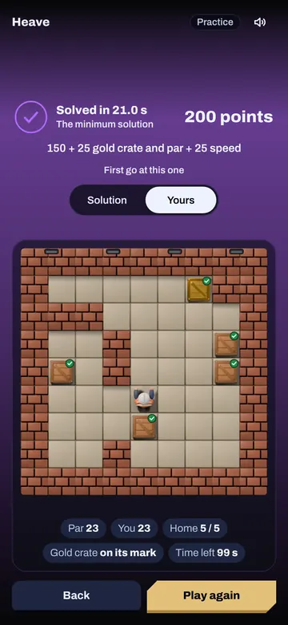 |

- **Look (A, the richness pass):** every tile and piece is a Blender render under the rich studio light, one cell each
  at 160 px (`docs/design/game-art/pattern/source/push.py`, `public/pattern-art/push/`, 10 WebPs, 54,006 bytes):
  bevelled brick with depth (whole bricks cropped at the cell edge, so courses run on from cell to cell), sandstone
  flags with a worn surface, wooden crates with grain under a satin coat, the gold crate and gold mark in polished gold
  that catches the light, dark marks with light tape corners. The worker (glossy white hard hat, orange hi-vis vest,
  navy arms reaching to push) is rendered once per facing, so the light stays top left. A crate on a mark carries a
  bold green tick; no glows anywhere.
- **Beside concept A:** the same brick, sand floor, wooden crates and dark marks; the walls read as brick tops rather
  than raised blocks, and the worker is a person where the concept had a gold token (so the gold crate stays the only
  gold piece on the floor).
- **Pushes and Par** are the pills during play (Pushes red once over par); par is the fewest pushes, looked up on the
  phone from the dealt layout (`pushPar.ts`, a count only, never the route). The Moves pill made way for it.
- **Undo** always gave the push back; the help now says so, describes the crate-home tick, and says where the
  arrows / swipe choice lives.
- **Controls:** Undo and Reset in champagne gold on navy.
- **Reveal:** the Solution / Yours switch, one board at a time at full size. Solution: the minimum solution plays back
  with its pushes as a strip of arrow chips (the push just played in gold). Yours: the player's final warehouse, every
  crate not on a mark outlined red and every empty mark ringed with a dashed red line. Key numbers as pills from the
  stored grade: Par, You (pushes), Home, Gold crate, Time left (the player's own only under Yours).
- **Sound:** the gold crate pushed off its mark (`push.goldOff`), a slot for the deadlock creak (`push.stuck`), and
  lines for the footstep, the crate's scrape and the lights coming on at the solve.
- No stamp: nothing Heave deals or grades changed.
<!-- heave:end -->

<!-- lightbender:start -->
## Lightbender

| Today (main) | Concept A | New |
|---|---|---|
|  | 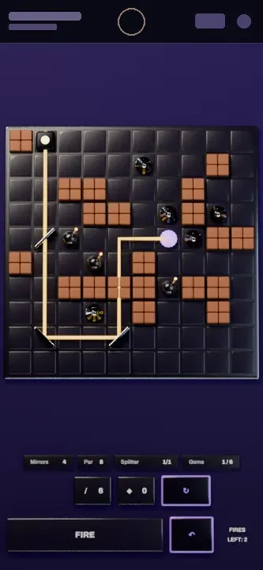 |  |

| | Before (main) | After |
|---|---|---|
| Start / intro |  | 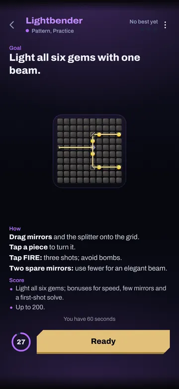 |
| Out of shots | — (only "Fires left: 0") |  |
| Reveal, unfinished | 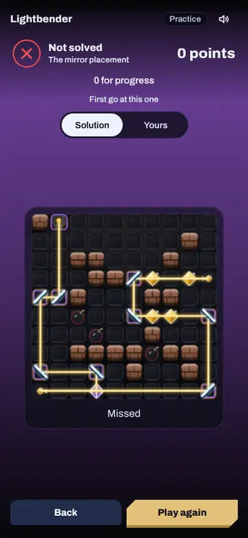 |  |
| Reveal, solved | 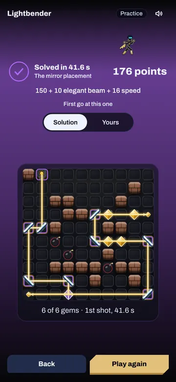 |   |

- **Look (A, richness pass):** Blender sprites under the rich studio (`docs/design/game-art/pattern/source/laser.py`,
  `public/pattern-art/laser/`, 10 files at 160 px, 63 KB): dark graphite floor plates, textured terracotta brick walls
  on sunk mortar, silvered glass mirrors on both diagonals, a violet glass
  splitter under its white split arrows, cut crystal gems (clear ice-blue faceted crystal dark, brilliant gold when lit; a gem lit
  from one side only is drawn smaller with a bold arrow on its side), round black bombs with a red band (red hot when
  hit) and a gunmetal emitter turned to the beam. The beam is a hot golden line with a warm inner tone and a bright
  core: no blurred neon copy, halo or glows (batch P's beam, cell and gem glows removed).
- **Undo takes back any change (laserRev 4):** a place, turn, move, removal or Reset, with the ordinary log verbs, so
  grading is unchanged (no moves are counted; laserRev 4 grades exactly as 3). Older stamps: Undo removes the last
  placed piece, as before.
- **Out of shots (laserRev 4):** after the third missed shot the board dims, says "Out of shots" and takes no more
  changes; "Shots left" is a big figure, gold at 0. The Gems pill keeps the best shot; Par shows in play.
- **Controls:** Undo and Reset in champagne gold on navy; Fire stays the gold primary.
- **Reveal:** one large board at a time (Solution / Yours). Yours draws the solving shot, else the best shot as the
  board stood at that FIRE, with its beam; red squares on pieces not in the solution, the solution's mirror ghosted in
  gold dashes where it was missing, red rings on gems left dark, a short key. The numbers come from the stored grade
  ("Gems 0/6 · Shots 3/3 · Par 8"; on a solve "Mirrors 8 · Par 8 · Time left 49 s"), with a strip of the shots (gem
  dots, a bomb). The "Missed" line under the solution is gone; the player's line is "You: …" under Yours.
- **Sound:** a near miss (5 of 6) plays `laser.nearMiss` in place of `wrong`, a bomb only `laser.bomb`, out of shots
  `laser.outOfShots` (library stand-ins); place, turn and fire keep their November placeholders; the gem notes kept.
<!-- lightbender:end -->

<!-- topsy:start -->
## Topsy-Turvy

| Today | Concept A | New |
|---|---|---|
|  |  | 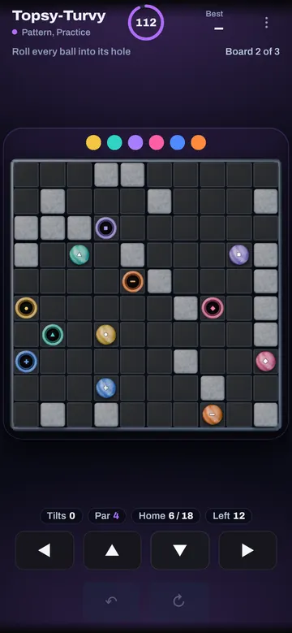 |

| Reveal | Before (main) | After |
|---|---|---|
| Solved |  | 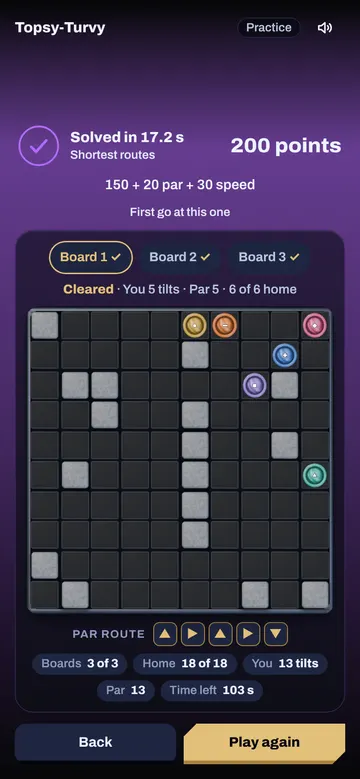 |
| Unfinished |  |  |

- **Look (A):** Blender sprites (`docs/design/game-art/pattern/source/gravity.py`, `public/pattern-art/gravity/`): grey
  honed-stone blocks, a dark slate floor, a glossy glass marble per ball colour and a cup rimmed in each ball's own
  colour (so every hole plainly belongs to one ball), inside a gunmetal tray frame. The marks stay drawn on the balls
  and in the cups. A ball home sits sunk in its cup. No glows round balls or holes. Undo and Reset gold on navy.
- **gravityRev 8:** each board's tilt limit is its fewest tilts + 8 (it was about twice what anyone needs); Undo and
  Reset give the tilt back. The Tilts pill is the board's own count against that board's par; Left counts down.
- **A tilt that moves nothing:** a small lean, no sound, no draft.
- **Clock:** the catalogue says the dealt 120 s (stored four-ball rounds keep 90 s).
- **Reveal:** one board at a time, large, with a Board 1 / 2 / 3 switcher (opening where you stopped, a tick on cleared
  boards); the board as you left it, balls not home and their empty cups ringed red; "Cleared / Out of tilts · You n
  tilts · Par p · n of 6 home"; the board's par route as gold arrow chips; key numbers from the stored grade (Boards,
  Home, You, Par, Time left).
- **Sound:** a looped marble rumble for exactly as long as the balls roll, a click as each stops, a pip as each drops
  home (a combo for two or more), a board-cleared sound, a closing clunk when a board runs out of tilts (library
  stand-ins until Joe's files).
<!-- topsy:end -->
