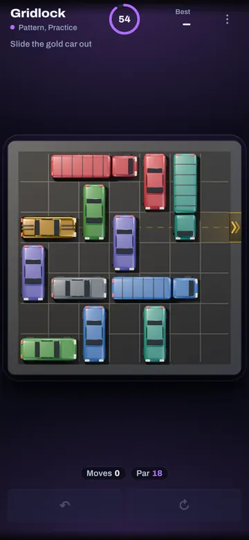
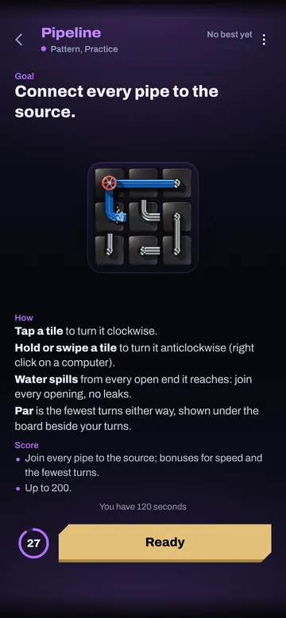
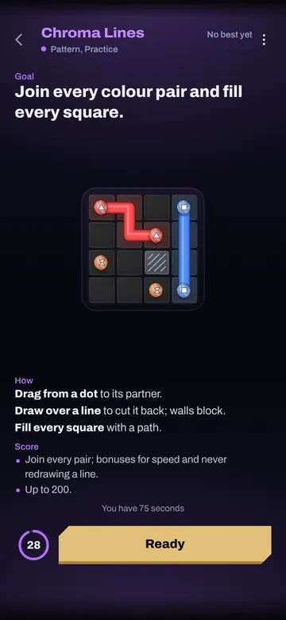

# Pattern overhaul: gallery

Phase 2 step 4 (15 Nov 2026). Before (main) and after for each of the eight Pattern games at 390 × 844, and short
clips of the hero effects. Images are in this folder.

<!-- Each game's section is between its own markers. -->

<!-- gridlock:start -->
## Gridlock

| Before (main) | After |
|---|---|
|  |  |
|  |  |
|  |   |

- **Look (A):** the cars and the lot are Blender renders (`docs/design/game-art/pattern/source/unblock.py`,
  `public/pattern-art/unblock/`): glossy painted toy cars in six muted bodies (blue, teal, red, violet, green, silver),
  2-long saloons and 3-long vans, each rendered horizontal and vertical so the light stays top left; the gold car is the
  only gold thing on the lot (metallic gold with dark pinstripes). The dark lot (kerb, asphalt, worn bay lines) is one
  render; the exit's gold dash and chevrons stay drawn over it. Every image is exactly its vehicle box. No glows.
- **Controls:** Undo and Reset in champagne gold on navy (`--jz-gold`, `--jz-surface-2`).
- **Undo gives the move back (unblockRev 4):** Moves, the par bonus and the stored figure count the slides left on the
  board; the help says so. Older stamps grade as before.
- **Reveal:** under Solution only "Par n" shows; "your moves" is on Yours, which shows the player's real final board,
  unfinished too (the after shot: one slide played, then the clock ran out).
- **Sound:** a short / long scrape by distance (`unblock.slide`, `unblock.slideLong`), a knock when a drag hits the car
  in the way (`unblock.blocked`), a glint when the gold car's lane opens (`unblock.laneClear`); the drive-out is kept.
<!-- gridlock:end -->

<!-- tessellate:start -->
## Tessellate
<!-- tessellate:end -->

<!-- pipeline:start -->
## Pipeline

| | Before (main) | After |
|---|---|---|
| Start / intro |  |  |
| Mid-play |  |  |
| Reveal |  |  |

- **Look**: Blender sprites (`docs/design/game-art/pattern/source/pipes.py`, `public/pattern-art/pipes/`, 13 files,
  55 KB): chrome pipes on dark tiles, each shape (end, straight, corner, tee, cross) rendered dry (plain chrome) and wet
  (blue water in sight-glass runs), turned by a CSS transform under even overhead light; the red source valve; no glow
  round the network (batch P's blue tile rims and drop shadows removed).
- **Leaks live** (pipesRev 5): water spills from every open end the water reaches, in play, the intro and the reveal.
- **Turns both ways** (pipesRev 5): a tap turns clockwise, a long press (380 ms), a swipe (14 px) or a right click
  anticlockwise; the log carries `-cell`; par is the fewest turns either way.
- **Turns / Par** sit directly under the board (were at the screen's bottom with a gap).
- **Reveal**: the player's line is Yours-only ("You: 12 / 49 connected"), no "×".
- **Sounds**: `pipes.combo` (6+ joined), `pipes.drain` (a turn that cuts pipes off), `pipes.bubble` (the source on the
  solve) added on library placeholders; `pipes.rotate` fires for both directions.
<!-- pipeline:end -->

<!-- chroma:start -->
## Chroma Lines

| Before (main) | After |
|---|---|
|  |  |
|  |  |
|  |   |

- **Look (A):** every dot is a glossy marble bead rendered in Blender (one per colour, `public/pattern-art/flow/`),
  each with its own white symbol so white/silver and yellow/lime are told apart; walls are hatched steel blocks, cells
  dark recessed slots; the lines keep their vivid colours as rich tubes with no glow.
- **flowRev 3:** drawing over another colour cuts that line back to the square before the crossing (the server grades
  the board by the same rule); a stray touch on a finished dot no longer wipes its line (only a drag restarts it).
- **Pills:** "Pairs 0 / 11" beside "Filled 8 / 78".
- **Reveal:** the player's own count reads "You: 0/11 pairs on route" and shows only under Yours.
- **Sound:** the line's tone rises as it grows (`flow.draw`), a cut (`flow.cut`), one sound for a join
  (`flow.connect`, the extra `correct` dropped), a near-miss hint (`flow.nearMiss`) and the solve (`flow.solve`).
<!-- chroma:end -->

<!-- skid:start -->
## Skid
<!-- skid:end -->

<!-- heave:start -->
## Heave
<!-- heave:end -->

<!-- lightbender:start -->
## Lightbender
<!-- lightbender:end -->

<!-- topsy:start -->
## Topsy-Turvy
<!-- topsy:end -->
