# Pattern overhaul: gallery

Phase 2 step 4 (15 Nov 2026). Before (main) and after for each of the eight Pattern games at 390 × 844, and short
clips of the hero effects. Images are in this folder.

<!-- Each game's section is between its own markers. -->

<!-- gridlock:start -->
## Gridlock

**Today | concept A | new** (play, the same scale):

| Today (main) | Concept A (PR #429) | New |
|---|---|---|
|  | 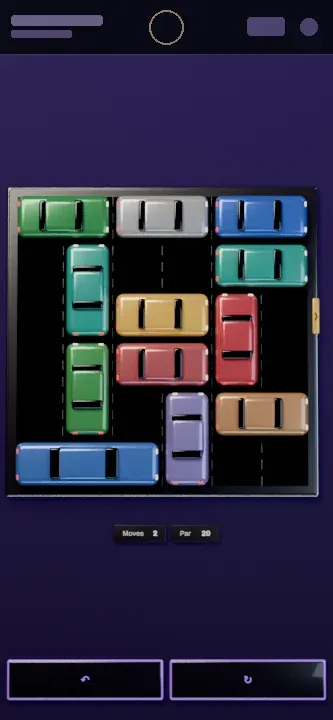 |  |

The richness pass (sprite.py's rich studio light): glossy lacquered bodies with a clear-coat highlight on their rounded
edges, dark reflective glass, cabins and lamps, the gold car metallic with a glint on its curves; deeper muted bodies
(none near gold); a near-black asphalt lot. Against the concept: the same top-down toy cars, our gold car brighter and
unmistakable (the concept's was mustard), no glowing lamps, the exit kept as gold markings.

| Before (main) | After |
|---|---|
|  |  |
|  |  |

**The answer reveal** (390 × 844, the same deal and answers on main and the branch: a solve with one slide undone, and
an unfinished third of the line):

| | Before (main) | After |
|---|---|---|
| Solved, Solution |  |  |
| Solved, Yours |  | 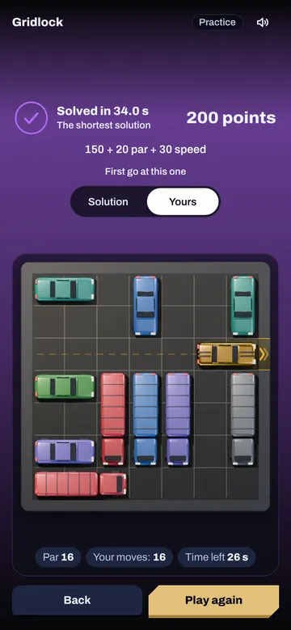 |
| Unfinished, Solution |  (no Yours side) |  |
| Unfinished, Yours | — |  |

- **Look (A):** the cars and the lot are Blender renders (`docs/design/game-art/pattern/source/unblock.py`,
  `public/pattern-art/unblock/`): glossy painted toy cars in six muted bodies (blue, teal, red, violet, green, silver),
  2-long saloons and 3-long vans, each rendered horizontal and vertical so the light stays top left; the gold car is the
  only gold thing on the lot (metallic gold with dark pinstripes). The dark lot (kerb, asphalt, worn bay lines) is one
  render; the exit's gold dash and chevrons stay drawn over it. Every image is exactly its vehicle box. No glows.
- **Controls:** Undo and Reset in champagne gold on navy (`--jz-gold`, `--jz-surface-2`).
- **Undo gives the move back (unblockRev 4):** Moves, the par bonus and the stored figure count the slides left on the
  board; the help says so. Older stamps grade as before.
- **Reveal:** the shortest solution large and playing back, with the par route under it as a strip of move chips (each
  the car's own sprite, its way and its bays, the move just played lit gold); Yours is the player's real final board,
  unfinished too, with the cars still in the gold car's lane outlined red and counted ("2 cars still in the gold car's
  way"); the key numbers as pills from the stored grade: Par under both, "Your moves" and "Time left" under Yours only.
  On main the solve with an undone slide read 17 moves (199); on unblockRev 4 it is 16 (200).
- **Words:** the help, the intro, the frame's goal line and the two challenges say "car", not "block".
- **Sound:** a short / long scrape by distance (`unblock.slide`, `unblock.slideLong`), a knock when a drag hits the car
  in the way (`unblock.blocked`), a glint when the gold car's lane opens (`unblock.laneClear`); the drive-out is kept.
**Stage 2: the effects** (390 × 844, a real practice deal played by its shortest line; 4 s):

| A blocked drag, two slides, the lane clearing, the drive-out |
|---|
| <video src="unblock-fx-moves.mp4" width="180" controls muted loop playsinline poster="unblock-fx-moves-still.webp"></video> 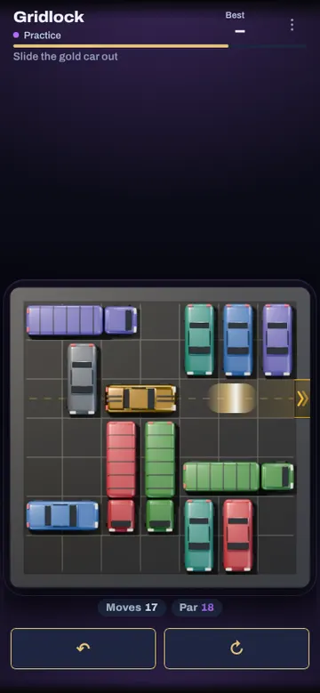 |

- **Slide:** the car glides to its bay as before (display only) and, as the glide ends, gets the effects kit's soft
  settle on its own art (`tap`, silent: the slide's scrape, `unblock.slide` / `unblock.slideLong` by distance, ends in
  the bump). Undo and Reset settle the same way.
- **Blocked:** the knock (`unblock.blocked`), the dragged car's shared shake, and now the kit's `wrong` shake on the
  car in the way as well (its art only; silent, no haptic). The kerb has no car to shake; a tap that tries to go
  nowhere plays nothing.
- **Lane cleared:** with `unblock.laneClear`, a gold-white band runs along the exit lane from the gold car's nose out
  through the gap (560 ms), on the lot's art layer under the cars; only on the move that opens the lane.
- **Solve:** the drive-out with its streaks, unchanged; the reveal's key numbers row lands with the kit's `win` (silent)
  on a solve.
- Every effect is on a car's art or the lot (never a car's box, which the drag reads), transform and opacity only, and
  the next drag is taken at once. Reduced motion: no glide; the settle and the shake are the kit's 120–160 ms
  crossfades, the glint a still glow along the lane fading in and out (240 ms).
**Stage 3: the levels** (390 × 844, a practice deal at each level, before the first move):

| Easy | Normal | Hard | Expert |
|---|---|---|---|
| 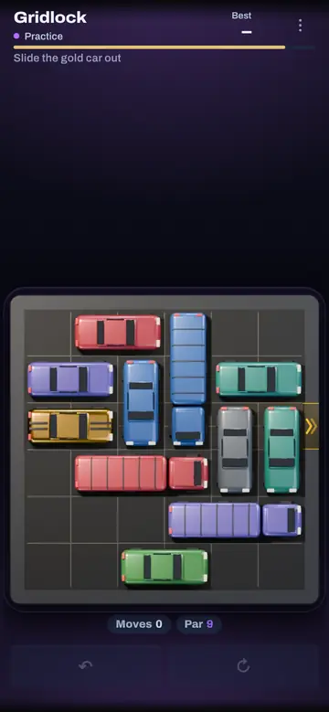 | 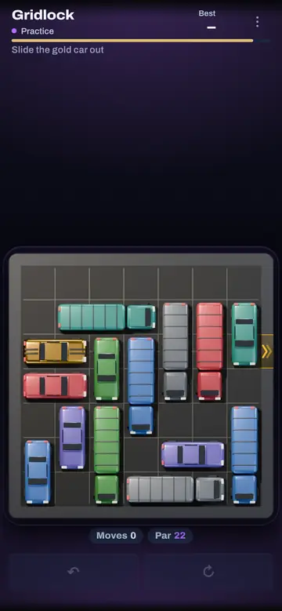 | 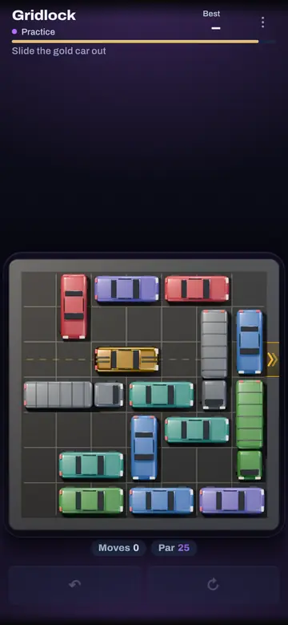 | 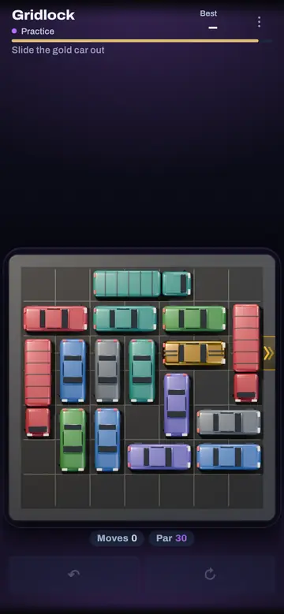 |

- **Easy:** a 6 × 6 lot (its own render, `lot-6.webp`; bays about 53 px on a 375 px phone), 8–10 cars, 6–12 moves at
  the minimum, 60 s, full speed by 40 s. **Normal:** today's game exactly (7 × 7, 15–22 moves, 60 s). **Hard:** 7 × 7,
  12–14 cars, 22–30 moves, 60 s, full speed by 28 s. **Expert:** 7 × 7, 13–15 cars, 30–40 moves, 75 s, full speed by
  30 s. The lot is the same square at every level; the cars, the ghost, the glint and the drive-out size from the lot.
- Each level deals from its own seeded bank of 120 boards (`scripts/unblock-levels-bank.ts`, rebuilt byte for byte),
  every board's minimum (the par) proved by breadth-first search over its whole lot
  (`pattern-overhaul-unblock-levels-check`). Any route out counts.
- Elite bots (level-tune, 40 deals): near-perfect 199.9 / 199.8 / 195.9 / 192.1, great 199.2 / 198.5 / 178.7 / 176.0
  (Easy / Normal / Hard / Expert).
<!-- gridlock:end -->

<!-- tessellate:start -->
## Tessellate

**The look: today | concept A | stage 1 | now** (play, same scale)

| Today | Concept A | Stage 1 (engraved studs, flat tray) | Now (16 Nov 2026, current code) |
|---|---|---|---|
|  | 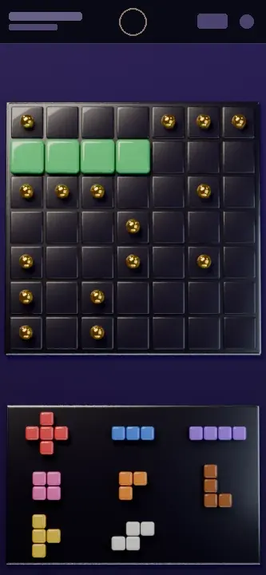 |  | 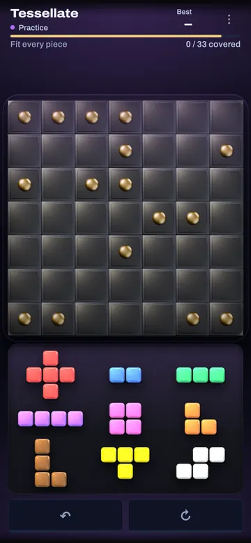 |

"Now" is a fresh 390 × 844 frame of a real Normal practice round on this branch's dev server: plain brass domes on
the pegs and the tray's own glossy blocks. The sprite files were already right; what could still show the old art was
the cache: the URLs (`/pattern-art/blockparty/peg.webp` …) never changed when stage 2 re-rendered them, so a phone
that had loaded stage 1 could keep the engraved studs and flat tray blocks. Every sprite URL now carries the files'
hash (`?v=cdb697b1`, `BLOCK_ART_HASH`; the levels check fails if a re-render doesn't update it).

The richness pass (sprite.py's rich studio): polished brass studs with a mirror highlight on the dome, lacquered
blocks with a hard clear coat (one crisp highlight on the bevel, depth down the sides, today's saturated colours: the
pieces render on the Standard view transform at a lower key, since AgX turned them pastel), satin recessed wells.

| | Before | After |
|---|---|---|
| Start / intro | 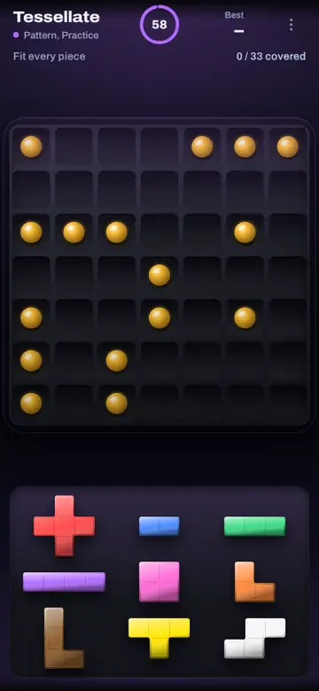 |  |
| Mid-play |  |  |
| Round end |  |  |

**The answer reveal** (390 × 844)

| Before, solved | Before, unfinished | After, unfinished (Yours) | After, solved (Yours) | After, Solution |
|---|---|---|---|---|
| 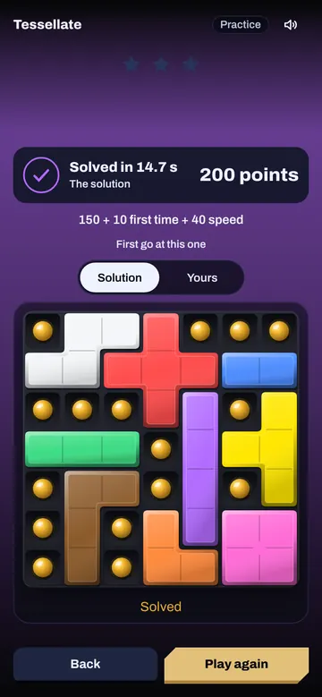 |  |  | 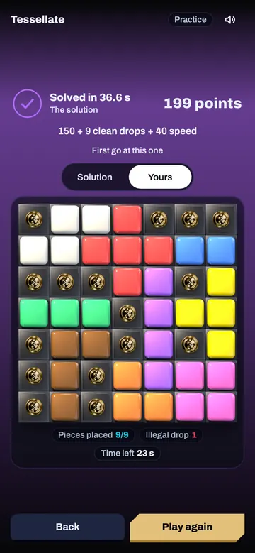 |  |

"Before, solved" is main's reveal of the solved intro example (main 36ea802, played in a worktree with real taps and drags).

- The solution drawn at full width (each board the reveal fit's own target, and a caption under it: with only a
  board in the shown view the fit had drawn it at half size).
- Under Yours: pieces off every solution spot outlined red, squares left empty dashed, a one-line key; pills from the
  stored grade: Pieces placed, Off the solution, Squares empty, Illegal drops (blockRev 4; Right first time on older
  rounds), Time left on a solve. No stray "×"; nothing under Solution but the board and its caption.

- **Look A** in Blender sprites (`public/pattern-art/blockparty/`, source `docs/design/game-art/pattern/source/blockparty.py`):
  brass studs for the pegs, satin recesses for the free squares, a glossy lacquered block for every square of a piece
  in today's nine colours, on a dark slab and tray. One image per board cell, exactly the cell's box (no hit area moved).
- **A double tap only flips**: a tap's turn waits out the 260 ms double-tap window, so the piece never turns first.
- **Undo and Reset** (blockRev 4), navy with champagne-gold icons: Undo gives the last move back, Reset sends every
  piece to the tray (Undo brings the board back).
- **Clean drops** (blockRev 4): moving a placed piece no longer costs the bonus; only a drop where a piece won't fit
  does (one piece's share each).
- **Help**: the flip, Undo and Reset are explained; "Drag a piece's anchor" is gone.
- **Reveal**: see the answer reveal above.
- **Tray**: the widest piece fits its own column (a four-long bar used to run over its neighbour once pieces were placed).
- **Sounds**: pick-up, illegal drop (a dull thud as the piece goes back; it was silent), Undo and Reset now sound.

### Stage 2: Joe's fixes and the effects

**Studs and tray** (390 × 844): stage 1 | concept A | now

| Stage 1 | Concept A | Now |
|---|---|---|
|  |  | 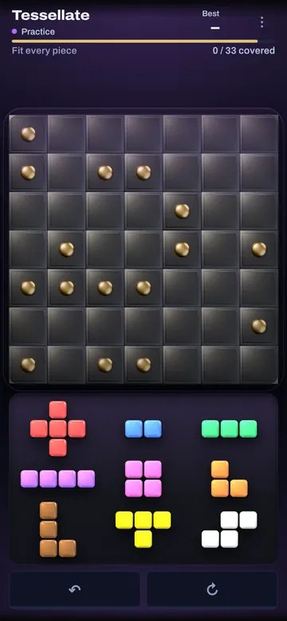 |

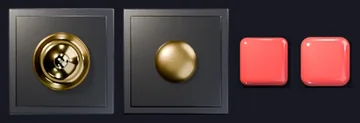

Close-up at a phone's 3× (stud at the board's cell size, a block at the tray's): stage 1's stud, now; stage 1's tray
block, now.

- **Studs**: one plain low brass dome on a short base, polished to a soft sheen and lit by the studio lights alone (no
  reflected studio pattern), so it carries one crisp highlight top left; the collar and polished cap that read as an
  engraved coin are gone.
- **Tray**: the tray draws its own render of the same lacquered block (`tray-<colour>.webp`): a rounder, deeper bevel
  and a little more clear coat, so the gloss and its highlight survive at the tray's third-size cells.
- **The lifted piece** is seen under the finger over the board: the tray stopped clipping it at its top edge while it
  is carried or gliding home (it vanished as it left the tray).

**The effects** (the effects kit, `src/lib/fx/kit.ts`; every kit call silent, the game's own cue plays)

| Moves: turn, illegal drop, legal drop | The last gap filled |
|---|---|
| <video src="blockparty-fx-moves.mp4" width="180" controls muted loop playsinline poster="blockparty-fx-moves-still.webp"></video> 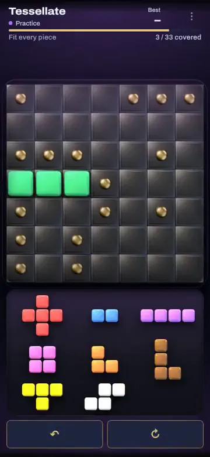 | <video src="blockparty-fx-solve.mp4" width="180" controls muted loop playsinline poster="blockparty-fx-solve-still.webp"></video> 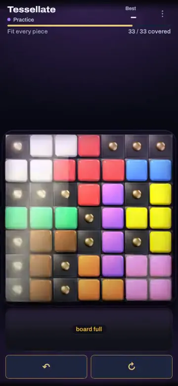 |

| After, solved reveal (the kit's win on the result line) |
|---|
| 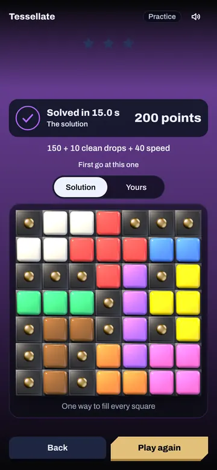 |

- **Turn**: the quick spin (the glyph's CSS turn) with the kit's tap on the piece, a click (`blockparty.turn`); a
  flip the same with `blockparty.flip`.
- **Pick up**: the kit's `pickUp` on the piece under the finger: it rises and grows a touch and stays up until it
  lands (`blockparty.pickup`).
- **Drop**: the kit's `drop` squash on the placed piece and a one-shot flash on exactly the squares it covered
  (`blockparty.place`).
- **Illegal**: a dull thud (`blockparty.illegal`); the piece glides back into its tray slot from where it was let go
  (the kit's `slide`) and the slot gives the kit's `wrong` shake. A placed piece dragged somewhere it won't fit shakes
  where it is. A tray piece let go off the board glides home silently (no move happened).
- **Solve**: a soft band of light sweeps across the board in 480 ms, each piece pulsing and each stud glinting as it
  passes (`blockparty.solve`); quick, because practice opens its reveal about a quarter of a second after the
  solving drop. On the reveal the kit's `win` lands on the result line in view.
- **Reduced motion**: every kit effect is its 120 ms crossfade; the spin, flash, glints and pulse are cut and the
  shine is a still glow that fades.
- Never in the way: the next move is taken during any effect (no input waits on one); effects animate only the piece's
  own elements, never the board, arena or tray holding the hit areas.

### Stage 3: levels

Practice rounds at 390 × 844 on the current code, each level chosen on the device (the framework's selector).

| Easy | Normal | Hard | Expert |
|---|---|---|---|
| 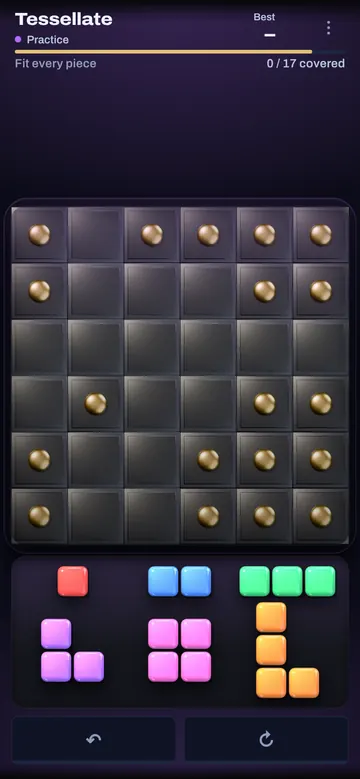 |  | 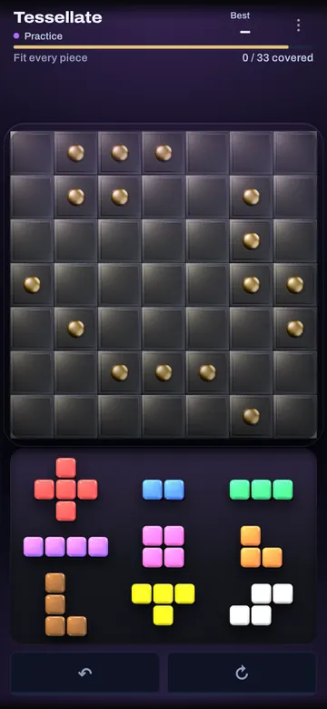 | 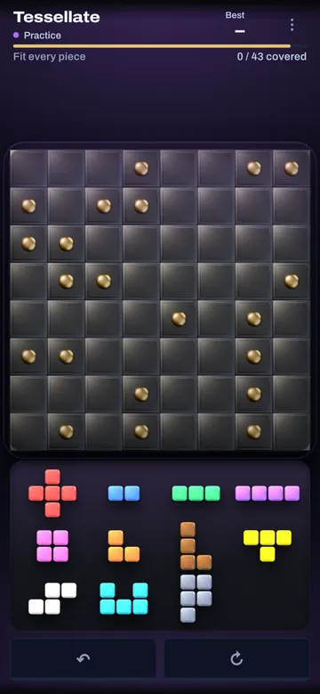 |

- **Easy**: 6 × 6, six small pieces (Dot, Two, Three, Corner, Square, L; 17 squares), the pieces grown into one patch,
  20+ ways to finish (20–626 in the bank), 60 s.
- **Normal**: today's game exactly (7 × 7, nine pieces, 5–60 ways, 60 s).
- **Hard**: Normal's board and pieces with only 2–5 ways to finish, and every board needs at least two held guesses
  of a person-like solver but no more than three; full speed by 32 s.
- **Expert**: 8 × 8 (44 px squares on a 375 px phone), eleven pieces (Normal's nine plus a U in cyan and a P in slate,
  new Blender renders), 1–2 ways, 70 s, full speed by 36 s; every board needs exactly three held guesses of the
  person-like solver, which finishes every one. (Joe's spec said 1–3 ways and 90 s; at 90 s or 75 s the tuning bots
  scored Expert as high as Hard, so Expert was tightened for a clear step. The frame above was taken before that
  change; the board and tray look the same.) The tray goes four to a row, so its eleven pieces take three rows and the board keeps its
  full width (351 px at 375 × 667, the same box as Normal's).
<!-- tessellate:end -->

<!-- pipeline:start -->
## Pipeline

**Play: today · concept A · now** (the richness pass, 15 Nov 2026)

| Today (main) | Concept A | Now |
|---|---|---|
|  |  |  |

**Intro**

| Before (main) | After |
|---|---|
|  |  |

**Answer reveal** (390 × 844, practice)

| | Before (main) | After |
|---|---|---|
| Solved, Yours |  | 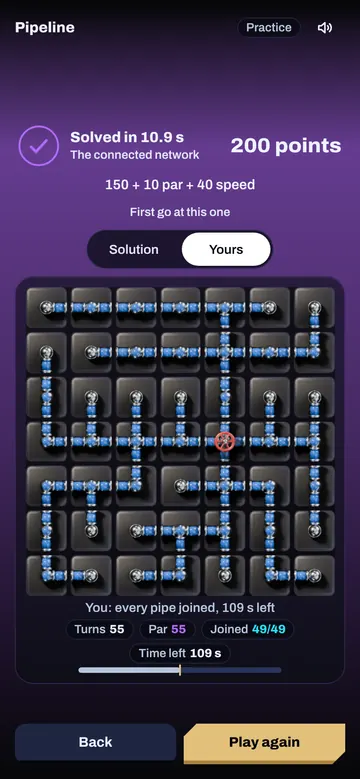 |
| Solved, Solution | | 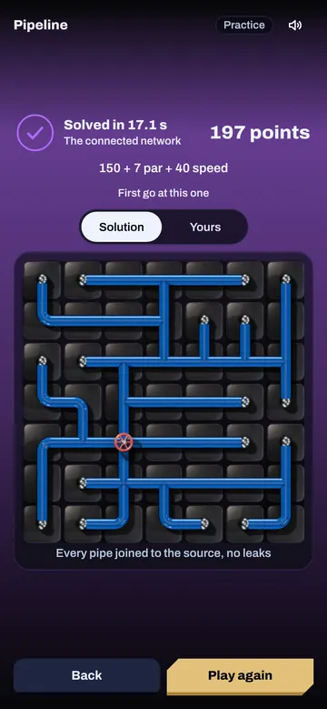 |
| Unfinished |  | 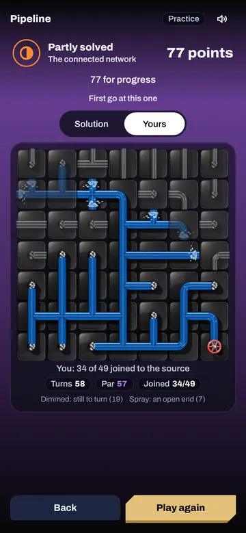 |

- **Look**: Blender sprites (`docs/design/game-art/pattern/source/pipes.py`, `public/pattern-art/pipes/`, 33 files,
  210 KB) under the rich studio light (HDRI reflections, a crisp top-left key, fill and rim, as distant lights so a tube
  shades the same along its whole length). Continuous pass (15 Nov 2026, after the captain's review of the knobbly first
  set): every pipe is one smooth, thicker polished-chrome tube (a corner one bend, no collars, beads or rings); connected
  pipes are a clear glass tube full of saturated glossy blue water with a crisp highlight along its whole length. Each
  sprite runs past its tile and is cropped at half the board gap (`PIPE_BLEED`, `--pipe-gap`), so a connected run reads
  as one continuous pipe across the gaps. Darker glossy tiles with a soft bevel. Each shape is rendered in each of its
  turns, so the key light stays top left; the turn only animates with a transform. No glow round the network.
- **Leaks live** (pipesRev 5): water spills from every open end the water reaches, in play, the intro and the reveal.
- **Turns both ways** (pipesRev 5): a tap turns clockwise, a long press (380 ms), a swipe (14 px) or a right click
  anticlockwise; the log carries `-cell`; par is the fewest turns either way.
- **Turns / Par** sit directly under the board (were at the screen's bottom with a gap).
- **Reveal**: Solution and Yours one large board at a time; Yours is the board the server graded (the log cut at the
  stored turns) with tiles turned but not as in the solution outlined red, tiles still to turn dimmed and spray at open
  ends; "You: …" and the pills (Turns, Par, Joined, Time left, from the stored grade) only under Yours; a turns-against-par
  bar on a solve; a short key; no "×".
- **Sounds**: `pipes.combo` (6+ joined), `pipes.drain` (a turn that cuts pipes off), `pipes.bubble` (the source on the
  solve) on library placeholders; `pipes.rotate` for both directions.

### Stage 2: Joe's fixes and the effects (15 Nov 2026)

**Glass and water, darker tiles** (390 × 844, practice)

| Stage 1 | Concept A | Stage 2 |
|---|---|---|
|  |  | 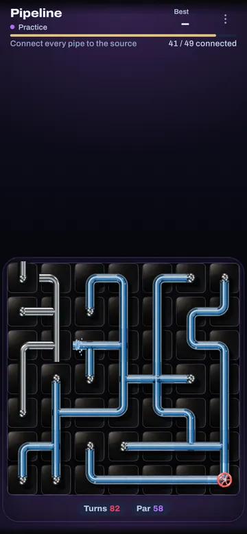 |

**Hero: water running into newly joined pipes** ([MP4, 4 s](pipes-hero.mp4)): one tap joins eight pipes and the water
runs into each from the source; a turn back drains them; the tap again; the last end piece solves the board (the rush
and the source's bubbles).

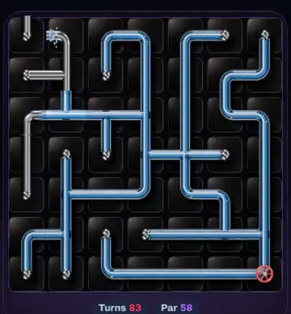

- **Fix 1, the water**: every wet pipe is a clear glass section full of deep glossy water: pale glass walls along both
  sides (where the glass is seen edge on), the water darkening towards its sides so the column reads round and deep, a
  crisp white specular stripe on the key light's reflection line with a soft sheen round it. The stripe and walls depend
  only on the pipe's direction, so they meet the neighbour's exactly in the board gap and follow a bend smoothly; arms
  from a junction start at the through pipe's wall (no cap showing through its glass).
- **Fix 2, darker tiles**: the tile plate and the board recess darker (the tile's mean brightness 53 → 24 of 255), so
  the water stands out.
- **Turn**: a metallic two-click ratchet (190 ms, a small overshoot) on the pipe's own art, either way; `pipes.rotate`.
- **Water in**: each newly joined pipe fills from the side its water enters by, in order from the source, 200 ms a
  pipe and every pipe full within 900 ms (the wet layer's clip slides in while its content holds still); `pipes.flow`
  pitched by the join (one pipe brighter, five or more lower).
- **Combo**: 6+ pipes joined by one turn: the kit's combo on the turned pipe (silent) and `pipes.combo`.
- **Drain**: a turn that cuts pipes off empties them back towards the water, the furthest first; `pipes.drain`.
- **Solve**: the rush fills the network (now a scale, transform only), the source valve bubbles (`pipes.bubble`), and
  the reveal's result card gets the kit's win.
- **Reduced motion**: every change a 120 ms crossfade (the kit's for the turn), no bubbles; the rush a still glow.
### Levels (stage 3)

**Easy · Normal · Hard · Expert** (390 × 844, practice, the live round; all 120 s)

| Easy 5 × 5 | Normal 7 × 7 | Hard 8 × 8 | Expert 8 × 11 |
|---|---|---|---|
| 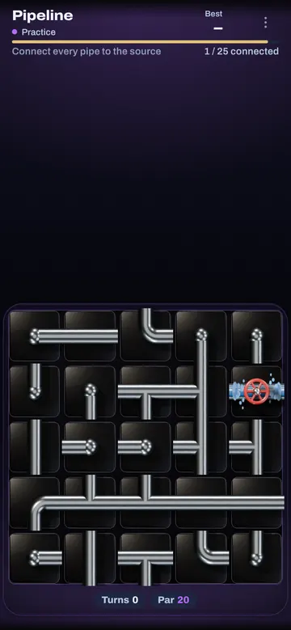 | 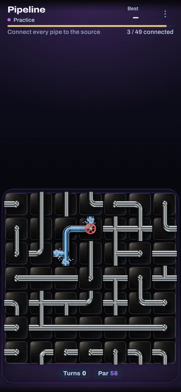 | 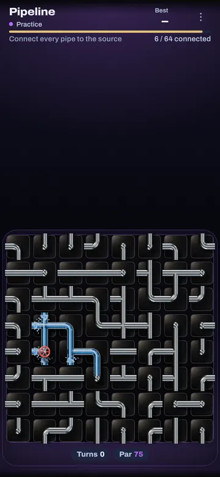 | 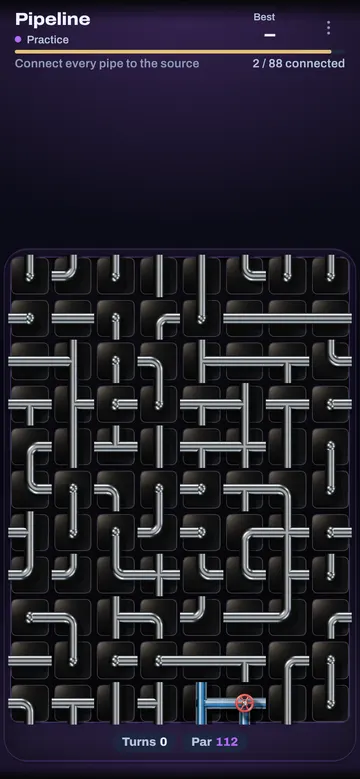 |

- **Easy**: 5 × 5, exactly 60 % of the tiles dealt turned (the rest already right), spills shown.
- **Normal**: today's game, byte for byte (7 × 7, at least 80 % turned, spills shown, pipesRev 5).
- **Hard**: 8 × 8 (about 44 px a tile on a 375 px phone), at least 90 % turned, spills shown.
- **Expert**: 8 across × 11 down (88 tiles; 9 across would be 39 px tiles), at least 95 % turned, **no spills during
  play** (the reveal still shows them). Fits 375 × 667 with the Turns / Par pills (39 px tiles).
- Every level board is proved one-solution when dealt by a solver that reasons like a person (matching sides, no loops,
  never seal off a group, no guessing), and re-proved in the check by a searching solver. Par is the fewest turns
  either way at every level.
<!-- pipeline:end -->

<!-- chroma:start -->
## Chroma Lines

**Play: today | concept A | new** (390 × 844, the same scale)

| Today (main) | Concept A | New |
|---|---|---|
|  |  |  |

**Reveal: before | after**

| | Before (main) | After |
|---|---|---|
| Solved | 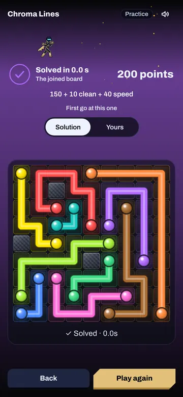 |  |
| Unfinished, Solution |  | 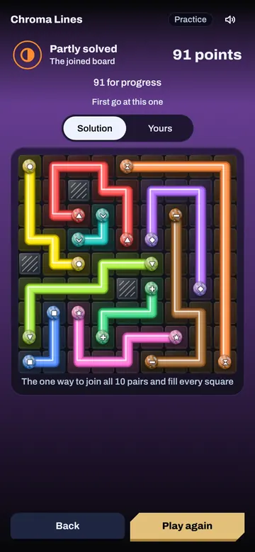 |
| Unfinished, Yours |  | 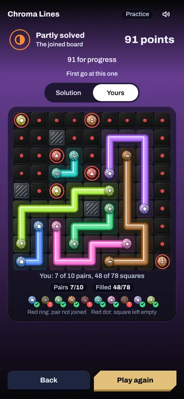 |

- **Look (A, richness pass):** every dot is a glossy marble bead rendered in Blender under the rich studio light (a crisp
  highlight on its curve; one per colour, `public/pattern-art/flow/`, 38 KB in all), each with its own white symbol so
  white/silver and yellow/lime are told apart; walls are hatched steel blocks, cells dark recessed slots; the lines are
  saturated glossy tubes (since stage 2: a thin dark edge, darker sides, the deep body and a crisp highlight stripe; no lighter core, no glow).
- **flowRev 3:** drawing over another colour cuts that line back to the square before the crossing (the server grades
  the board by the same rule); a stray touch on a finished dot no longer wipes its line (only a drag restarts it).
- **Pills:** "Pairs 7 / 10" beside "Filled 48 / 78".
- **Reveal:** one board at a time, full width (Solution / Yours). Yours shows the player's lines with each unjoined
  pair's dots ringed red and every empty square dotted red, a strip of the pairs as beads (✓ on the solution's route,
  amber ✓ joined another way, red ! not joined), "You: 7 of 10 pairs, 48 of 78 squares" and pills from the stored grade
  (Pairs, Filled, Redraws, Time left). No stray "×".
- **Sound:** the line's tone rises as it grows (`flow.draw`), a cut (`flow.cut`), one sound for a join
  (`flow.connect`, the extra `correct` dropped), a near-miss hint (`flow.nearMiss`) and the solve (`flow.solve`).

### Stage 2: Joe's no-glow fix and the effects (15 Nov 2026)

**Lines: before (neon on a phone) | concept A | after** (390 × 844, the real game, the same board)

| Before (stage 1) | Concept A | After |
|---|---|---|
| 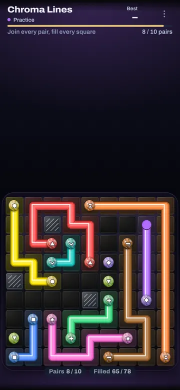 |  |  |

- **No glow:** the lighter core that made every line read as neon is gone, so is the colour wash in the squares round a
  line, the beads' CSS drop shadow and the old CSS solve glow and dash pulse. Each line is a glossy tube like concept
  A: a thin dark edge, darker sides, the colour's deep pigment (light neons such as lime, pink and purple brought to
  about half lightness, a fifth less saturated, `tubeBody`) and one crisp white highlight stripe towards the top-left
  light.

**Effects** (the effects kit; transform and opacity only, nothing blocks the next move): the last line drawn, its join
and the solve.

<video src="flow-fx.mp4" width="300" autoplay loop muted playsinline></video>

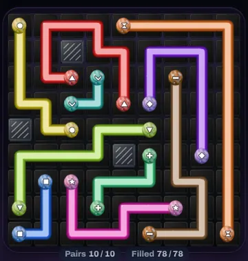

- **Drawing:** the line's head slides into each new square (kit `slide` on the head's own layers, FLIP from the square
  before) while `flow.draw` rises smoothly in pitch, levelling off at half again.
- **A pair joined:** one light runs along the tube from bead to bead with a match-style swell (≤ 560 ms), under the one
  sound `flow.connect`; no extra `correct`.
- **Near miss** (one pair short): the two unjoined beads pulse twice (kit `nearMiss`, silent) under `flow.nearMiss`.
- **A cut:** the cut part retracts into the square it was cut back to and fades (240 ms) under `flow.cut`.
- **Solve:** a light copy of every line lands on the lines together and fades (kit `win`, its gold burst and haptic,
  silent) under `flow.solve`.
- **Reduced motion:** each change shows as a 120 ms crossfade (the head, the joined tube, the cut part, the solve), no
  light runs and no particles.

### Stage 3: levels (16 Nov 2026)

**Lines today, for Joe's brightness check: a fresh Normal round mid-play from the current code | concept A** (390 × 844,
colours unchanged)

| Normal now (mid-play) | Concept A |
|---|---|
| 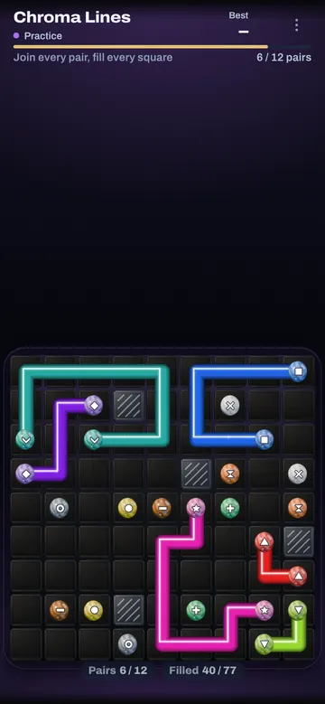 |  |

**The four levels, mid-play** (390 × 844, practice, about half the pairs joined)

| Easy | Normal | Hard | Expert |
|---|---|---|---|
| 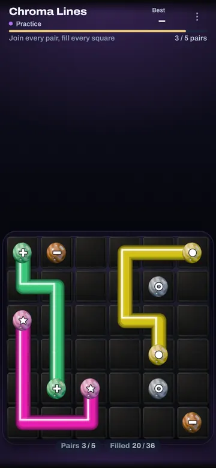 |  | 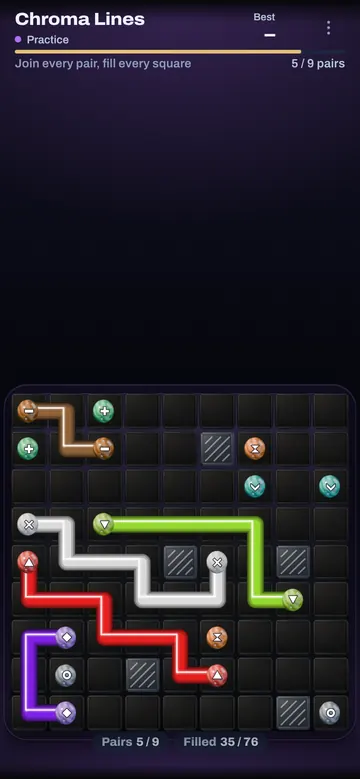 | 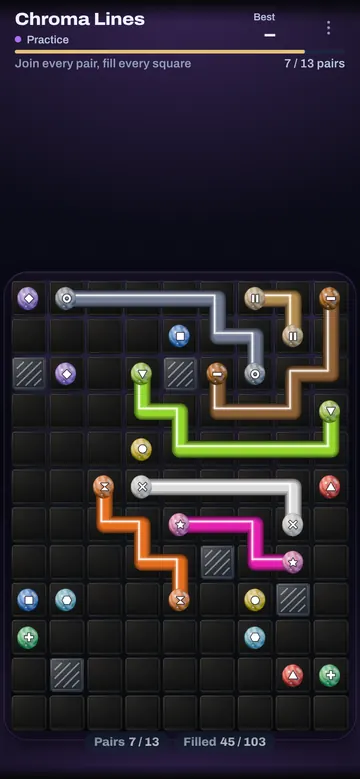 |

**Expert's answer reveal** (the 9 × 12 board at its own aspect, all 14 pairs): 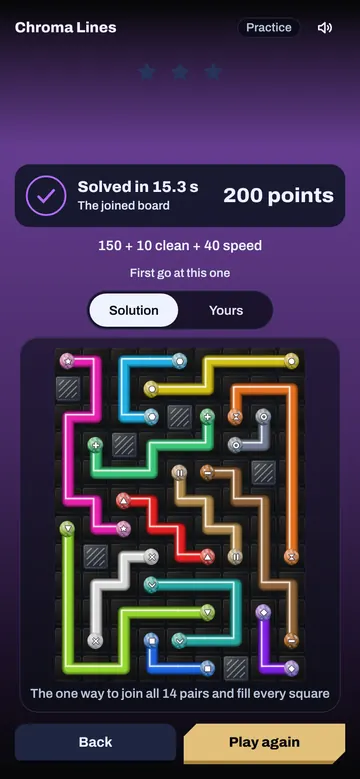

- **Easy:** 6 × 6, 5–6 pairs, no walls, 75 s; full speed by 15 s.
- **Normal:** today's game (9 × 9, 10–12 pairs, 2–4 walls, 75 s), the same bank and deal; full speed by 30 s on
  flowRev 3 (was 20 s, which no strong player reached).
- **Hard:** 9 × 9, 8–9 pairs with longer lines (8+ squares on average), 4–6 walls, 75 s; full speed by 35 s.
- **Expert:** 9 wide × 12 tall (squares stay about 39 px on a 375 px phone; the board grows downwards), 12–14 pairs,
  4–6 walls, 90 s; full speed by 45 s. Two new colours for the 13th and 14th pairs: cyan (a hexagon) and tan (two
  bars), each a Blender bead like the twelve.
- Every level's boards come from their own seeded bank of 500, each proved to have exactly one solution and finished by
  a solver that reasons like a person (no guessing).
<!-- chroma:end -->

<!-- skid:start -->
## Skid

**The play frame: today | concept A | new** (same scale)

| Today (main) | Concept A | New |
|---|---|---|
|  |  |  |

**Intro** (the example board in the new art): 

**The answer reveal: before | after**

| Before (main, unfinished) | After, unfinished: Solution | After, unfinished: Yours |
|---|---|---|
|  |  |  |

| Before (main, solved) | After, solved: Solution | After, solved: Yours |
|---|---|---|
| 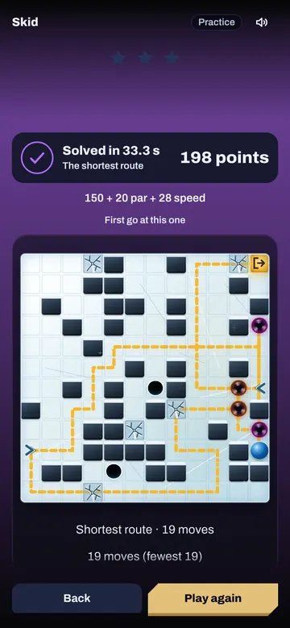 |  |  |

(Main's solved reveal, shot on origin/main by solving the practice example: the same single board as the unfinished
one, plus a "19 moves (fewest 19)" line.)

- **Look (A, the richness pass, redone 15 Nov 2026 after the captain's review: the first rink read as a pale, near-white
  sheet):** every piece is a Blender render under the rich studio light
  (`docs/design/game-art/pattern/source/iceslide.py`, `public/pattern-art/iceslide/`, 13 images, 106 KB):
  - The ice is now a pale-to-mid icy blue with depth: deeper blue where the ice is thick, faint crystal facets and
    frost, fine skate scratches and a scatter of air bubbles under a clear coat (an even sheen, no glare patch). It
    is richer than both today's grey-blue sheet and concept A's flat pale one.
  - The blocks are polished speckled granite with a wide bevel catching the light, so they stand up off the ice.
  - The ball is glossy blue enamel over steel with one crisp highlight (only the key light shows on its curve); its
    shadow fades out round, never a square.
  - The portals are a glossy magenta and a glossy teal enamel ring. The chevrons are navy lacquer on pale frosted
    plates.
  - Thin ice is dark, glassy deep water with bright white cracks, so it stands apart from the rink; the exit is a
    shinier polished gold plate.
  - Each image is exactly its cell. There is no glow on any piece.
- **Controls:** the arrow pad, Undo and Reset in champagne gold on navy (`--jz-gold`, `--jz-surface-2`).
- **Undo gives the slide back (slideRev 5):**
  - The Slides pill, the par bonus and the stored figure count the slides still standing.
  - Unfinished credit still counts every slide played, so wandering and undoing never earns credit.
  - Older stamps grade as before.
- **A slide into a wall** costs nothing and gives a tiny bump (`iceslide.bump`). One slide from the exit at par, the
  exit glows softly (`iceslide.nearExit`).
- **Reveal (every stamp):** a Solution / Yours switch, one large board at a time.
  - Solution: the shortest route drawn on the rink, "Shortest route · n slides" and the par route as arrow chips (the
    arrow tiles' renders).
  - Yours: the player's own final board (the ball where it stopped, the slides left standing, the ice it broke) with a
    red ring on every square where the ball fell. Below it, pills from the stored grade: You · Par · Falls ·
    From the exit (unfinished) · Time left (solved). Then the player's slides against the par route as two rows of
    arrow chips.
- **Help and intro:** the arrow pad ("Swipe or tap an arrow") is named apart from the chevron tiles ("Chevron tiles turn
  you; holes send you back to the start"). Undo gives the slide back. The arrow pad or swipe is chosen in the game menu
  (⋮) or Settings → Game controls.
- **Intro demo:** a demo recorded before slideRev 5 is stopped; the intro shows its example board.
- **Sound:** a short or long ice hiss by distance (`iceslide.slide`, `iceslide.slideLong`), a thump when the ball
  stops (`iceslide.stop`), the bump and the near-exit shimmer. Crack, portal, fall and the exit shatter are kept.

### Stage 2: the effects

| The clip (4 s: a bump, two portals, one slide from the exit at par, then the exit) | Still: both ends of a portal flaring |
|---|---|
| <video src="iceslide-fx-clip.mp4" width="180" controls muted loop playsinline poster="iceslide-fx-still.webp"></video> [MP4, 4 s](iceslide-fx-clip.mp4) | 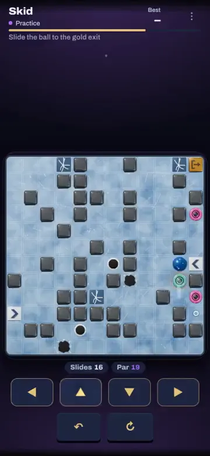 |

Every effect plays on its piece's own art (`src/components/puzzles/pattern/iceSlideFx.ts`, the effects kit's variants;
transform and opacity only), never on the board, a cell or a control, and the next slide is taken as soon as the ball
stops:

- **A slide:** the ice hiss lasts about as long as the slide (`iceslide.slide` up to four squares, `iceslide.slideLong`
  past that).
- **It stops:** a thump (`iceslide.stop`) and the ball's art settles with the kit's drop (a small squash).
- **Straight into a wall:** a dull tap (`iceslide.bump`) and a 3 px nudge toward the wall (2 px on a slow phone); nothing
  counts.
- **Thin ice** cracks open out of the sheet (`iceslide.crack`); **a portal** flares at both ends, the ring swelling over
  a bloom of its own colour (`iceslide.portal`); **a hole** spins the ball down and out (`iceslide.fall`).
- **One slide from the exit at par:** the exit glows and the kit's near miss pulses it twice (`iceslide.nearExit`).
- **The exit:** the ice frosts over and shatters as before (`iceslide.solve`), and the reveal's result card plays the
  kit's win (silent).
- **Reduced motion:** each is a 120 ms crossfade to the new state (no movement); the kit's own variants for the settle
  and the near miss.
- The old CSS effects that animated `filter` (the portal flare, the pulsing exit, the fall's darkening) are gone.

### Stage 3: levels (16 Nov 2026)

Practice rounds at 390 × 844, each level chosen on the device (the framework's selector), at the start of play.

| Easy | Normal | Hard | Expert |
|---|---|---|---|
| 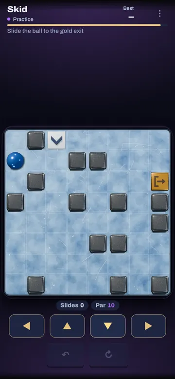 | 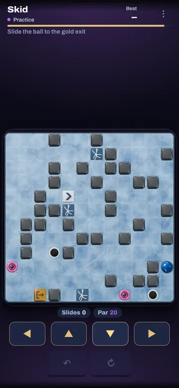 | 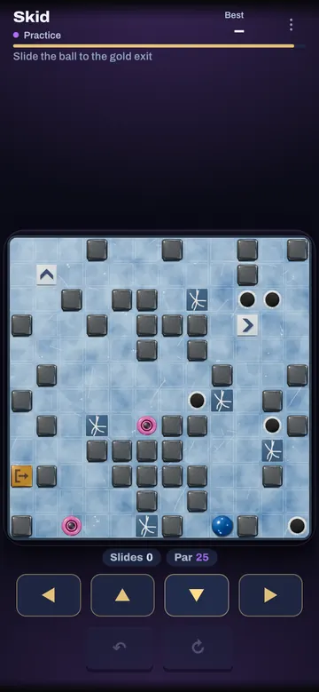 | 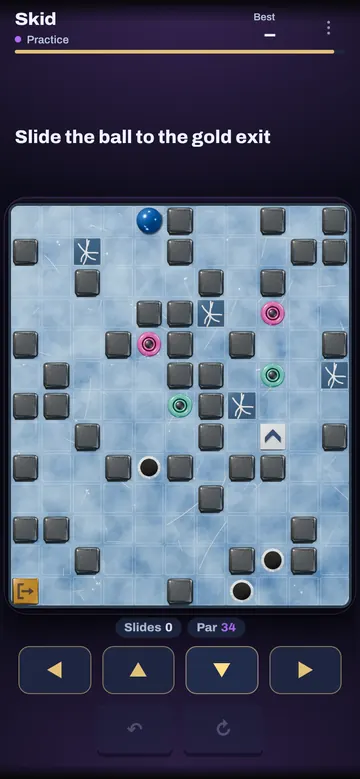 |

- **Easy**: 8 × 8 (44 px squares at 390, 42 px at 375), 8–12 slides, no holes or thin ice, at most one chevron and one
  portal pair, 90 s, speed full by 20 s.
- **Normal**: today's game exactly (12 × 12, 18–26 slides, every hazard, 90 s, slideRev 5).
- **Hard**: 12 × 12, 24–30 slides, 5–8 holes (Normal 2–4), the route through a portal and over thin ice; **100 s**
  (Joe's spec said 90: at 90 s every bot scored Hard below Expert), speed full by 40 s.
- **Expert**: 11 across × 13 down (143 squares), 28–36 slides, every hazard, 120 s, speed full by 45 s. Joe (16 Nov
  2026): the first Expert, 12 × 14, drew 25.9 px squares at 375 × 667, too small to read the ice, holes and portals, so
  the rink grows downwards and narrower: measured in Chromium (pattern-overhaul-iceslide-levels-check section 9), 28.1 px
  at 375 × 667 (Hard 27.4) and 31.5 px at 390 × 844 (Hard 28.7), every piece's art inside its square, the pad and
  buttons unchanged, nothing scrolls. Boards to play: `levels/iceslide-expert-boards.tsv` (every Expert bank board,
  best first by the person-like player, with a bank seed that deals it, its par route and layout).
- Each level deals from its own seeded bank of 300 boards (`bun scripts/iceslide-levels-bank.ts [--check]`), every
  board's fewest slides proved by breadth-first search; the par is that minimum. Any route to the exit counts.
<!-- skid:end -->

<!-- heave:start -->
## Heave

**The look: today | concept A | new** (390 × 844, mid-play)

| Today | Concept A | New |
|---|---|---|
|  |  |  |
|  | |  |

**The reveal: before | after**

| Before (main) | After: Solution | After: Yours |
|---|---|---|
|  |  | 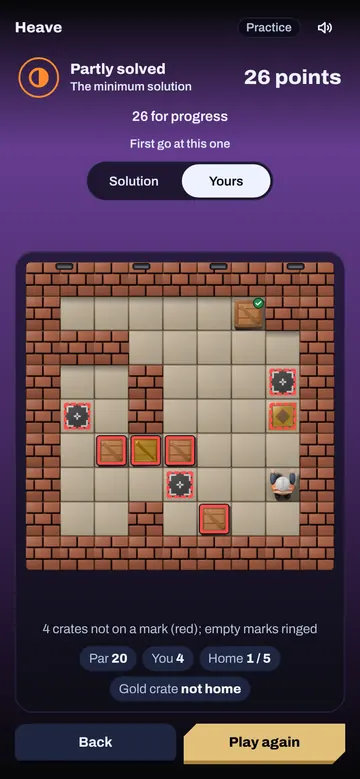 |
| 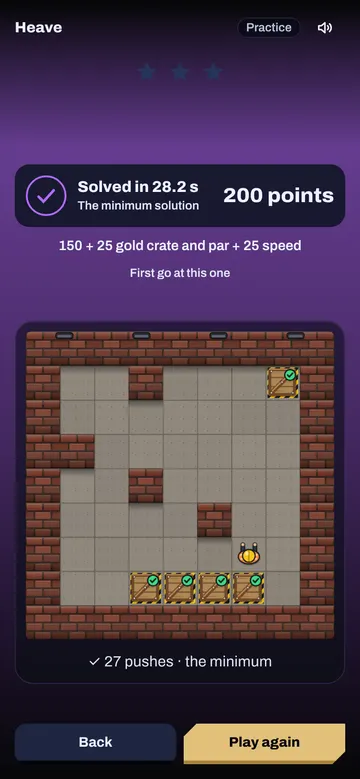 | 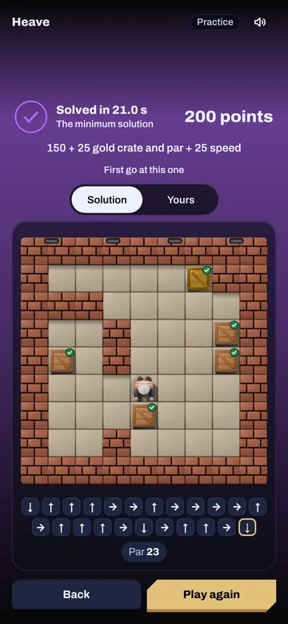 |  |

(Main's solved reveal, shot on origin/main by solving the practice example: the same single board as the unfinished
one, plus a "27 pushes · the minimum" line.)

- **Look (A, the richness pass):** every tile and piece is a Blender render under the rich studio light, one cell each
  at 160 px (`docs/design/game-art/pattern/source/push.py`, `public/pattern-art/push/`, 10 WebPs, 54,006 bytes):
  bevelled brick with depth (whole bricks cropped at the cell edge, so courses run on from cell to cell), sandstone
  flags with a worn surface, wooden crates with grain under a satin coat, the gold crate and gold mark in polished gold
  that catches the light, dark marks with light tape corners. The worker (glossy white hard hat, orange hi-vis vest,
  navy arms reaching to push) is rendered once per facing, so the light stays top left. A crate on a mark carries a
  bold green tick; no glows anywhere.
- **Beside concept A:** the same brick, sand floor, wooden crates and dark marks; the walls read as brick tops rather
  than raised blocks, and the worker is a person where the concept had a gold token (so the gold crate stays the only
  gold piece on the floor).
- **Pushes and Par** are the pills during play (Pushes red once over par); par is the fewest pushes, looked up on the
  phone from the dealt layout (`pushPar.ts`, a count only, never the route). The Moves pill made way for it.
- **Undo** always gave the push back; the help now says so, describes the crate-home tick, and says where the
  arrows / swipe choice lives.
- **Controls:** Undo and Reset in champagne gold on navy.
- **Reveal:** the Solution / Yours switch, one board at a time at full size. Solution: the minimum solution plays back
  with its pushes as a strip of arrow chips (the push just played in gold). Yours: the player's final warehouse, every
  crate not on a mark outlined red and every empty mark ringed with a dashed red line. Key numbers as pills from the
  stored grade: Par, You (pushes), Home, Gold crate, Time left (the player's own only under Yours).
- **Sound:** the gold crate pushed off its mark (`push.goldOff`), a slot for the deadlock creak (`push.stuck`), and
  lines for the footstep, the crate's scrape and the lights coming on at the solve.
- No stamp: nothing Heave deals or grades changed.

### Stage 2: the effects

| The clip (4 s: the last crates of the practice example, a crate home, the solve's lights) | Still: a crate home, its mark glowing |
|---|---|
| <video src="push-fx-clip.mp4" width="180" controls muted loop playsinline poster="push-fx-still.webp"></video> [MP4, 4 s](push-fx-clip.mp4) | 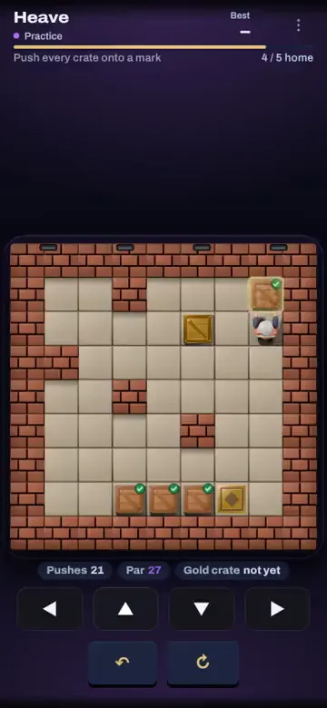 |

Every effect plays on a piece's own art or the floor's own light layers (`src/components/puzzles/pattern/pushFx.ts`, the
effects kit's variants; transform and opacity only), never on the board, a cell box or a control; every step is taken
at once, as before:

- **A step:** a light footstep (`push.step`), nothing else.
- **A push:** the heavy scrape (`push.push`), and the crate starts its glide 60 ms after the worker's, so the worker is
  seen to lean in and heave it.
- **A crate home:** the thump (`push.home`), the kit's drop on the crate (a small squash), the dust as before, and the
  mark lighting up warm round the crate and fading back. Never when Undo or Reset puts a crate back on a mark.
- **The gold crate pushed off its gold mark:** its sound (`push.goldOff`) and the gold mark dimming for a moment; no shake.
- **A crate stuck where it can't leave:** from the levels (stage 3): on Easy and Normal the crate tints red and `push.stuck` plays (see Levels below).
- **The solve:** the warehouse lights come on along the top wall (`push.solve`), each lamp's pool flickering on in turn
  as a warm wash over the floor under the pieces, and they stay on; the reveal's result card plays the kit's win
  (silent).
- **Reduced motion:** each is a 120 ms crossfade (no movement, no dust); the lights are simply on.
- The bulbs' old `fill` animation is gone: each lit bulb is its own layer, its opacity only.
### Levels (stage 3)

**Easy · Normal · Hard · Expert** (390 × 844, practice, the live round; all 120 s, the same 9 × 9 warehouse)

| Easy 3 crates | Normal 5 crates | Hard 5 crates | Expert 6 crates |
|---|---|---|---|
| 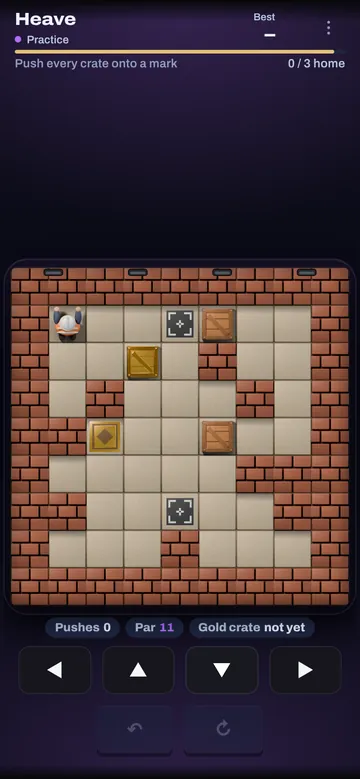 |  |  |  |

- **Easy**: three crates, 8–14 pushes (the minimum), an open warehouse, speed full by 30 s, the stuck hint on.
- **Normal**: today's game, byte for byte (five crates, 18–27 pushes, full by 45 s), now with the stuck hint.
- **Hard**: five crates, 25–32 pushes, the detour rule, no stuck hint.
- **Expert**: six crates, 30–40 pushes, the detour rule, no stuck hint.
- **The stuck hint** (Easy and Normal, display only, no stamp): a crate pushed onto a square from which it can never
  reach a mark (a corner without a mark, a run along a wall with no mark, any square no mark can be pulled back to)
  takes a red wash and edge and plays `push.stuck`; Undo takes it off. Nothing graded reads it.
- Every level board comes from its own seeded bank (`scripts/push-levels-bank.ts`): grown backwards from the solved
  warehouse, so its depth is the exact minimum, and re-proved forwards by an independent optimal solver in
  pattern-overhaul-push-levels-check. Every level fits 375 × 667 and 390 × 844 exactly as Normal (same board box).
<!-- heave:end -->

<!-- lightbender:start -->
## Lightbender

| Today (main) | Concept A | New |
|---|---|---|
|  |  |  |

| | Before (main) | After |
|---|---|---|
| Start / intro |  |  |
| Out of shots | — (only "Fires left: 0") |  |
| Reveal, unfinished |  |  |
| Reveal, solved |  |   |

- **Look (A, richness pass):** Blender sprites under the rich studio (`docs/design/game-art/pattern/source/laser.py`,
  `public/pattern-art/laser/`, 10 files at 160 px, 63 KB): dark graphite floor plates, textured terracotta brick walls
  on sunk mortar, silvered glass mirrors on both diagonals, a violet glass
  splitter under its white split arrows, cut crystal gems (clear ice-blue faceted crystal dark, brilliant gold when lit; a gem lit
  from one side only is drawn smaller with a bold arrow on its side), round black bombs with a red band (red hot when
  hit) and a gunmetal emitter turned to the beam. The beam is a hot golden line with a warm inner tone and a bright
  core: no blurred neon copy, halo or glows (batch P's beam, cell and gem glows removed).
- **Undo takes back any change (laserRev 4):** a place, turn, move, removal or Reset, with the ordinary log verbs, so
  grading is unchanged (no moves are counted; laserRev 4 grades exactly as 3). Older stamps: Undo removes the last
  placed piece, as before.
- **Out of shots (laserRev 4):** after the third missed shot the board dims, says "Out of shots" and takes no more
  changes; "Shots left" is a big figure, gold at 0. The Gems pill keeps the best shot; Par shows in play.
- **Controls:** Undo and Reset in champagne gold on navy; Fire stays the gold primary.
- **Reveal:** one large board at a time (Solution / Yours). Yours draws the solving shot, else the best shot as the
  board stood at that FIRE, with its beam; red squares on pieces not in the solution, the solution's mirror ghosted in
  gold dashes where it was missing, red rings on gems left dark, a short key. The numbers come from the stored grade
  ("Gems 0/6 · Shots 3/3 · Par 8"; on a solve "Mirrors 8 · Par 8 · Time left 49 s"), with a strip of the shots (gem
  dots, a bomb). The "Missed" line under the solution is gone; the player's line is "You: …" under Yours.
- **Sound:** a near miss (5 of 6) plays `laser.nearMiss` in place of `wrong`, a bomb only `laser.bomb`, out of shots
  `laser.outOfShots` (library stand-ins); place, turn and fire keep their November placeholders; the gem notes kept.

### Stage 2: effects

**Hero: the beam** ([MP4, 3.7 s](laser-hero.mp4)): Fire on the intro example's solution; the beam draws along its path
with a hot leading point (today's timing), forks at the splitter, each gem lights in turn with a pop and a few gold
sparks, then the solve flare.

<video src="laser-hero.mp4" width="300" autoplay loop muted playsinline></video> 

- **Place** (`laser.place`): the kit's drop on the mirror's own sprite (a small squash and settle).
- **Turn** (`laser.turn`): a two-click ratchet, the new diagonal swinging in from the old one with a small overshoot
  (170 ms).
- **Fire** (`laser.fire`): the emitter pulses; the beam draws step by step with a bright head on each branch.
- **Gems** (`pz_laser_gem`, rising): each gem the beam reaches lights up with the kit's combo pop (growing gem by gem)
  and gold sparks; the splitter pulses as it forks the beam (`pz_laser_split`).
- **Bomb** (`laser.bomb`): the hit bomb jolts (the kit's wrong, silent) under its red-hot blast.
- **Near miss** (`laser.nearMiss`, Joe's approval): a shot lighting all but one gem pulses the dark gem twice and shows
  "1 gem dark" in gold in the Gems pill's own place for 2.2 s (stage 3, Joe: the pill's content swaps, the count and
  the words sharing one grid cell so the pill keeps its width and the row never shifts; never over the board; the
  next press is taken meanwhile).
- **Out of shots** (`laser.outOfShots`): a dark veil fades over the board and the badge eases up into place (no bounce).
- **Solve** (`laser.solve`): the flare and gem bursts as before, then the kit's win on the reveal's result card.
- **Refused drop**: the kit's shake on that square's own art, in place of the whole-board shake.
- Transform and opacity only (the beam's colour animation and the filter transitions are gone); reduced motion is the
  kit's 120 ms crossfade on every piece.
### Stage 3: levels (16 Nov 2026)

**The four levels at the start of a round** (390 × 844, practice, each level chosen on the device)

| Easy | Normal | Hard | Expert |
|---|---|---|---|
|  |  |  |  |

| | Mirrors (par) | Spare | Bombs | Shots | Clock | Full speed by |
|---|---|---|---|---|---|---|
| Easy | 4–5 | 3 | 1–2 | 5 | 60 s | 20 s |
| Normal | 7–8 | 2 | 3–4 | 3 | 60 s | 30 s (laserRev 4; 15 s before) |
| Hard | 8–9 | 1 | 4–5 | 3 | 75 s | 35 s |
| Expert | 9–10 | 1 | 5–6 | 2 | 90 s | 30 s |

- The same 10 × 10 board, six gems and one splitter at every level; the tray is the par plus the level's spare, the
  "Shots left" figure and the lock after the last shot follow the level's shots (stamped `shots`, absent = 3).
- Lightbender takes any layout that lights every gem, so its levels are open by design (a second layout with only the
  par's mirrors exists on most boards). Every level board is still proved when dealt: the stored layout lights every
  gem and needs every piece, and a person-like solver (`laserSolve.server.ts`: aims at the gems it can see, two turns
  ahead, never into a bomb, backing up one decision at a time) lights it from the level's own tray, needing at least
  100 tries on Hard and 750 on Expert and at most 1,000 (Normal's boards: 155 at the median, three quarters within
  about 770). Hard and Expert deal from their own seeded banks (300 and 200 boards, `bun scripts/laser-bank.ts
  --level=<level> [--check]`); Easy is generated live.
- Twelve Expert boards to play, with their solutions: [levels/laser-expert-boards.md](levels/laser-expert-boards.md).
<!-- lightbender:end -->

<!-- topsy:start -->
## Topsy-Turvy

| Today | Concept A | New |
|---|---|---|
|  |  |  |

| Reveal | Before (main) | After |
|---|---|---|
| Solved |  |  |
| Unfinished |  |  |

- **Look (A):** Blender sprites (`docs/design/game-art/pattern/source/gravity.py`, `public/pattern-art/gravity/`): grey
  honed-stone blocks, a dark slate floor, a glossy glass marble per ball colour and a cup rimmed in each ball's own
  colour (so every hole plainly belongs to one ball), inside a gunmetal tray frame. The marks stay drawn on the balls
  and in the cups. A ball home sits sunk in its cup. No glows round balls or holes. Undo and Reset gold on navy.
- **gravityRev 8:** each board's tilt limit is its fewest tilts + 8 (it was about twice what anyone needs); Undo and
  Reset give the tilt back. The Tilts pill is the board's own count against that board's par; Left counts down.
- **A tilt that moves nothing:** a small lean, no sound, no draft.
- **Clock:** the catalogue says the dealt 120 s (stored four-ball rounds keep 90 s).
- **Reveal:** one board at a time, large, with a Board 1 / 2 / 3 switcher (opening where you stopped, a tick on cleared
  boards); the board as you left it, balls not home and their empty cups ringed red; "Cleared / Out of tilts · You n
  tilts · Par p · n of 6 home"; the board's par route as gold arrow chips; key numbers from the stored grade (Boards,
  Home, You, Par, Time left).
- **Sound:** a looped marble rumble for exactly as long as the balls roll, a click as each stops, a pip as each drops
  home (a combo for two or more), a board-cleared sound, a closing clunk when a board runs out of tilts (library
  stand-ins until Joe's files).

### Stage 2: Joe's reveal fix and the effects (15 Nov 2026)

| Reveal, before (stage 1) | After: board 2 | After: board 1 | Concept A |
|---|---|---|---|
|  |  |  |  |

- **Joe's fix:** the line and the pills under the Board 1 / 2 / 3 switcher are now all the chosen board's own: "Board 2 ·
  Not finished", then Tilts (the stored grade's tilts on that board), Par (that board's par) and Home (that board's
  balls home, from the grader's replay). The round's totals (Boards, Home of 18, Tilts, Par, Time left) sit apart in
  their own row under a **Round** label, below the par route, so the two never read as the same thing.

| Hero clip: the roll | Still | Mid-lean |
|---|---|---|
| <video src="gravity-fx.mp4" width="180" autoplay loop muted playsinline></video> ([MP4](gravity-fx.mp4)) |  |  |

- **A tilt:** the tray's art layer leans 6° towards the tilt and holds while the balls roll, then settles; the rumble
  (`gravity.tilt`, a loop) lasts exactly as long as they move, and each ball that stops clicks (`gravity.stop`). The
  board's measured grid never moves (a separate, hidden grid in the same place), so no square or ball place changes.
- **A ball home:** it drops into its cup as its roll ends (kit `drop`) with the bright pip (`gravity.lock`); two or more
  in one tilt pop their rings above the board as a combo (kit `combo`, `gravity.combo`).
- **A tilt that moves nothing:** a 2° nod and back, no sound, no draft.
- **A board cleared:** at the end of its hold the tray flips away and the next one turns in (`gravity.boardClear`).
- **Out of tilts:** the banner lands (kit `drop`) with the closing clunk (`gravity.outOfTilts`).
- **Solved:** the solve as before (`gravity.solve`, the cups lighting in turn), plus the kit's `win` on the reveal's
  result (the board line and pills).
- Every effect is transform and opacity only, at most 900 ms, and the next tilt is taken at once. Reduced motion: a
  120 ms crossfade for the tilt, the drop and the next board; no lean, nod or flip.

### Stage 3: levels (16 Nov 2026)

Practice rounds at 390 × 844, one per level (each after its first tilt), and the Expert reveal at 375 × 667 with the
Round row on one line (Joe's stage-2 answer).

| Easy | Normal | Hard | Expert | Expert reveal, 375 px |
|---|---|---|---|---|
|  |  |  |  |  |

- **Easy:** two boards of three balls, 2–4 tilts at the fewest, a limit of the fewest + 12, full speed by 20 s.
- **Normal:** today's game exactly (three boards of six, 4–7 tilts, the fewest + 8, full speed by 32 s).
- **Hard:** three boards of six, 6–9 tilts, the fewest + 6, full speed by 45 s.
- **Expert:** three boards of eight (lime green with a heart, pearl white with a crescent, rendered in Blender beside
  the six), 7–10 tilts, the fewest + 5, full speed by 50 s; every board one the person-like solver clears.
- **Round row:** "ROUND" sits on the divider and the pills ("Boards 3/3", "Home 24/24", "Tilts", "Par", "Left 94 s")
  stay on one line at 375 and 390 px (labels 11 px, figures 12 px); long par routes (8–10 tilts) use smaller chips so
  they stay on one line too. Boards to play: `levels/gravity-expert-boards.tsv`.
<!-- topsy:end -->

<!-- intro-demos:start -->
## Intro demos (stage 2, fix 7)

The five demos that were stopped for the new stamps, recorded again by real play on today's intro example and
bundled with the app (`src/lib/duel/bundledDemos/`; a live demo saved on today's stamp still wins). Each still shows
the demo mid-way and at its solved end. Gridlock's live demo was never stopped and plays as before.

| Game | Demo |
|---|---|
| Tessellate (blockRev 4): turns, a flip, clean drops |  |
| Pipeline (pipesRev 5): clockwise taps and anticlockwise long presses, water filling |  |
| Chroma Lines (flowRev 3): a line cut back by another, then redrawn |  |
| Skid (slideRev 5): the par route with a wrong slide undone |  |
| Topsy-Turvy (gravityRev 8): the shortest tilts on all three boards |  |
<!-- intro-demos:end -->
