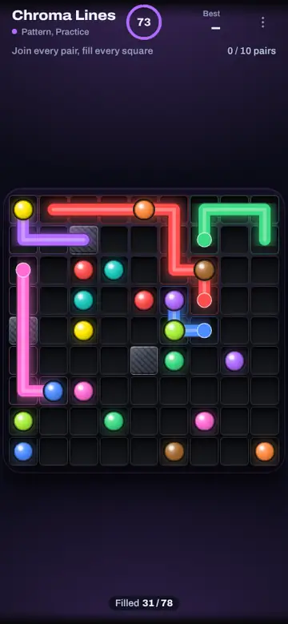
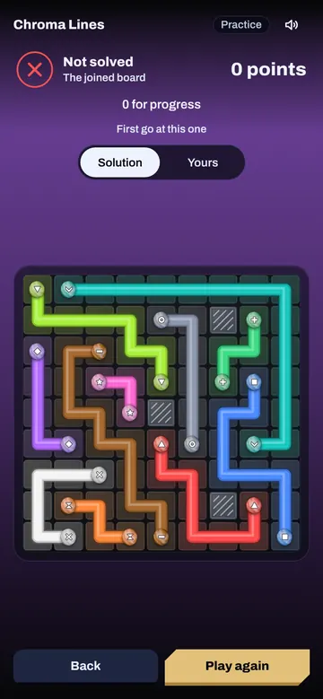

# Pattern overhaul: gallery

Phase 2 step 4 (15 Nov 2026). Before (main) and after for each of the eight Pattern games at 390 × 844, and short
clips of the hero effects. Images are in this folder.

<!-- Each game's section is between its own markers. -->

<!-- gridlock:start -->
## Gridlock
<!-- gridlock:end -->

<!-- tessellate:start -->
## Tessellate
<!-- tessellate:end -->

<!-- pipeline:start -->
## Pipeline
<!-- pipeline:end -->

<!-- chroma:start -->
## Chroma Lines

| Before (main) | After |
|---|---|
|  |  |
|  |  |
|  |   |

- **Look (A):** every dot is a glossy marble bead rendered in Blender (one per colour, `public/pattern-art/flow/`),
  each with its own white symbol so white/silver and yellow/lime are told apart; walls are hatched steel blocks, cells
  dark recessed slots; the lines keep their vivid colours as rich tubes with no glow.
- **flowRev 3:** drawing over another colour cuts that line back to the square before the crossing (the server grades
  the board by the same rule); a stray touch on a finished dot no longer wipes its line (only a drag restarts it).
- **Pills:** "Pairs 0 / 11" beside "Filled 8 / 78".
- **Reveal:** the player's own count reads "You: 0/11 pairs on route" and shows only under Yours.
- **Sound:** the line's tone rises as it grows (`flow.draw`), a cut (`flow.cut`), one sound for a join
  (`flow.connect`, the extra `correct` dropped), a near-miss hint (`flow.nearMiss`) and the solve (`flow.solve`).
<!-- chroma:end -->

<!-- skid:start -->
## Skid
<!-- skid:end -->

<!-- heave:start -->
## Heave
<!-- heave:end -->

<!-- lightbender:start -->
## Lightbender
<!-- lightbender:end -->

<!-- topsy:start -->
## Topsy-Turvy
<!-- topsy:end -->
