# Profile pages · review (phase 2, step 3)

14 Nov 2026 · the Profile session. Built to the style guide's
[phone/profile.png](../../style-guide/phone/profile.png) and [desktop/profile.png](../../style-guide/desktop/profile.png).
Phone pictures at 390 × 844 (shrunk to 300 px wide), dark theme unless named; before = main, after = this branch.
Drawn by `bun scripts/shots/profile-pages-shots.ts --tag=before|after` from the screens in `scripts/screens/profile.ts`.

## Your Profile (an account placed in rated play)

| Before | After |
|---|---|
| 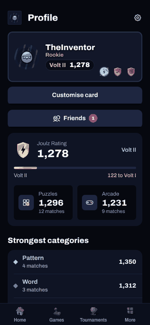 | 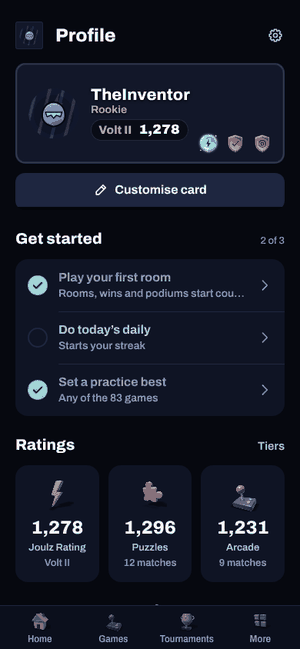 |
| 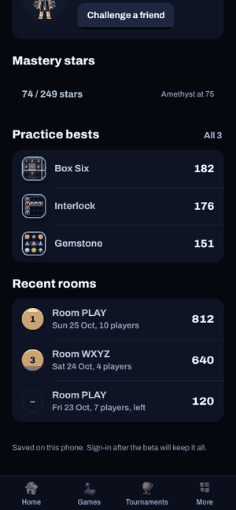 | 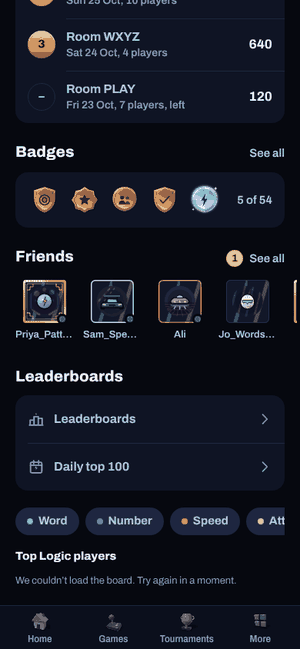 |

Card, Customise card, Ratings (Joulz Rating, Puzzles, Arcade tiles), strongest categories, Mastery (stars, bar, gem),
Recent matches, the Badges row and the Friends strip, then the sections Profile already had.

## An account without rated play · a guest

| Before | After |
|---|---|
| 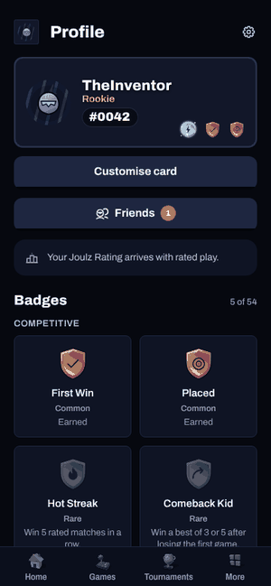 | 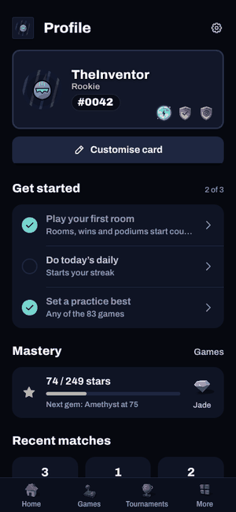 |
| 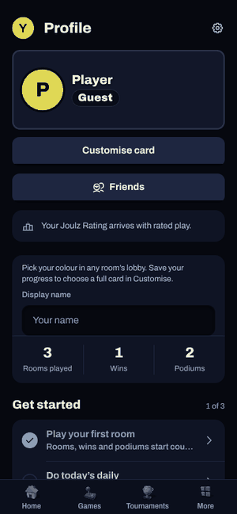 | 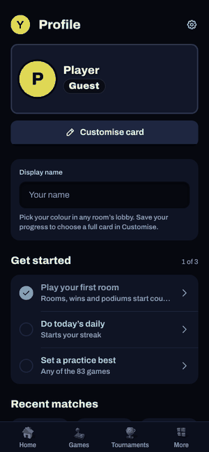 |

No Ratings section at all without rated play (the same rule as Home; the old "arrives with rated play" note is gone).
A guest keeps the Display name box; Customise and Friends open the save-your-progress sheet.

## New pages: Badges and your card

| Badges (`/badges`) | Your card (`/card`) |
|---|---|
| 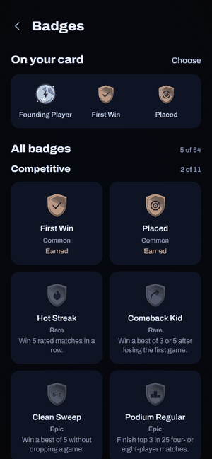 | 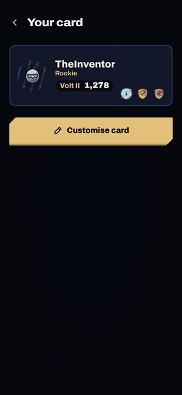 |

## Friends

| Before | After |
|---|---|
| 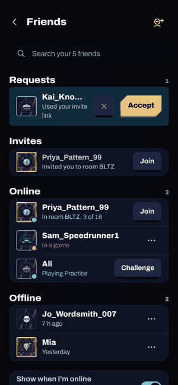 | 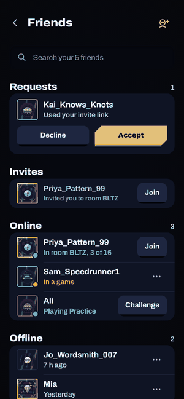 |
| 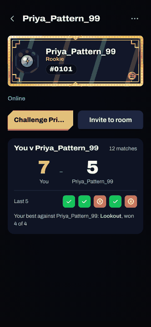 | 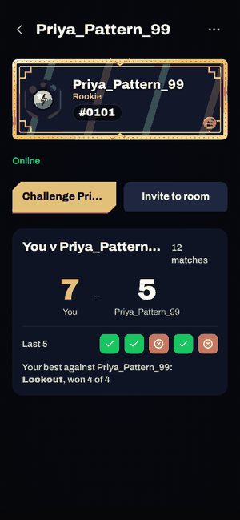 |
|  | 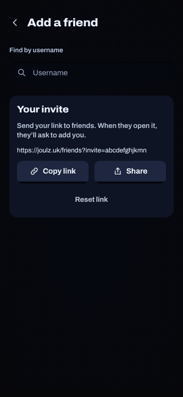 |

## Customise

| Before | After |
|---|---|
| 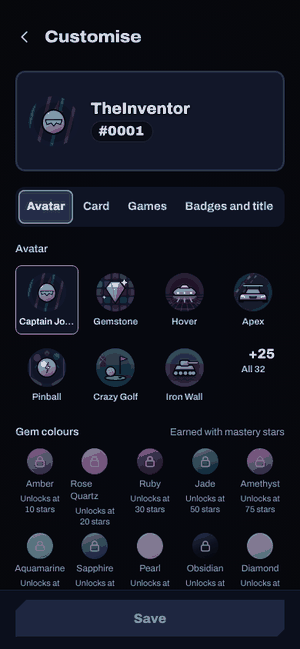 | 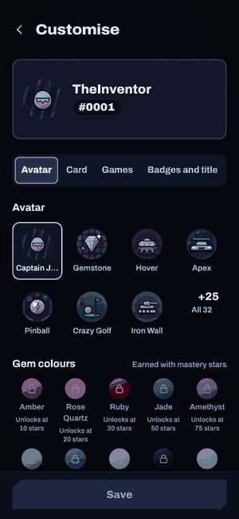 |
| 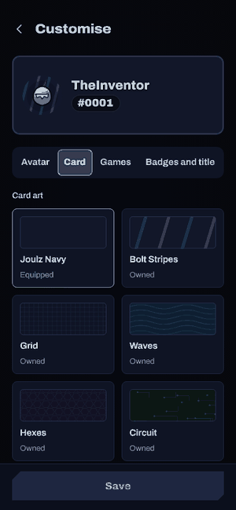 | 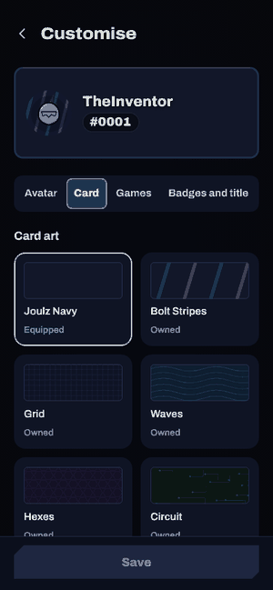 |

## Light theme

| Before | After |
|---|---|
| 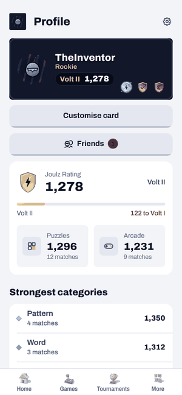 | 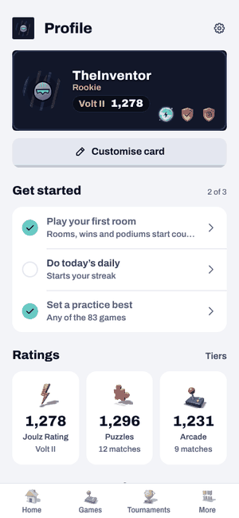 |

## Tablet and computer

The card column becomes the page's side column (left, sticky); the sections fill the rest.

| Before | After |
|---|---|
| 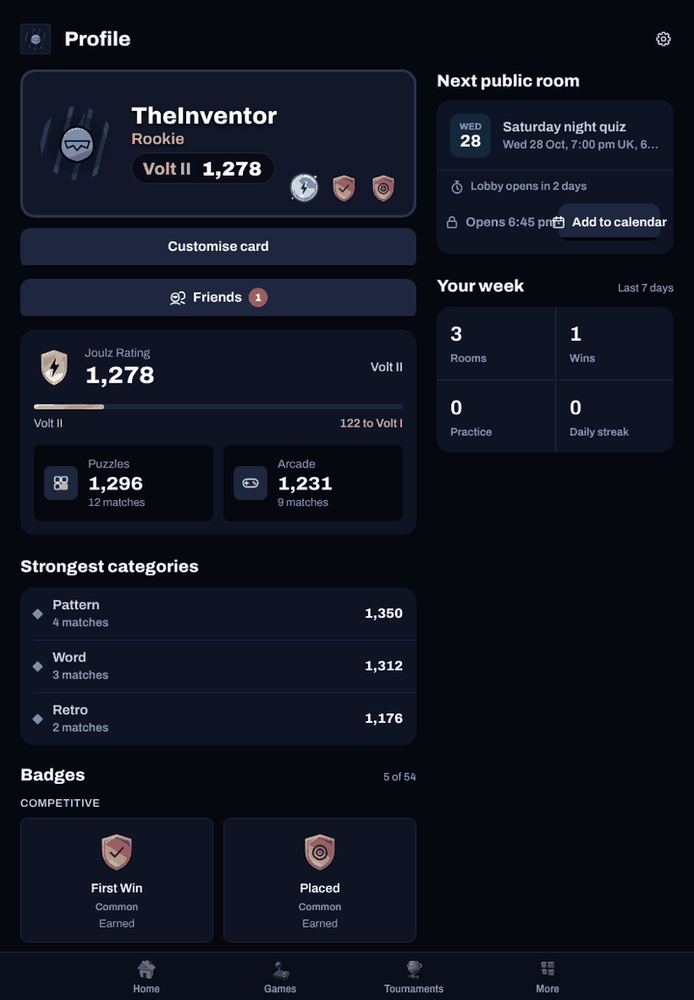 | 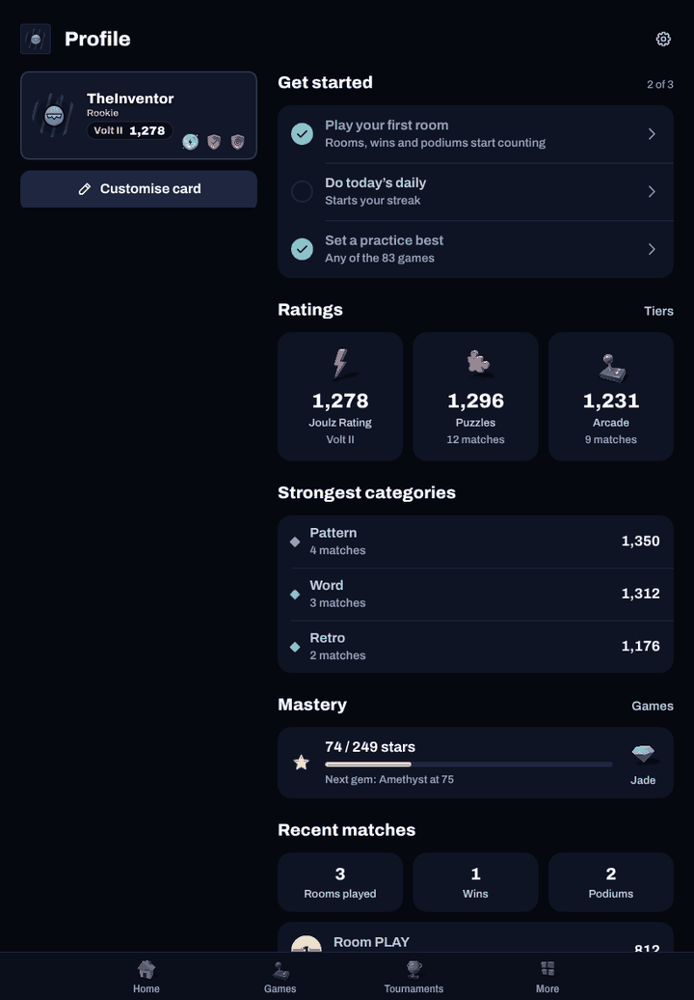 |
| 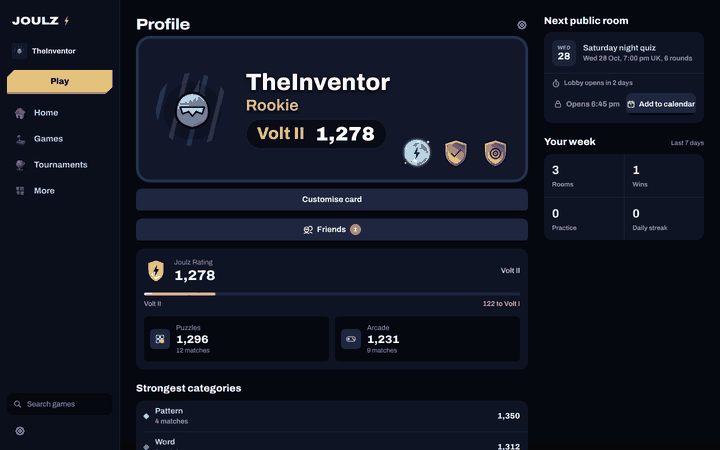 | 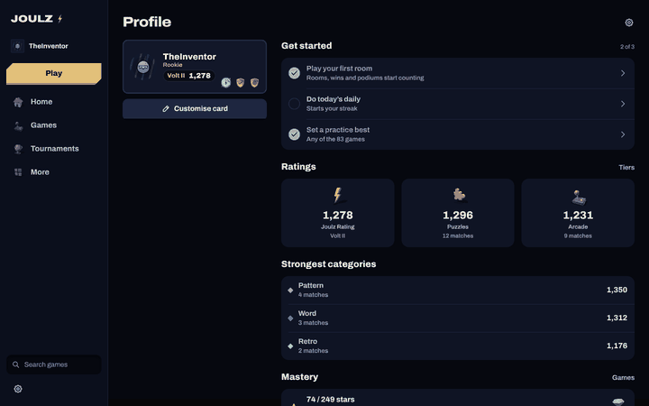 |
