# Retro overhaul gallery (stages 2 and 3)

## Stage 3 (16 Nov 2026)

Drawn by each game's own renderer in Node from skill-band bot runs on the dealt stamps (`bun scripts/shots/retro-stage3-frames.ts`,
`RETRO_PIXEL_FONT` set to Press Start 2P). The round-end payoffs are drawn 0.9 s into their own clock.

**Meteor's wormholes** as concept A's glowing rings: today (stage 2, approved head 1155779c) | concept A | new, close up at
the same square, then the whole boards.

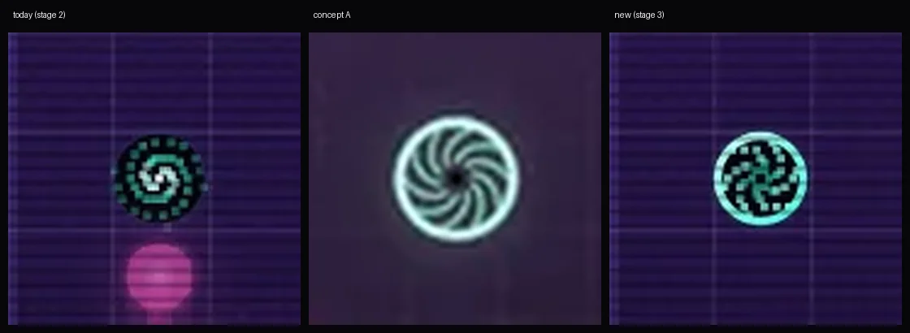

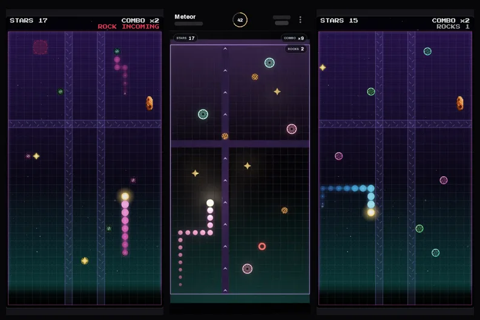

**The carried payoffs and the new moments**

| Hover: fly-off | Breaker: TIME BONUS | Wavefront: SECTOR CLEAR | Pinball: counter roll |
|---|---|---|---|
| 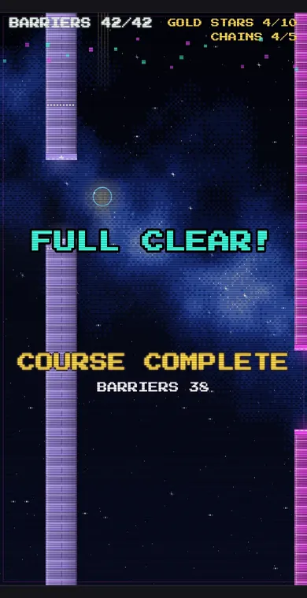 | 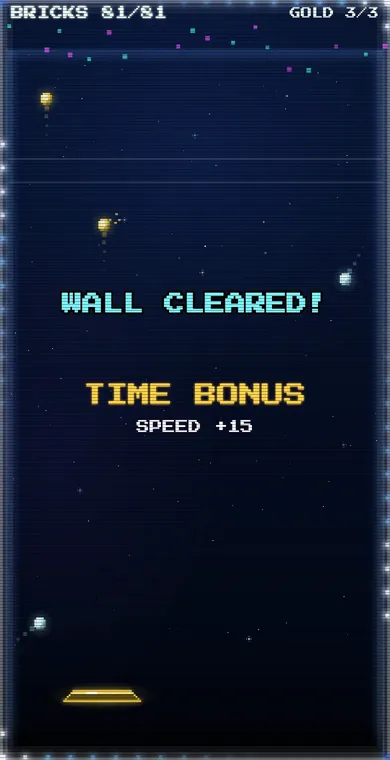 | 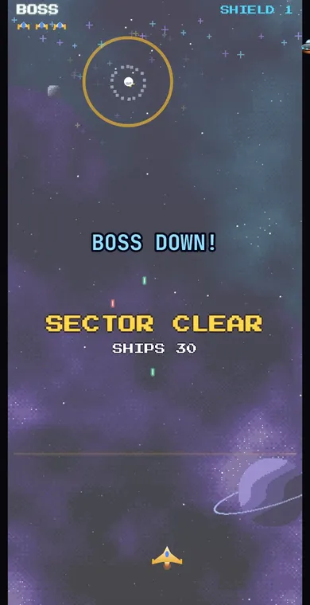 | 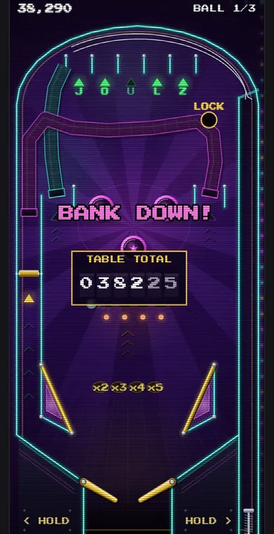 |

| Pinball: outlane save (pinRev 8) | Meteor: SAVED! (snakeRev 15) |
|---|---|
| 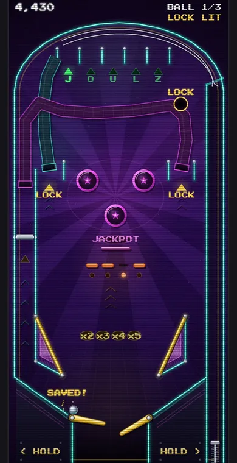 | 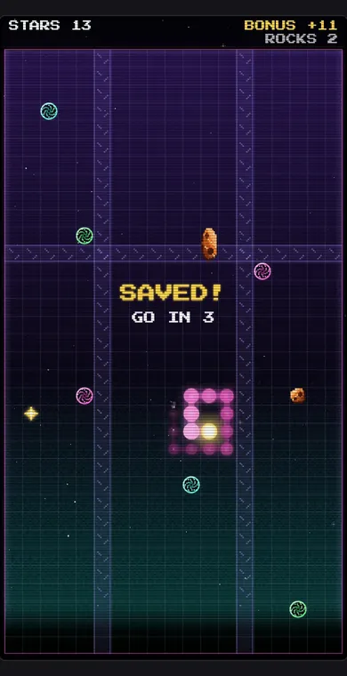 |

The stage-2 gallery follows (unchanged).

# Stage 2

Every frame is drawn by the game's own renderer in Node from the same run (the skill-band bot's Near-perfect log on room
seed 0, the dealt stamp, a fixed point in the run; `bun scripts/shots/retro-frames.ts`, with `RETRO_PIXEL_FONT` set to
Press Start 2P so the HUD draws in the app's font) at phone size: **today** on main 36ea8022, the **concept** Joe chose
from PR #428, and **new** on this branch at stage 2's head. **Clip**: four seconds of the same run with stage 2's
in-world effects (`bun scripts/shots/retro-clips.ts`, one canvas for the whole clip so the effects show; animated WebP).
**Intro**: before is the review's start screenshot, after the still from stage 1 (the app draws the still live from the
dealt stamp's renderer, so it carries stage 2's look). **Reveal**: before is the review's end screenshot (main dd9acbe6),
after is stage 2's reveal with the run summary, drawn by the screen harness at 390 × 844 from a stored run on the dealt
stamp (`bun scripts/shots/retro-reveal-shots.ts reveal`; the same screens theme-check and no-wrap-check draw).

## Hover

Concept B's deep space, kept retro: a pixel-art nebula (value noise quantised into four blue and indigo steps with a 4 × 4 ordered dither, 3 px blocks) sweeping across the sky, a nearer star layer drifting at three times the far one's pace, and the saucer's glass dome (a crisp highlight on its curve, a darker rim) over a polished metal hull.

**Stage 2.** A much richer nebula, close to concept B (six steps, three noise octaves, dark space between the clouds). Effects: a thrust puff and tilt on each tap, a gate chime rising along clean gates, DEAD CENTRE rims, scrape sparks within 3 px, the shield shattering.

| Today | Concept | New | Clip |
|---|---|---|---|
| 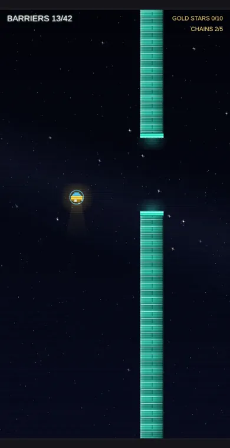 |  | 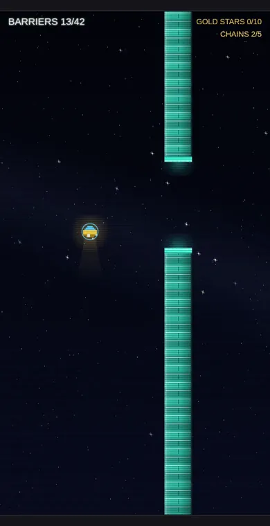 |  |

| Intro before | Intro after | Reveal before | Reveal after |
|---|---|---|---|
|  | 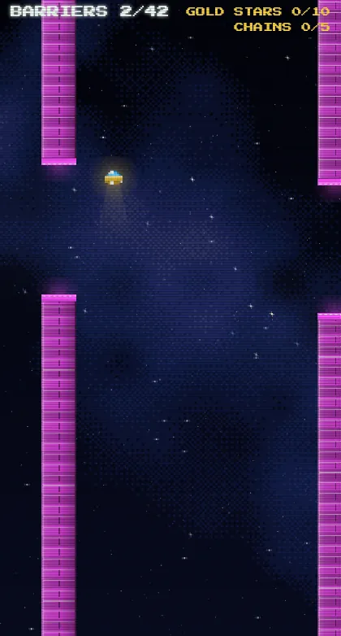 |  | 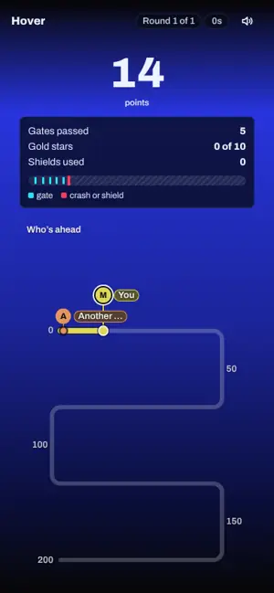 |

## Breaker

Today's pixel bricks, richer: enamel bricks with a glossy streak and glint; power bricks in a polished gold frame over smoked glass, **each with its own icon** (two balls, three shots, a laser beam, and now the Fireball's own burning ball, where it had a plain star); the falling capsules show the same icons (they printed 7 px letters); metal paddle; lit pixel-sphere ball. brkRev 12's 9-row wall.

**Stage 2.** Effects: a 2 px paddle dip and a pitched thock, hit bricks flashing and cracking (gold bricks deeper each hit), the break pitch stepping up within a volley, a caught power-up's icon rising over the paddle, the relaunch countdown on the paddle.

| Today | Concept | New | Clip |
|---|---|---|---|
|  |  |  |  |

| Intro before | Intro after | Reveal before | Reveal after |
|---|---|---|---|
| 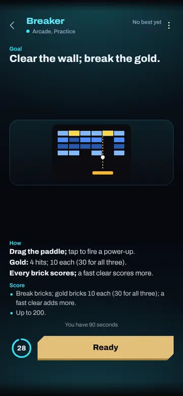 | 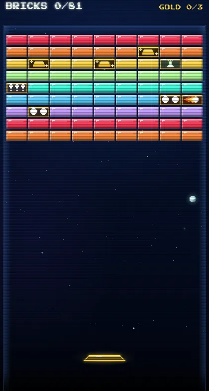 |  | 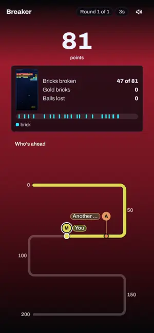 |

## Rally

Today's neon court, richer: a two-tone hard court (the service area a shade lighter), the floodlight painted as an ordered pixel dither, a fine surface grain, crisp painted lines each with a 1 px shadow, a lacquer sheen along the near baseline; lit pixel-sphere balls; metal paddle; the lives under GOLD (rallyRev 13).

**Stage 2.** The court reworked as a whole, with no box: a deep base, faint panels, two floodlight pools at the far end, grain and a sheen. Effects: the return pitch rising with the rally, a paddle flash in the ball's colour, a curl swirl on a spin swipe, edge-save sparks.

| Today | Concept | New | Clip |
|---|---|---|---|
|  |  | 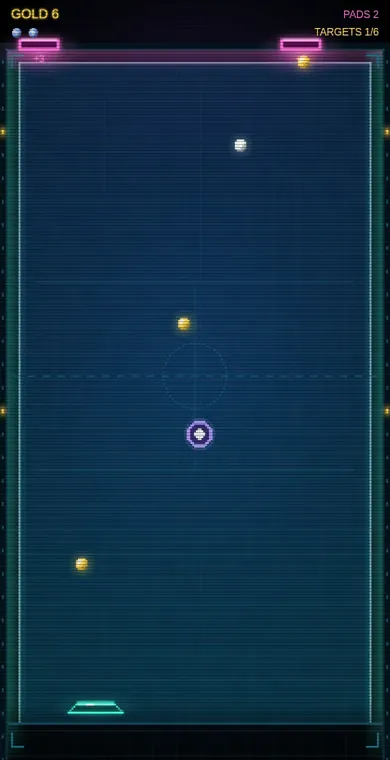 | 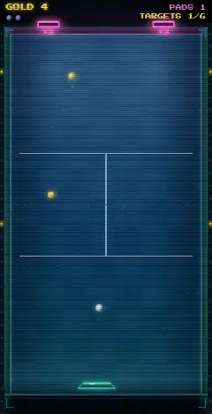 |

| Intro before | Intro after | Reveal before | Reveal after |
|---|---|---|---|
| 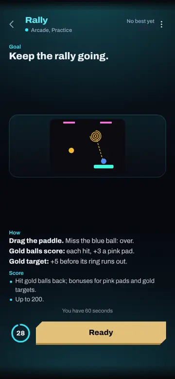 |  |  | 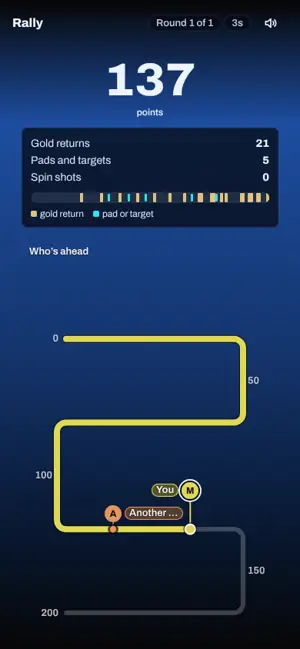 |

## Wavefront

Concept A's purple nebula (already behind it, unchanged); enemy edge lights electric cyan, no pink. wavRev 14's charged shot.

**Stage 2.** A richer space scene with depth and no pink: a violet and teal pixel nebula, a ringed planet and a moon, two drifting star layers; the wave banner in the pixel font. Effects: armour flashing white, kills pitch-stepped in a volley, gold sparks on weak points, a ring on a power-up, a streak and zip for a bolt within 4 px.

| Today | Concept | New | Clip |
|---|---|---|---|
|  |  |  |  |

| Intro before | Intro after | Reveal before | Reveal after |
|---|---|---|---|
|  | already a real frame (3 Nov 2026) |  | 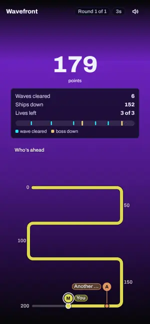 |

## Fission

Glass atoms (a crisp highlight on the curve, a thin rim of reflected light) in today's green, **bigger and bolder on burstRev 13** (38, 26, 17 and 10 px; were 32, 22, 14 and 8: a new stamp, since the atoms collide at the size drawn).

**Stage 2.** Effects: the split pop pitched by atom size, a grey fizzle where a wasted beam meets the ceiling, a shimmer when an atom skims within 6 px over the ship, the ship breaking into shards on a life lost.

| Today | Concept | New | Clip |
|---|---|---|---|
| 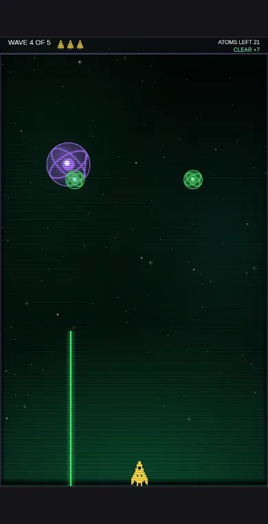 |  |  | 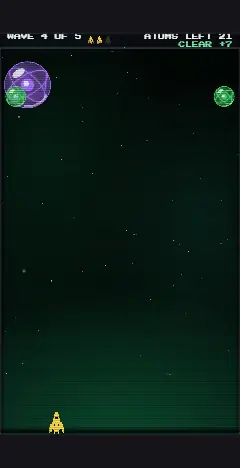 |

| Intro before | Intro after | Reveal before | Reveal after |
|---|---|---|---|
|  | 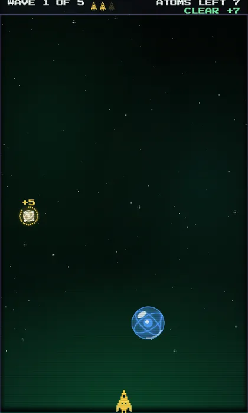 | 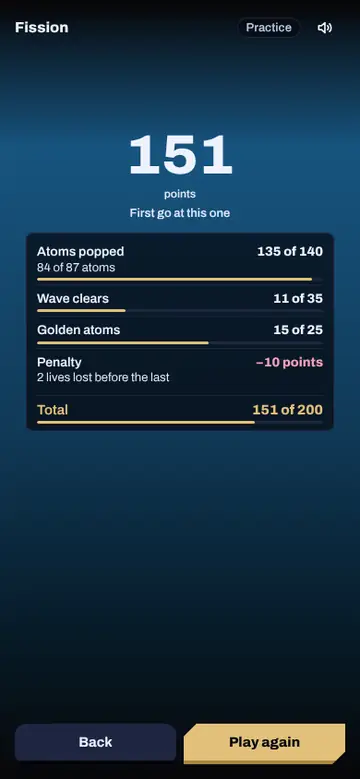 | 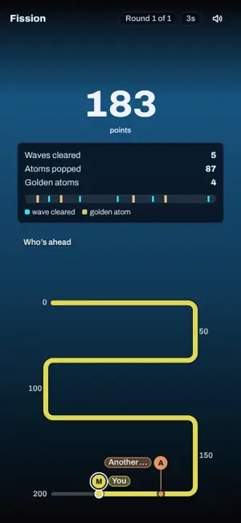 |

## Tempo

Concept A's cleaner lanes, kept retro with today's warmth: one crisp rail a lane edge (were two rails and two hairlines), no pad outlines, and a **round glass button for each lane on the hit line** (2 px blocks, a highlight on its upper curve), lit in the lane's colour when its note is struck; a dark glass floor under the line; the combo count moved under the buttons; the FEVER bar taller so its label reads at 11 px.

**Stage 2.** Effects: a Good's smaller spark burst (Perfect keeps its rays), sparks while a hold is held and a crackle on its clean release, a swipe's streak along the line, a missed note dropping grey, fever's riser.

| Today | Concept | New | Clip |
|---|---|---|---|
|  |  |  |  |

| Intro before | Intro after | Reveal before | Reveal after |
|---|---|---|---|
|  |  |  | 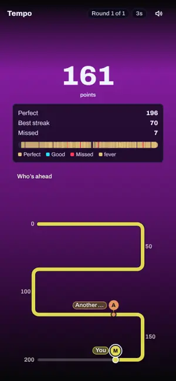 |

## Meteor

Concepts A/B's glowing tail, kept retro: a soft halo round the white-gold head, a light band along the body, and a ribbon joining the segments in the tail's colours (all inside the body's own cells); **rocks in three sizes on snakeRev 14** (1 × 1, the new 2 × 1 and 1 × 2, and the 2 × 2 boulders).

**Stage 2.** The background towards concept A (a dithered violet-to-teal field on the board, sparse stars outside) and concept A's spiral wormholes. Effects: a turn flare, the crunch rising inside the combo window, a gold ring, a ring where the comet wraps in, dust off a rock grazed.

| Today | Concept | New | Clip |
|---|---|---|---|
|  |  |  |  |

| Intro before | Intro after | Reveal before | Reveal after |
|---|---|---|---|
|  | 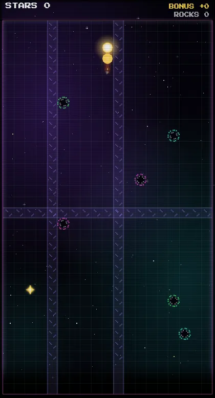 |  | 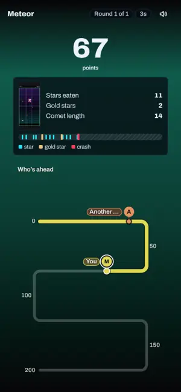 |

## Spacewalk

Today's pixel style, richer: a faint violet and teal pixel nebula and a distant lit planet behind translucent lanes, ships of lit metal (panel seams, a darker keel, a glint on the nose) and a **bigger astronaut** (42 px of the 44 px lane and the hit box's full ±13 px width, was 37 by ±12), lit panels and a gold visor with a crisp reflection.

**Stage 2.** A clear lift: lit, bevelled station decks with window lights and a glossy hazard band, three-band shading on the ships, stars drifting in the lanes. Effects: a jet puff on each hop and a dust ring on landing, close-call streaks, the deck lighting gold on a crossing, the streak's count above the astronaut.

| Today | Concept | New | Clip |
|---|---|---|---|
|  |  |  | 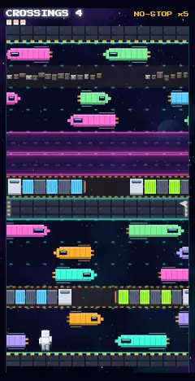 |

| Intro before | Intro after | Reveal before | Reveal after |
|---|---|---|---|
|  | already a real frame (3 Nov 2026) | 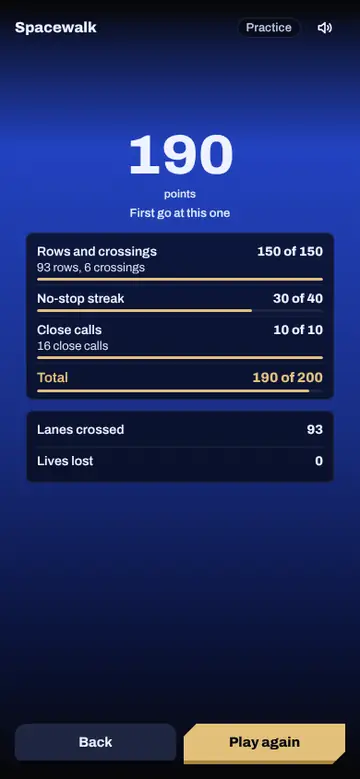 | 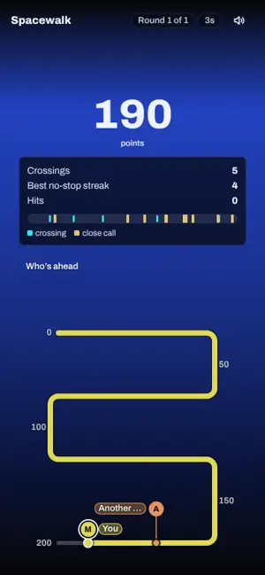 |

## Pinball

Today's chrome table kept. Every label now draws at 11 px (LOCK, J-O-U-L-Z, the multipliers, JACKPOT, HOLD), the jackpot insert widened to hold its word.

**Stage 2.** A clear lift: sunburst rays and doubled light pools on the playfield, a gold pinstripe. Effects: an 80 ms white flash on a raised flipper, the bumper cap swelling 2 px, gold lamps chasing a ball up a ramp, "BALL n LOCKED" with a gold flare, sparks for multiball (with its own start and end sounds).

| Today | Concept | New | Clip |
|---|---|---|---|
|  |  | 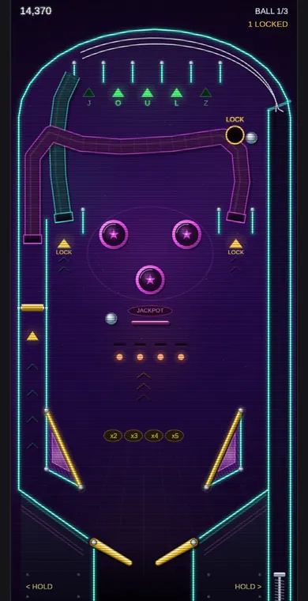 | 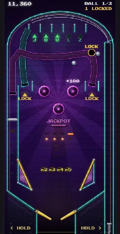 |

| Intro before | Intro after | Reveal before | Reveal after |
|---|---|---|---|
| 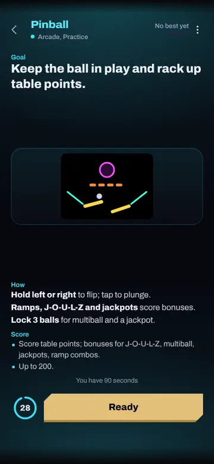 | 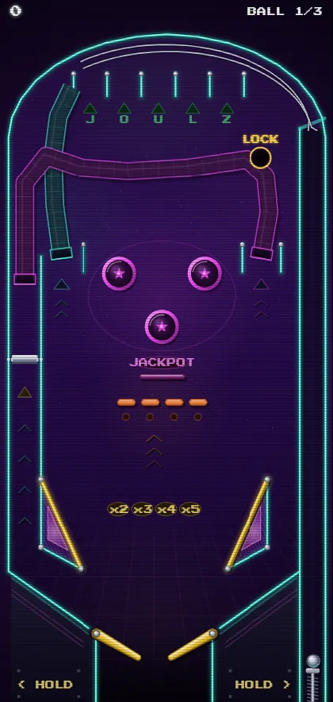 |  | 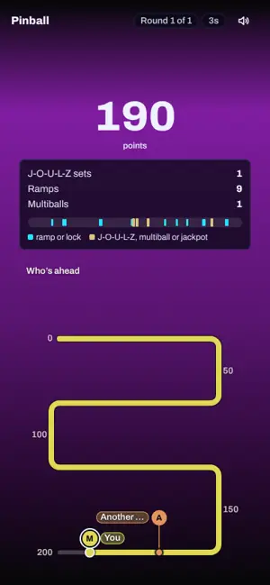 |

## Blockzone

Solid, chunky lacquered blocks with a glossy streak, a hot spot and a soft glow inside each cell (glow is this game's allowance); NEXT at 11 px.

**Stage 2.** A clear lift with the glow emphasised: a glass well with a top light, a dot grid, a chrome bevel, a cabinet scene, and a neon halo round the stack. Effects: a white outline on a turn and a red one when refused, a hard drop's streaks, a lock flash, sparks along a clear with the rows above dropping into place, the rim beating red within three rows of the top.

| Today | Concept | New | Clip |
|---|---|---|---|
| 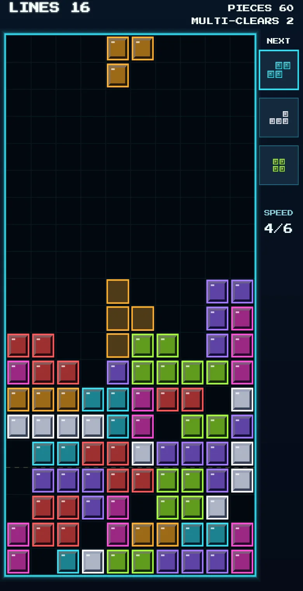 |  |  |  |

| Intro before | Intro after | Reveal before | Reveal after |
|---|---|---|---|
|  | 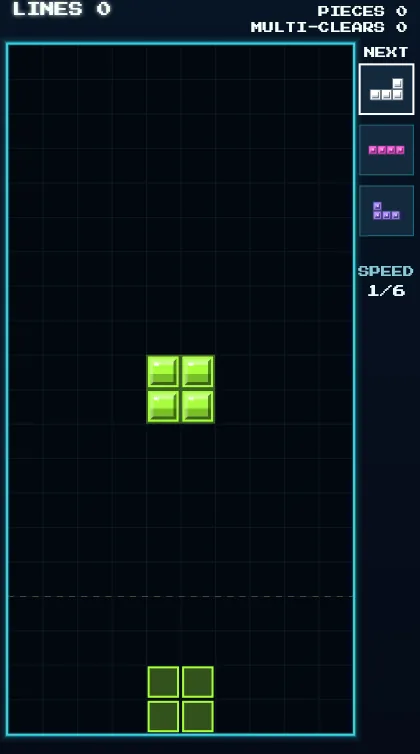 |  | 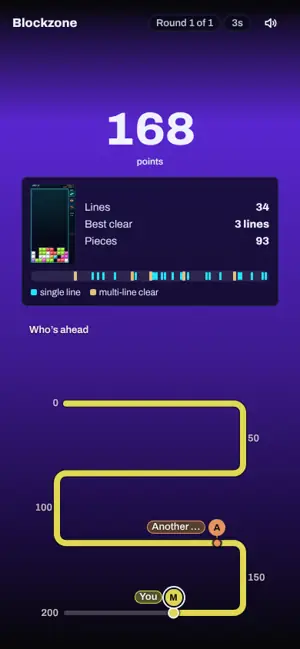 |
