# Retro overhaul gallery (stage 1)

Every frame is drawn by the game's own renderer in Node from the same run (the skill-band bot's Near-perfect log on room
seed 0, the dealt stamp, a fixed point in the run; `bun scripts/shots/retro-frames.ts`, with `RETRO_PIXEL_FONT` set to
Press Start 2P so the HUD draws in the app's font): **today** on main 36ea8022, **new** on this branch, beside the concept
Joe chose from PR #428 (where Joe kept today's look, concept A for reference). **Clip**: three seconds of the same run
(`bun scripts/shots/retro-clips.ts`, animated WebP). **Intro**: before is the review's start screenshot (the old
drawing), after is the new still, a real frame from the dealt stamp's renderer (`ArtStill`). **Reveal**: today's, unchanged
in stage 1 (the redesign is stage 2, inside #422's shared reveal layout).

## Hover

Concept B's deep space, kept retro: a pixel-art nebula (value noise quantised into four blue and indigo steps with a 4 × 4 ordered dither, 3 px blocks) sweeping across the sky, a nearer star layer drifting at three times the far one's pace, and the saucer's glass dome (a crisp highlight on its curve, a darker rim) over a polished metal hull.

| Today | Concept | New | Clip |
|---|---|---|---|
|  |  |  | 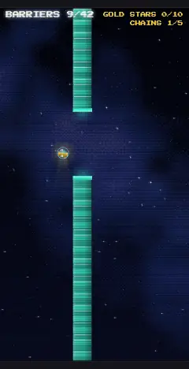 |

| Intro before | Intro after | Reveal (today, unchanged) |
|---|---|---|
| 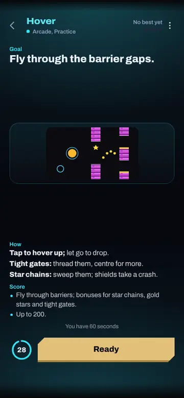 |  | 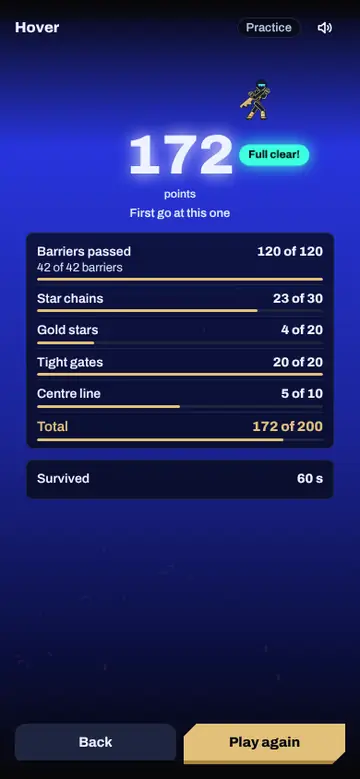 |

## Breaker

Today's pixel bricks, richer: enamel bricks with a glossy streak and glint; power bricks in a polished gold frame over smoked glass, **each with its own icon** (two balls, three shots, a laser beam, and now the Fireball's own burning ball, where it had a plain star); the falling capsules show the same icons (they printed 7 px letters); metal paddle; lit pixel-sphere ball. brkRev 12's 9-row wall.

| Today | Concept | New | Clip |
|---|---|---|---|
| 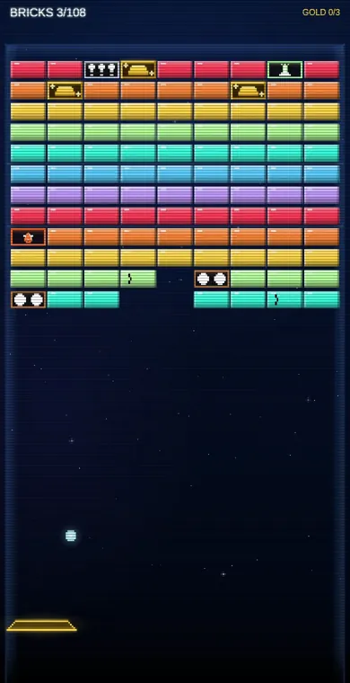 |  | 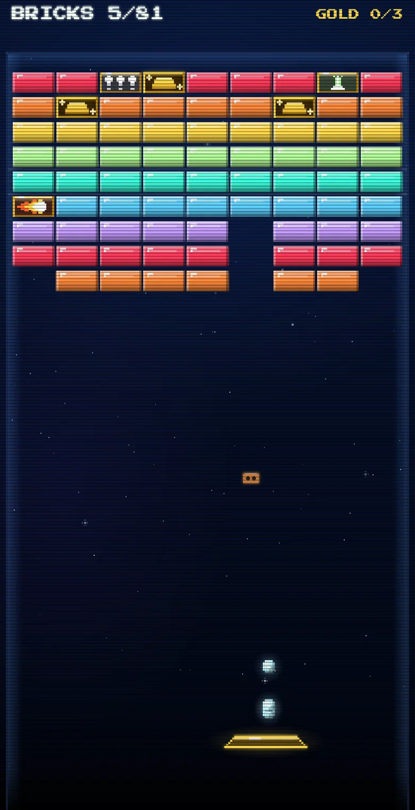 | 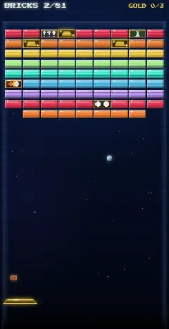 |

| Intro before | Intro after | Reveal (today, unchanged) |
|---|---|---|
|  |  |  |

## Rally

Today's neon court, richer: a two-tone hard court (the service area a shade lighter), the floodlight painted as an ordered pixel dither, a fine surface grain, crisp painted lines each with a 1 px shadow, a lacquer sheen along the near baseline; lit pixel-sphere balls; metal paddle; the lives under GOLD (rallyRev 13).

| Today | Concept | New | Clip |
|---|---|---|---|
| 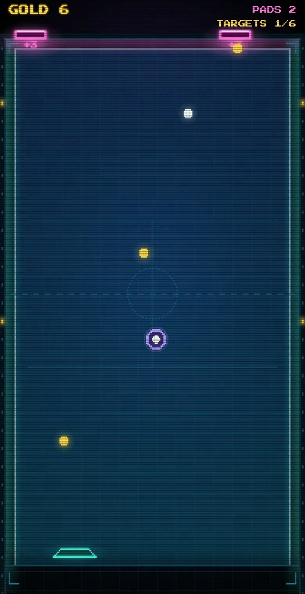 |  |  |  |

| Intro before | Intro after | Reveal (today, unchanged) |
|---|---|---|
|  | 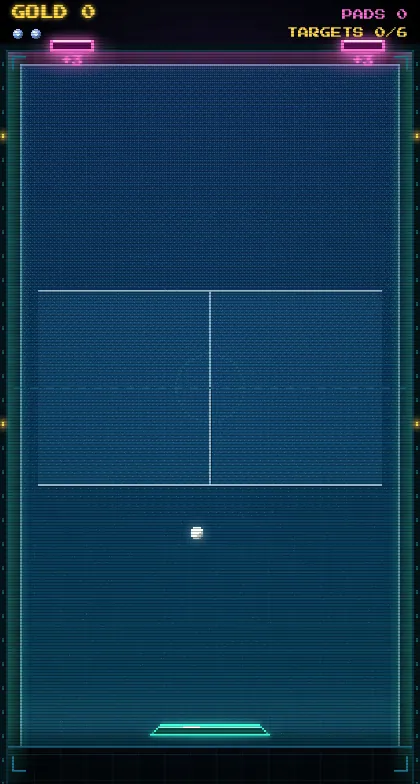 | 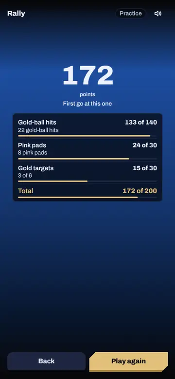 |

## Wavefront

Concept A's purple nebula (already behind it, unchanged); enemy edge lights electric cyan, no pink. wavRev 14's charged shot.

| Today | Concept | New | Clip |
|---|---|---|---|
|  | 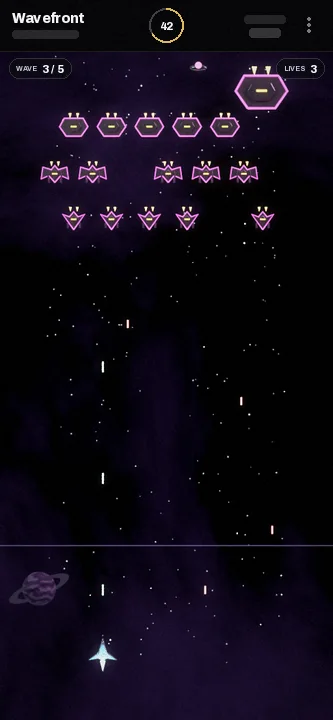 | 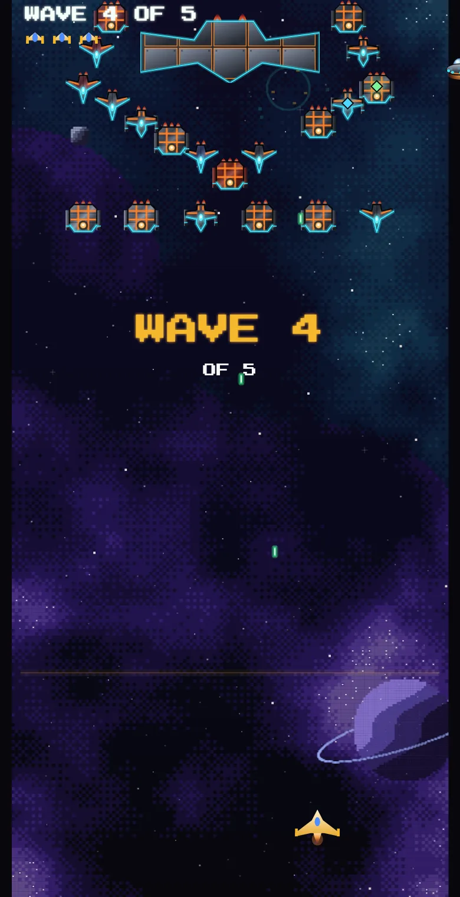 | 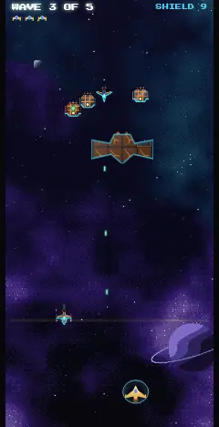 |

| Intro before | Intro after | Reveal (today, unchanged) |
|---|---|---|
|  | already a real frame (3 Nov 2026) |  |

## Fission

Glass atoms (a crisp highlight on the curve, a thin rim of reflected light) in today's green, **bigger and bolder on burstRev 13** (38, 26, 17 and 10 px; were 32, 22, 14 and 8: a new stamp, since the atoms collide at the size drawn).

| Today | Concept | New | Clip |
|---|---|---|---|
|  |  |  |  |

| Intro before | Intro after | Reveal (today, unchanged) |
|---|---|---|
| 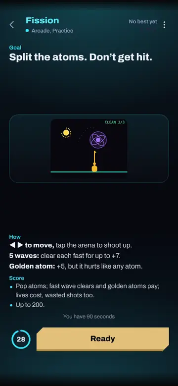 |  |  |

## Tempo

Concept A's cleaner lanes, kept retro with today's warmth: one crisp rail a lane edge (were two rails and two hairlines), no pad outlines, and a **round glass button for each lane on the hit line** (2 px blocks, a highlight on its upper curve), lit in the lane's colour when its note is struck; a dark glass floor under the line; the combo count moved under the buttons; the FEVER bar taller so its label reads at 11 px.

| Today | Concept | New | Clip |
|---|---|---|---|
|  |  |  | 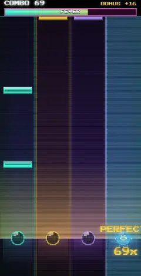 |

| Intro before | Intro after | Reveal (today, unchanged) |
|---|---|---|
| 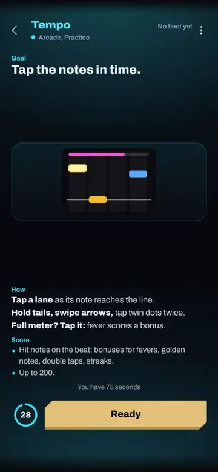 | 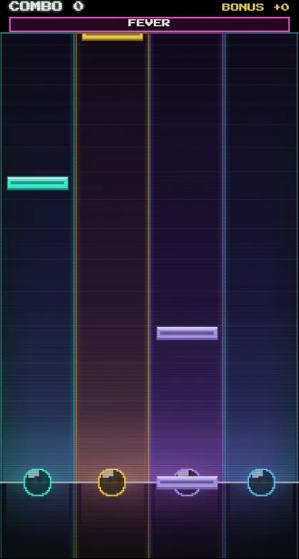 |  |

## Meteor

Concepts A/B's glowing tail, kept retro: a soft halo round the white-gold head, a light band along the body, and a ribbon joining the segments in the tail's colours (all inside the body's own cells); **rocks in three sizes on snakeRev 14** (1 × 1, the new 2 × 1 and 1 × 2, and the 2 × 2 boulders).

| Today | Concept | New | Clip |
|---|---|---|---|
|  |  | 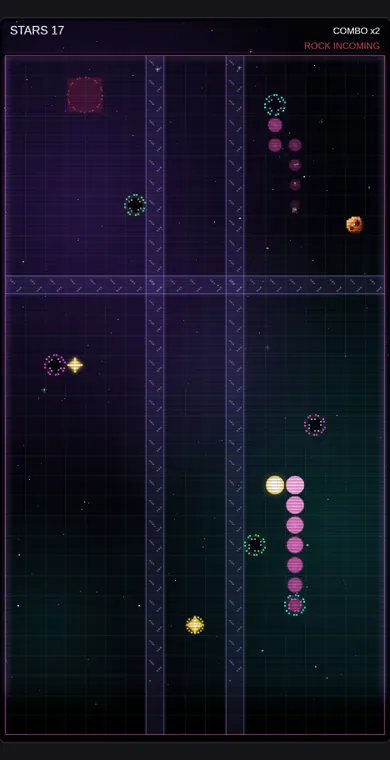 | 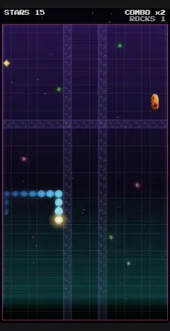 |

| Intro before | Intro after | Reveal (today, unchanged) |
|---|---|---|
| 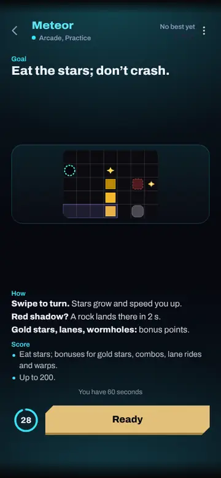 |  |  |

## Spacewalk

Today's pixel style, richer: a faint violet and teal pixel nebula and a distant lit planet behind translucent lanes, ships of lit metal (panel seams, a darker keel, a glint on the nose) and a **bigger astronaut** (42 px of the 44 px lane and the hit box's full ±13 px width, was 37 by ±12), lit panels and a gold visor with a crisp reflection.

| Today | Concept | New | Clip |
|---|---|---|---|
| 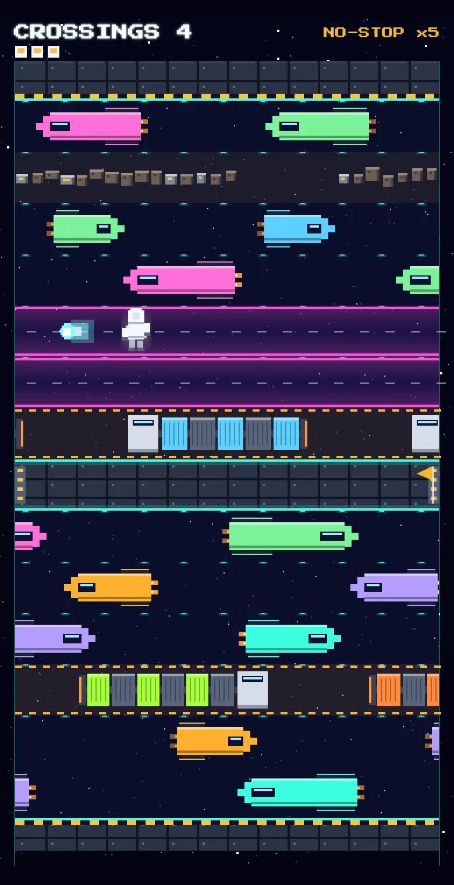 |  |  |  |

| Intro before | Intro after | Reveal (today, unchanged) |
|---|---|---|
| 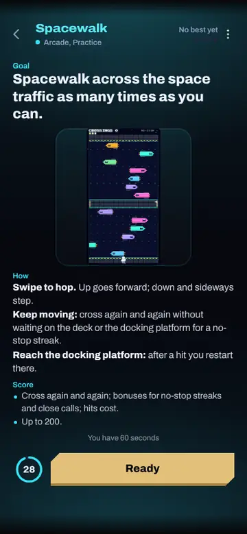 | already a real frame (3 Nov 2026) |  |

## Pinball

Today's chrome table kept. Every label now draws at 11 px (LOCK, J-O-U-L-Z, the multipliers, JACKPOT, HOLD), the jackpot insert widened to hold its word.

| Today | Concept | New | Clip |
|---|---|---|---|
|  |  |  |  |

| Intro before | Intro after | Reveal (today, unchanged) |
|---|---|---|
|  |  |  |

## Blockzone

Solid, chunky lacquered blocks with a glossy streak, a hot spot and a soft glow inside each cell (glow is this game's allowance); NEXT at 11 px.

| Today | Concept | New | Clip |
|---|---|---|---|
|  |  | 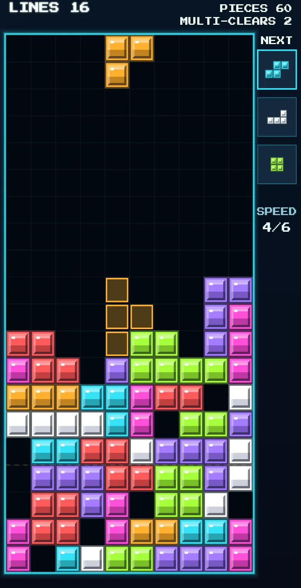 | 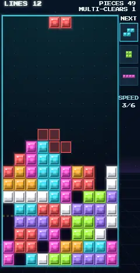 |

| Intro before | Intro after | Reveal (today, unchanged) |
|---|---|---|
|  |  | 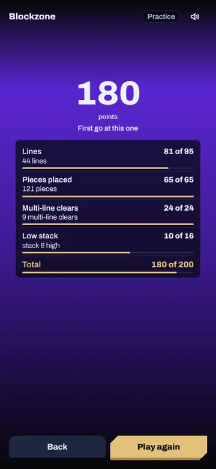 |
