# Retro overhaul gallery (stage 1)

Each game's arena drawn by its own renderer from the same run (the skill-band bot's Near-perfect log, the dealt stamp,
a fixed point in the run; `bun scripts/shots/retro-frames.ts`), on main (today) and on this branch (new), beside the
concept Joe chose from PR #428 (or, where Joe kept today's look, concept A for reference). The HUD's pixel font is a
stand-in in these renders (the app loads Press Start 2P from Google Fonts). Answer reveals: unchanged in stage 1 (the
redesign is built in stage 2 inside #422's shared reveal layout), so the reveal column shows today's reveal from the
review (docs/design/game-reviews/img/retro).

Play clips: not recorded yet (no clip tool in this pass).

## Hover

Chosen concept: B (deep-space starfield). Look not yet changed in this pass: today's frame and the new one are the same art (the starfield and saucer pass is still to do).

| Today | Concept | New | Reveal (today, unchanged) |
|---|---|---|---|
|  | 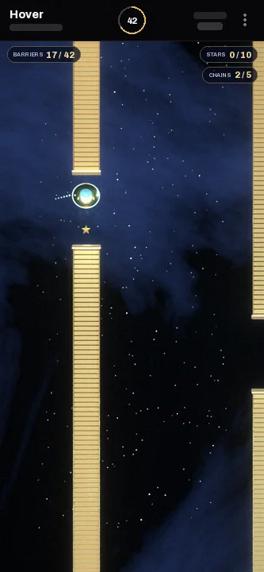 |  |  |

## Breaker

Chosen concept: none: today's pixel bricks, richer. Enamel bricks with a crisp glossy streak and glint; power bricks in a polished gold frame over smoked glass; metal paddle; lit pixel-sphere ball. The new frame is brkRev 12's 9-row wall.

| Today | Concept | New | Reveal (today, unchanged) |
|---|---|---|---|
|  | 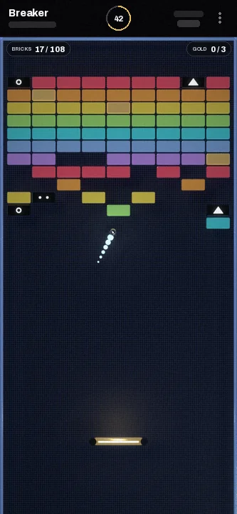 |  | 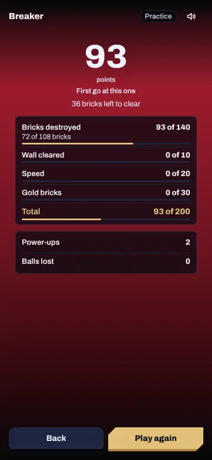 |

## Rally

Chosen concept: none: today's neon court, crisper. Lit pixel-sphere balls with a highlight on the curve; metal paddle; the lives under GOLD (rallyRev 13).

| Today | Concept | New | Reveal (today, unchanged) |
|---|---|---|---|
|  | 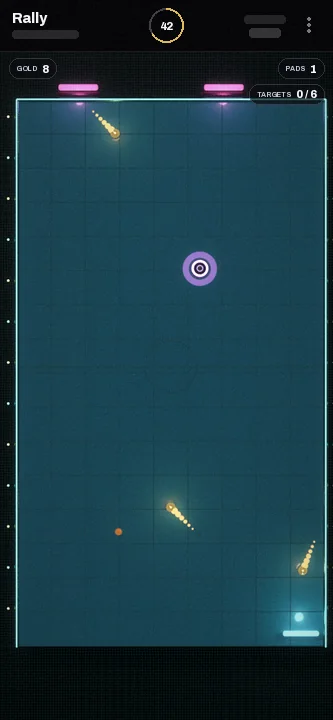 |  |  |

## Wavefront

Chosen concept: A (purple nebula). Enemy edge lights electric cyan, no pink (were magenta); the nebula already sits behind (Polish A4) and is unchanged.

| Today | Concept | New | Reveal (today, unchanged) |
|---|---|---|---|
| 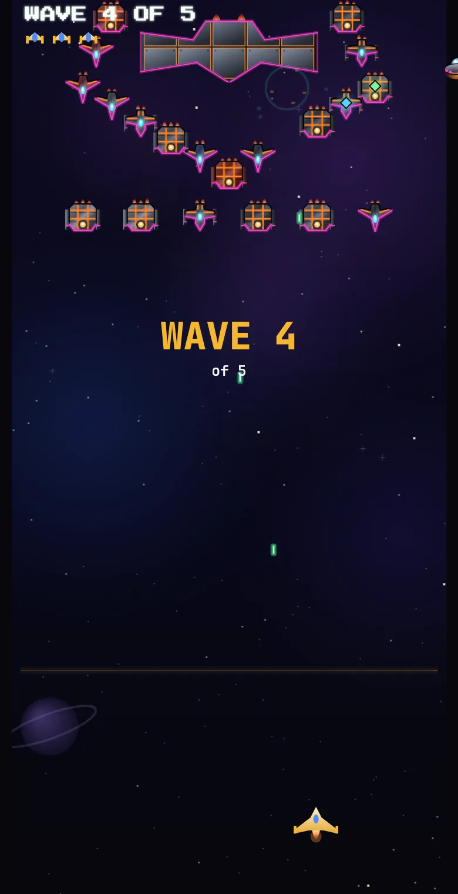 |  |  | 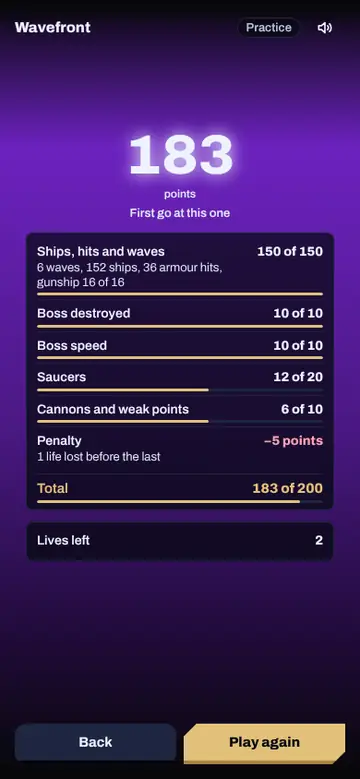 |

## Fission

Chosen concept: A/B atoms, simpler, in today's green. Glass atoms: a crisp highlight on each orb's curve and reflected rim light. The atoms are not yet bigger (that needs a stamp).

| Today | Concept | New | Reveal (today, unchanged) |
|---|---|---|---|
|  | 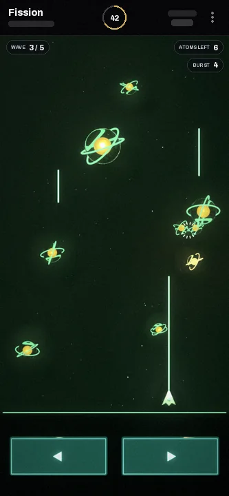 | 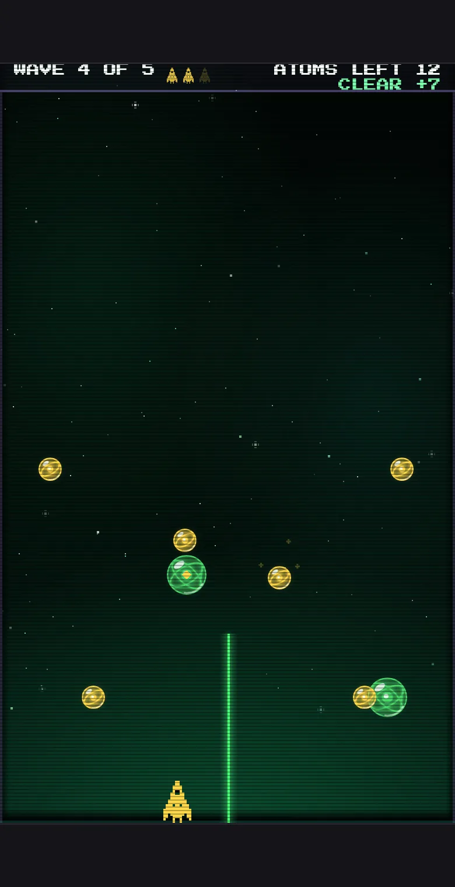 |  |

## Tempo

Chosen concept: A (cleaner lanes, big tap buttons). Look not yet changed in this pass.

| Today | Concept | New | Reveal (today, unchanged) |
|---|---|---|---|
| 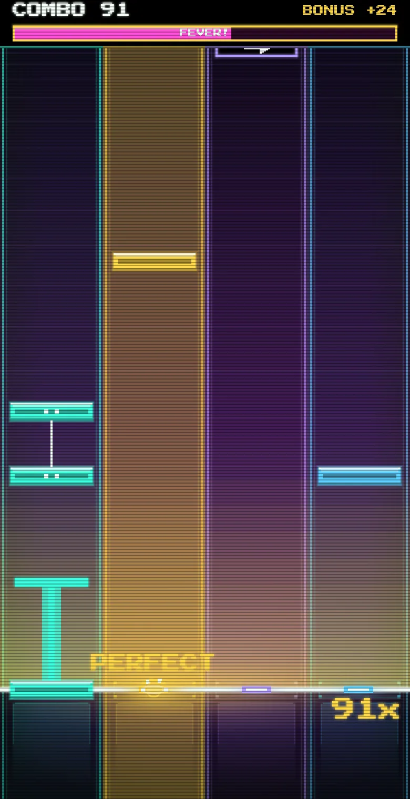 | 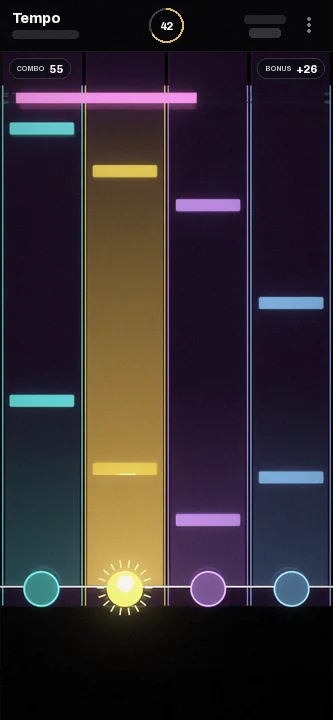 | 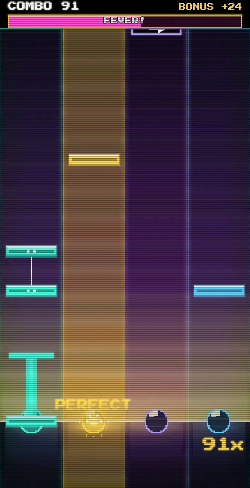 | 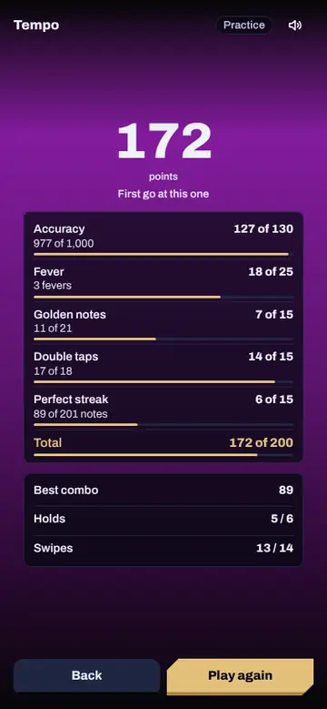 |

## Meteor

Chosen concept: A and B (glowing comet tail). Look not yet changed in this pass; the new frame is snakeRev 13 (wrap-around edges).

| Today | Concept | New | Reveal (today, unchanged) |
|---|---|---|---|
| 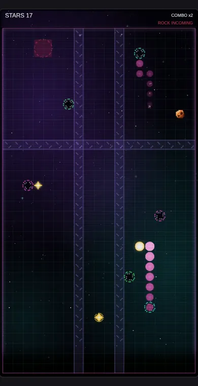 | 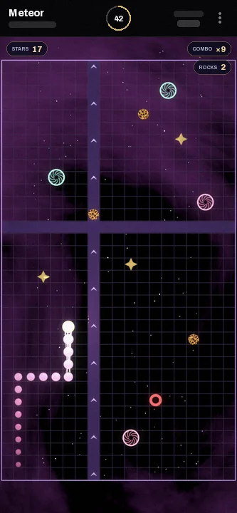 |  | 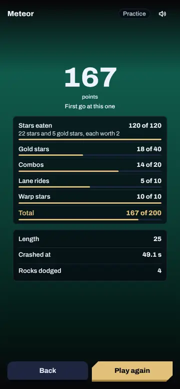 |

## Spacewalk

Chosen concept: none: today's pixel style, richer. Look not yet changed in this pass.

| Today | Concept | New | Reveal (today, unchanged) |
|---|---|---|---|
|  | 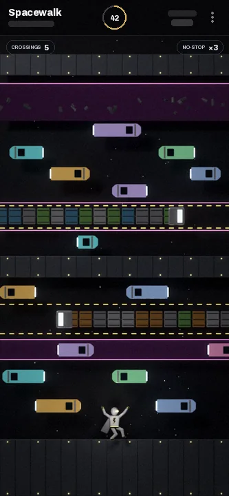 | 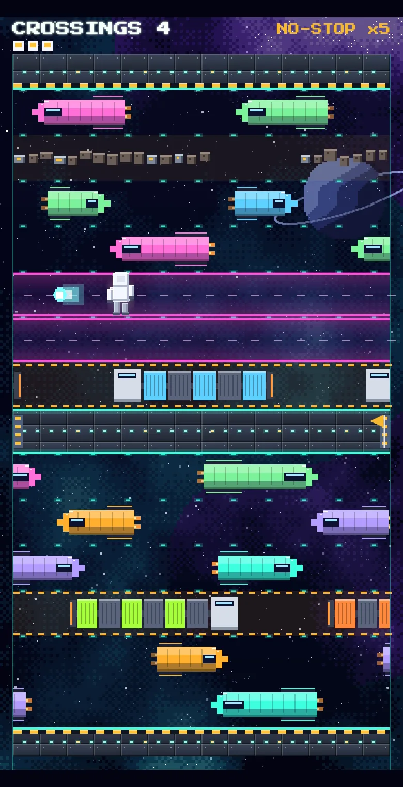 |  |

## Pinball

Chosen concept: none: today's richer table. Already a chrome ball and rich table; no change in this pass.

| Today | Concept | New | Reveal (today, unchanged) |
|---|---|---|---|
| 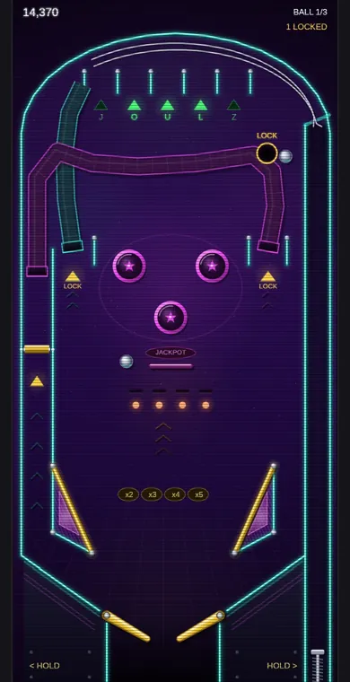 | 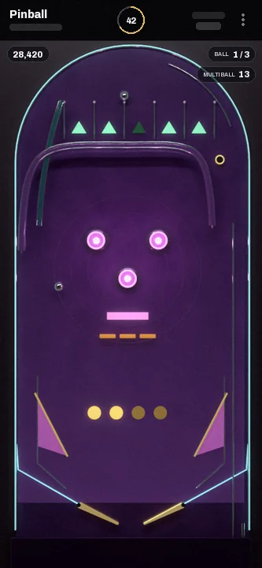 |  | 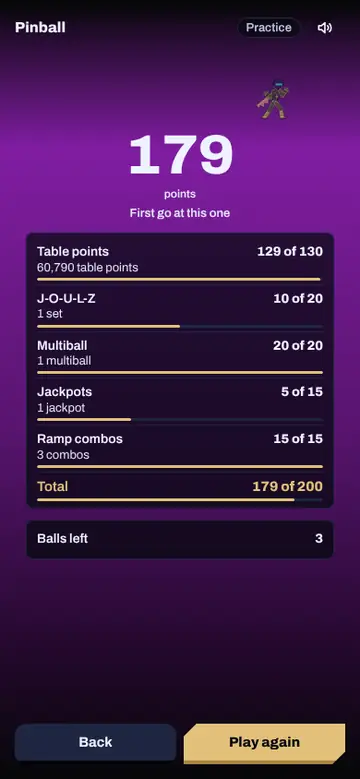 |

## Blockzone

Chosen concept: none: today's colours, solid blocks. Solid, chunky lacquered blocks (were dark faces inside bright rims), a glossy streak and hot spot on each, a soft in-cell halo (Blockzone's glow exception).

| Today | Concept | New | Reveal (today, unchanged) |
|---|---|---|---|
|  | 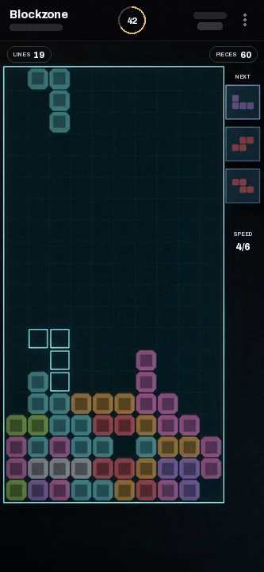 |  |  |
