# Rooms and rated: before and after

Phase 2 step 3, 14 Nov 2026. Each phone picture is main (left) beside this branch (right) at 390 × 844, drawn
from the theme harness by `bun scripts/shots/rooms-rated-shots.ts --out=<dir> [--tag=before]`. New screens show the
branch only.

## Rooms

**Lobby.** Your own row now comes first and runs across the grid, marked in your colour. When your look can be
changed it has a plain **Change** button with a chevron instead of the ▾ glyph. Code, Copy link, Share, Room
settings and the gold Start game are unchanged.

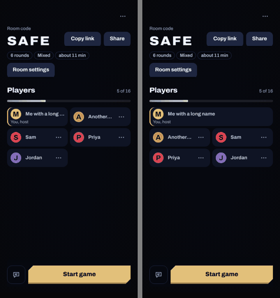

**Round result and standings** are unchanged for ordinary rooms. In a rated 1v1 the match header now sits on top
(see below).

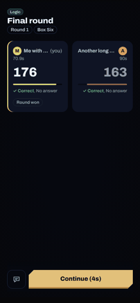 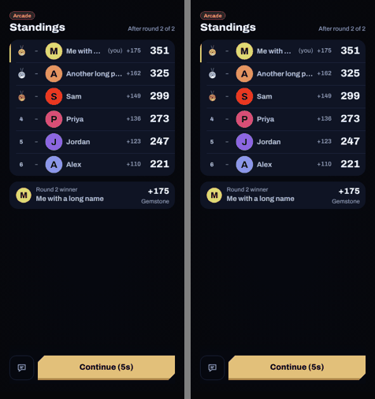

**Podium** (the top three as full cards; Share and Play again) is unchanged.

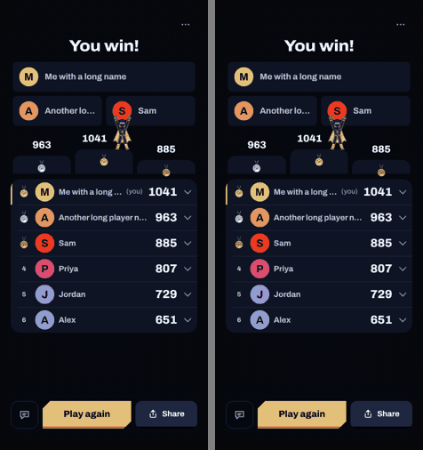

**Dropout and Finish now banner.** It's now a surface panel with a loss-red edge instead of the orange box. The words,
countdown and Finish now flow are exactly as before.

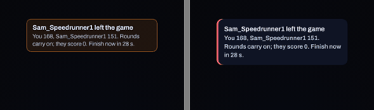

## Rated

**Searching**: Cancel sits at the foot as before.

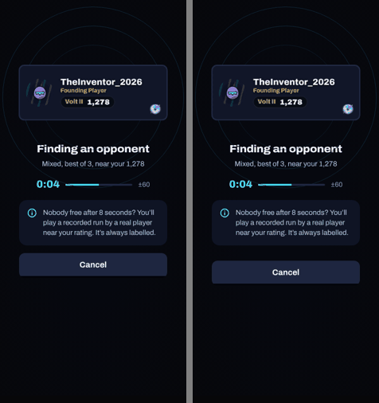

**VS**: both full PlayerCards, now centred on the screen.

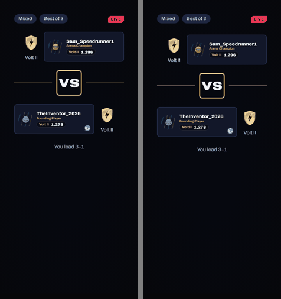

**Match header (new).** Both players as mini cards, with their rating, Placement or Guest. In the middle, Game N of M
over the games won, then one line: "Rated · Mixed · Best of 3". It shows over a rated 1v1's round result and
standings in the room, as in the style guide's arcade.png and puzzle.png.

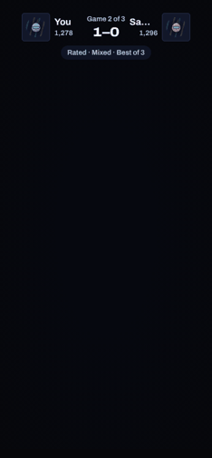

**Result**: panels on the surface, without the stripe texture behind the headline.

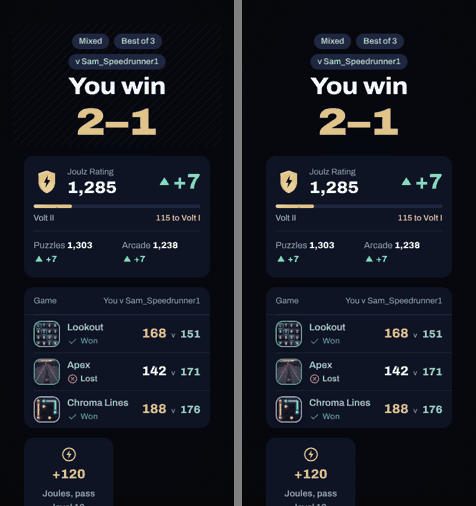

**Tier ladder**

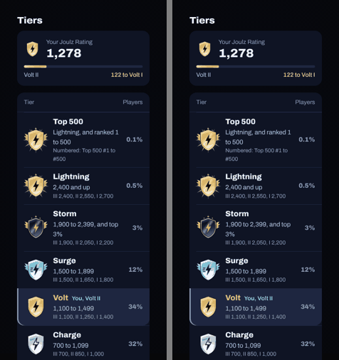

**4- and 8-player standings** (still switched off). Seats with an account now draw their mini card instead of a bare
avatar.

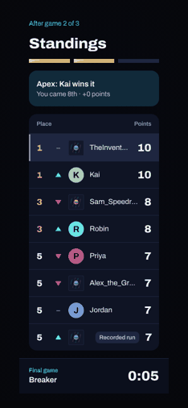

## Computer (1366 × 768)

VS side by side, with VS between the cards (before, then after):

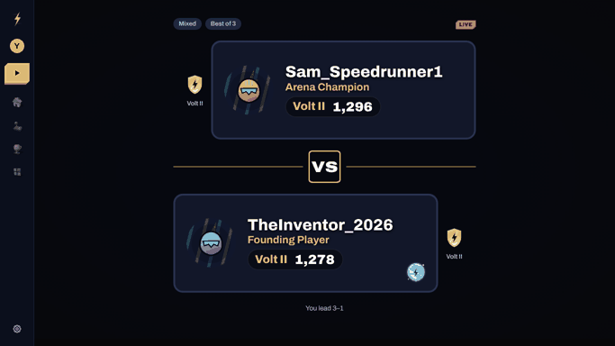 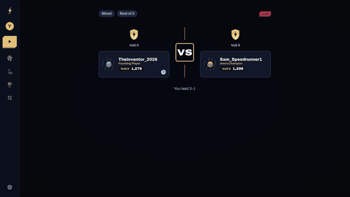

The result in two columns: rating and Joules on the left, games and actions on the right.

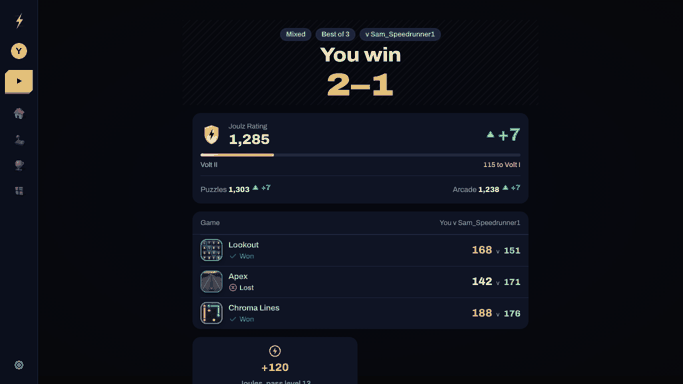 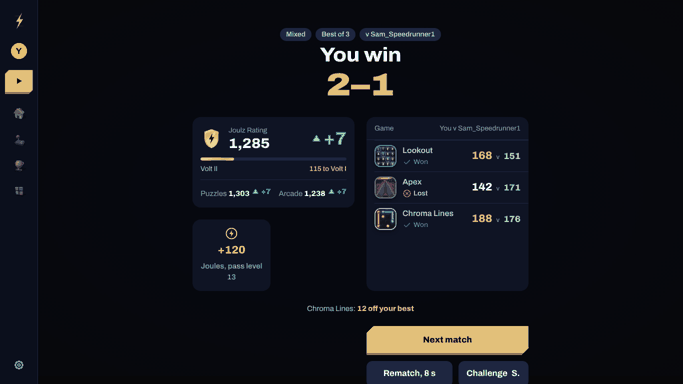
