# Settings, account and onboarding · review (phase 2, step 3)

14 Nov 2026 · the Settings, account and onboarding session. Built to the style guide's list rows
([phone/list.png](../../style-guide/phone/list.png), [phone/more.png](../../style-guide/phone/more.png),
[desktop/list.png](../../style-guide/desktop/list.png)). Phone pictures at 390 × 844 shrunk to 300 px wide, dark unless
named; before = main, after = this branch. Drawn by `bun scripts/shots/settings-account-shots.ts --tag=before|after`
(the intro's before from onboarding-check's own shots, since main draws it only through Home).

## Settings is a page (/settings)

| Before (the sheet) | After |
|---|---|
| 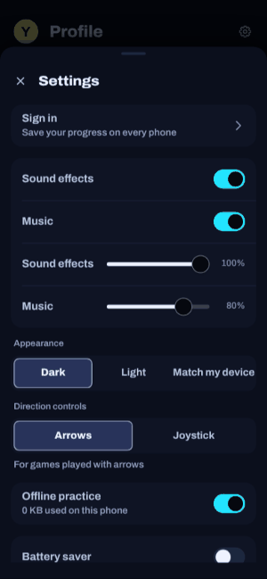 | 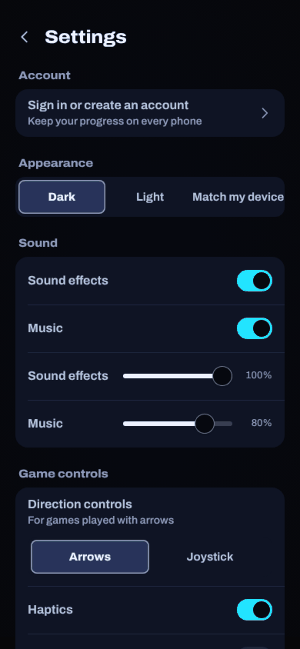 |
| | 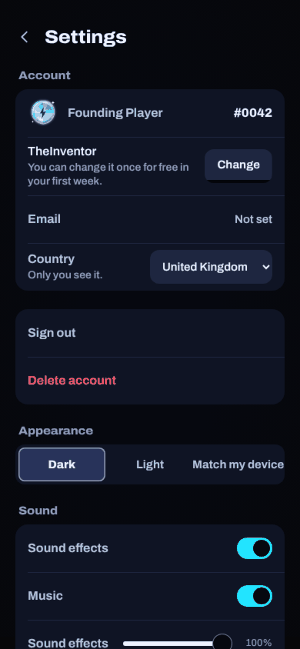 |
| | 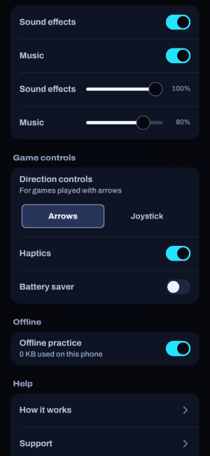 |
| | 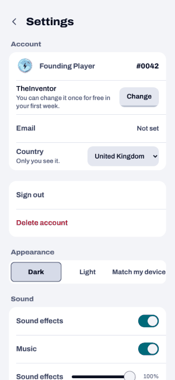 |

One group per job, in order: Account (an account's username, email, country, leaderboards, sign out and delete; a
guest's one "Sign in or create an account" row), Appearance, Sound, Game controls, Notifications (only where they are
on for this player), Offline, Help (How it works, Support, Send feedback where it shows today, Beta terms), About (the
build). Opened from More → Settings, Profile's gear and the computer rail's gear. Nothing opens it during play (the
game menu keeps its own sound controls).

## Account (/account for a signed-in player)

| Before | After |
|---|---|
| 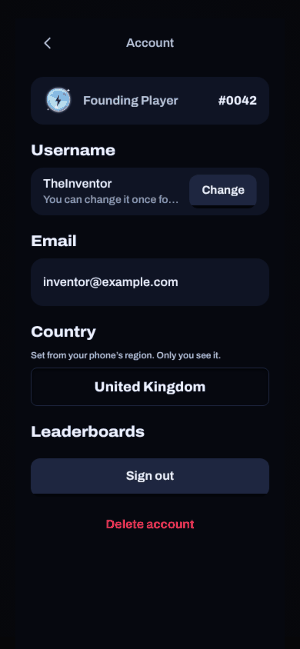 | 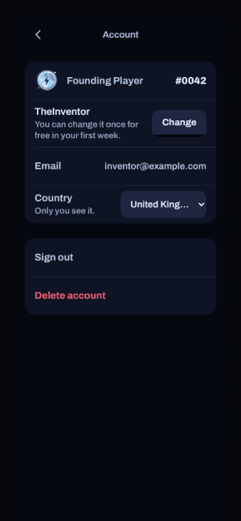 |

The same rows as Settings' Account group (one component, `AccountSection`).

## Sign in and sign up

| Before | After |
|---|---|
| 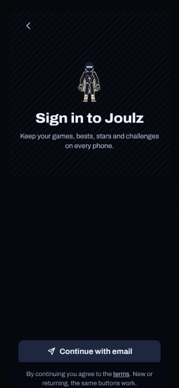 | 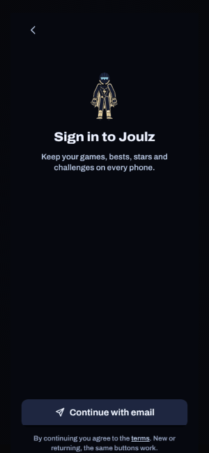 |
| 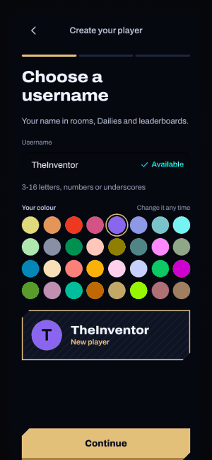 | 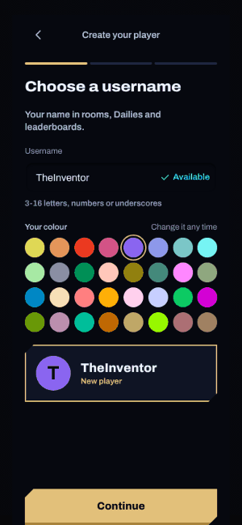 |
| 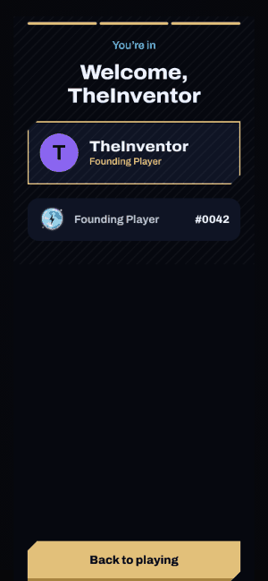 | 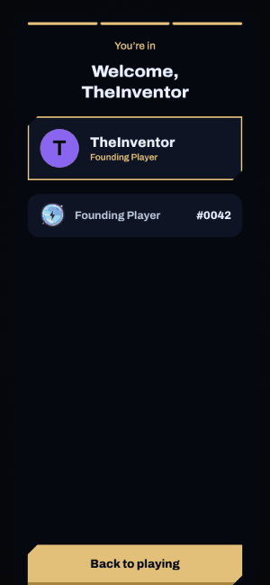 |

The style guide's type roles, no striped backgrounds, loss colour for errors, live-blue focus rings. Every step and
every rule unchanged (the age gate, sign-in never creating a user, the order of calls).

## The first-time intro

| Before | After |
|---|---|
| 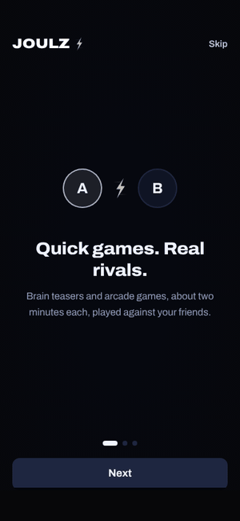 | 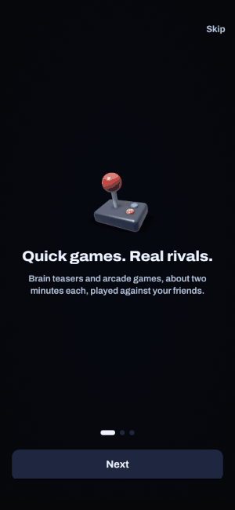 |
| 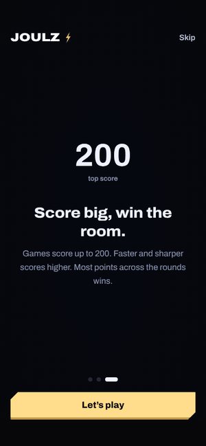 | 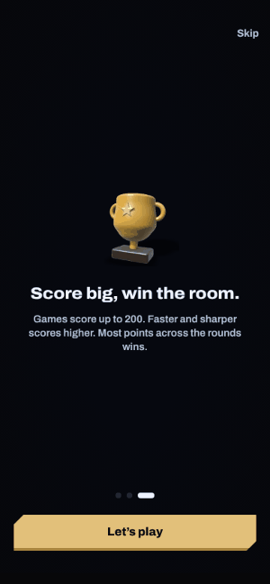 |

Art from the art kit (games, rooms, trophy; `bun scripts/settings-art.ts`), Skip on every panel, Next, then Let’s play.

## The terms

| Before | After |
|---|---|
| 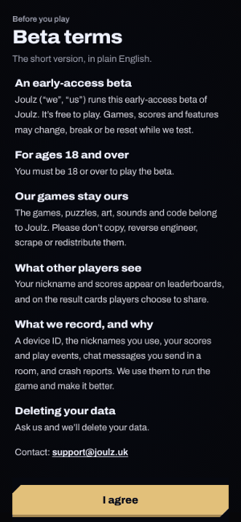 | 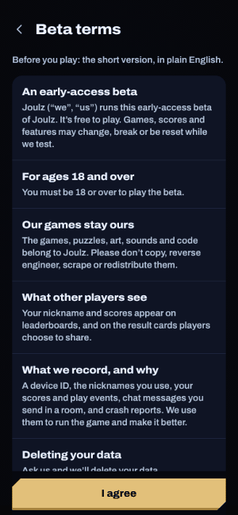 |

## On a computer

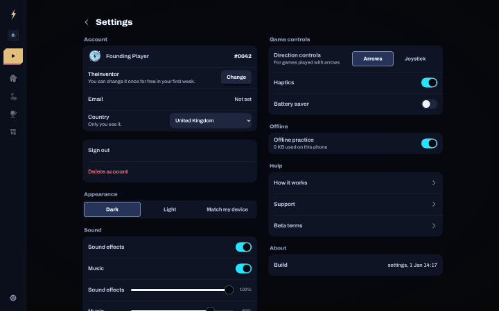

Settings in two columns; the sign-in and sign-up steps (and the intro) as a centred panel:

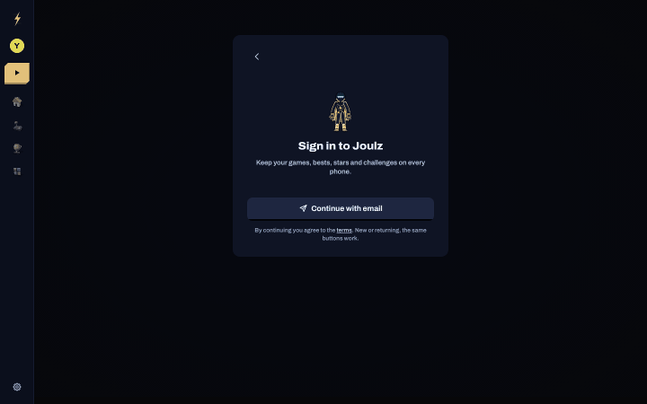
