# Shop, Pass and Plus: before and after

Phase 2 step 3, the Shop pages session, 14 Nov 2026. Phone shots at 390 px wide (scaled to 300), drawn by
`bun scripts/shots/shop-pages-shots.ts` from the stand-ins in `scripts/shop-fixture.ts` and `scripts/pass-fixture.ts`
(real catalogue items kept by the cosmetics review; the bundle is Card Table, as in the mockup).

## Shop

| Before | After | Light |
|---|---|---|
| 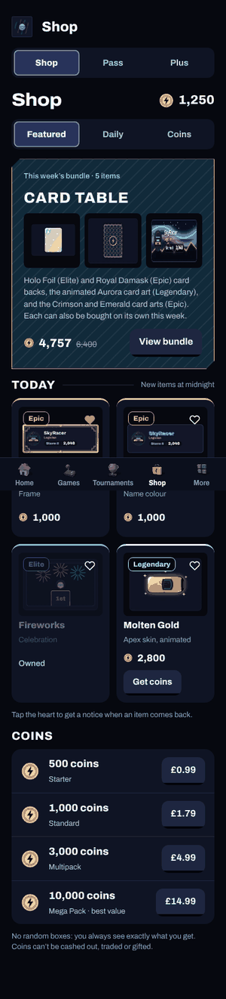 | 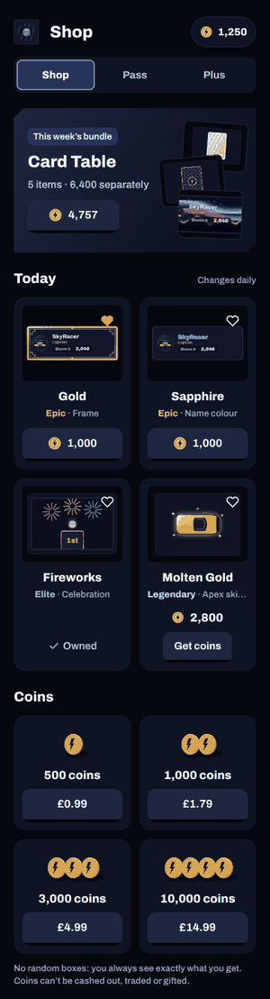 | 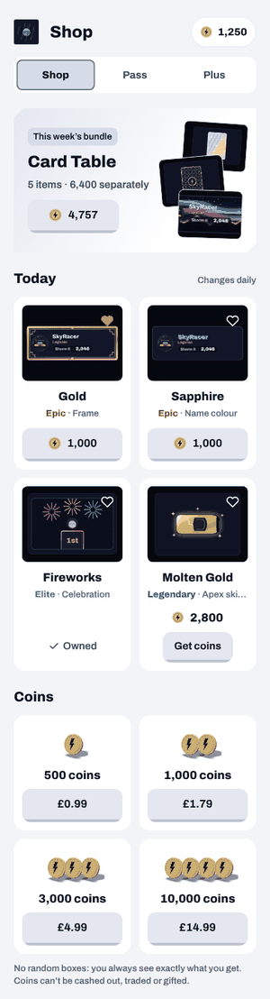 |

The second "Shop" title, the balance and the Featured / Daily / Coins switch are gone: the header carries the title and
the coin counter, and the page is one scroll. The bundle is the angled-cut hero card; Today is tiles (art, name,
rarity · kind, price button) with "Changes daily"; coins are four tiles with the art kit's coin. The struck "was"
price, "Mega Pack · best value" and the wishlist hint line are gone.

| Confirm an item | The bundle's sheet |
|---|---|
| 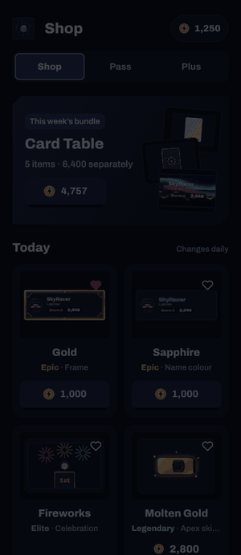 | 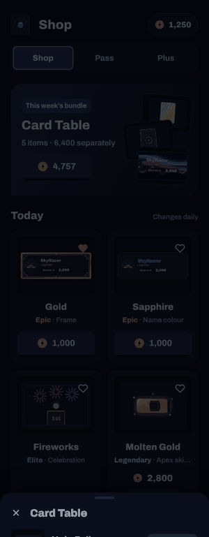 |

Computer (1366 × 768): four tiles a row, the coin counter in the rail.

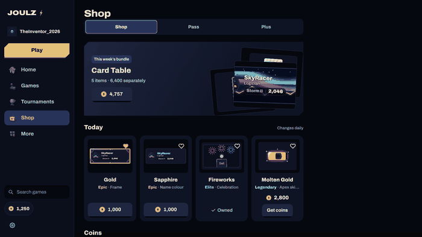

## Pass

| Before | After |
|---|---|
| 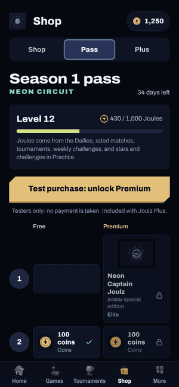 | 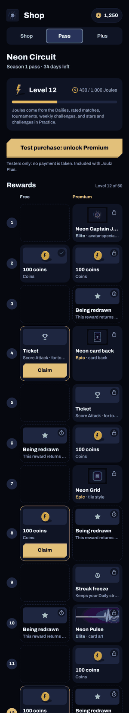 |

## Plus

| Before | After (offer) | After (member) |
|---|---|---|
| 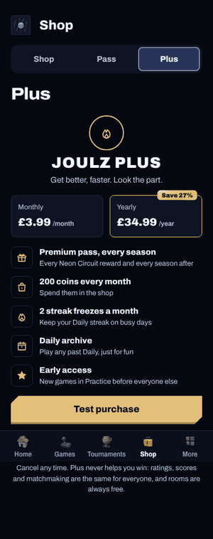 | 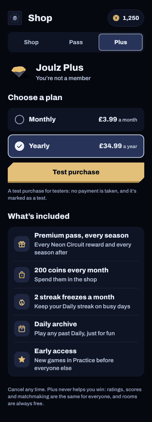 | 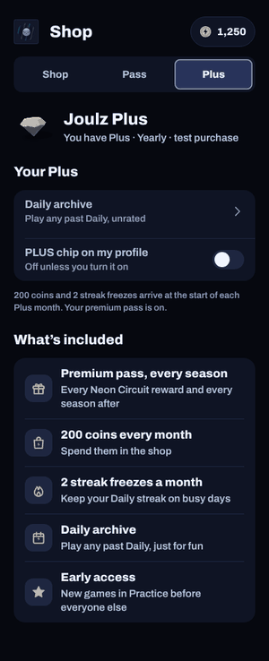 |
