# Speed overhaul: review gallery, stage 1 (15 Nov 2026)

Phone shots at 390 × 844 (shrunk to 360 wide). **Today** is the game review's mid-play screenshot
(docs/design/game-reviews/img/speed/), **Concept** the look Joe picked (PR #427, docs/design/game-concepts/speed/), **New** this
branch a few seconds into a practice round with the Blender sprites (docs/design/speed-art/README.md). Effect clips come with
stage 2 (the effects kit), levels with stage 3.

## Flash

| Today | Concept | New |
|---|---|---|
| 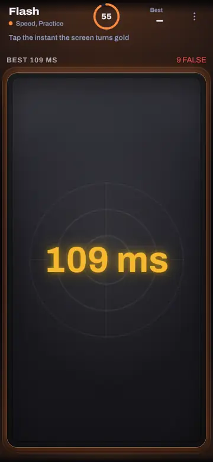 |  A, waiting | 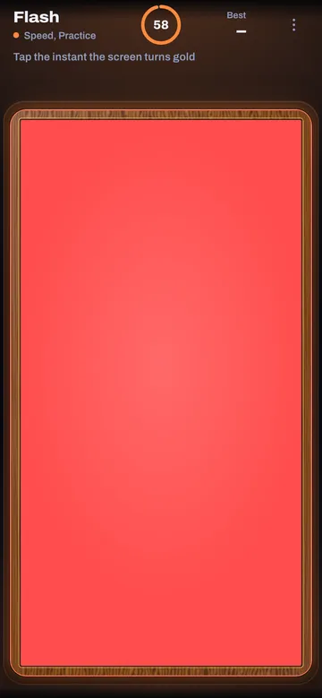 |
|  |  B, the flash |  |

Waiting: dark smoked glass with faint etched rings inside a lacquered walnut frame whose grain and rounded edge catch the light. The flash: the glass floods gold from a white-hot centre through faint rings (concept B). Decoys keep their flat colours (the waiting shot here caught a teal decoy). The run ends on a clear "Done".

## Ascend

| Today | Concept | New |
|---|---|---|
| 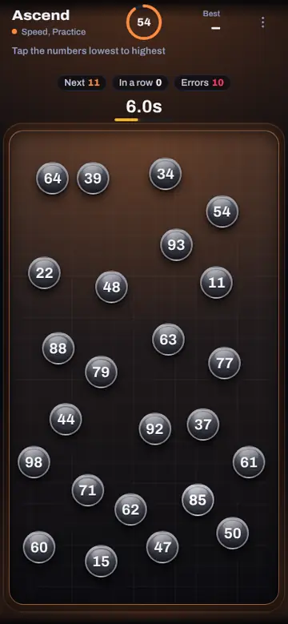 | 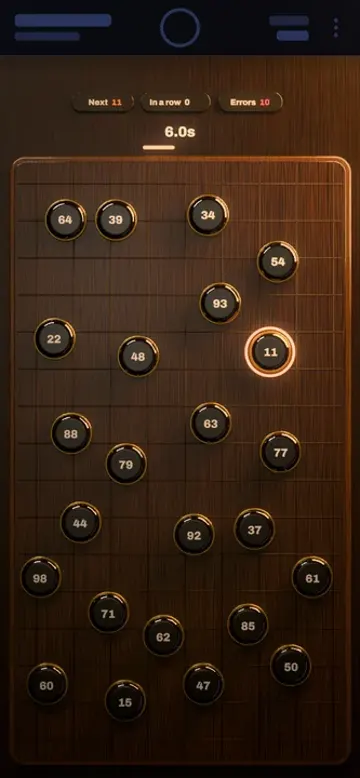 B |  |

Darker lacquered walnut; glossy domed onyx counters with polished brass rims, each with one crisp highlight on its curve and none across the number; reached counters are glazed gold domes with navy numbers. Bold Archivo numbers.

## Don't Break the Chain

| Today | Concept | New |
|---|---|---|
|  | 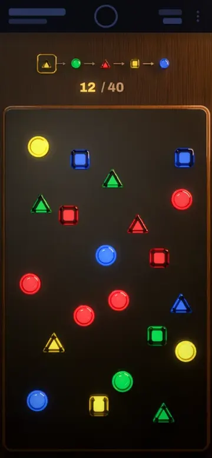 B | 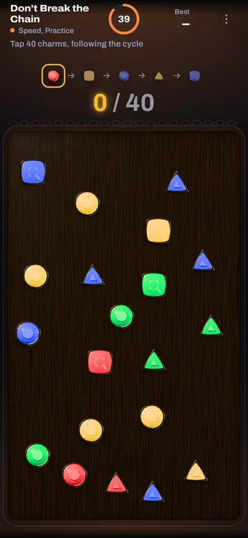 |

Vivid charms in six colours, each colour in all three cuts, in polished champagne bezels on dark lacquered walnut, drawn at the concept's size. Each is a lit glaze under a glassy coat (domed on the round ones), so the colour glows from inside with a crisp edge highlight. "Chain broken" sits on the chain strip.

## Bonk

| Today | Concept | New |
|---|---|---|
| 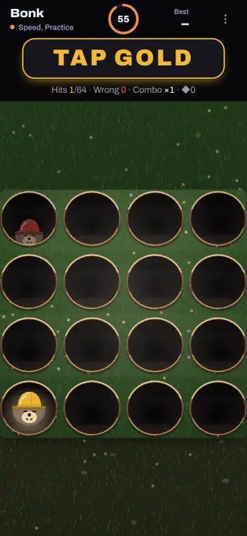 |  B |  |

Gophers in glossy gold and red hard hats and the hedgehog, in dark burrows with polished brass rims, on a darker dusk lawn; nothing but the sixteen burrows looks like one.

## Tenfall

| Today | Concept | New |
|---|---|---|
| 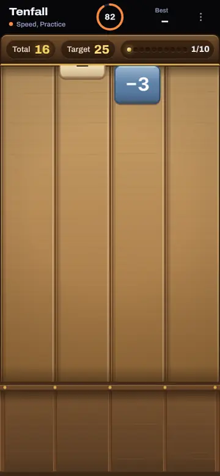 |  B (with A's tiles) |  |

Dark lacquered planks with their grain and a brass rail; glazed enamel tiles (cream digits, gold operators, blue minus) whose bevels catch the light; flat bold labels, operators bigger; tiles slide out of a chute under the counters.

## Pull!

| Today | Concept | New |
|---|---|---|
|  |  A, sun toned down | 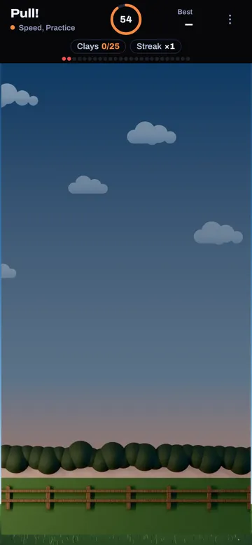 |

A deep late-afternoon range with haze over the treeline and the sun toned right down; glazed orange clays and polished gold ones; white gulls in three wing frames. HUD as two pills.

## Answer reveals (Joe, 15 Nov 2026)

Each game's own part of the reveal, inside the shared reveal layout: practice rounds with scripted taps, the clock run out. The
local dev server grades these runs at 0, so the score lines read 0; the pictures are what changed.

### Flash

| Before | After |
|---|---|
| 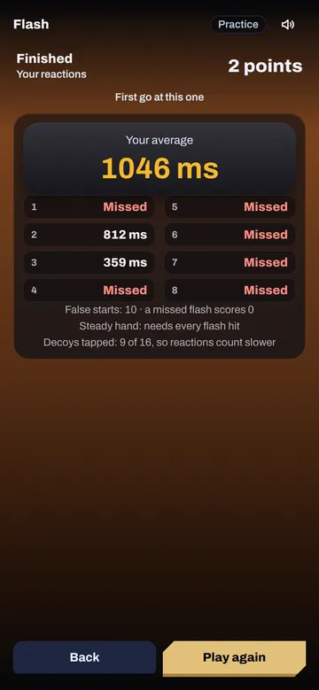 |  |

The average big, one bar per flash (taller is faster, gold under 250 ms, red a miss), Fastest, Missed and False starts.

### Ascend

| Before | After |
|---|---|
|  |  |

The board large in the new art, reached discs gold, the disc you needed next ringed; Reached, Wrong taps, Best run, Time.

### Don't Break the Chain

| Before | After |
|---|---|
|  | 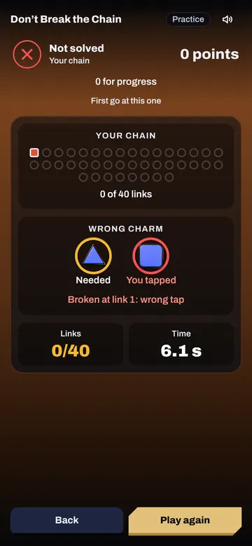 |

The forty links as pips (made gold, the break red), the charm needed beside the one tapped; Links and Time.

### Bonk

| Before | After |
|---|---|
|  |  |

The field as a map, each burrow its right hits (gold) and mistakes (a red badge); Best combo and Hedgehogs.

### Tenfall

| Before | After |
|---|---|
| 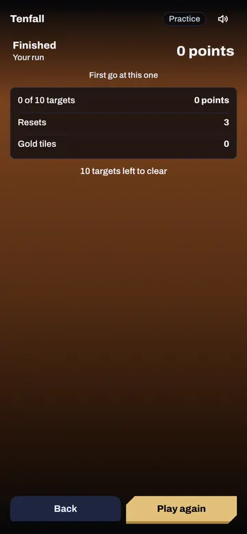 |  |

The ten targets as plaques, made ones in enamel, the next marked; the finish time.

### Pull!

| Before | After |
|---|---|
|  | 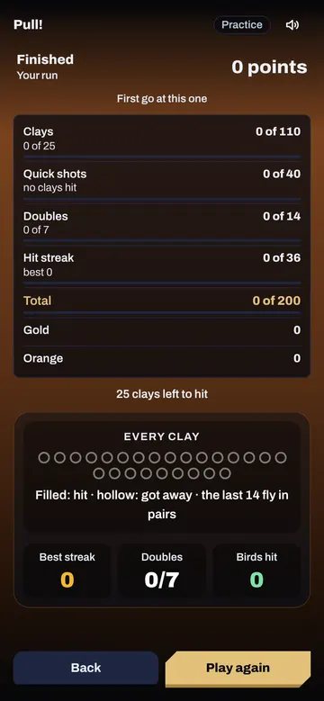 |

Every clay in launch order, filled when hit and hollow when it got away; Best streak, Doubles, Birds hit.
