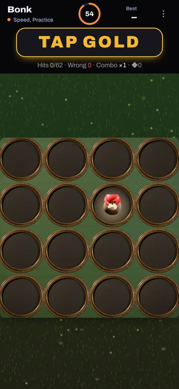
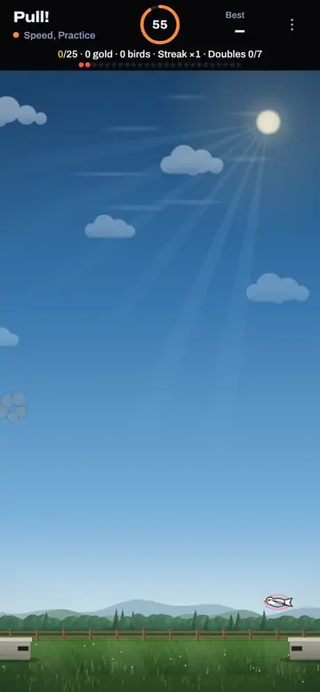
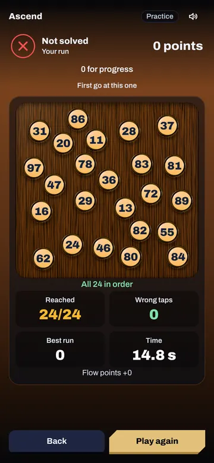

# Speed overhaul: review gallery, stage 1 (15 Nov 2026)

Phone shots at 390 × 844 (shrunk to 360 wide), each a few seconds into a practice round. "Before" is the game review's mid-play
screenshot (docs/design/game-reviews/img/speed/), "after" this branch with the Blender sprites (docs/design/speed-art/README.md).
Effect clips come with stage 2 (the effects kit); levels with stage 3.

## Flash

| Before | After |
|---|---|
|  |  |

The polished walnut frame round the screen; waiting is dark smoked glass with faint etched rings, the flash a warm, even gold (decoys keep their flat colours, as here). The run ends on a clear "Done".

## Ascend

| Before | After |
|---|---|
|  |  |

Darker walnut board; domed onyx counters with brass rims and bold white numbers, reached ones gold with navy numbers. Discs grow to the room the board has (44–60 px, never closer than 6 px).

## Don't Break the Chain

| Before | After |
|---|---|
|  |  |

Vivid gem charms in champagne bezels, each colour keeping its own cut, on darker wood. "Chain broken" now sits on the chain strip at the top.

## Bonk

| Before | After |
|---|---|
|  |  |

Rendered gophers in gold and red hard hats in dark burrows, on a darker dusk lawn; nothing but the sixteen burrows looks like one.

## Tenfall

| Before | After |
|---|---|
|  |  |

Dark oiled wood with four lanes, satin enamel tiles with flat bold labels (operators bigger); tiles slide out of a chute under the counters. tenRev 6: resets cost on a finished run too.

## Pull!

| Before | After |
|---|---|
|  |  |

A late-afternoon range with the sun toned right down; satin clays, brushed gold ones; white gulls. The HUD is two pills (clays, streak). clayRev 10: a wider quick-hit window (0.4 s full, 0.6 s none).

## Answer reveals (Joe, 15 Nov 2026)

Each game's own part of the reveal, inside the shared reveal layout: practice rounds with some scripted taps, the clock run out
(the local dev server grades these at 0, so the score lines read 0; the pictures are what changed).

### Flash

| Before | After |
|---|---|
|  |  |

The average stays big; the two-column text list becomes one bar per flash (taller is faster, gold under 250 ms, red a miss), with Fastest, Missed and False starts as big figures.

### Ascend

| Before | After |
|---|---|
|  |  |

The board drawn large in the new art, reached discs gold and the disc you needed next ringed; "Finished with 0 errors · 14.7s" becomes Reached, Wrong taps, Best run and Time.

### Don't Break the Chain

| Before | After |
|---|---|
|  |  |

The forty links as pips (made gold, the break red), then the charm the chain needed beside the one tapped, both large; Links and Time as big figures.

### Bonk

| Before | After |
|---|---|
|  |  |

The field as a map: every burrow shows its right hits in gold and its mistakes as a red badge, with Best combo and Hedgehogs (the stored breakdown above already gives the rest).

### Tenfall

| Before | After |
|---|---|
|  |  |

The ten targets as plaques, made ones in enamel and the next one marked; the finish time when there is one.

### Pull!

| Before | After |
|---|---|
|  |  |

Every clay in launch order (orange or gold filled when hit, hollow when it got away), with Best streak, Doubles and Birds hit.
