# Speed overhaul: review gallery, stage 1 (15 Nov 2026)

Phone shots at 390 × 844 (shrunk to 360 wide). **Today** is the game review's mid-play screenshot
(docs/design/game-reviews/img/speed/), **Concept** the look Joe picked (PR #427, docs/design/game-concepts/speed/), **New** this
branch a few seconds into a practice round with the Blender sprites (docs/design/speed-art/README.md). Effect clips come with
stage 2 (the effects kit), levels with stage 3.

## Flash

| Today | Concept | New |
|---|---|---|
|  | 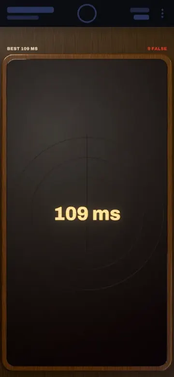 A, waiting |  |
|  | 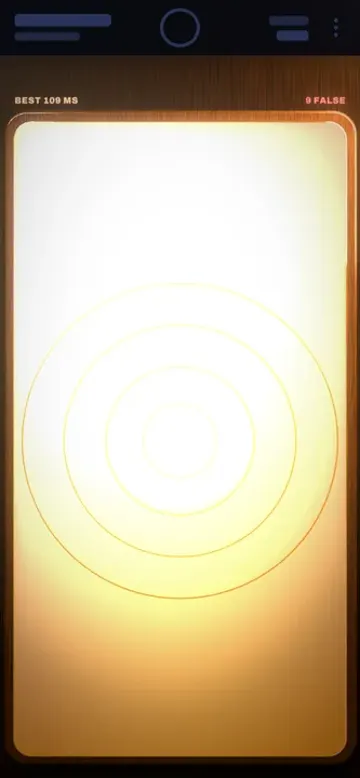 B, the flash | 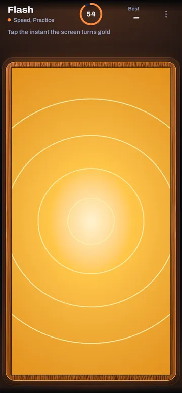 |

Waiting: dark smoked glass with faint etched rings inside a lacquered walnut frame whose grain and rounded edge catch the light. The flash: the glass floods gold from a white-hot centre through faint rings (concept B). Decoys keep their flat colours (the waiting shot here caught a teal decoy). The run ends on a clear "Done".

## Ascend

| Today | Concept | New |
|---|---|---|
|  |  B | 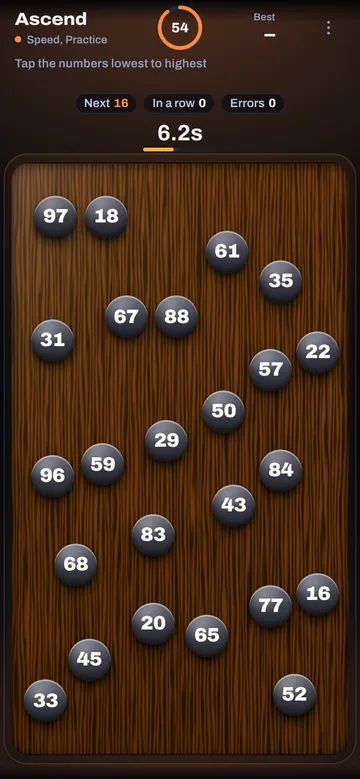 |

Darker lacquered walnut; glossy domed onyx counters with polished brass rims, each with one crisp highlight on its curve and none across the number; reached counters are glazed gold domes with navy numbers. Bold Archivo numbers.

## Don't Break the Chain

| Today | Concept | New |
|---|---|---|
| 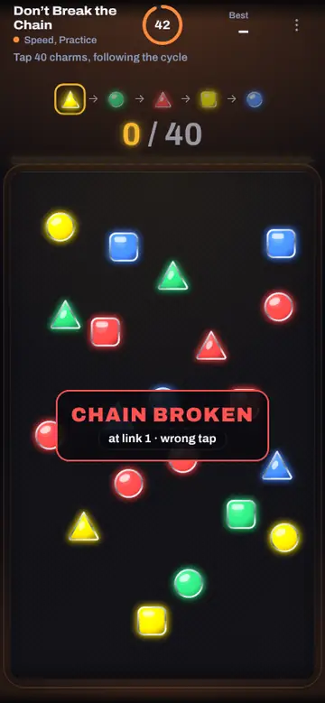 |  B |  |

Cut gems in six colours, each colour in all three cuts (a faceted round brilliant, a cushion-cut square, a trillion-cut triangle), in polished champagne bezels on dark lacquered walnut, at the concept's size: every facet catches its own crisp highlight under a glassy coat, the colour glowing faintly from inside. "Chain broken" sits on the chain strip.

## Bonk

| Today | Concept | New |
|---|---|---|
|  | 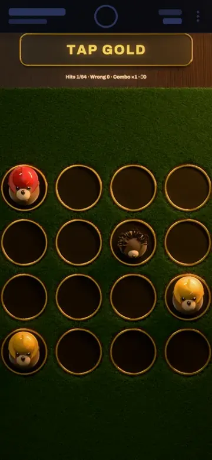 B |  |

Gophers in glossy gold and red hard hats and the hedgehog, in dark burrows with polished brass rims, on a darker dusk lawn; nothing but the sixteen burrows looks like one.

## Tenfall

| Today | Concept | New |
|---|---|---|
|  | 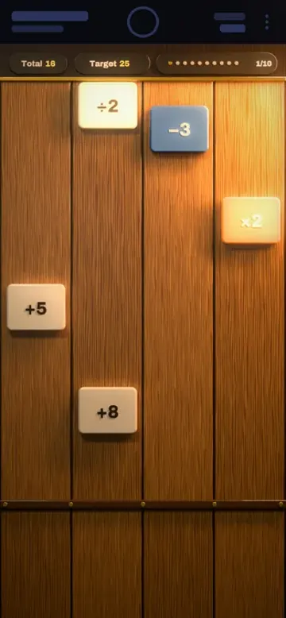 B (with A's tiles) | 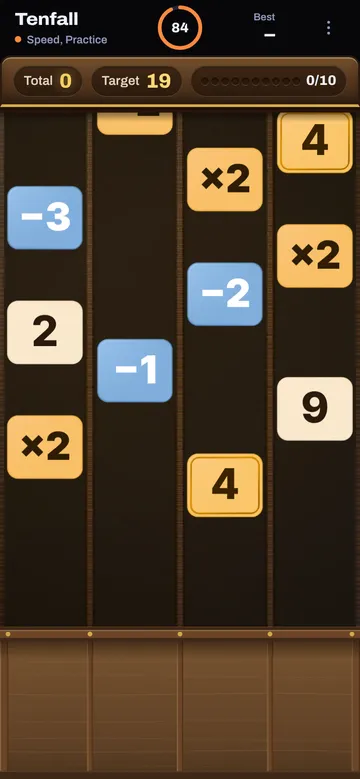 |

Dark lacquered planks with their grain and a brass rail; glazed enamel tiles (cream digits, gold operators, blue minus) whose bevels catch the light; flat bold labels, operators bigger; tiles slide out of a chute under the counters.

## Pull!

| Today | Concept | New |
|---|---|---|
|  | 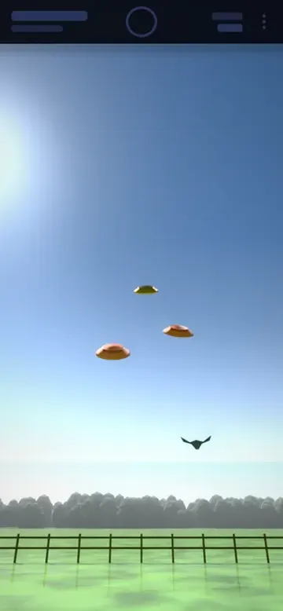 A, sun toned down |  |

A layered late-afternoon range: deep blue warming to a hazy horizon glow (no sun disc, no glare), soft high cloud, blue far hills fading behind two treelines, the grass and rail fence in front (the drawn cartoon clouds stay off over it); glazed orange clays and polished gold ones; white gulls in three wing frames. HUD as two pills.

## Answer reveals (Joe, 15 Nov 2026)

Each game's own part of the reveal, inside the shared reveal layout: practice rounds with scripted taps, the clock run out. The
local dev server grades these runs at 0, so the score lines read 0; the pictures are what changed.

### Flash

| Before | After |
|---|---|
|  | 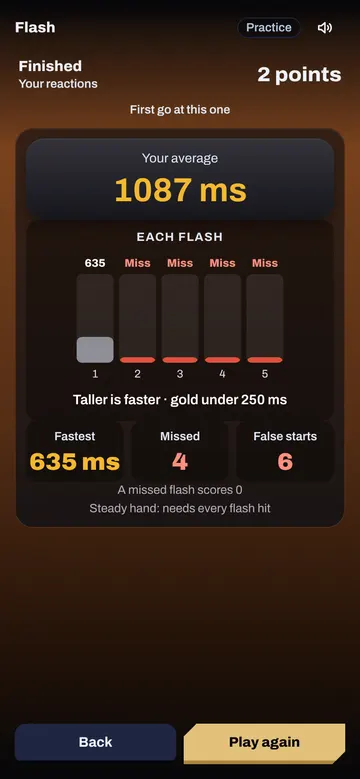 |

The average big, one bar per flash (taller is faster, gold under 250 ms, red a miss), Fastest, Missed and False starts.

### Ascend

| Before | After |
|---|---|
| 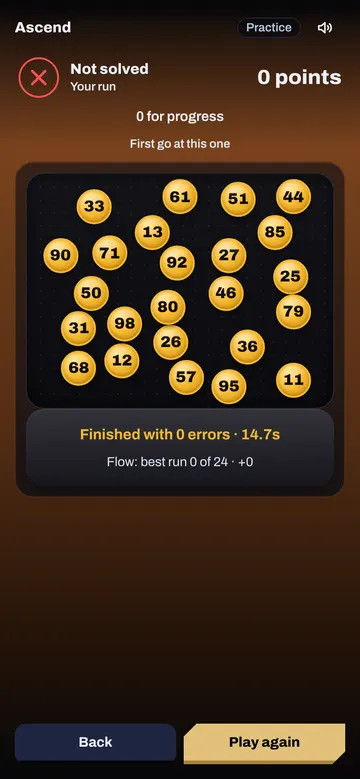 |  |

The board large in the new art, reached discs gold, the disc you needed next ringed; Reached, Wrong taps, Best run, Time.

### Don't Break the Chain

| Before | After |
|---|---|
| 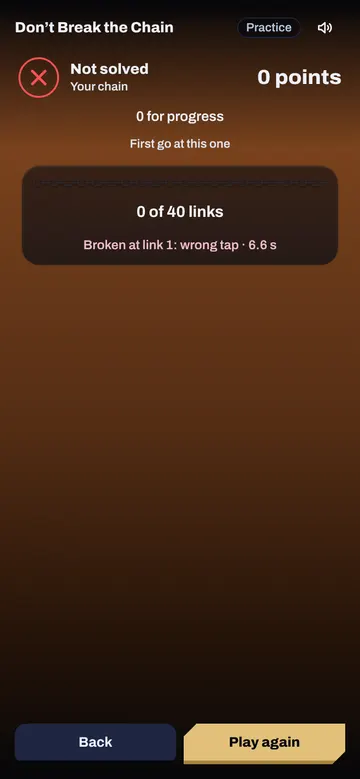 |  |

The forty links as pips (made gold, the break red), the charm needed beside the one tapped; Links and Time.

### Bonk

| Before | After |
|---|---|
| 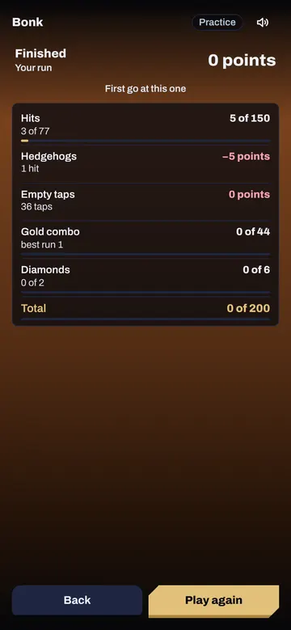 | 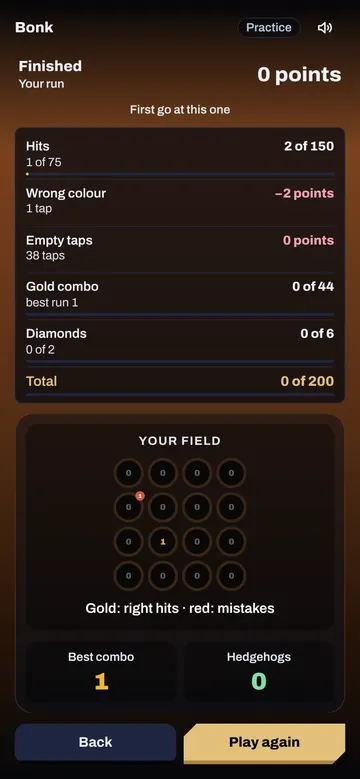 |

The field as a map, each burrow its right hits (gold) and mistakes (a red badge); Best combo and Hedgehogs.

### Tenfall

| Before | After |
|---|---|
|  | 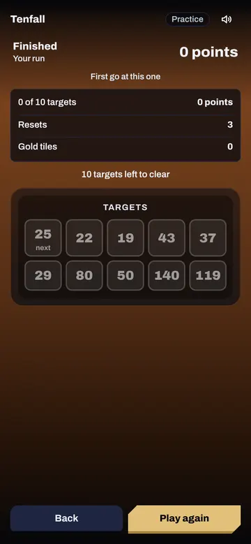 |

The ten targets as plaques, made ones in enamel, the next marked; the finish time.

### Pull!

| Before | After |
|---|---|
| 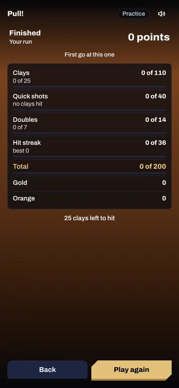 |  |

Every clay in launch order, filled when hit and hollow when it got away; Best streak, Doubles, Birds hit.

## Effects (stage 2, 15 Nov 2026)

Short clips of a practice round with scripted taps (9 s, 360 wide, no sound: the sounds are listed in
docs/sound-cues/speed-overhaul.md, placeholders until Joe's ElevenLabs files arrive).

### Flash

<video src="clip-reaction.mp4" width="240" controls muted loop></video> [clip-reaction.mp4](clip-reaction.mp4)

Hits snap on the tap with the time popping up (gold under 250 ms, orange fast, white slower); three fast in a row adds "3 fast in a row" with a climbing chime; a decoy tap is one short wrong and a shake; the run ends on "Done".

### Ascend

<video src="clip-numhunt.mp4" width="240" controls muted loop></video> [clip-numhunt.mp4](clip-numhunt.mp4)

Each right number a marimba note a semitone higher (two octaves over 24) and the disc turns gold; five fast in a row a combo; the bell one second before the shuffle, then every disc glides to its new place with a whoosh.

### Don't Break the Chain

<video src="clip-chain.mp4" width="240" controls muted loop></video> [clip-chain.mp4](clip-chain.mp4)

The rising link tones as before; a soft whoosh as the board reshuffles every 5 links; a heartbeat under the last 5 links, quickening.

### Bonk

<video src="clip-whack.mp4" width="240" controls muted loop></video> [clip-whack.mp4](clip-whack.mp4)

A cartoon bonk on every right hit (rising with the combo) as the gopher squashes; the rule flip: a whistle, the banner slamming in and every burrow rim flashing the new hat colour; a hedgehog a heavy wrong; a diamond a sparkle.

### Tenfall

<video src="clip-tendrop.mp4" width="240" controls muted loop></video> [clip-tendrop.mp4](clip-tendrop.mp4)

The total counts quickly to its new value; within 5 of the target the target glows softly with a shimmer; a hit throws "TEN!" over the strip; an overshoot shatters the total to 0; an empty tap a soft tap.

### Pull!

<video src="clip-clayshoot.mp4" width="240" controls muted loop></video> [clip-clayshoot.mp4](clip-clayshoot.mp4)

Shot and shatter in one with shards in the clay's colour; a gold clay a brighter shatter and a chime; a double the combo; a bird feathers and a short wrong; an escaping clay a soft whistle.

## Stage 3: the levels (Expert shown)

Each game's page with Expert chosen (its goal, how-to lines and clock follow the level; the level line sits under the switch), the round intro at Expert (the level line on top, the goal and how-to lines in the level's numbers), and a frame of Expert play. Measured scores per level: docs/design/speed-art/README.md "Levels".

### Flash

| Game page | Intro | Play |
|---|---|---|
| 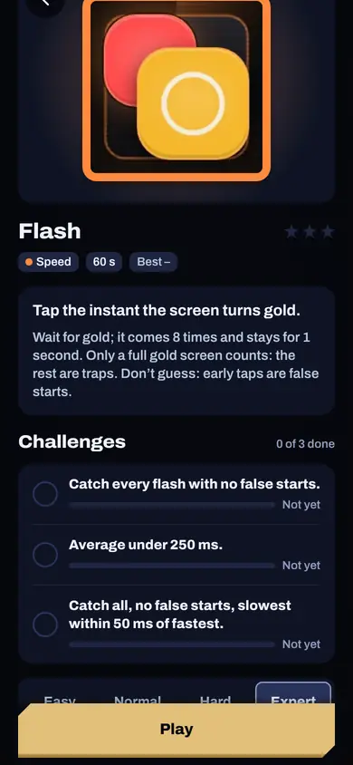 | 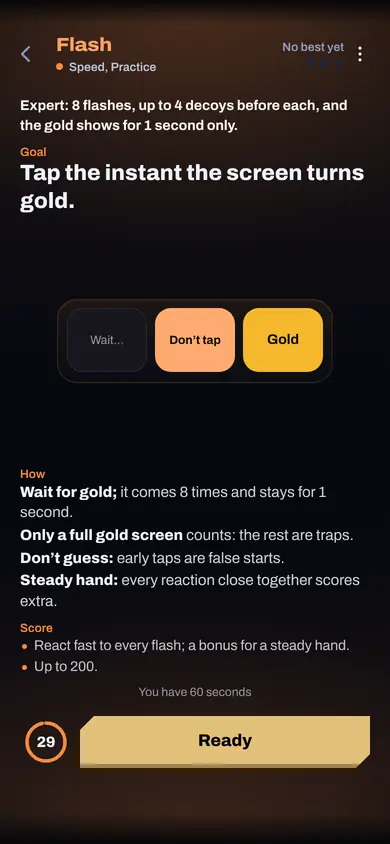 | 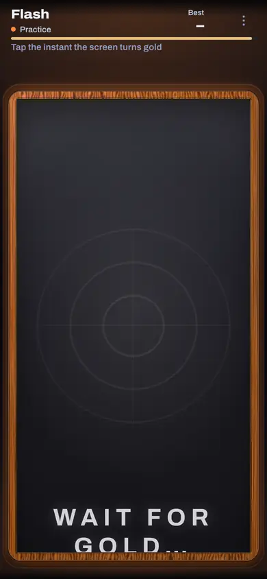 |

### Ascend

| Game page | Intro | Play |
|---|---|---|
| 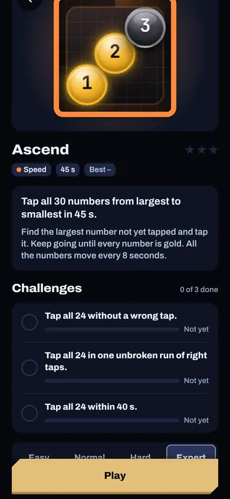 | 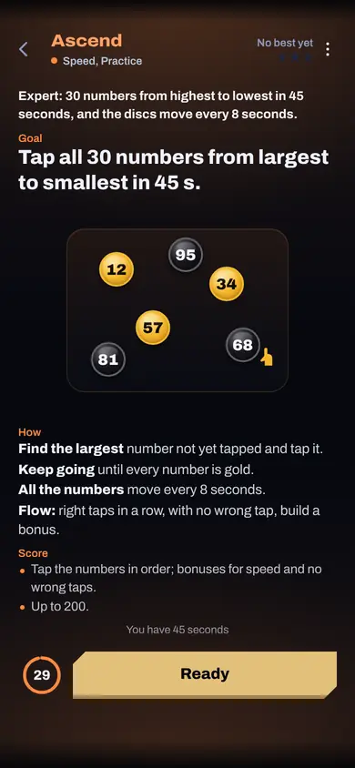 | 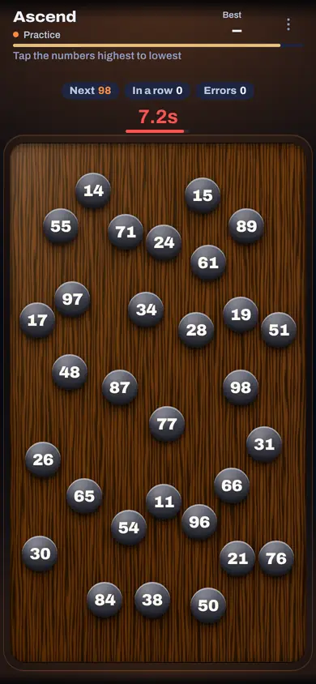 |

### Don't Break the Chain

| Game page | Intro | Play |
|---|---|---|
| 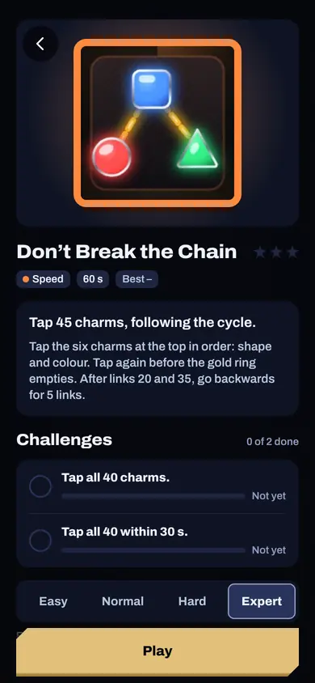 | 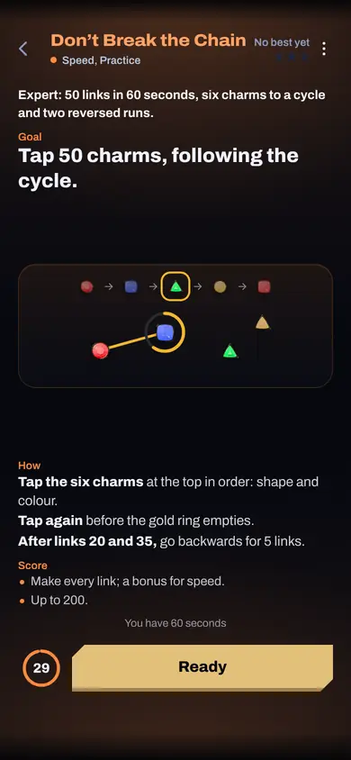 | 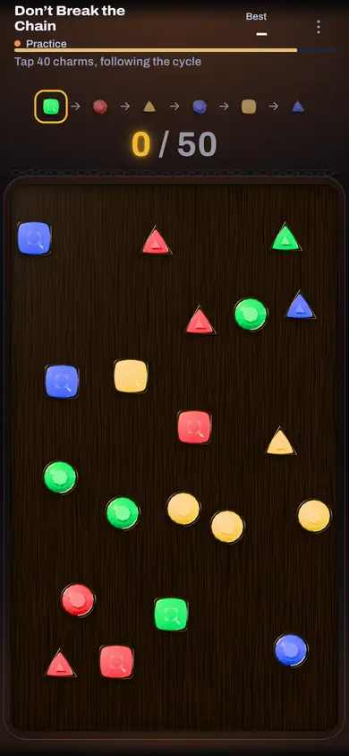 |

### Bonk

| Game page | Intro | Play |
|---|---|---|
| 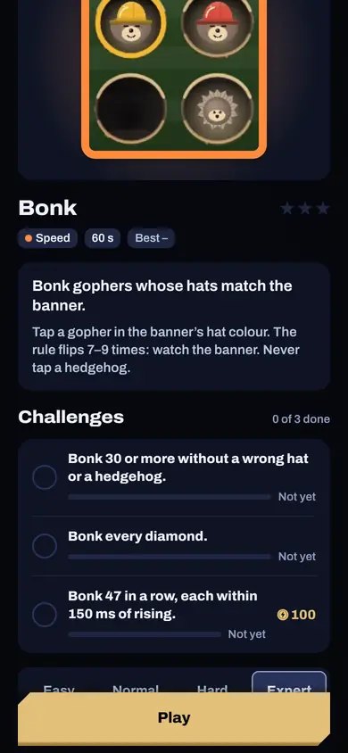 | 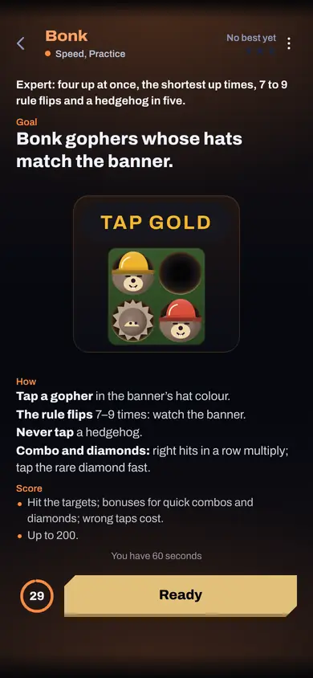 | 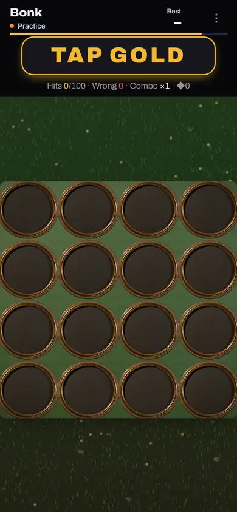 |

### Tenfall

| Game page | Intro | Play |
|---|---|---|
| 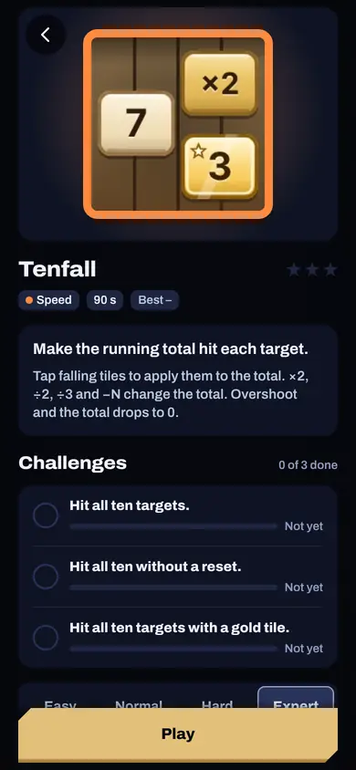 | 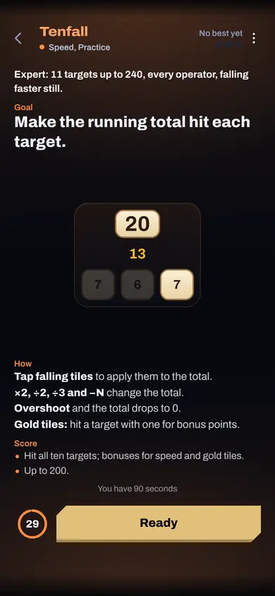 | 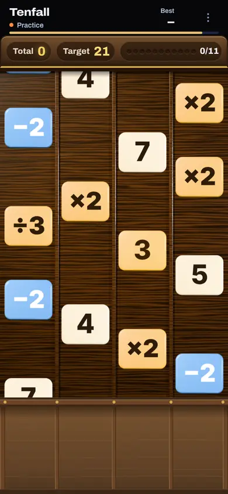 |

### Pull!

| Game page | Intro | Play |
|---|---|---|
| 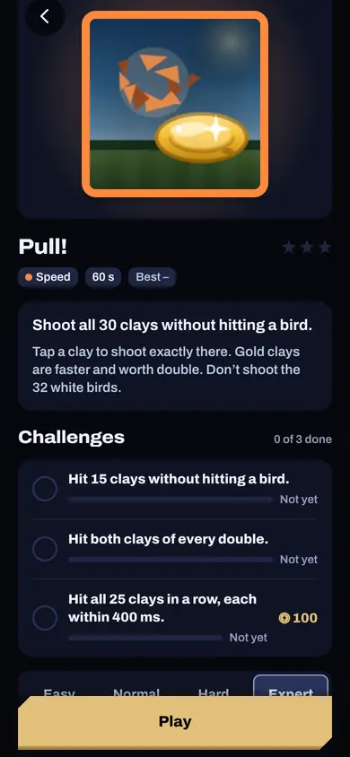 | 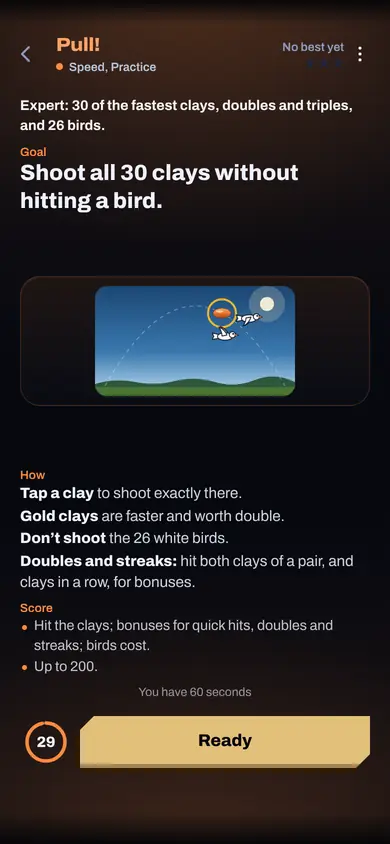 | 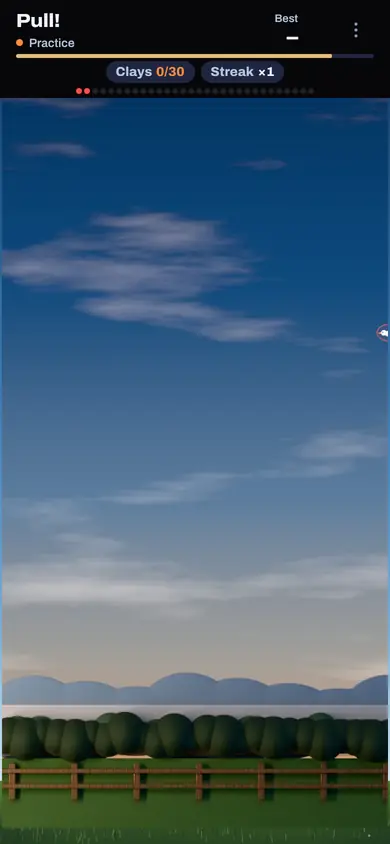 |
