# Sports overhaul: Cue Ball, Curl Champ, Apex (stages 1 and 2)

Phase 2, step 4. This page shows each game three ways: today (main), the concept Joe chose
(`docs/design/game-concepts/sports.md`, PR #426) and the new frame. It also shows the answer reveal before and after, plus
short clips.

**How the images were made**
- **Play frames, intros and reveals:** from the app in Chromium at 390 × 844 (2×), shrunk to fit. Runs are played by
  each game's own skill-band bot through the dev-only audit hook.
- **Clips:** drawn by the real renderer and sim with the rendered images loaded, using the same bots, at 15 fps
  (`bun scripts/shots/sports-clips.ts`).

- Stage 1 (approved at a23372a7): the look, Captain Joulz, the game changes, haptics, the reveals, and the intro and
  help text.
- Stage 2: Joe's notes on Apex's track, then the effects on the kit (#422). Each game's "Effects" section below shows
  them.
- The clips show both stages.
- Stage 3 (the difficulty levels) comes once PR #432 is on main.

## Cue Ball

- **Table:** concept C's heritage table, a Blender render built on the sim's own rail, cushion and pocket geometry. It has
  lacquered walnut with grain, brass castings and sights, deep felt with nap under a lamp pool, and today's pocket shapes.
- **Surround:** herringbone parquet fills the screen.
- **Balls:** glossy, with a crisp highlight on their curve.
- **The black:** locked (dimmed, with a padlock badge) until your seven are down. Then "NOW THE BLACK" lights it.

The Captain's cue arm, gripping the butt and drawing back with the pull, the intro, and a run in progress:

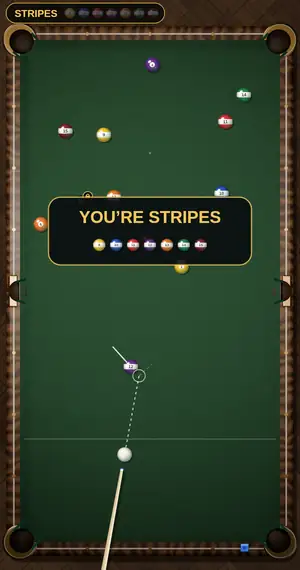

**Effects (stage 2).** Each one is read off the sim; reduced motion keeps the state and drops the flourish.
- Aim and strike: the side-spin bend on the aim, the cue's thrust with a chalk puff.
- Contact and pots: a flash where balls meet, the jaw rattle's shiver, a pot flying to the rack.
- Fouls and streaks: "FOUL −10" by the cue ball, the IN A ROW chip growing, and "CLEARED!" with the time.

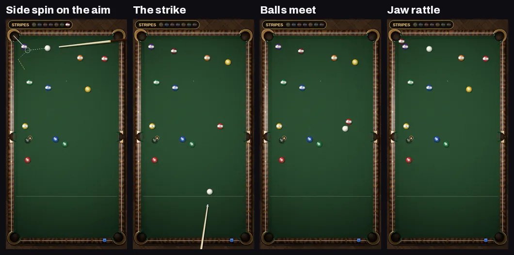

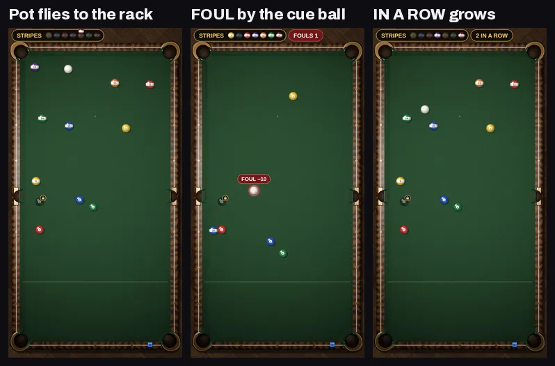

Close-up clips at phone size (stage 3's start): the strike, a contact flash (gold rays and a ring, no glare), a jaw rattle
(the ball shivers along the jaw, with two short arcs where it struck) and a pot flying to the rack.

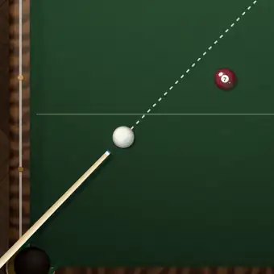 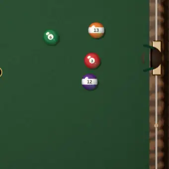 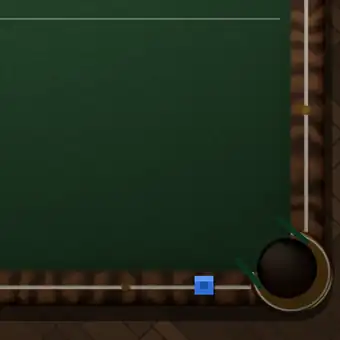 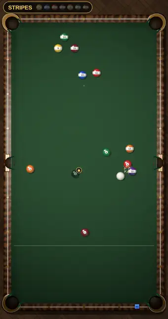

**Answer reveal: today, then new.** The new reveal draws the table full width on its side. Each potted ball sits by its
pocket in order, fouls show where they happened, and four plain tiles sit under the table (spots potted, the black,
best streak, fouls), above the parts breakdown. In stage 2 the pots land on the table one by one and the tiles count up.

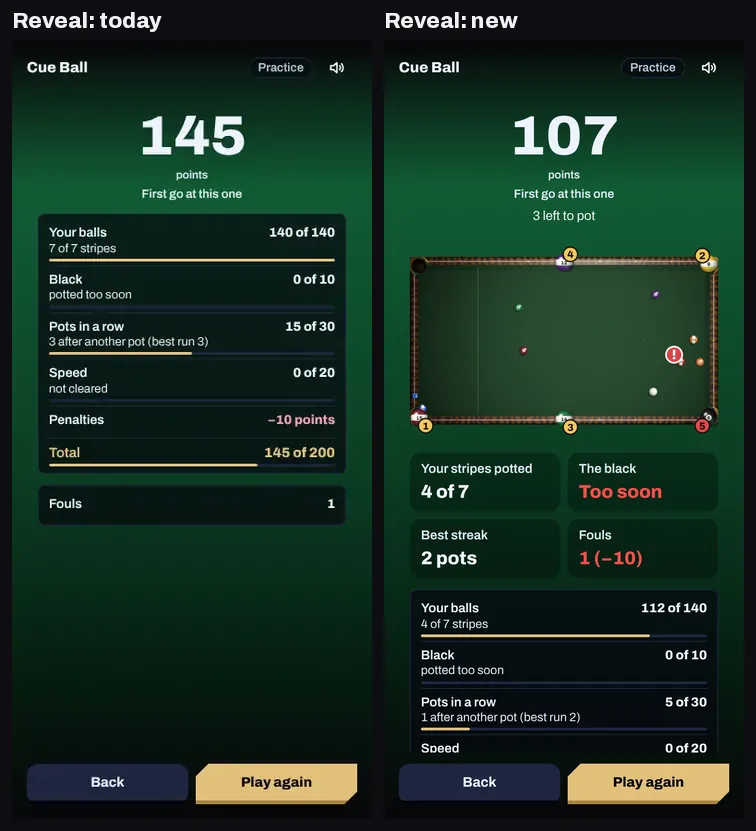

## Curl Champ

- **Arena:** concept A's lit crowd (a render), clean polished ice carrying soft reflections of the roof lights, darker boards
  and neighbouring sheets, rings crisp under the ice. There's no glare over the stones or the numbers.
- **Stones:** rendered granite.
- **House view:** larger on its own solid panel (curlRev 4).
- **Throw:** a flat grey while a stone travels.

The Captain sets up beside the stone, slides and lets go, then the stone runs:

**Effects (stage 2).** The far-house moments also show in the enlarged house view, where they read.
- Throw and sweep: the power notch (louder in HOUSE), sweep strokes on the brushed side.
- Hits: a clack ring where stones meet, the takeout's ring, a gold line and ring to each counting stone, a grey ring on a
  near miss.
- The end: the house grows and the counting stones light one by one.

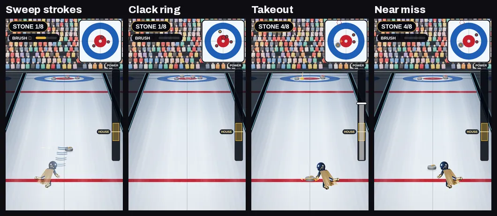

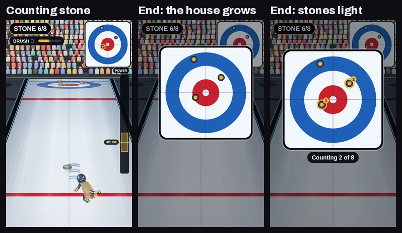

**Answer reveal: today, then new.** The house drawn large from above, with your stones numbered by throw and the reds
shown. Counting stones get a gold ring and near misses a grey one. Counting, Takeouts and Closest sit under the house. In stage 2 the counting rings light one by one and the numbers count
up.

## Apex

- **Car:** concept A's race car from behind, in lacquered crimson, carbon and gold, with the Captain at the wheel. The car is
  1.35× larger on screen (the camera is closer; collision is unchanged).
- **World:** a dusk sky, the sun low on the road ahead, rim-lit tree silhouettes, and a warm sheen up the asphalt.
- **Track (Joe's stage 1 note, done in stage 2):** the red-and-white kerbs, edge lines and dashed markings, gravel
  traps, the 150 / 100 / 50 boards, marshal posts, catch fences and grandstands are back.
- **Scenery:** each circuit has its own: parkland for Sunset Park, a harbour (cranes, lighthouse, boats, containers) for
  Harbour Run, hills (ridges, pines, rock) for Ridge Loop.
- **Neon Night:** stays a cosmetic.

The three circuits of racingRev 4, each dealt at every level: Sunset Park, Harbour Run and Ridge Loop.

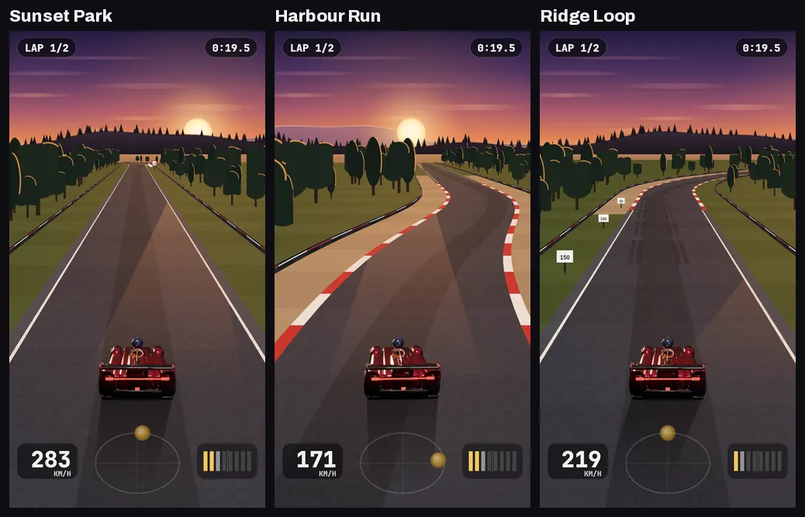

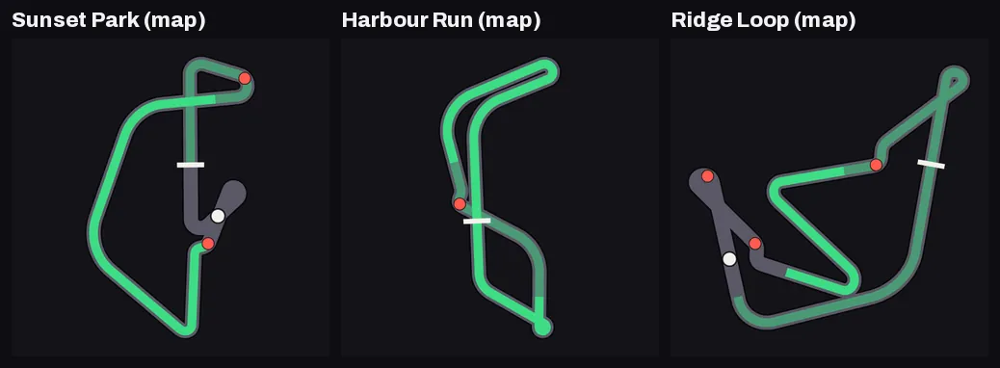

Today's track beside the three circuits after stage 2:

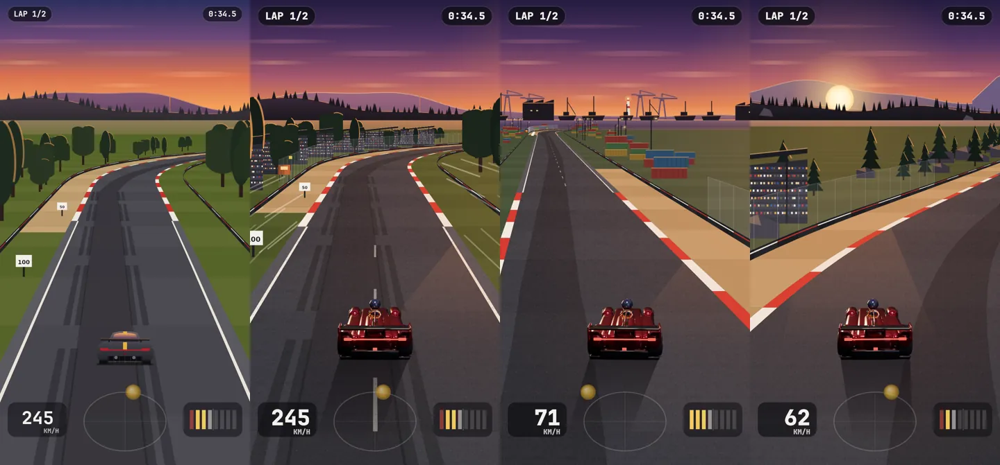

**Effects (stage 2).**
- Speed and surfaces: speed lines above 200 km/h, a small shake of the view on the kerb, dust and a red speedo drop on
  the grass.
- Corners and sectors: the corner sign green within its speed and red over, the clean-sector flash.
- Walls and the finish: sparks off a wall scrape, the chequered flag with the lap times and average speed counting up.

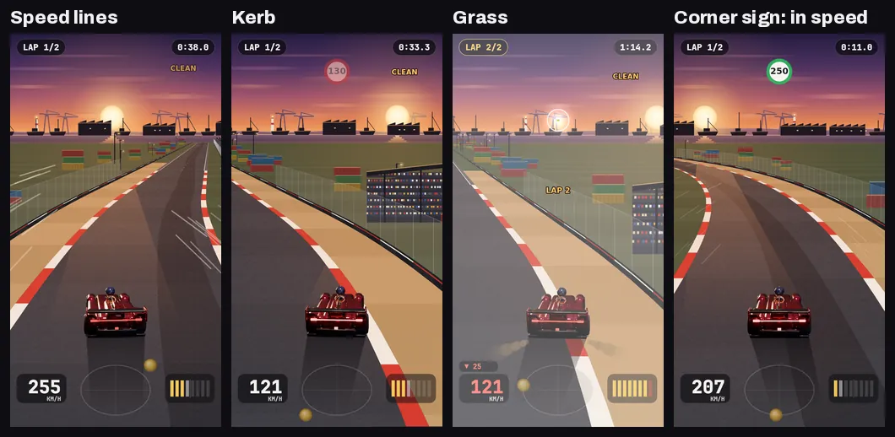

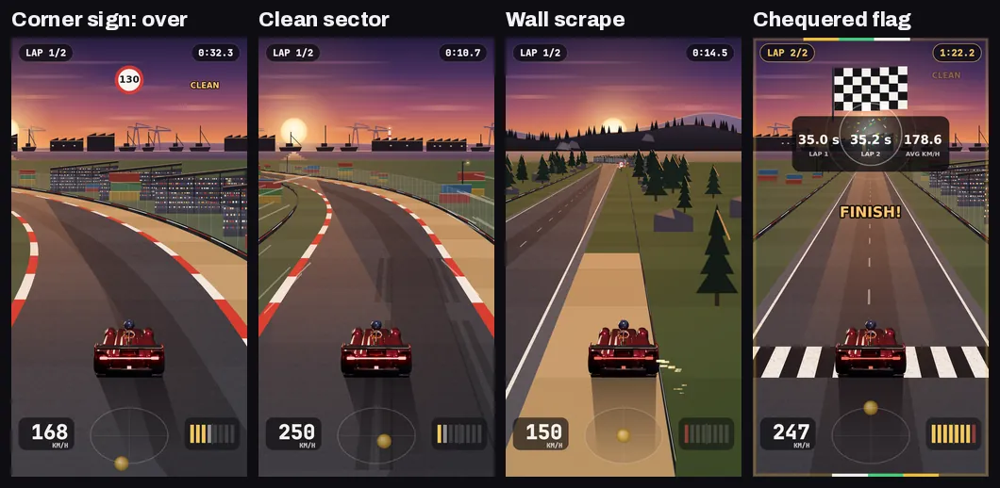

**Answer reveal: today, then new.** One large map of the circuit:
- **Map marks:** sectors driven clean in green, trips onto the grass as red dots, wall hits as red rings.
- **Numbers:** the lap times, the average speed and the clean sectors under it.

The right-hand shot is an unfinished race. In stage 2 the lap times and the average speed count up.

## Practice tiles

The three tiles, today and new, drawn with the rendered art: Cue Ball's table, Curl Champ's granite stones and Apex's
car with the Captain at the wheel.

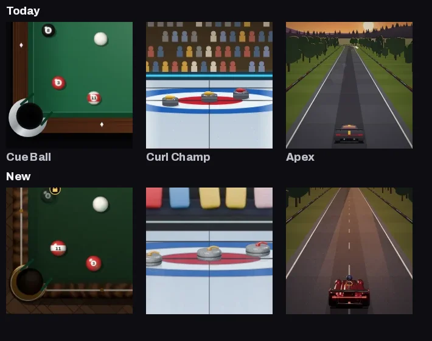
