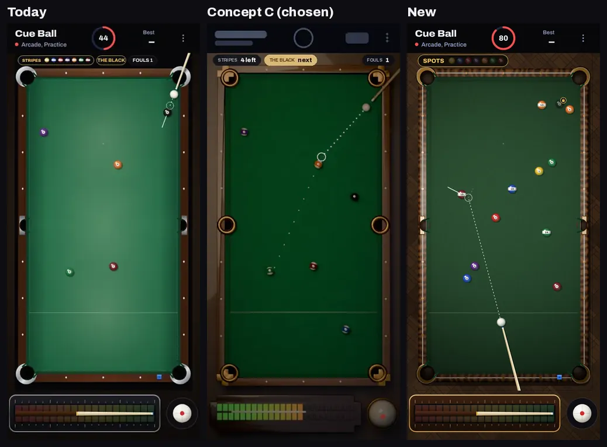
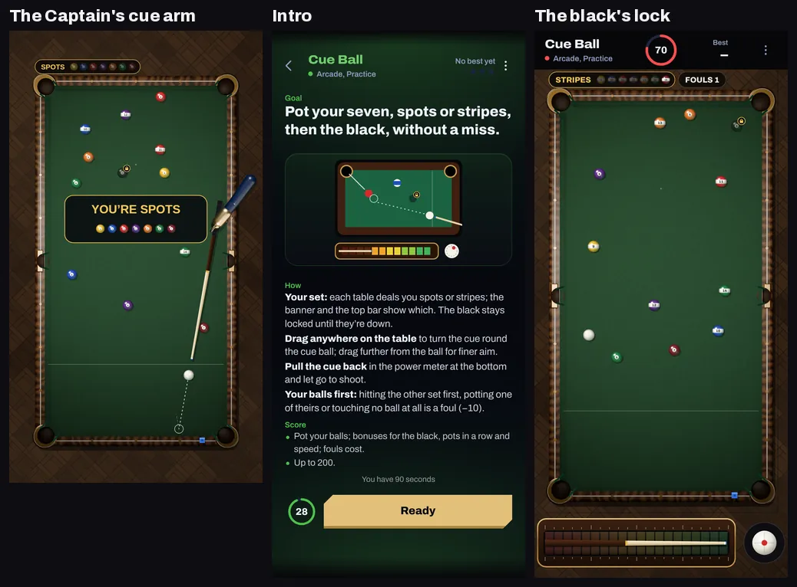
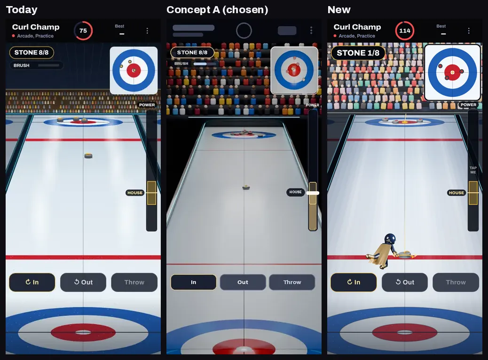
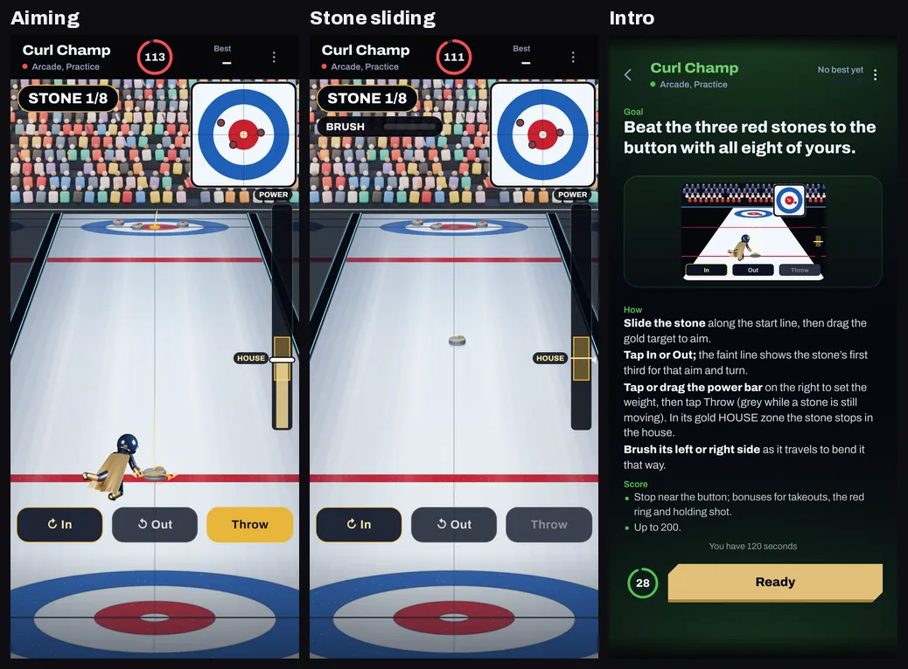
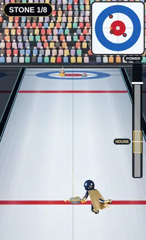
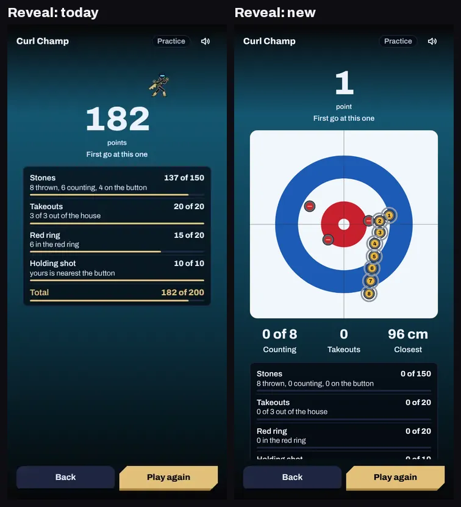
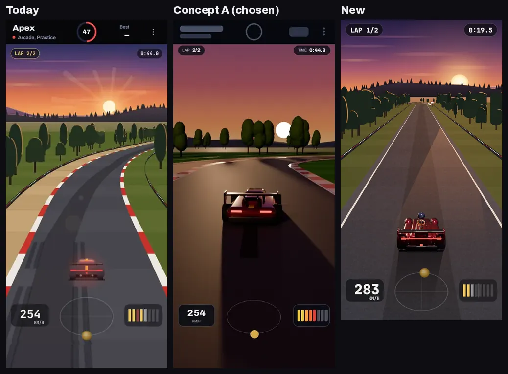
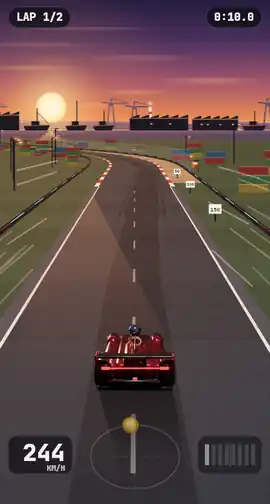
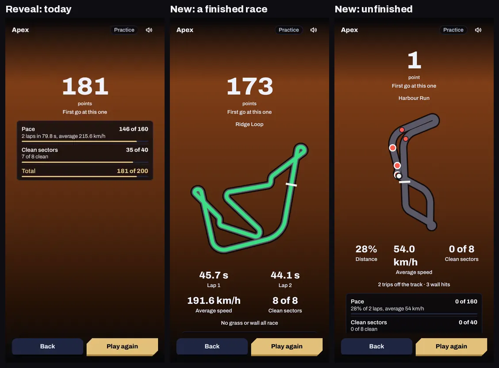

# Sports overhaul, stage 1: Cue Ball, Curl Champ, Apex

Phase 2, step 4. This page shows each game three ways: today (main), the concept Joe chose
(`docs/design/game-concepts/sports.md`, PR #426) and the new frame. It also shows the answer reveal before and after, plus
short clips.

**How the images were made**
- **Play frames, intros and reveals:** from the app in Chromium at 390 × 844 (2×), shrunk to fit. Runs are played by
  each game's own skill-band bot through the dev-only audit hook.
- **Clips:** drawn by the real renderer and sim with the rendered images loaded, using the same bots, at 15 fps
  (`bun scripts/shots/sports-clips.ts`).

Stage 1 covers the look, Captain Joulz, the game changes, haptics, the reveals, and the intro and help text. Stage 2 (the
effects kit, PR #422) and stage 3 (the difficulty levels, PR #432) come once those are on main.

## Cue Ball

- **Table:** concept C's heritage table, a Blender render built on the sim's own rail, cushion and pocket geometry. It has
  lacquered walnut with grain, brass castings and sights, deep felt with nap under a lamp pool, and today's pocket shapes.
- **Surround:** herringbone parquet fills the screen.
- **Balls:** glossy, with a crisp highlight on their curve.
- **The black:** locked (dimmed, with a padlock badge) until your seven are down. Then "NOW THE BLACK" lights it.

The Captain's cue arm, gripping the butt and drawing back with the pull, the intro, and a run in progress:

**Answer reveal: today, then new.** The new reveal draws the table full width on its side. Each potted ball sits by its
pocket in order, fouls show where they happened, and four plain tiles sit under the table (spots potted, the black,
best streak, fouls), above the parts breakdown.

## Curl Champ

- **Arena:** concept A's lit crowd (a render), clean polished ice carrying soft reflections of the roof lights, darker boards
  and neighbouring sheets, rings crisp under the ice. There's no glare over the stones or the numbers.
- **Stones:** rendered granite.
- **House view:** larger on its own solid panel (curlRev 4).
- **Throw:** a flat grey while a stone travels.

The Captain sets up beside the stone, slides and lets go, then the stone runs:

**Answer reveal: today, then new.** The house drawn large from above, with your stones numbered by throw and the reds
shown. Counting stones get a gold ring and near misses a grey one. Counting, Takeouts and Closest sit under the house.

## Apex

- **Car:** concept A's race car from behind, in lacquered crimson, carbon and gold, with the Captain at the wheel. The car is
  1.35× larger on screen (the camera is closer; collision is unchanged).
- **World:** a dusk sky, the sun low on the road ahead, rim-lit tree silhouettes, and a warm sheen up the asphalt.
- **Neon Night:** stays a cosmetic.

The three circuits of racingRev 4, each dealt at every level: Sunset Park, Harbour Run and Ridge Loop.

**Answer reveal: today, then new.** One large map of the circuit:
- **Map marks:** sectors driven clean in green, trips onto the grass as red dots, wall hits as red rings.
- **Numbers:** the lap times, the average speed and the clean sectors under it.

The right-hand shot is an unfinished race.

