# Strategy overhaul: gallery (stage 2: rendered materials, effects, reveals; follow-up of 15 Nov 2026)

Phase 2, step 4 (15 Nov 2026). Each game: today (main e0aa53f2), the concept Joe chose (PR #426) and the new frame, at 390 × 844, then today's and the new answer reveal, the game page and a short play clip. Frames from `bun scripts/shots/strategy-shots.ts --url=<origin> --reveal --clip`, turned into these WebPs by `python3 -I scripts/shots/strategy-gallery.py <shots dir>`. Stage 2 (this page): the pieces players look at most are Cycles renders (`docs/design/cosmetics-redraws/blender/strategy_art.py`, `public/strategy/`): Gemstone's cut gems, Coral Pop's candy-glass bubbles, Tilt's and Ball Tracker's glass marbles, Tilt's lacquered walnut disc, Captain Joulz by Rainbow Bridge's pot (ready, cheering when the coin lands); the answer reveals are redesigned inside #422's shared reveal layout (one picture of the run under the score); new effects (below); the tiles and intro stills redrawn from the new art. The levels come in stage 3.

## Tilt

The disc fills the width on every maze (maze 4 drawn as large as maze 1), concept A's lacquered walnut and glass marbles on concept B's dark, shadowed table that runs to the screen's edges with no seam; champagne-gold walls. "MAZE 3 DONE!" and every other word sit in the strip above the disc.

**Stage 2:** a calm painted walnut face (the grain a quiet step of tone, so the gold walls lead) under a small screen-fixed lacquer reflection, rendered glass marbles; a filled cup ringed in its marble's colour; the rim's 48 notches turn like a dial past a fixed pointer; a knock nudges the disc 1.5 px; a marble on a black hole's lip wobbles; a finished maze spins away as the next drops in. Reveal: the four discs, each ticked with its time, ringed gold when under par.

**New effects** (drawn by the game's own renderer from the near-perfect bot's run, or the weak bot's where a strong player never sees it; every second frame, played at 30 fps):

| 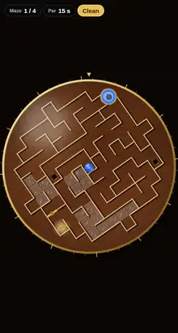 Knock and nudge (rim dial turning) | 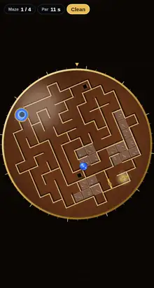 Wobble on a pit's lip | 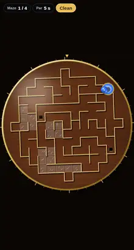 Finished maze spins away |
|---|---|---|

| Today | Concept chosen | New |
|---|---|---|
| 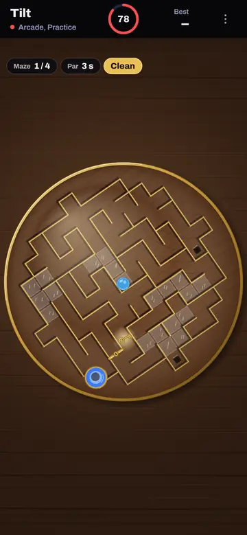 |  A · Today, upgraded (with B's dark table) | 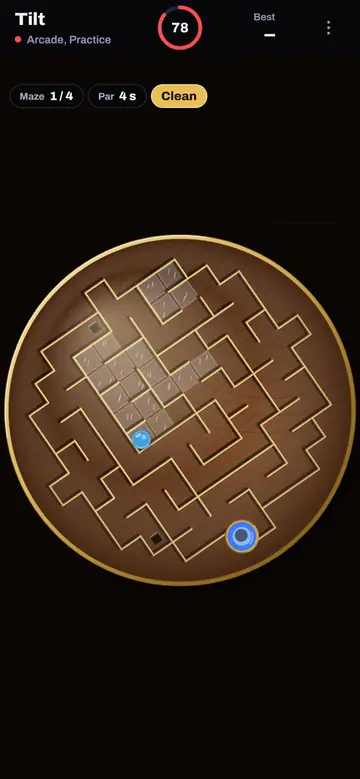 |

| Reveal today | Reveal new | Intro (new, real frame) | Play clip |
|---|---|---|---|
| 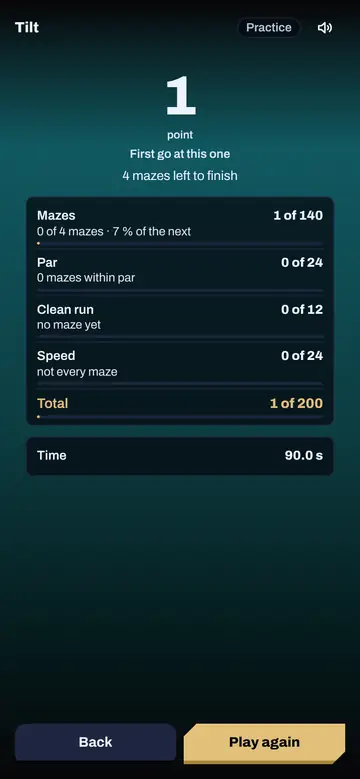 |  |  | 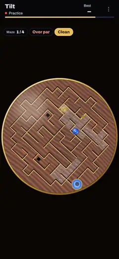 |

## Gemstone

Today's clean layout and gem shapes, each now a lit cut stone (every bevel facet shaded by how it faces the light, a refracting table, a crisp specular strip). The treasure is a bronze-banded cherry-wood chest with a gold-lit fall trail down its column and a "↓ n" chip within three rows of home. GOAL! and TREASURE! sit between the board and its goals.

**Stage 2:** cut gems re-rendered so the cut reads at 44 px: the table and alternate crown facets light, the rest dark, a ring of softboxes giving the glints. A spark flies from each cleared gem to its colour's goal under the board; broken ice cracks, then shatters. Reveal: the six colour goals ticked off ("Met" or how many were left), the six chests (found lit), a gems-cleared meter.

**New effects** (drawn by the game's own renderer from the near-perfect bot's run, or the weak bot's where a strong player never sees it; every second frame, played at 30 fps):

| 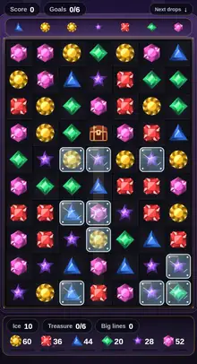 Sparks to the goals | 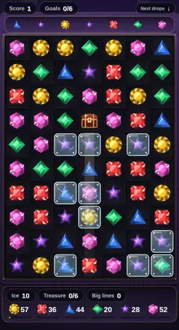 Ice cracks, then shatters |
|---|---|

| Today | Concept chosen | New |
|---|---|---|
|  |  A · Today, upgraded | 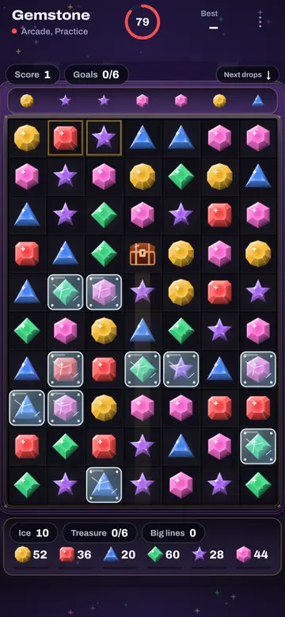 |

| Reveal today | Reveal new | Intro (new, real frame) | Play clip |
|---|---|---|---|
|  |  | 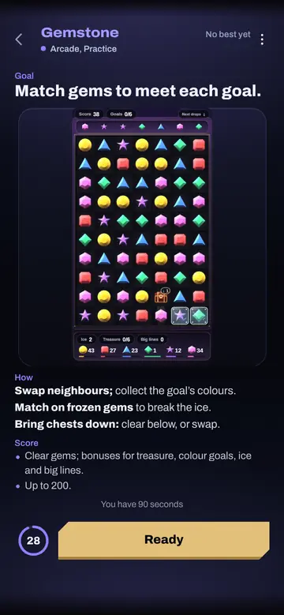 |  |

## Coral Pop

Close to today: candy-glass bubbles with depth (a shade low on the far side, light through the glass) under the crisp sheen; lighter water kept. New stamp: an 86-bubble reef and the fast shot (gold chevrons over the gun). BANK / COMBO / TREASURE sit beside the gun, never on the reef.

**Stage 2:** candy-glass bubbles re-rendered to show clearly: a big window of light high on the upper left and a soft rim of light low on the far side, the creature printed under the gloss; a faint trail behind each shot; a shot that sticks squashes (at most 10 %); the reef rumbles as it shifts down; the warning line flashes red once the reef is two rows from it. Reveal: the reef meter and the bubbles popped, dropped and the shots.

**New effects** (drawn by the game's own renderer from the near-perfect bot's run, or the weak bot's where a strong player never sees it; every second frame, played at 30 fps):

| 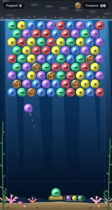 A stuck shot squashes | 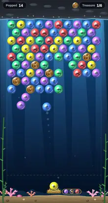 The reef rumbles down | 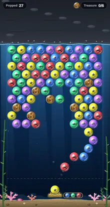 The warning line flashes |
|---|---|---|

| Today | Concept chosen | New |
|---|---|---|
| 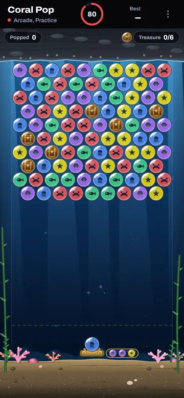 |  A · Today, upgraded |  |

| Reveal today | Reveal new | Intro (new, real frame) | Play clip |
|---|---|---|---|
|  |  |  |  |

## Rainbow Bridge

Concept A by day turning to concept B's sunset over the ten levels; a rendered cast-iron pot of gold heaped with lit coins; glossy rainbow tubes; fewer, bigger birds flapping out of step. New stamp: the pot and its hill move level to level.

**Stage 2:** Captain Joulz (the #423 model), about 70 px tall, waits beside the pot (on its left when the pot is near the right edge) and cheers for 1.25 s when the coin lands, with a burst of rainbow coins from the pot; the coin wobbles on release; a flock the coin passes close to beats its wings and lifts (1.5 px at most) with a feather; a miss falls away with speed lines. Reveal: the ten level coins (potted ones lit) and the levels within ink par.

**New effects** (drawn by the game's own renderer from the near-perfect bot's run, or the weak bot's where a strong player never sees it; every second frame, played at 30 fps):

| 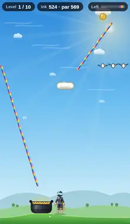 Coin wobbles on release | 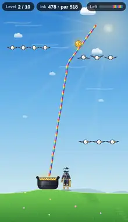 Birds flap away | 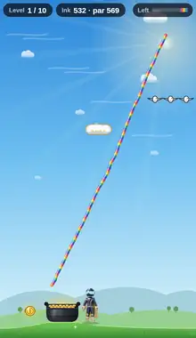 A miss falls away | 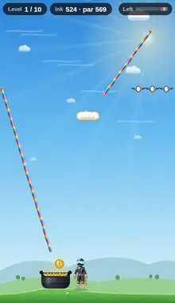 Pot, coins and the Captain's cheer |
|---|---|---|---|

| Today | Concept chosen | New |
|---|---|---|
| 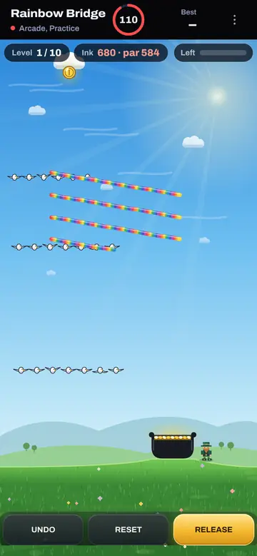 |  A by day → B's sunset |  |

| Reveal today | Reveal new | Intro (new, real frame) | Play clip |
|---|---|---|---|
|  | 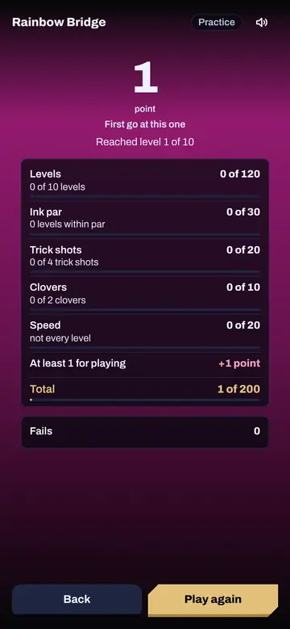 |  |  |

## Ball Tracker

Concept A's warm wood and gold tubes (today's), marbles drawn bigger (27 px in their 67 px channels) and bigger cup symbols. Words sit in the free right half of the waiting row.

**Stage 2:** concept A's wood: a warm oak board and the fixed tracks as deep oiled-walnut grooves (tileable painted textures, the same channel widths), the turnable tubes gold as agreed; rendered glass marbles; a turning tube's marble draws the arc it is carried through; a booster's chevrons flash as a marble crosses; the combo steps up beside the cups, in an empty cup slot; a wrong cup flashes red; the cups pulse in the second before they move. One wording: "Wrong cup" everywhere (stored reveals that said "Wrong tray" are shown the same). Reveal: every marble, home in its colour, a wrong cup (red ring) or lost.

**New effects** (drawn by the game's own renderer from the near-perfect bot's run, or the weak bot's where a strong player never sees it; every second frame, played at 30 fps):

| 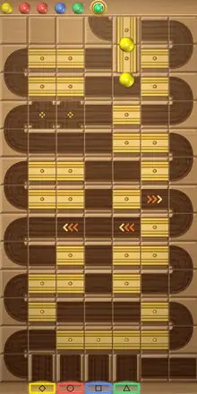 Tube carries its marble | 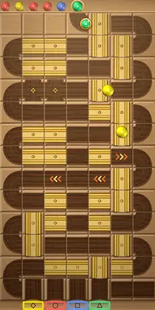 Booster chevrons flash | 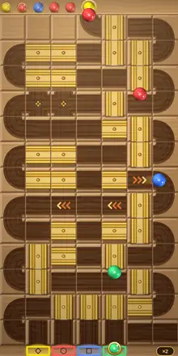 Combo steps up by the cups | 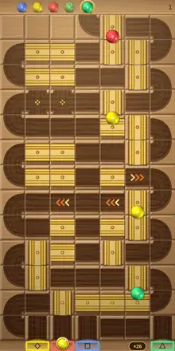 Wrong cup | 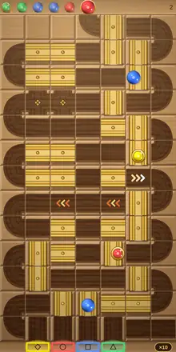 Cups pulse before moving |
|---|---|---|---|---|

| Today | Concept chosen | New |
|---|---|---|
| 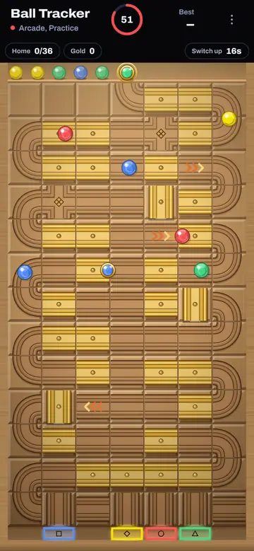 |  A · Today, upgraded | 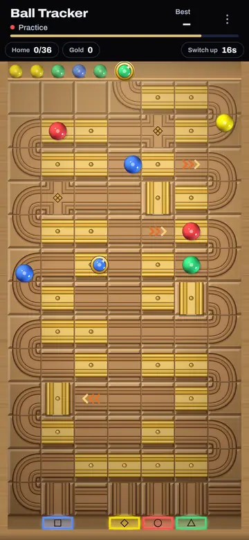 |

| Reveal today | Reveal new | Intro (new, real frame) | Play clip |
|---|---|---|---|
|  |  |  |  |

## Stage 3: levels (16 Nov 2026)

One frame per level, Easy · Normal · Hard · Expert left to right: the Near-perfect bot's run at the same tick on each level's own deal (`bun scripts/shots/strategy-level-frames.ts`; Normal is the intro example deal). Elite bot averages, Easy / Normal / Hard / Expert, under human limits (about 0.25 s to react, 0.15 s to move) unless marked; each game's levels check proves 200 is reachable at every level.

| Game | Levels | Elite averages |
|---|---|---|
| Tilt | 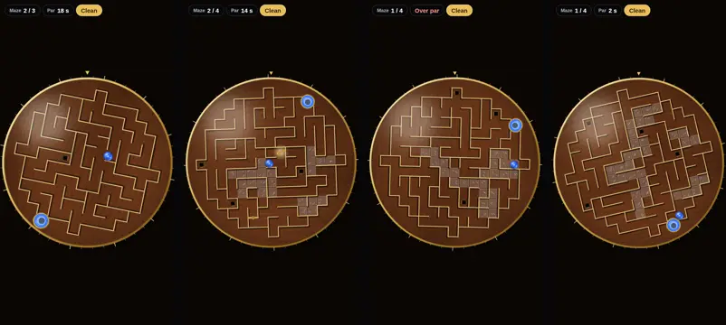 | 193 / 144 / 141 / 121 |
| Gemstone (matchupRev 13, two-hit ice) | 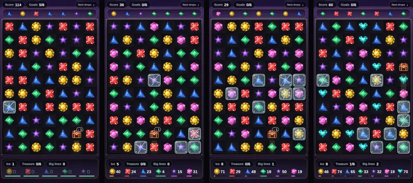 | 197 / 158 / 146 / 137 |
| Coral Pop | 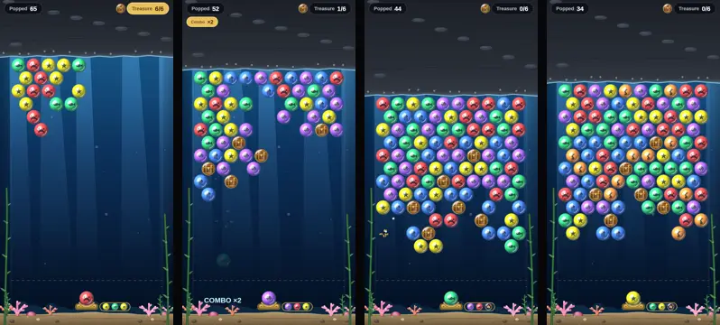 | 194 / 179 / 169 / 132 |
| Rainbow Bridge | 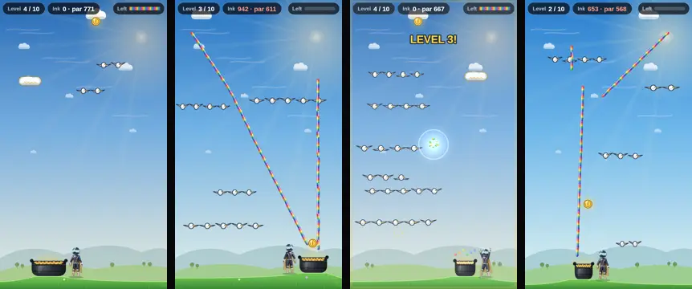 | 197 / 189 / 181 / 165 |
| Ball Tracker | 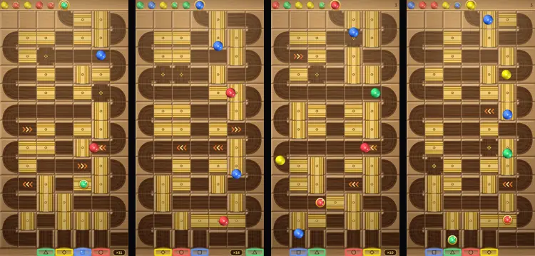 | 198 / 196 / 179 / 145 |

## Image sizes (new art shipped in the app)

Every new look is drawn in code by the games' renderers; the only new images in the app are the five intro stills (`public/intro/<type>.webp`): Tilt 24.6 KB, Gemstone 39.7 KB, Coral Pop 30.8 KB, Rainbow Bridge 20.2 KB, Ball Tracker 42.8 KB, all well inside the 400 KB a game.
