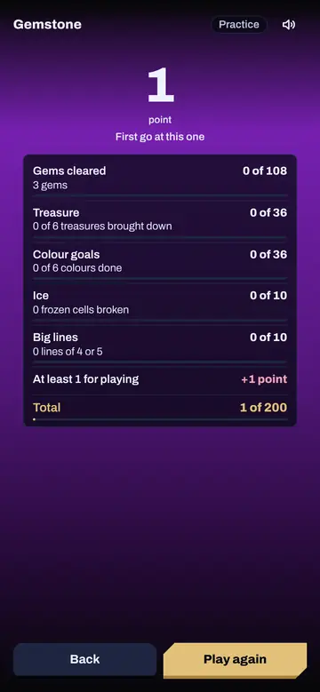
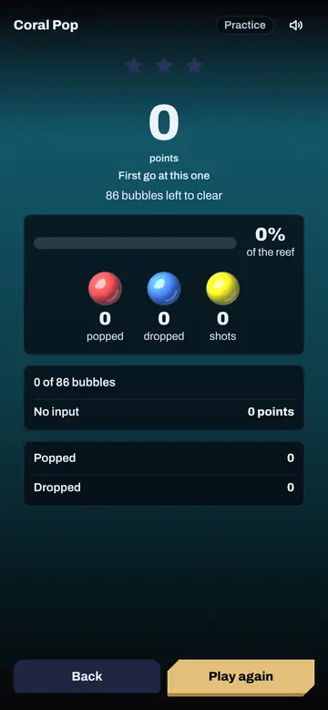
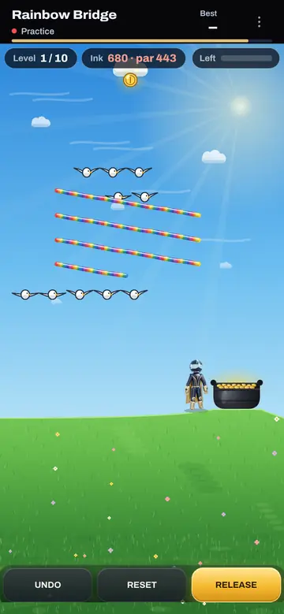
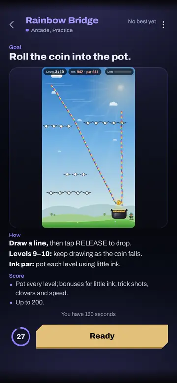
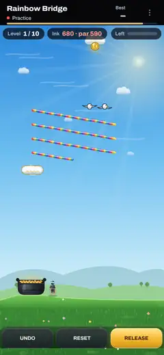
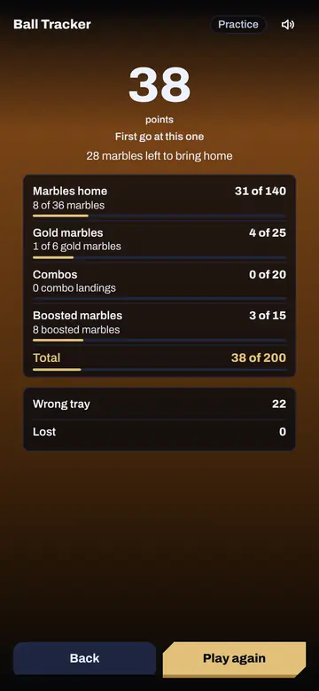
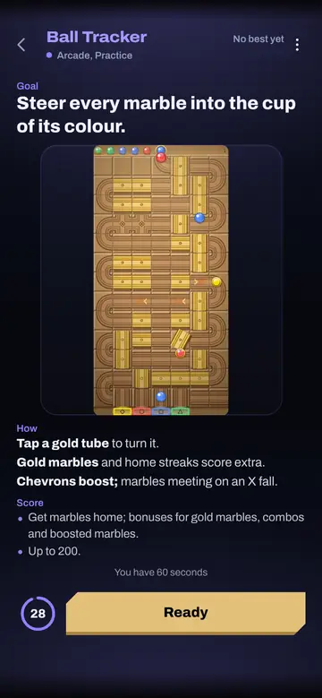

# Strategy overhaul: gallery (stage 1, look and game changes)

Phase 2, step 4 (15 Nov 2026). Each game: today (main e0aa53f2), the concept Joe chose (PR #426) and the new frame, at 390 × 844, then today's and the new answer reveal, the game page and a short play clip. Frames from `bun scripts/shots/strategy-shots.ts --url=<origin> --reveal --clip`, turned into these WebPs by `python3 -I scripts/shots/strategy-gallery.py <shots dir>`. The effects (PR #422) and the levels come in stages 2 and 3; the answer reveals are redesigned inside #422's shared reveal layout in stage 2, so they are today's here.

## Tilt

The disc fills the width on every maze (maze 4 drawn as large as maze 1), concept A's lacquered walnut and glass marbles on concept B's dark, shadowed table that runs to the screen's edges with no seam; champagne-gold walls. "MAZE 3 DONE!" and every other word sit in the strip above the disc.

| Today | Concept chosen | New |
|---|---|---|
|  |  A · Today, upgraded (with B's dark table) |  |

| Reveal today | Reveal new | Intro (new, real frame) | Play clip |
|---|---|---|---|
|  |  |  |  |

## Gemstone

Today's clean layout and gem shapes, each now a lit cut stone (every bevel facet shaded by how it faces the light, a refracting table, a crisp specular strip). The treasure is a bronze-banded cherry-wood chest with a gold-lit fall trail down its column and a "↓ n" chip within three rows of home. GOAL! and TREASURE! sit between the board and its goals.

| Today | Concept chosen | New |
|---|---|---|
|  |  A · Today, upgraded |  |

| Reveal today | Reveal new | Intro (new, real frame) | Play clip |
|---|---|---|---|
|  |  |  |  |

## Coral Pop

Close to today: candy-glass bubbles with depth (a shade low on the far side, light through the glass) under the crisp sheen; lighter water kept. New stamp: an 86-bubble reef and the fast shot (gold chevrons over the gun). BANK / COMBO / TREASURE sit beside the gun, never on the reef.

| Today | Concept chosen | New |
|---|---|---|
|  |  A · Today, upgraded |  |

| Reveal today | Reveal new | Intro (new, real frame) | Play clip |
|---|---|---|---|
|  |  |  |  |

## Rainbow Bridge

Concept A by day turning to concept B's sunset over the ten levels; a rendered cast-iron pot of gold heaped with lit coins; glossy rainbow tubes; fewer, bigger birds flapping out of step. New stamp: the pot and its hill move level to level.

| Today | Concept chosen | New |
|---|---|---|
|  |  A by day → B's sunset |  |

| Reveal today | Reveal new | Intro (new, real frame) | Play clip |
|---|---|---|---|
|  |  |  |  |

## Ball Tracker

Concept A's warm wood and gold tubes (today's), marbles drawn bigger (27 px in their 67 px channels) and bigger cup symbols. Words sit in the free right half of the waiting row.

| Today | Concept chosen | New |
|---|---|---|
|  |  A · Today, upgraded |  |

| Reveal today | Reveal new | Intro (new, real frame) | Play clip |
|---|---|---|---|
|  |  |  |  |

## Image sizes (new art shipped in the app)

Every new look is drawn in code by the games' renderers; the only new images in the app are the five intro stills (`public/intro/<type>.webp`): Tilt 24.6 KB, Gemstone 39.7 KB, Coral Pop 30.8 KB, Rainbow Bridge 20.2 KB, Ball Tracker 42.8 KB, all well inside the 400 KB a game.
