# Tournaments, Leaderboards and Daily: before and after

Phase 2 step 3, 14 Nov 2026. Phone shots at 390 × 844 (scaled down), drawn on the screen harness with stand-in data
(`scripts/screens/tournaments.ts`), dark theme; one computer shot of each new layout at 1280 × 800. Light theme and
every other size are drawn by theme-check and no-wrap-check.

## Tournaments tab (a player with tournaments)

Upcoming and Your results on a segmented control; live events as hero cards (the first with the cut and the one gold
button); the week as list rows with the art kit's icons, the time on the right and the reminder bell.

| Before | After |
|---|---|
| 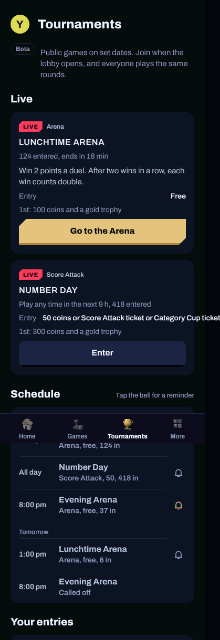 | 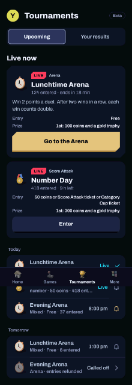 |

| Nothing live | Your results |
|---|---|
| 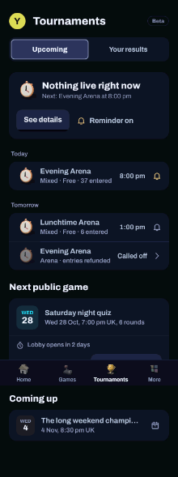 | 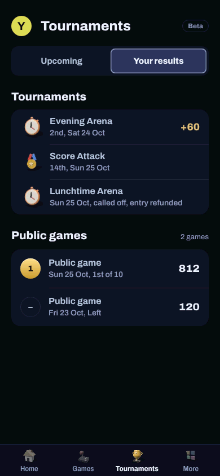 |

## Event pages

A cut hero card with the event's icon; the board's top three as compact cards side by side (2nd · 1st · 3rd, 1st
raised, each with its medal and points; a hidden player on a plain disc), then the nameplate rows from 4th; prizes
with medals; the full rules as a row. The live Arena and a finished Score Attack:

| Arena, live | Score Attack |
|---|---|
| 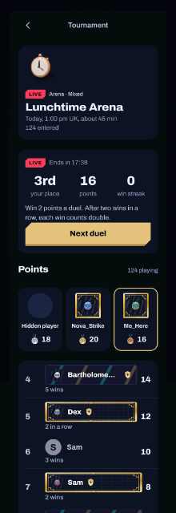 | 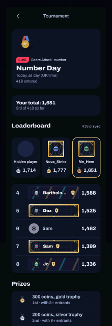 |

## Leaderboards

One board picker (the Joulz Rating, Puzzles, Arcade, the Daily top 100 and the eleven categories) in place of the
three-way switch and the category section at the foot of the page.

| Before | After | The picker |
|---|---|---|
| 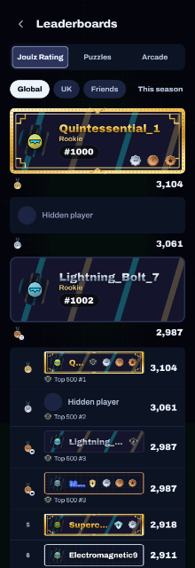 | 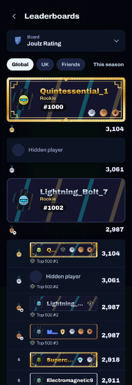 | 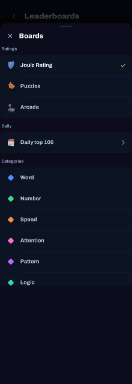 |

## Daily

| Daily, before | Daily, after | Daily top 100, after | Daily archive, after |
|---|---|---|---|
| 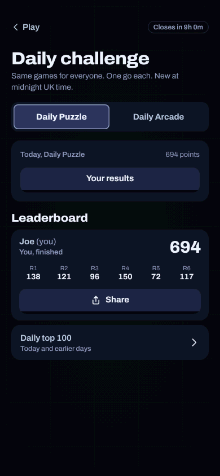 | 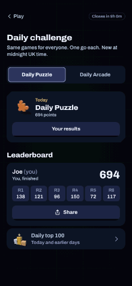 | 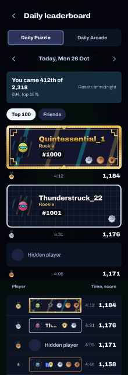 | 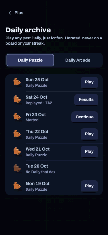 |

## Computer

The hub, an event page (the event beside its board) and the leaderboards (the boards listed beside the board).

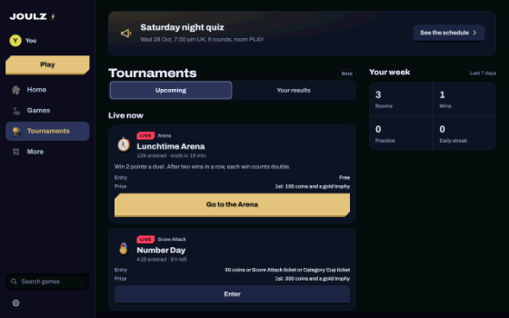

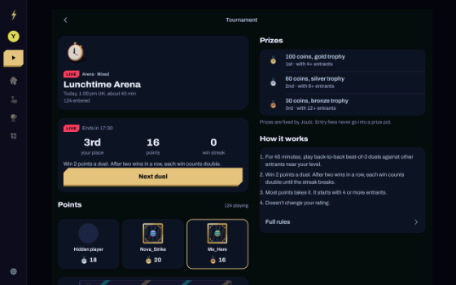

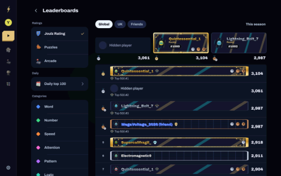
