# Word overhaul: gallery

Phase 2, step 4 (`docs/design/game-reviews/word.md`). Before (main) beside after (this branch) for every Word game,
taken with `scripts/shots/capture.ts` at 390 × 844 on each game's fixed intro example (shown at half size): mid-play,
the round end, and the intro where it changed. Stage 1 is the new look and the game changes; the effects (stage 2)
and the levels (stage 3) come next, with clips of the hero effects then.

## Stage 1: the look and the game changes

Every tile, disc, well, key, pip, the bonus jar and the padlocks are rendered in Blender
(`scripts/word-art/word_art.py`; the pieces in `public/word-art/`): glazed black tiles, enamel champagne gold, teal and
grey clue glazes, sapphire for a picked piece, recessed wells for empty squares, under clean even studio light with no
glare or glow. The letters stay live text, big and bold. Controls are champagne gold (the action that plays) and navy.

### Nucleus
Pearl-black discs round a sapphire centre, picked letters in gold; Enter gold, Shuffle and Clear navy. The counter now
counts the board's everyday words; an obscure word still scores, as a bonus word (`wordsmithRev 5`).

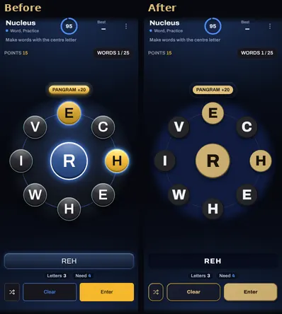 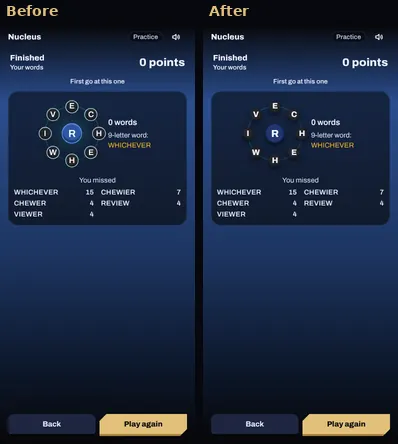

### Interlock
Concept B's tray of recessed wells with concept A's tiles; tiles in a real word turn gold, a run that isn't a word stays
faint red while it stands; tiles drag back to the tray; the board no longer clips on short screens; the status is pills.

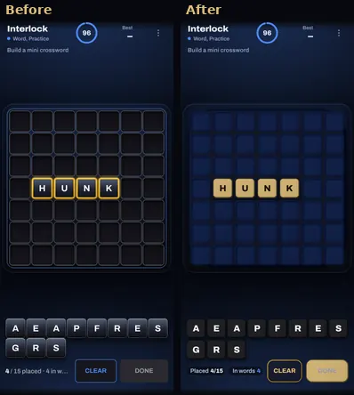 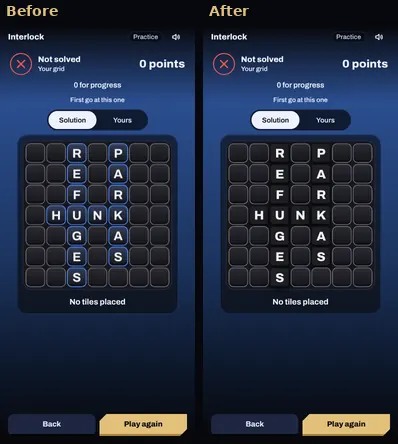

### Slider
Glazed tiles in a lacquer tray, rows reading as words in teal, locked rows in gold, rendered padlocks; fits a 375 px
phone; Reset asks first; par is the proven fewest slides (`wordSlideRev 6`).

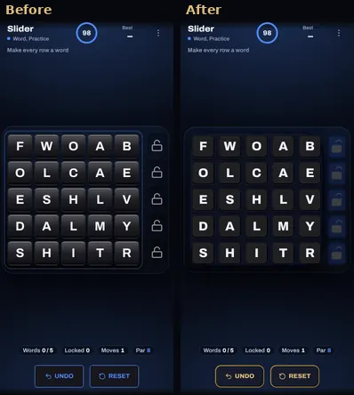 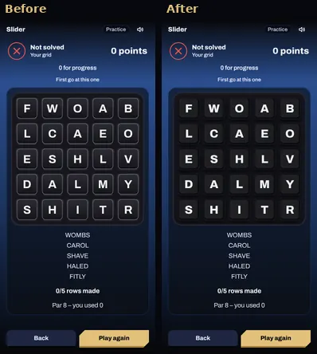

### Forage
Polished tiles, the trace in sapphire, the golden tile in gold; Submit gold; the miss allowance on screen
("Misses 3 / 14 free").

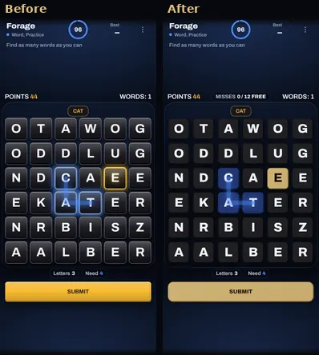 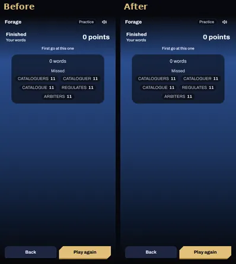

### Lookout
Small glazed tiles, found words gold within a capsule loop, whole-word chips; on `wordSearchRev 6` the round goes on
after the sixth word for the bonus, with a Done button.

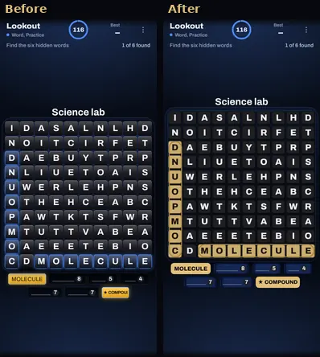 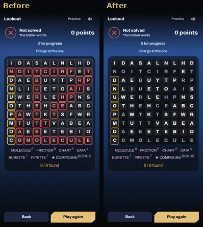

### Roundabout
Pearl-black wheel letters on a plain navy wheel (no glow ring), the crossword as wells and tiles with more of the
height, the rendered glass jar filling with coins; a miss and a repeat look different; new boards without odd or many
three-letter words (`wheelRev 5`).

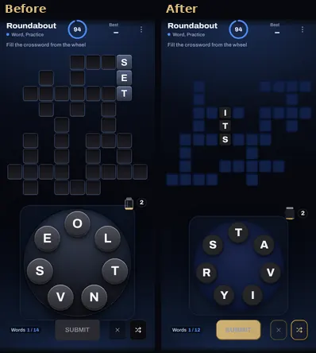 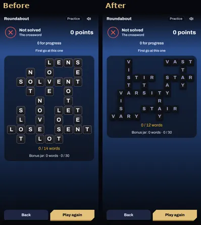

### Strikeout
The keyboard at the bottom with 52 px keys and a letter preview, the tiles grown into the space, gold strike pips that
turn to red studs, the gold Solve key; the delete key keeps one label.

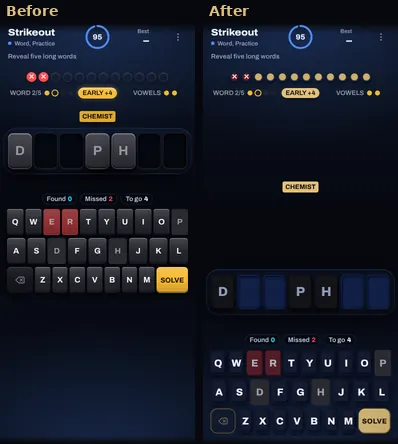 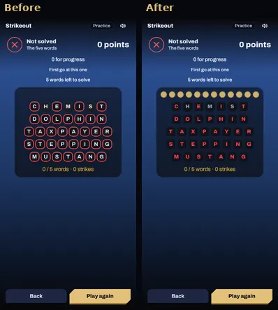

### Cryptogrid
Wells and dark tiles with gold given letters and much bigger clue numbers, the keyboard at the bottom; after a letter
the next unsolved number is picked; only letters shown wrong cost the clean crack (`codewordRev 6`).

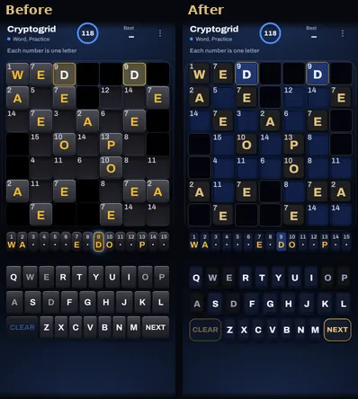 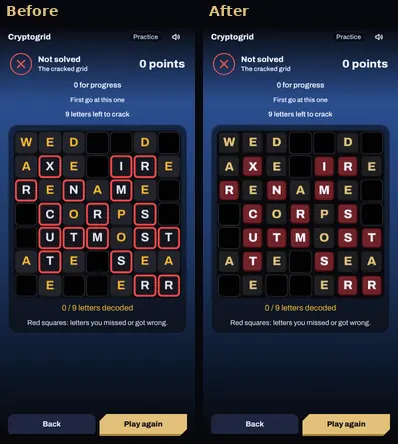

### Swapword
Gold, teal and grey glazes (the game's clues), bigger tiles; the intro shows one swap turning two tiles gold.

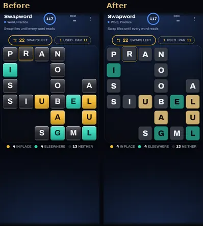 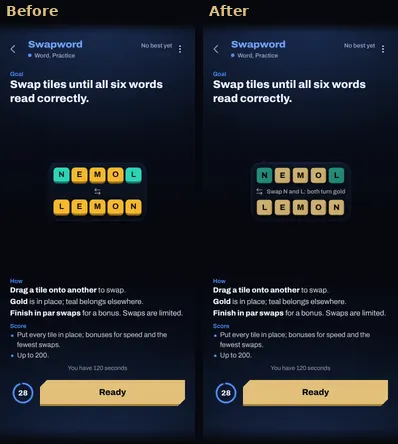

## Reveals

Joe's reveal brief (15 Nov 2026): each game's answer reveal redesigned inside the shared reveal layout, on the new
stamps only (older stamps draw their reveal exactly as before). Kit `src/components/puzzles/WordReveal.tsx`: the
numbers that explain the score as big tiles with short plain labels, the solution drawn large, one board at a time
with the shared Solution / Yours switch where there are two, misses and mistakes marked, and words as chips (the
longest gold, missed outlined) in place of dense lists. Before (main) on the left, after on the right, at 390 × 844
shown two-thirds size: a timed-out round, then the capture tool's driven run (a full solve where it has a driver).

| Game | Timed out | Played |
| --- | --- | --- |
| Nucleus | 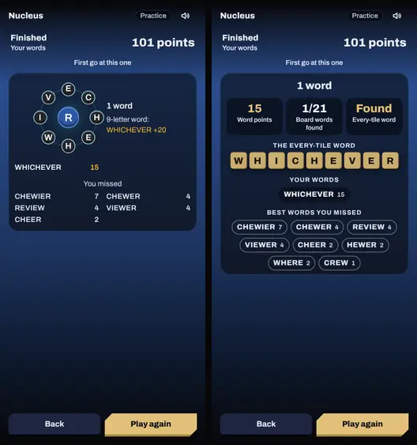 |  |
| Interlock |  | 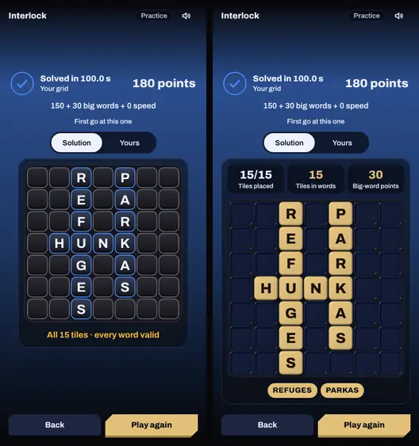 |
| Slider |  |  |
| Forage | 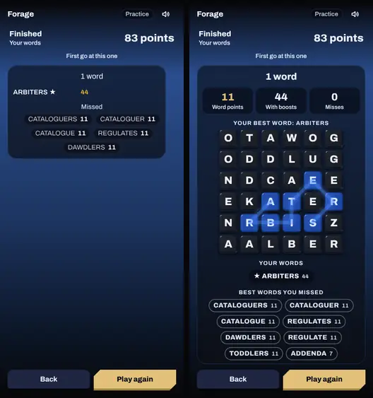 |  |
| Lookout |  | 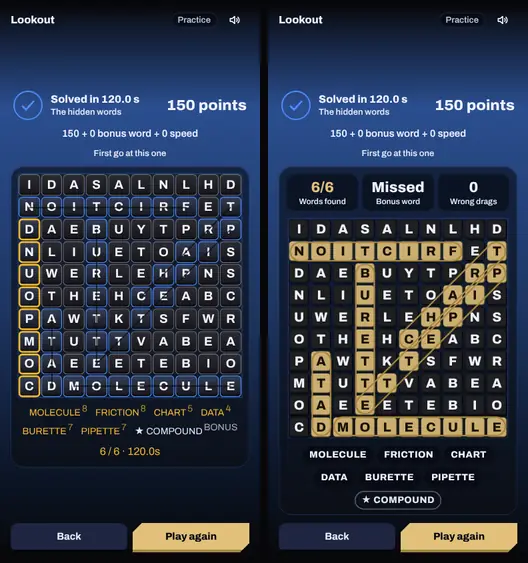 |
| Roundabout | 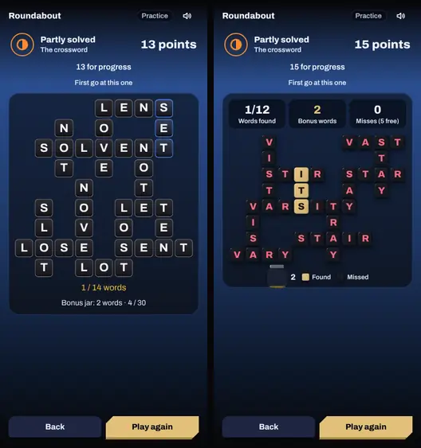 |  |
| Strikeout | 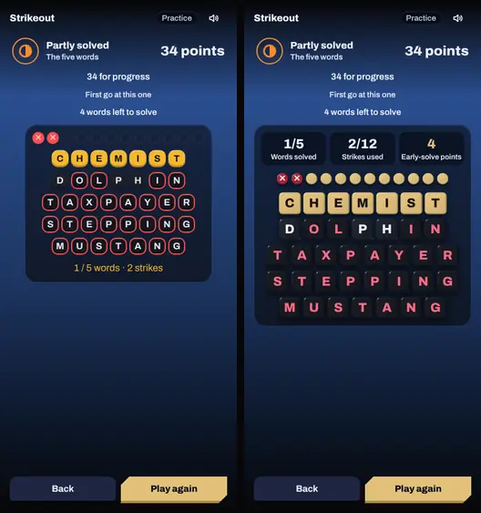 |  |
| Cryptogrid | 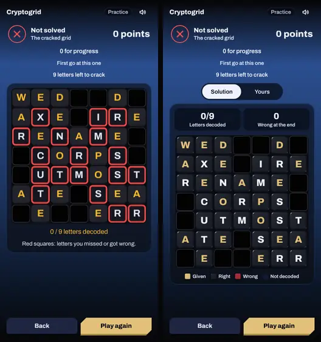 |  |
| Swapword |  |  |
