# Word overhaul: gallery

Phase 2, step 4 (`docs/design/game-reviews/word.md`, concepts in `docs/design/game-concepts/word.md`, PR #427). Each
game mid-play at 390 × 844 on its fixed intro example: **today** (main), **concept A** (the concept Joe picked) and
**new** (this branch), side by side. Stage 1 is the new look and the game changes; the effects (stage 2) and the levels
(stage 3) follow, with clips of the hero effects then.

## Stage 1: the look and the game changes

Every tile, disc, well, key, pip, tray, the bonus jar and the padlocks are rendered in Blender
(`scripts/word-art/word_art.py`, the pieces in `public/word-art/`, 139 KB for the set) with real materials and light on
them (Joe's clarification, 15 Nov 2026): glazes and lacquer under a glossy clear coat with depth, enamel gold, polished
metal, glass with a crisp line on its curve. The camera looks straight down and the world is dark overhead, so a face
never carries a sheet of glare across its letter, while every curve turned to the key light catches a clean highlight;
no glowing edges or rims. The letters stay live text, big and bold. Controls are champagne gold and navy lacquer.

### Nucleus
Concept A: pearl-black glazed discs with a crisp line on their curve round a sapphire centre (ringed in gold once it is in the word) on a turned lacquer tray; the letters in the word in enamel gold; Enter champagne gold, Shuffle and Clear navy lacquer on a gold bezel. Concept A's blue glow under a picked letter is left out (Joe's no-glow rule). The counter counts the board's everyday words; a rarer word still scores, as a bonus word (`wordsmithRev 5`).

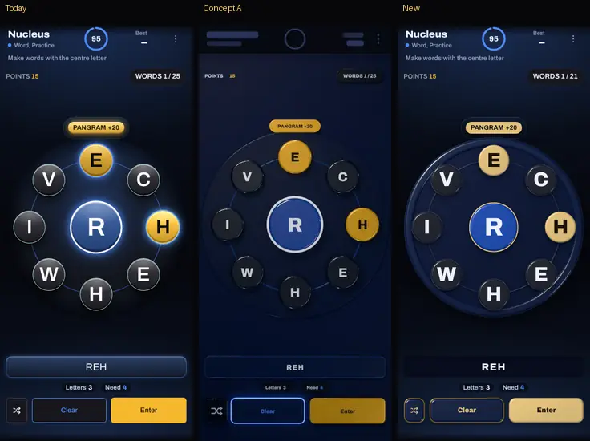

### Interlock
Concept A's tiles in concept A's framed tray of dark recessed squares; a tile in a real word turns enamel gold (concept A rims it in gold instead), a run that is no word shows faint red while it stands; tiles drag back to the tray; the status is pills.

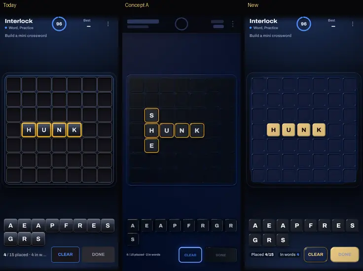

### Slider
Concept A: glazed tiles in a lacquer tray, a padlock in its own dark slot beside each row; a row reading as a word in teal glaze, a locked row in gold. Reset asks first; par is the proven fewest slides (`wordSlideRev 6`).

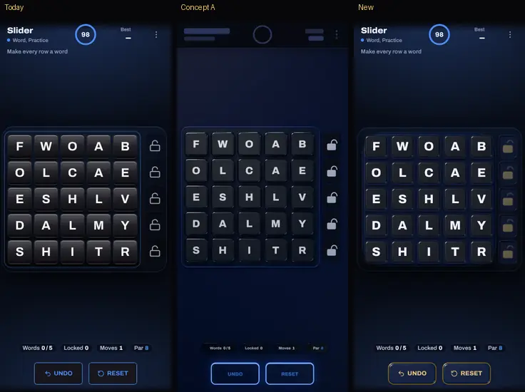

### Forage
Concept A: glazed tiles, the traced word in sapphire glaze with a fine line between (concept A rims them in blue light: no glow here), the golden tile in enamel gold; Submit gold; the miss allowance on screen.

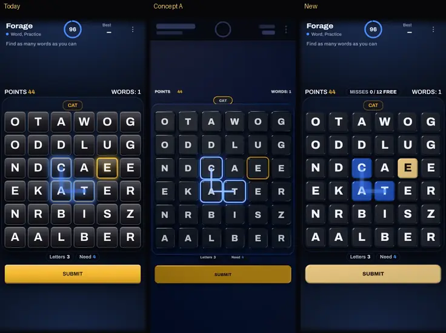

### Lookout
Concept A: small glazed tiles, a found word circled by a gold capsule loop like a pen ring (its letters gold, the tiles never filled gold; Joe, 15 Nov 2026), the chips below as tags; on `wordSearchRev 6` the round goes on after the sixth word for the bonus, with Done.

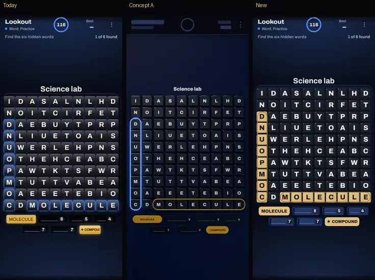

### Roundabout
Concept A: the crossword's empty squares as low slate glazed tiles (as readable as today's; Joe, 15 Nov 2026) and filled ones glazed tiles, the letter wheel a bigger turned lacquer tray, the bonus jar real glass (a crisp line down its curve) filling with polished coins. A miss and a repeat look different; boards without odd or many three-letter words (`wheelRev 5`).

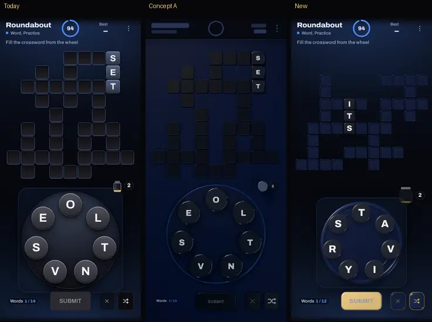

### Strikeout
Concept A: strike counters as gold enamel pips turning to red studs, the word as tall tiles in a dark slot with the solved words just above them, the two centred together in the space the keyboard left (Joe, 15 Nov 2026), the keyboard real keys with depth at the bottom (52 px, with a letter preview), Solve gold.

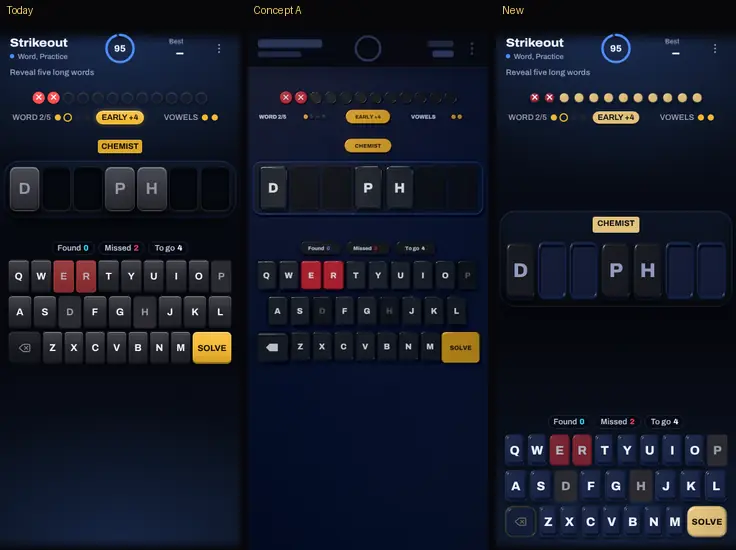

### Cryptogrid
Concept A: dark wells and glazed tiles, given letters in gold, the picked number tinted gold and ringed in gold, the strip as small tags, the keyboard at the bottom; after a letter the next unsolved number is picked; only letters shown wrong cost the clean crack (`codewordRev 6`).

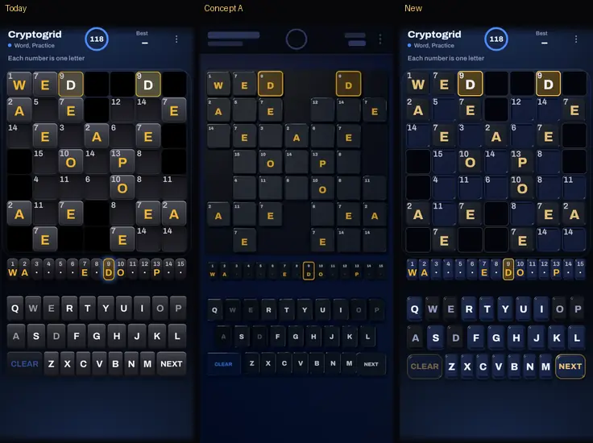

### Swapword
Concept A: the figure-eight in glossy gold, teal and grey glazes, exactly today's clue colours; the intro shows a swap.

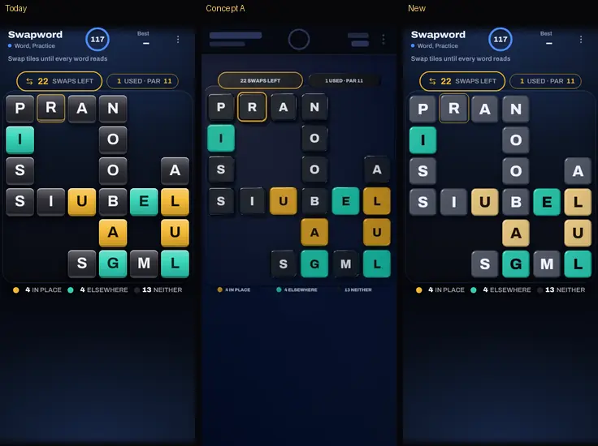

Intro, today and new: 

## Reveals

Joe's reveal brief (15 Nov 2026): each game's answer reveal redesigned inside the shared reveal layout, on the new
stamps only (older stamps draw their reveal exactly as before). Kit `src/components/puzzles/WordReveal.tsx`: the
numbers that explain the score as big tiles with short plain labels, the solution drawn large, one board at a time
with the shared Solution / Yours switch where there are two, misses and mistakes marked, and words as chips (the
longest gold, missed outlined) in place of dense lists. Before (main) on the left, after (this branch, in the new art) on the right, at 390 × 844
shown two-thirds size: a timed-out round, then the capture tool's driven run (a full solve where it has a driver).

| Game | Timed out | Played |
| --- | --- | --- |
| Nucleus |  | 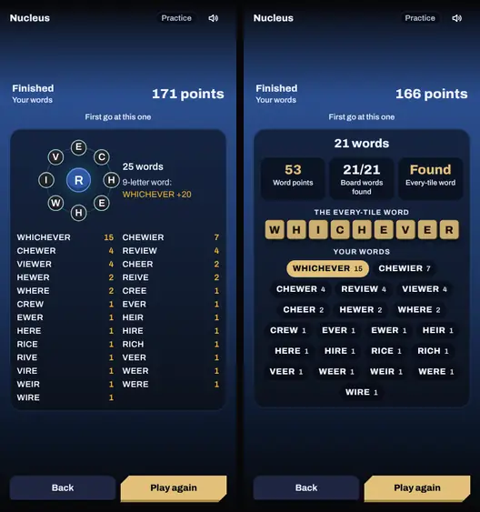 |
| Interlock | 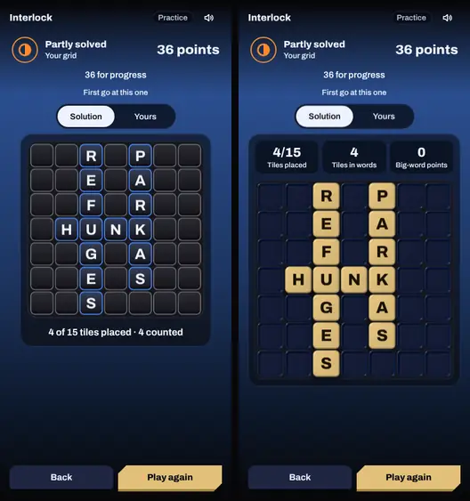 |  |
| Slider | 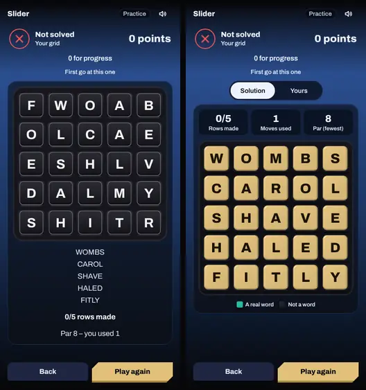 |  |
| Forage |  | 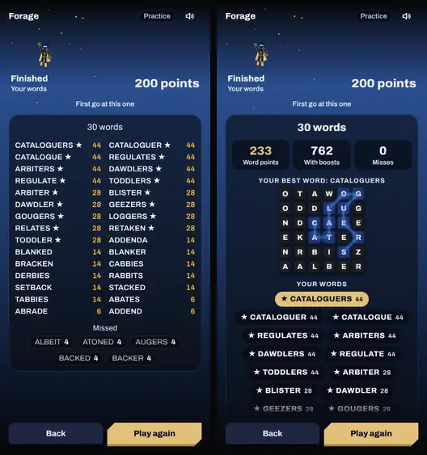 |
| Lookout | 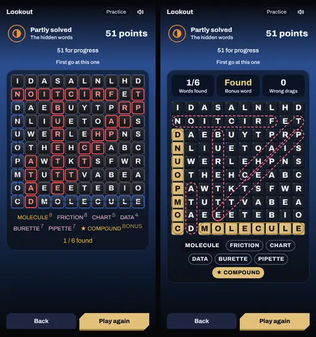 |  |
| Roundabout |  | 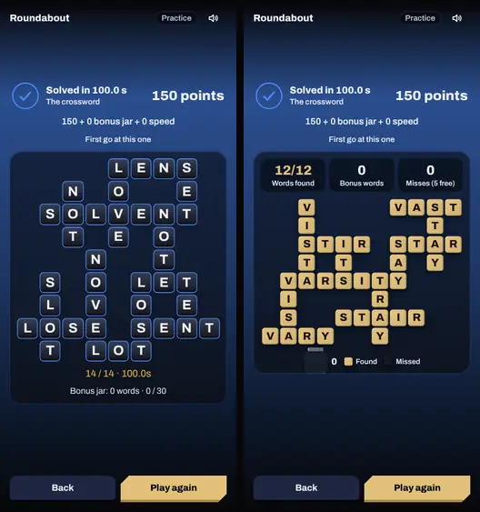 |
| Strikeout |  | 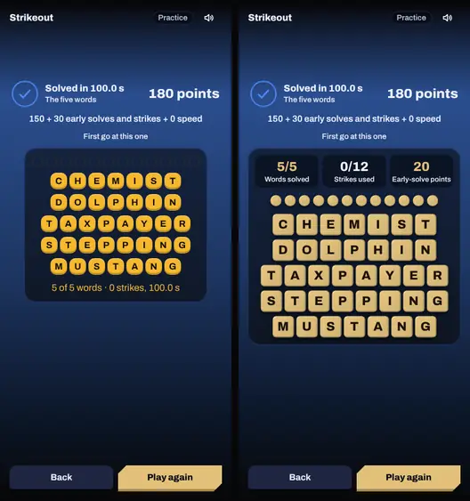 |
| Cryptogrid |  | 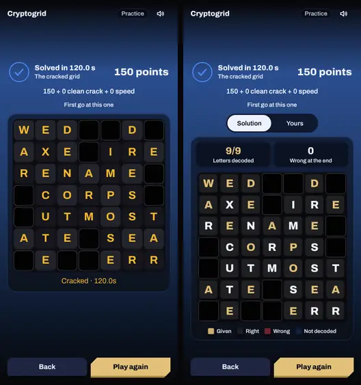 |
| Swapword | 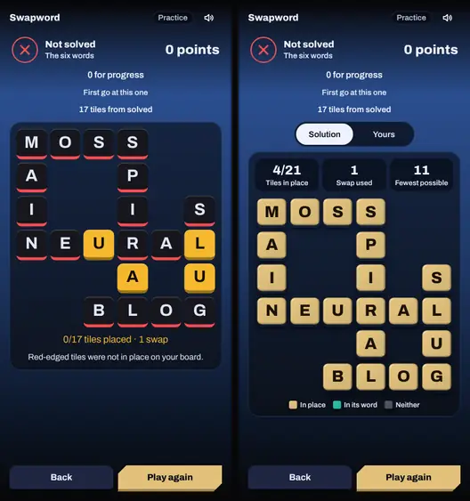 | 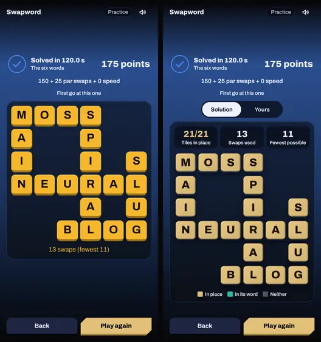 |
